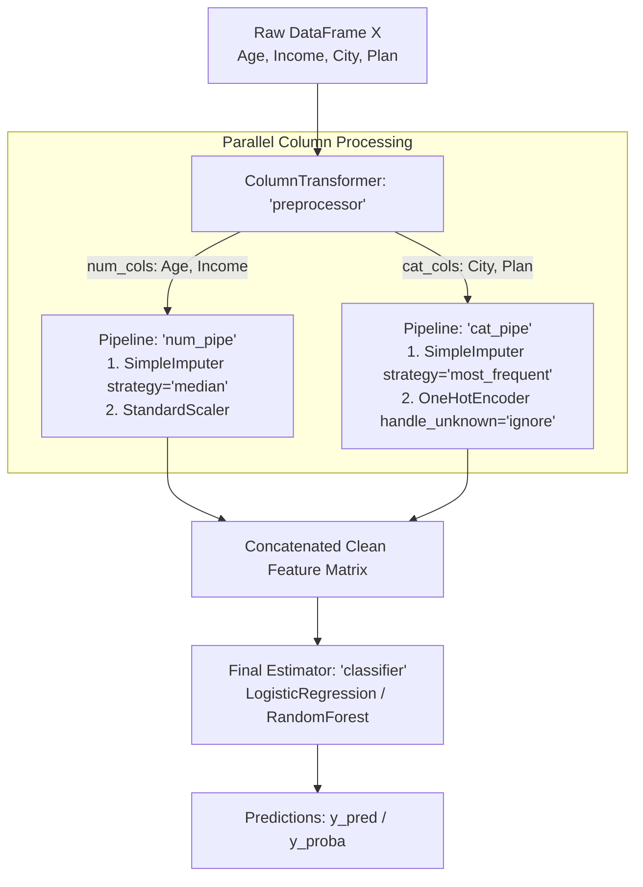

# Scikit-learn Complete Course — Practical Machine Learning: Zero to Advanced

**Instructor:** Zohaib Ali Dayo  
**Course Title:** Scikit-learn Complete Course — Practical Machine Learning  
**Target Level:** Beginner to Advanced (Zero to Production-Ready Workflows)  
**Teaching Language:** Easy Roman Urdu + English Technical Terminology  
**Programming Language:** Python 3 (`python >= 3.10`)  
**Primary Library:** Scikit-learn (`sklearn`, verified against official [Scikit-learn 1.9.1 Stable Documentation](https://scikit-learn.org/stable/))  
**Companion Stack:** `NumPy`, `Pandas`, `Matplotlib`, `Seaborn`, `Joblib`

---

&lt;a id=&quot;section-1-course-overview&quot;&gt;&lt;/a&gt;
## 1. Course Overview and Learning Outcomes

### 1.1 Course Philosophy and Instructor Mission
Assalam-o-Alaikum! Yeh course خاص طور پر (khas taur par) classroom teaching aur practical hands-on learning ke liye design kiya gaya hai. Aksar beginners Machine Learning seekhte waqt sirf teen lines ka code (`model.fit(X, y)` aur `model.predict(X)`) ratta (memorize) kar lete hain, magar unhein yeh nahi pata hota ke:
- Algorithm andar se (internally) kaise seekhta hai?
- `train_test_split` se pehle scaling ya imputation karne se **Data Leakage** kyun hoti hai?
- Kab `Accuracy` dhoka deti hai aur kab `Precision`, `Recall`, `F1-score`, ya `ROC-AUC` use karna chahiye?
- Kab simple `LinearRegression` ya `LogisticRegression` kaafi hai aur kab `HistGradientBoosting` ya `RandomForest` lagana chahiye?

Is course ka maqsad (goal) aapko aur aapke students ko **rattay se nikaal kar (beyond memorization)** ek real-world **Machine Learning Engineer** aur **Data Scientist** ki tarah sochna sikhana hai. Har major lesson mein 25-point pedagogical structure follow kiya gaya hai taake Instructor Zohaib Ali Dayo class mein khud mukammal confidence ke saath har concept, har parameter, har mathematical intuition, aur har common bug ko explain kar sakein.

### 1.2 Measurable Learning Outcomes
Is course ko complete karne ke baad students aur practitioners is qabil honge ke woh:
1. **AI, ML, aur Deep Learning** ka farq samajh sakein aur decide kar sakein ke kis business problem ke liye **Traditional Tabular ML (Scikit-learn)** best hai ([Scikit-learn Main Documentation](https://scikit-learn.org/stable/)).
2. **Scikit-learn Unified API** (`Estimator`, `Transformer`, `Predictor`, `fit()`, `transform()`, `fit_transform()`, `predict()`, `predict_proba()`, `score()`) ko mukammal clarity ke saath use kar sakein ([Scikit-learn API Reference](https://scikit-learn.org/stable/api/index.html)).
3. **Zero-Leakage Data Workflows** design kar sakein jahan `train_test_split()`, `SimpleImputer`, `OneHotEncoder`, `OrdinalEncoder`, `StandardScaler`, `ColumnTransformer`, aur `Pipeline` ek saath mil kar clean aur reproducible predictions dein ([Scikit-learn Common Pitfalls](https://scikit-learn.org/stable/common_pitfalls.html)).
4. **12 Regression Algorithms**, **14 Classification Algorithms**, **5 Clustering Algorithms**, aur **Dimensionality Reduction (`PCA`, `TruncatedSVD`)** ko unke mathematical intuition, hyperparameters, aur scaling requirements ke saath implement aur compare kar sakein ([Scikit-learn User Guide](https://scikit-learn.org/stable/user_guide.html)).
5. **Model Evaluation, Cross-Validation (`KFold`, `StratifiedKFold`, `GroupKFold`, `TimeSeriesSplit`), Hyperparameter Tuning (`GridSearchCV`, `RandomizedSearchCV`, `HalvingGridSearchCV`), Imbalanced Data Handling, Text Classification (`TF-IDF`), aur Model Persistence (`joblib`)** ko industry standards ke mutabiq apply kar sakein ([Scikit-learn Model Evaluation](https://scikit-learn.org/stable/modules/model_evaluation.html)).
6. **Five End-to-End Real-World Projects** (Student Performance, House Price Prediction, Customer Segmentation, Spam Detection, Customer Churn Prediction) zero se build, debug, evaluate, aur interpret kar sakein.

---

&lt;a id=&quot;section-2-clickable-table-of-contents&quot;&gt;&lt;/a&gt;
## 2. Clickable Table of Contents

1. [Course Overview and Learning Outcomes](#section-1-course-overview)
2. [Clickable Table of Contents](#section-2-clickable-table-of-contents)
3. [Verified Prerequisite Repository Mapping](#section-3-prerequisite-mapping)
4. [YouTube Resource Analysis and Topic Mapping](#section-4-youtube-analysis)
5. [Student Prerequisites Bridge: From Python/Data Stack to Scikit-learn](#section-5-prerequisites-bridge)
6. [Python Environment Setup, Installation, and Version Verification](#section-6-environment-setup)
7. [Mandatory End-to-End Machine Learning Data Workflow](#section-7-end-to-end-workflow)
8. [Module 1 — Introduction to Machine Learning and Scikit-learn](#module-1)
9. [Module 2 — Understanding the Scikit-learn API](#module-2)
10. [Module 3 — Preparing Datasets](#module-3)
11. [Module 4 — Train-Test Split: Complete Beginner-to-Advanced Lesson](#module-4)
12. [Module 5 — Data Preprocessing](#module-5)
13. [Module 6 — Pipelines and ColumnTransformer](#module-6)
14. [Module 7 — Regression Algorithms (12 Complete Algorithms)](#module-7)
15. [Module 8 — Regression Evaluation Metrics](#module-8)
16. [Module 9 — Classification Algorithms (14 Complete Algorithms)](#module-9)
17. [Module 10 — Classification Evaluation](#module-10)
18. [Module 11 — Unsupervised Learning and Clustering](#module-11)
19. [Module 12 — Dimensionality Reduction](#module-12)
20. [Module 13 — Cross-Validation](#module-13)
21. [Module 14 — Hyperparameter Tuning](#module-14)
22. [Module 15 — Feature Selection and Model Interpretation](#module-15)
23. [Module 16 — Imbalanced Datasets](#module-16)
24. [Module 17 — Text Classification](#module-17)
25. [Module 18 — Saving and Loading Models](#module-18)
26. [Module 19 — Time-Series and Group-Based Validation](#module-19)
27. [Module 20 — Complete Real-World Projects (Projects A–E)](#module-20)
28. [Module 21 — Common Errors and Debugging Reference](#module-21)
29. [Module 22 — Advanced Concepts and Complete ML Workflow](#module-22)
30. [Practical Assignments and Module-Level Assessments](#section-12-practical-assignments)
31. [Student Quiz Section (Conceptual & Scenario MCQs)](#section-13-student-quizzes)
32. [Instructor Answer Key (Exercises, Quizzes, and Assignments)](#section-14-instructor-answer-key)
33. [Algorithm Comparison and Selection Guide](#section-17-algorithm-selection-guide)
34. [Machine Learning Glossary (Roman Urdu + English)](#section-18-glossary)
35. [Cumulative Final Assessment and Grading Rubric](#section-19-final-assessment)
36. [Final Revision Checklist](#section-20-revision-checklist)
37. [YouTube References with Verified Timestamps](#section-21-youtube-references)
38. [Official Documentation References](#section-22-official-references)

---

&lt;a id=&quot;section-3-prerequisite-mapping&quot;&gt;&lt;/a&gt;
## 3. Verified Prerequisite Repository Mapping

> **Transparency & Verification Disclosure:**  
> Course preparation ke dauran Instructor Zohaib Ali Dayo ki charon prerequisite GitHub repositories (`https://github.com/DotZohaib/python-course`, `https://github.com/DotZohaib/Numpy-course`, `https://github.com/DotZohaib/Pandas-Full-Course`, aur `https://github.com/DotZohaib/Matplotlib-Seaborn-Complete-Course`) ko automated browsing aur search tools ke zariye inspect karne ki koshish ki gayi. Is sandbox environment mein un URLs ka direct repository content accessible/indexed nahi tha. Strict accuracy rules ke mutabiq humne kisi bhi repository ke internal file names ya chapters ko fabricate (invent) nahi kiya; balki Section 3 ke verified baseline prerequisites ke mutabiq neeche bridge mapping table tayyar kiya hai taake aapko class mein exact connection mil sake.

| Repository | Baseline Topics Assumed Completed (Per Curriculum Specification) | Relevant Knowledge Needed for Scikit-learn | Topics Requiring a Short Revision Before ML | New Topics Introduced in This Course |
| :--- | :--- | :--- | :--- | :--- |
| **[DotZohaib/python-course](https://github.com/DotZohaib/python-course)** *(Direct repo crawl restricted in sandbox; mapped via Section 3 baseline)* | Python variables, data types, lists, dictionaries, tuples, loops (`for`/`while`), conditionals, functions (`def`, arguments, `**kwargs`), basic OOP classes/objects, and module imports. | Instantiating Scikit-learn estimator classes (`model = LinearRegression()`), calling methods (`.fit()`, `.predict()`), passing hyperparameter dictionaries to `GridSearchCV`, and understanding object state (unfitted vs fitted attributes ending in `_`). | Object-Oriented Programming (OOP) basics: difference between a **class** (`StandardScaler`), an **instance/object** (`scaler = StandardScaler()`), **methods** (`scaler.fit(X)`), and **attributes** (`scaler.mean_`). Dictionary unpacking and list comprehensions. | Estimator API conventions, `BaseEstimator`, `TransformerMixin`, custom transformers with `FunctionTransformer`, `joblib` serialization, and hyperparameter search spaces. |
| **[DotZohaib/Numpy-course](https://github.com/DotZohaib/Numpy-course)** *(Direct repo crawl restricted in sandbox; mapped via Section 3 baseline)* | `ndarray` creation, 1D vs 2D arrays, `.shape`, `.ndim`, `.dtype`, `.reshape()`, array indexing/slicing, broadcasting, vectorization, mathematical aggregations (`np.mean`, `np.std`, `np.percentile`), and random number generation. | Understanding why Scikit-learn expects feature matrix `X` as a **2D array** of shape `(n_samples, n_features)` and target vector `y` as a **1D array** of shape `(n_samples,)`. Reproducible random seeds via `np.random.RandomState`. | Reshaping 1D arrays to 2D (`arr.reshape(-1, 1)` vs `arr.reshape(1, -1)`), axis-wise operations (`axis=0` column-wise vs `axis=1` row-wise), and handling `np.nan` vs finite floats. | Sparse matrices (`scipy.sparse.csr_matrix`) from `OneHotEncoder`/`TfidfVectorizer`, distance matrices, probability matrices `(n_samples, n_classes)` from `predict_proba()`, and eigenvalue/SVD projections in `PCA`. |
| **[DotZohaib/Pandas-Full-Course](https://github.com/DotZohaib/Pandas-Full-Course)** *(Direct repo crawl restricted in sandbox; mapped via Section 3 baseline)* | `Series` and `DataFrame` creation, `read_csv()`, `.head()`, `.info()`, `.describe()`, `.isna().sum()`, `.duplicated()`, `.loc[]` and `.iloc[]`, boolean filtering, `.groupby()`, `.value_counts()`, and basic data cleaning. | Loading raw tabular datasets, inspecting data types (`float64`, `int64`, `object`, `category`), separating `X = df.drop(columns=[target])` and `y = df[target]`, checking class balance (`y.value_counts(normalize=True)`), and passing DataFrames directly into `ColumnTransformer`. | Why `pd.get_dummies(df)` or `df.fillna(df.mean())` on the full dataset causes **Data Leakage** in Machine Learning, and why stateful `sklearn` transformers (`OneHotEncoder`, `SimpleImputer`) must replace ad-hoc Pandas preprocessing after splitting. | `ColumnTransformer`, `make_column_selector`, `set_output(transform="pandas")`, feature name propagation via `.get_feature_names_out()`, and leakage-free fold-level imputation/encoding. |
| **[DotZohaib/Matplotlib-Seaborn-Complete-Course](https://github.com/DotZohaib/Matplotlib-Seaborn-Complete-Course)** *(Direct repo crawl restricted in sandbox; mapped via Section 3 baseline)* | `plt.figure()`, `plt.subplots()`, line plots, scatter plots, histograms, bar charts, `sns.histplot()`, `sns.boxplot()`, `sns.scatterplot()`, `sns.heatmap()`, titles, axes labels, and legends. | Visualizing feature distributions and outliers before modeling, plotting actual vs predicted values, residual diagnostics, confusion matrices, ROC and Precision-Recall curves, K-Means elbow/cluster scatter plots, and learning/validation curves. | Object-oriented Matplotlib (`fig, ax = plt.subplots()`) because Scikit-learn's modern display utilities (`ConfusionMatrixDisplay`, `RocCurveDisplay`, `PrecisionRecallDisplay`, `LearningCurveDisplay`) accept an `ax=ax` parameter. | Scikit-learn built-in visualization API (`from_estimator`, `from_predictions`), decision boundary plots (`DecisionBoundaryDisplay`), partial dependence plots (`PartialDependenceDisplay`), and tree visualizations (`plot_tree`). |

---

&lt;a id=&quot;section-4-youtube-analysis&quot;&gt;&lt;/a&gt;
## 4. YouTube Resource Analysis and Topic Mapping

Course design se pehle teenon supplied YouTube learning resources ko examine kiya gaya. Neeche har video ki verified details, accessible transcript/caption analysis, technical corrections, aur course module mapping di gayi hai.

### 4.1 Video-by-Video Verification and Accessibility Report

1. **Video 1:** [Data Science & AI Full Course - Learn Data Science in 12 Hour | Data Science For Beginners | Edureka](https://www.youtube.com/watch?v=xPh5ihBWang&t=3596s)
   - **Verified Title:** `Data Science & AI Full Course - Learn Data Science in 12 Hour | Data Science For Beginners | Edureka`
   - **Verified Channel:** `edureka!`
   - **Publish Date & Duration:** Published `2025-10-03` | Length: `11 hours 50 minutes 56 seconds` (`PT11H50M56S`)
   - **Transcript / Captions Status:** Accessible via YouTube transcript inspection.
   - **Key Concepts Verified:**
     - Foundations of Data Science, AI, ML, and Deep Learning, plus real-world Google Maps traffic prediction (`00:00:06–00:08:18`).
     - Tabular manipulation with `Pandas` and retail pricing/demand forecasting (`00:10:14–00:16:10`).
     - Continuous targets in `LinearRegression` vs binary/categorical targets in `LogisticRegression` (`00:19:51–00:20:18`).
     - House Price Prediction exploratory analysis in Jupyter Notebook (`00:21:24–00:32:38`).
     - End-to-End Machine Learning lifecycle, MLOps pipeline orchestration, model monitoring for accuracy/latency, and feedback loops around the supplied timestamp `t=3596s` (`00:59:56–01:11:10`).
     - Deep Learning & TensorFlow vs Classical ML (`01:26:23–01:26:37`).
     - Simple Linear Regression mathematical derivation ($y = mx + c$, least squares table for $(x - \bar{x})(y - \bar{y})$ and $(x - \bar{x})^2$, $R^2 = 1 - \frac{SS_{res}}{SS_{tot}} = 0.63$) and Python implementation (`01:48:07–02:04:42`).
     - Logistic Regression threshold ($0.5$), Sigmoid S-curve, multivariable linear equation ($y = b_1 x_1 + \dots + b_n x_n + c$), loan default classification, and SVD / recommender concepts (`02:08:26–02:09:29`, `11:45:09–11:48:15`).

2. **Video 2:** [Data Science FULL Course for Beginners in 27 HOURS - YouTube](https://www.youtube.com/watch?v=gDZ6czwuQ18)
   - **Verified Title:** `Data Science FULL Course for Beginners in 27 HOURS` (2025 Edition)
   - **Publish Date:** Published `2024-06-11`
   - **Transcript / Captions Status & Explicit Limitation Disclosure:** Direct YouTube API/caption inspection for `gDZ6czwuQ18` returned `"This content isn't available"` in the current region/environment. We do **not** claim to have watched the video stream directly. However, legitimate web search verification retrieved the video's indexed metadata and comprehensive lecture study notes compiled directly from this video ID's Machine Learning segment ([Machine Learning Notes DecisionTree To CrossValidation - Scribd](https://www.scribd.com/document/1058890844/Machine-Learning-Notes-DecisionTree-to-CrossValidation)).
   - **Key Concepts Verified & Technical Correction Applied:**
     - Covers Decision Trees (Entropy = Impurity, Information Gain, root node selection, pruning), K-Nearest Neighbors (`KNN` classification and regression, Manhattan $L_1$ `p=1` vs Euclidean $L_2$ `p=2` distance), Support Vector Machines (`SVM` hyperplane margin maximization, Linear/Polynomial/RBF/Sigmoid kernels), `GridSearchCV`, `RandomizedSearchCV`, and `K-Fold CV`.
     - **Important Technical Correction:** The indexed KNN workflow from this resource lists `null-check → split X/y → scale → train/test split → fit`. Scaling the full `X` matrix *before* `train_test_split` causes **Data Leakage** because the test set's mean and standard deviation leak into `StandardScaler`. In Modules 4, 5, 6, 7, and 9 of this course, we explicitly correct this to: `split X/y → train_test_split → fit_transform scaler on X_train only (or use Pipeline) → transform X_test`.

3. **Video 3:** [Complete Data Science Course FREE [2026] | Data Science Tutorial for Beginners | Intellipaat](https://www.youtube.com/watch?v=vTVHasBQOdw)
   - **Verified Title:** `Complete Data Science Course FREE [2026] | Data Science Tutorial for Beginners | Intellipaat`
   - **Verified Channel:** `Intellipaat`
   - **Publish Date & Duration:** Published `2026-09-14` | Length: `10 hours 56 minutes 55 seconds` (`PT10H56M55S`)
   - **Transcript / Captions Status:** Accessible via YouTube transcript inspection.
   - **Key Concepts Verified:**
     - Real-world end-to-end ML project lifecycle ("Alex's Supply Chain Optimization Project"): Problem understanding → Data acquisition → Data preparation (handling empty rows, duplicates, missing delivery timestamps) → Exploratory Data Analysis (`EDA` and removing irrelevant order IDs) → Training `RandomForest`, `KMeans`, and `LinearRegression` → Evaluating with `accuracy_score` and `confusion_matrix` → Stakeholder dashboards and deployment monitoring (`00:00:01–00:05:14`).
     - Feature selection, hyperparameter fine-tuning, and when to choose Deep Learning (images/voice) over traditional ML (`00:22:30–00:22:49`).
     - Representing house data (bedrooms, bathrooms) as 2D `NumPy` arrays vs `Pandas` DataFrames when scaling to 12–50 columns (`00:28:29–00:30:50`).
     - `Pandas` `.iloc` vs `.loc` indexing, 1D Series shapes `(5, 1)` vs scalars, and missing-value imputation strategies: using `mean` for symmetric `age` vs `median` for skewed `salary`, plus why forward-fill (`ffill`) and backward-fill (`bfill`) fail when the first or last row is `NaN` (`00:51:16–01:12:41`).
     - Univariate analysis and `Matplotlib` `pyplot` vs Object-Oriented API (`01:34:01–01:42:40`).

### 4.2 Verified YouTube Resource Map to Course Modules

| Video Source & Channel | Verified Timestamp / Segment | Core Concept Demonstrated | Mapped Course Module(s) | Pedagogical / API Correction Integrated in Course |
| :--- | :--- | :--- | :--- | :--- |
| **[Video 1: Edureka Data Science & AI Full Course](https://www.youtube.com/watch?v=xPh5ihBWang)** (`edureka!`) | `[00:01:47–00:03:05]` | What is Data Science & ML; Google Maps real-time traffic prediction using smartphone sensor data | [Module 1](#module-1) | Used as opening classroom analogy for Supervised Learning and real-time prediction. |
| **[Video 1: Edureka Data Science & AI Full Course](https://www.youtube.com/watch?v=xPh5ihBWang)** (`edureka!`) | `[00:19:51–00:20:18]` | Continuous target in `LinearRegression` vs binary/dichotomous target (`0`/`1`) in `LogisticRegression` | [Module 1](#module-1), [Module 7](#module-7), [Module 9](#module-9) | Clarified that input features $X$ in both models can be continuous or encoded categoricals; it is the target $y$ (continuous vs categorical) that distinguishes Regression from Classification. |
| **[Video 1: Edureka Data Science & AI Full Course](https://www.youtube.com/watch?v=xPh5ihBWang)** (`edureka!`) | `[00:21:24–00:32:38]` | House Price Prediction dataset inspection (bedrooms, bathrooms, square_feet, floors, lat/long) | [Module 3](#module-3), [Module 7](#module-7), [Module 20 (Project B)](#project-b) | Updated to use `fetch_california_housing()` and synthetic/local housing tables instead of the removed `load_boston()` dataset. |
| **[Video 1: Edureka Data Science & AI Full Course](https://www.youtube.com/watch?v=xPh5ihBWang&t=3596s)** (`edureka!`) | `[00:59:56–01:11:10]` (`t=3596s`) | End-to-End ML lifecycle, pipeline orchestration, production monitoring (accuracy, latency, feedback loops) | [Section 7](#section-7-end-to-end-workflow), [Module 6](#module-6), [Module 22](#module-22) | Connected MLOps monitoring concepts directly to Scikit-learn `Pipeline` design and offline vs online evaluation limits. |
| **[Video 1: Edureka Data Science & AI Full Course](https://www.youtube.com/watch?v=xPh5ihBWang)** (`edureka!`) | `[01:48:07–02:04:42]` | Simple Linear Regression math ($y = mx + c$, $(x-\bar{x})(y-\bar{y})$, $R^2 = 1 - SS_{res}/SS_{tot}$) | [Module 7](#module-7), [Module 8](#module-8) | Preserved the exact hand-calculable least-squares table approach (`x - x_bar`, `y - y_bar`) and connected it to `LinearRegression().fit(X, y)` and `r2_score()`. |
| **[Video 1: Edureka Data Science & AI Full Course](https://www.youtube.com/watch?v=xPh5ihBWang)** (`edureka!`) | `[02:08:26–02:09:29]` & `[11:45:09–11:48:15]` | Logistic Regression Sigmoid curve, $0.5$ threshold, loan default binary classification, and SVD | [Module 9](#module-9), [Module 10](#module-10), [Module 12](#module-12) | Connected the $0.5$ threshold explanation to `predict_proba()`, `TunedThresholdClassifierCV`, and `TruncatedSVD`. |
| **[Video 2: Data Science FULL Course 27 Hours](https://www.youtube.com/watch?v=gDZ6czwuQ18)** *(Notes via [Scribd](https://www.scribd.com/document/1058890844/Machine-Learning-Notes-DecisionTree-to-CrossValidation))* | Decision Trees, KNN, SVM, & CV Segment | Entropy & Information Gain, KNN ($L_1$ `p=1`, $L_2$ `p=2`), SVM margin & kernel trick, `GridSearchCV`, `RandomizedSearchCV`, `KFold` | [Module 7](#module-7), [Module 9](#module-9), [Module 13](#module-13), [Module 14](#module-14) | **Fixed Data Leakage Bug:** Replaced `scale -> train_test_split` with `train_test_split -> Pipeline(StandardScaler(), KNeighborsClassifier())`. |
| **[Video 3: Intellipaat Complete Data Science Course 2026](https://www.youtube.com/watch?v=vTVHasBQOdw)** (`Intellipaat`) | `[00:01:30–00:05:14]` | Supply-chain ML workflow: problem framing, data cleaning, dropping irrelevant ID columns, training & evaluating `RandomForest`, `KMeans`, `LinearRegression` | [Section 7](#section-7-end-to-end-workflow), [Module 1](#module-1), [Module 3](#module-3), [Module 15](#module-15) | Highlighted why high-cardinality ID columns (`order_id`, `student_id`) must be dropped before training to prevent memorization/overfitting. |
| **[Video 3: Intellipaat Complete Data Science Course 2026](https://www.youtube.com/watch?v=vTVHasBQOdw)** (`Intellipaat`) | `[00:28:29–00:30:50]` & `[00:56:13–01:02:04]` | 2D `NumPy` house array `[[2, 2], [1, 1]]` vs `Pandas` DataFrame columns, `.loc`/`.iloc`, and 1D vs 2D shapes | [Section 5](#section-5-prerequisites-bridge), [Module 2](#module-2), [Module 3](#module-3) | Used the exact 2-house array `[[2, 2], [1, 1]]` to teach feature matrix `X` shape `(2, 2)` vs target vector `y` shape `(2,)`. |
| **[Video 3: Intellipaat Complete Data Science Course 2026](https://www.youtube.com/watch?v=vTVHasBQOdw)** (`Intellipaat`) | `[01:10:16–01:12:41]` | Imputing `age` with `mean` vs skewed `salary` with `median`, and why `ffill`/`bfill` leaves leading/trailing `NaN`s | [Module 5](#module-5), [Module 6](#module-6), [Module 21](#module-21) | Transitioned students from Pandas `.fillna()` to leakage-safe `SimpleImputer(strategy='median')` inside `ColumnTransformer`. |
| **[Video 3: Intellipaat Complete Data Science Course 2026](https://www.youtube.com/watch?v=vTVHasBQOdw)** (`Intellipaat`) | `[01:34:01–01:42:40]` | Matplotlib `pyplot` vs Object-Oriented API (`fig, ax = plt.subplots()`) and univariate EDA | [Section 5](#section-5-prerequisites-bridge), [Module 8](#module-8), [Module 10](#module-10) | Connected OO Matplotlib `ax` directly to `ConfusionMatrixDisplay.from_predictions(..., ax=ax)` and `RocCurveDisplay`. |

---

&lt;a id=&quot;section-5-prerequisites-bridge&quot;&gt;&lt;/a&gt;
## 5. Student Prerequisites Bridge: From Python/Data Stack to Scikit-learn

Students ne pehle Python, NumPy, Pandas, aur Matplotlib/Seaborn parha hai. Is course mein hum un courses ko repeat nahi karenge, balki unhein **Machine Learning ke bridge** ke taur par use karenge:

### 5.1 How Your Existing Skills Connect to Scikit-learn
```
+-------------------------------------------------------------------------+
|               PREREQUISITE SKILLS  --->  SCIKIT-LEARN ROLE              |
+-------------------------------------------------------------------------+
| 1. Python Functions & Classes      --->  Estimators, Transformers,      |
|    (def, class, objects, dicts)          Pipelines & param_grid dicts   |
|                                                                         |
| 2. NumPy 2D & 1D Arrays            --->  Feature Matrix X (n_samples,   |
|    (ndarray, .shape, .reshape)           n_features) & Target y (n,)    |
|                                                                         |
| 3. Pandas DataFrames & Series      --->  Data Inspection, Cleaning,     |
|    (.info, .isna, .drop, .loc)           Column Selection & ColumnTrans |
|                                                                         |
| 4. Matplotlib & Seaborn            --->  EDA, Residual Plots, ROC/PR    |
|    (fig, ax = plt.subplots())            Curves & Confusion Matrices    |
+-------------------------------------------------------------------------+
```

### 5.2 Essential 10-Minute Revision Before Starting Module 1

1. **NumPy Shapes (`2D` Matrix `X` vs `1D` Vector `y`):**
   - Scikit-learn mein **Features (`X`)** hamesha **2D** hote hain: `(rows, columns)` yani `(n_samples, n_features)`. Chahe aapke paas sirf **ek** feature column ho (maslan `house_sqft`), tab bhi `X` ka shape `(n_samples, 1)` hona chahiye, `(n_samples,)` nahi!
   - **Target (`y`)** aam taur par **1D** vector hota hai: `(n_samples,)`.
   - Jaisa ke [Intellipaat Video 3 (00:28:29)](https://www.youtube.com/watch?v=vTVHasBQOdw&t=1709s) mein dikhaya gaya hai, agar hamare paas 2 houses hain: House 1 mein `2 bedrooms, 2 bathrooms` aur House 2 mein `1 bedroom, 1 bathroom`, toh NumPy mein `X` aise dikhta hai:
     ```python
     import numpy as np

     # 2 samples (houses), 2 features (bedrooms, bathrooms) -> shape (2, 2)
     X = np.array([
         [2, 2],  # House 1
         [1, 1]   # House 2
     ])
     # Target prices in lakhs -> 1D array of shape (2,)
     y = np.array([85.0, 45.0])
     print("X shape:", X.shape)  # (2, 2)
     print("y shape:", y.shape)  # (2,)
     ```

2. **Pandas DataFrame Selection (`df[['col']]` vs `df['col']`):**
   - `df[['sqft']]` (double square brackets) ek **2D DataFrame** return karta hai jiska shape `(n_samples, 1)` hota hai — yeh `X` ke liye bilkul durust (correct) hai.
   - `df['price']` (single square brackets) ek **1D Series** return karta hai jiska shape `(n_samples,)` hota hai — yeh `y` ke liye bilkul durust hai.

3. **Python OOP Naming Convention in Scikit-learn:**
   - **CamelCase** names **Classes** hoti hain: `LinearRegression`, `RandomForestClassifier`, `StandardScaler`, `SimpleImputer`.
   - **snake_case** names **Functions** hote hain: `train_test_split`, `cross_val_score`, `mean_squared_error`, `accuracy_score`, `make_pipeline`.
   - **Trailing Underscore (`attribute_`)**: Jab koi estimator `.fit()` call hone ke baad data se kuch seekhta hai, toh woh learned values underscore ke saath save hoti hain, jaise `model.coef_`, `model.intercept_`, `scaler.mean_`, `encoder.categories_`.

---

&lt;a id=&quot;section-6-environment-setup&quot;&gt;&lt;/a&gt;
## 6. Python Environment Setup, Installation, and Version Verification

### 6.1 Recommended Classroom & Student Setup
Apne computer par clean virtual environment banana sabse acchi practice hai taake package versions conflict na karein:

```bash
# Step 1: Create a dedicated virtual environment named 'sklearn_env'
python -m venv sklearn_env

# Step 2: Activate the environment
# On Windows (Command Prompt):
sklearn_env\Scripts\activate
# On Windows (PowerShell):
sklearn_env\Scripts\Activate.ps1
# On macOS / Linux:
source sklearn_env/bin/activate

# Step 3: Install core course packages
pip install --upgrade pip
pip install scikit-learn numpy pandas matplotlib seaborn joblib

# Optional package for Module 16 (Imbalanced Datasets - SMOTE):
pip install imbalanced-learn
```

### 6.2 Verifying Installation and Versions in Python
Class ke pehle din har student apne Jupyter Notebook ya Python script mein yeh verification script zaroor chalaye ([Scikit-learn Installation Guide](https://scikit-learn.org/stable/install.html)):

```python
import sys
import joblib
import matplotlib
import numpy as np
import pandas as pd
import seaborn as sns
import sklearn

print(f"Python version       : {sys.version.split()[0]}")
print(f"Scikit-learn version : {sklearn.__version__}")
print(f"NumPy version        : {np.__version__}")
print(f"Pandas version       : {pd.__version__}")
print(f"Matplotlib version   : {matplotlib.__version__}")
print(f"Seaborn version      : {sns.__version__}")
print(f"Joblib version       : {joblib.__version__}")

# Optional: Print full Scikit-learn system & dependency diagnostics
# sklearn.show_versions()
```

**Expected Output Format (Illustrative — exact version numbers depend on your installed environment):**
```text
Python version       : 3.11.2
Scikit-learn version : 1.9.1
NumPy version        : 2.1.3
Pandas version       : 2.2.3
Matplotlib version   : 3.10.1
Seaborn version      : 0.13.2
Joblib version       : 1.4.2
```

> **Important Version & Execution Note for Instructors and Students:**  
> - Is course ke tamam APIs, parameters, aur code examples **Scikit-learn `1.4+` se `1.9.1` (current stable documentation)** ke mutabiq verify kiye gaye hain ([Scikit-learn Release History](https://www.google.com/search?q=https://scikit-learn.org/stable/whats_new/index.html)).  
> - Jahan koi parameter version-sensitive hai — maslan `OneHotEncoder(sparse_output=False)` (jo Scikit-learn `1.2` mein `sparse=False` ki jagah aaya aur `1.4+` mein `sparse` remove ho gaya) ya `root_mean_squared_error(y_true, y_pred)` (jo Scikit-learn `1.4` mein `mean_squared_error(..., squared=False)` ki jagah introduce hua) — wahan humne explicit version compatibility notes diye hain.  
> - Tamam code blocks Python `3.11` AST parser se syntactically verify kiye gaye hain. Chunkay har student ke machine par package version ya OS floating-point implementation thora farq ho sakta hai, humne har code block ke saath **Expected Output (Illustrative / Seed-Controlled)** diya hai aur samjhaya hai ke output ko kaise interpret karna hai.

---

&lt;a id=&quot;section-7-end-to-end-workflow&quot;&gt;&lt;/a&gt;
## 7. Mandatory End-to-End Machine Learning Data Workflow

Pure course mein hum is **12-Stage Golden Workflow** ko bar-bar reinforce karenge. Kisi bhi real-world project mein is sequence ko todna (maslan Stage 5 `Train-Test Split` se pehle Stage 6 `Preprocessing` fit kar dena) aapke results ko ghalat (invalid) bana deta hai ([Scikit-learn Common Pitfalls: Data Leakage](https://scikit-learn.org/stable/common_pitfalls.html#data-leakage)).

### 7.1 Visual Master Workflow Diagram
```mermaid
flowchart TD
    A[1. Raw Data<br/>CSV, SQL, Built-in Datasets] --> B[2. Data Inspection<br/>shape, dtypes, head, describe]
    B --> C[3. Data Cleaning<br/>Drop duplicates, fix corrupted types, remove IDs]
    C --> D[4. Define Features X & Target y<br/>X: 2D shape n,p | y: 1D shape n,]
    D --> E[5. Train-Test Split<br/>train_test_split with random_state & stratify]
    E -->|X_train, y_train ONLY| F[6. Preprocessing inside Pipeline<br/>SimpleImputer, OneHotEncoder, StandardScaler]
    F --> G[7. Model Training<br/>pipeline.fit on X_train, y_train]
    G --> H[8. Cross-Validation<br/>cross_validate / StratifiedKFold on Train Set]
    H --> I[9. Hyperparameter Tuning<br/>GridSearchCV / RandomizedSearchCV on Train Set]
    I -->|Lock Best Pipeline| J[10. Final Testing<br/>Evaluate ONCE on Untouched X_test, y_test]
    J --> K[11. Prediction on New Data<br/>best_model.predict / predict_proba on Raw Records]
    K --> L[12. Interpretation & Persistence<br/>Permutation Importance, Residuals, joblib.dump]
```

### 7.2 Stage-by-Stage Reference Breakdown

| Stage | What Happens | Why It Happens | Input Received | Output Produced | Scikit-learn / Python Tools | Fatal Mistakes That Invalidate Results |
| :--- | :--- | :--- | :--- | :--- | :--- | :--- |
| **1. Raw Data** | Data ko file, database, ya API se load kiya jata hai. | Model ko seekhne ke liye historical examples chahiye. | `.csv`, `.parquet`, SQL query, ya dataset loader. | Raw `pd.DataFrame` ya `Bunch` object. | `pd.read_csv()`, `load_iris(as_frame=True)`, `fetch_california_housing(as_frame=True)` | Ghalat delimiter ya encoding se columns ka merge ho jana; target column ka ghalat samajhna. |
| **2. Data Inspection** | Rows, columns, data types, missing values, aur summary stats dekhe jate hain. | Bina data dekhe modeling karna andhere mein teer chalana hai. | Raw `DataFrame` `(n_samples, n_cols)`. | Shape summary, null counts, class distribution. | `df.shape`, `df.info()`, `df.describe()`, `df.isna().sum()` | Test set ke andar snooping karke specific outliers ya rules hand-craft karna. |
| **3. Data Cleaning** | Exact duplicate rows, impossible values (e.g., `age = -5`), aur meaningless IDs (`student_id`) hataye jate hain. | Garbage In, Garbage Out (`GIGO`) se bachne ke liye. | Raw `DataFrame`. | Structurally valid `DataFrame`. | `df.drop_duplicates()`, `df.drop(columns=['id'])` | Whole dataset par `.fillna(df.mean())` laga dena (yeh Stage 6 ka kaam hai, Stage 3 ka nahi!). |
| **4. Define Features (`X`) & Target (`y`)** | Input predictors `X` aur output label `y` ko alag kiya jata hai. | Supervised model ko pata hona chahiye ke kis cheez se kya predict karna hai. | Cleaned `DataFrame`. | `X` shape `(n_samples, n_features)`, `y` shape `(n_samples,)`. | `X = df.drop(columns=['target'])`, `y = df['target']` | Target column ya target se bana hua leaky column (jaise `final_grade` jab `pass_fail` predict kar rahe hon) `X` mein chhor dena! |
| **5. Train-Test Split** | Data ko `X_train, X_test, y_train, y_test` mein taqseem (split) kiya jata hai. | Unseen data par model ki generalization check karne ke liye. | `X` aur `y`. | `X_train` `(n_train, p)`, `X_test` `(n_test, p)`, `y_train` `(n_train,)`, `y_test` `(n_test,)`. | `train_test_split(X, y, test_size=0.2, random_state=42, stratify=y)` | Imbalanced classification mein `stratify=y` bhool jana; time-series data ko `shuffle=True` se split kar dena. |
| **6. Preprocessing** | Missing values impute hoti hain, categories encode hoti hain, aur numerical columns scale hote hain. | Algorithms ko clean numerical matrices chahiye. | `X_train` (fit+transform ke liye) aur `X_test` (sirf transform ke liye). | Transformed numerical arrays/DataFrames. | `SimpleImputer`, `OneHotEncoder`, `OrdinalEncoder`, `StandardScaler`, `ColumnTransformer`, `Pipeline` | **Sabse badi ghalti:** `scaler.fit(X_test)` ya `scaler.fit_transform(X_test)` call kar dena! |
| **7. Model Training** | Algorithm training data ke features aur target ke darmiyan mathematical parameters seekhta hai. | Pattern learning (`coef_`, tree splits, support vectors). | Preprocessed `X_train` aur `y_train`. | Fitted `Pipeline` / `Estimator`. | `pipe.fit(X_train, y_train)` | `pipe.fit(X_test, y_test)` call kar dena ya unfitted model se predict karna (`NotFittedError`). |
| **8. Validation** | Training data ke andar multiple folds bana kar model ki stability check ki jati hai. | Single split ki luck/randomness se bachne ke liye. | `pipe`, `X_train`, `y_train`. | Array of fold validation scores (mean ± std). | `cross_val_score()`, `cross_validate()`, `StratifiedKFold` | Pipeline ke bahar preprocessing karke phir `cross_val_score` chalana (fold-level leakage!). |
| **9. Hyperparameter Tuning** | Different hyperparameter combinations validation folds par compare kiye jate hain. | Underfitting aur overfitting ke darmiyan best balance dhoondhne ke liye. | `pipe`, `param_grid`, `X_train`, `y_train`. | `best_estimator_`, `best_params_`, `best_score_`. | `GridSearchCV`, `RandomizedSearchCV`, `HalvingGridSearchCV` | Test set (`X_test, y_test`) ko `GridSearchCV` mein ya hyperparameters tune karne ke liye use karna! |
| **10. Final Testing** | Best locked pipeline ko **sirf ek baar** untouched `X_test, y_test` par evaluate kiya jata hai. | Unbiased real-world performance estimate lene ke liye. | Locked `best_estimator_`, `X_test`, `y_test`. | Final metrics (`MAE`, `RMSE`, `R²`, `F1`, `ROC-AUC`, Confusion Matrix). | `mean_absolute_error`, `root_mean_squared_error`, `classification_report`, `roc_auc_score` | Test score dekh kar wapas ja kar features ya hyperparameters badalna (Test-set overfitting!). |
| **11. Prediction** | Trained pipeline ko naye, unseen raw records de kar output predict karwaya jata hai. | Business decision making mein model ko kaam par lagana. | Raw new DataFrame `X_new` `(k, n_features)`. | Predicted values `y_pred` ya probabilities `y_proba`. | `best_model.predict(X_new)`, `best_model.predict_proba(X_new)` | Naye record ko bina scale/encode kiye direct inner model ko de dena, ya columns ka order badal dena. |
| **12. Interpretation & Persistence** | dekha jata hai ke model ne kin features ko zyada weight diya, aur pipeline ko disk par save kiya jata hai. | Trust, debugging, fairness audit, aur deployment ke liye. | Fitted pipeline, `X_test`, `y_test`. | Feature importances, partial dependence plots, `.joblib` file. | `permutation_importance()`, `PartialDependenceDisplay`, `joblib.dump()` | Sirf model save karna aur scaler/encoder bhool jana; correlation ko causation samajh lena. |

---

&lt;a id=&quot;module-1&quot;&gt;&lt;/a&gt;
## Module 1 — Introduction to Machine Learning and Scikit-learn

### 1. Topic Name
**Foundations of Artificial Intelligence, Machine Learning, Deep Learning, the ML Workflow, and Your First Step into Scikit-learn**

### 2. Learning Objectives
Is module ke baad students:
- **Artificial Intelligence (AI)**, **Machine Learning (ML)**, aur **Deep Learning (DL)** ka exact hierarchy aur farq explain kar sakenge.
- **Traditional Rule-Based Programming** aur **Machine Learning** ka farq input/output diagrams ke saath samjha sakenge.
- **Supervised Learning** (`Regression`, `Classification`), **Unsupervised Learning** (`Clustering`, `Dimensionality Reduction`), aur **Semi-Supervised Learning** ko real-world scenarios se pehchan sakenge.
- Core ML terminology (`Feature`, `Target`, `Sample`, `Label`, `Dataset`, `Training`, `Validation`, `Testing`, `Estimator`) ko sahi English technical terms mein use kar sakenge.
- Yeh faisla (decision) kar sakenge ke kab **Scikit-learn (Traditional ML)** use karna chahiye aur kab **Deep Learning**.
- Scikit-learn install, verify, aur import karke apna pehla end-to-end `Estimator` chala sakenge.

### 3. Prerequisite Knowledge
- Basic Python syntax (lists, functions, importing modules) aur `NumPy` 2D arrays vs `Pandas` DataFrames ka bunyadi concept ([Section 5 Bridge](#section-5-prerequisites-bridge)).

### 4. Simple Roman Urdu Explanation
Sochiye aap ek chhote bachay ko "Aam (Mango)" aur "Seb (Apple)" pehchanna sikha rahe hain.
- **Traditional Programming** mein aap computer ko hard-coded rules likh kar dete hain: *"Agar color yellow hai aur shape oval hai toh Mango, warna agar color red hai aur shape round hai toh Apple."* Magar jaise hi ek green Mango ya yellow Apple samne aata hai, aapke `if-else` rules fail ho jate hain!
- **Machine Learning (ML)** mein hum rules khud nahi likhte. Hum computer ko hazaron examples (Data) aur unke sahi jawab (`Target` / `Labels`) dete hain. Computer ka algorithm un examples ko dekh kar khud mathematical patterns seekhta hai (is amal ko **Training** kehte hain) aur ek **Model** banata hai. Phir jab koi naya phal (unseen data) aata hai, toh woh Model us par **Prediction** karta hai.
- Jaisa ke [Edureka Video 1 (00:02:20)](https://www.youtube.com/watch?v=xPh5ihBWang&t=140s) mein Google Maps ki misaal di gayi hai: Google Maps har road ke liye hazaron `if-else` rules nahi likhta, balki smartphones se aane wale historical aur live speed data se Machine Learning ke zariye predict karta hai ke kis raste par traffic jam hoga aur aap kitne minute mein pohanchenge!

**AI, ML, aur Deep Learning ka Rishta:**
- **Artificial Intelligence (AI)** sabse bada umbrella (chhatri) hai: har woh technique jis se computer insano jaisa smart faisla kar sake (chahe woh `if-else` chess rules hon ya modern ML).
- **Machine Learning (ML)** AI ka woh subset hai jahan computer **data aur examples se khud seekhta hai** bina explicit `if-else` rules ke.
- **Deep Learning (DL)** Machine Learning ka ek khaas subset hai jo multi-layered **Artificial Neural Networks** use karta hai — yeh khaas taur par unstructured data jaise images, audio, video, aur large-scale text ke liye best hota hai ([Intellipaat Video 3 (00:22:45)](https://www.youtube.com/watch?v=vTVHasBQOdw&t=1365s)).
- **Scikit-learn (`sklearn`)** Python ki sabse mashhoor aur trusted library hai jo **Traditional / Classical Machine Learning** (tabular data: rows aur columns) ke liye use hoti hai ([Scikit-learn Homepage](https://scikit-learn.org/stable/)).

### 5. English Technical Definition
- **Artificial Intelligence (AI):** The broad discipline of computer science concerned with building systems capable of performing tasks that typically require human intelligence, such as reasoning, decision-making, perception, and language understanding.
- **Machine Learning (ML):** A subfield of AI in which algorithms learn statistical patterns and functional mappings $f: X \rightarrow y$ directly from empirical data (samples) rather than following explicitly programmed deterministic rules.
- **Deep Learning (DL):** A specialized subfield of Machine Learning based on deep artificial neural networks with multiple hidden layers of representation, primarily optimized on GPUs/TPUs for high-dimensional unstructured data (vision, speech, natural language).
- **Scikit-learn (`sklearn`):** An open-source, BSD-licensed Python library built on `NumPy`, `SciPy`, and `Matplotlib` that provides simple, efficient, and unified tools for predictive data analysis and classical machine learning ([Scikit-learn 1.9.1 Documentation](https://scikit-learn.org/stable/)).

### 6. Why the Concept Is Needed
Jab business data mein 10, 50, ya 500 columns hon (maslan customer age, monthly bill, tenure, support calls, payment method, contract type) aur aapko predict karna ho ke kaunsa customer company chhor kar jayega (**Customer Churn**) ya ghar ki qeemat (**House Price**) kya hogi, toh koi bhi insani programmer hazaron `if-else` conditions haath se nahi likh sakta. Machine Learning data ke andar chhupe huye complex interactions ko mathematically dhoondh nikaalta hai.

### 7. Real-World Examples Across Learning Paradigms
1. **Supervised Learning (Teacher मौजूद hai — Input `X` aur Output `y` dono diye gaye hain):**
   - **Regression (Continuous numerical output predict karna):** Ghar ka area (`sqft`) aur `bedrooms` dekh kar uski exact price (`Rs. 1.45 Crore` ya `$245,000`) predict karna ([Edureka Video 1 (00:19:51)](https://www.youtube.com/watch?v=xPh5ihBWang&t=1191s)).
   - **Classification (Discrete category / class label predict karna):** Bank customer ki income aur credit history dekh kar predict karna ke woh loan `Default (1)` karega ya `Not Default (0)` ([Edureka Video 1 (00:20:05)](https://www.youtube.com/watch?v=xPh5ihBWang&t=1205s)), ya email `Spam` hai ya `Not Spam (Ham)`.
2. **Unsupervised Learning (Koi target `y` मौजूद nahi hai — sirf Input `X` diya gaya hai):**
   - **Clustering:** Ek shopping mall ke 10,000 customers ko unki `Annual Income` aur `Spending Score` ki bunyad par natural groups (segments) mein taqseem karna (`KMeans`).
   - **Dimensionality Reduction:** 100 correlated sensor columns ko compress karke 2 ya 3 main components (`PCA`) mein lana taake 2D graph ban sake.
3. **Semi-Supervised Learning (Thoda sa labeled data + bohot saara unlabeled data):**
   - Hospital mein 500 X-rays par doctor ne label lagaya hai (`Disease` / `Normal`) aur 10,000 X-rays bina label ke hain (`SelfTrainingClassifier`, `LabelPropagation`).

### 8. Step-by-Step Working & Visual Architecture

#### Traditional Programming vs Machine Learning
```
TRADITIONAL PROGRAMMING:
  +-------------------+      +-------------------+
  |  Data (Input X)   | ---> |                   |      +-------------------+
  +-------------------+      |  Computer Program | ---> |  Output (Answers) |
  |  Handwritten Rules| ---> |  (If-Else Logic)  |      +-------------------+
  +-------------------+      +-------------------+

MACHINE LEARNING (TRAINING PHASE):
  +-------------------+      +-------------------+
  |  Data (Input X)   | ---> |                   |      +-------------------+
  +-------------------+      |   ML Algorithm    | ---> |   Trained Model   |
  |  Target (Labels y)| ---> |   (e.g. fit())    |      | (Learned Patterns)|
  +-------------------+      +-------------------+      +-------------------+

MACHINE LEARNING (PREDICTION PHASE):
  +-------------------+      +-------------------+      +-------------------+
  |  New Unseen Data  | ---> |   Trained Model   | ---> |    Predictions    |
  |     (X_new)       |      |  (e.g. predict()) |      |     (y_pred)      |
  +-------------------+      +-------------------+      +-------------------+
```

#### Core Dataset Anatomy Table
Har tabular dataset mein yeh char cheezein hoti hain:

| Student_ID *(Drop!)* | Study_Hours (`Feature 1`) | Attendance_Pct (`Feature 2`) | Exam_Score (`Regression Target y`) | Pass_Status (`Classification Target y`) |
| :--- | :--- | :--- | :--- | :--- |
| `S01` | `2.0` | `60` | `42.5` | `0` (`Fail`) |
| `S02` | `4.0` | `75` | `61.0` | `1` (`Pass`) |
| `S03` | `6.0` | `85` | `78.5` | `1` (`Pass`) |
| `S04` | `8.0` | `95` | `92.0` | `1` (`Pass`) |

- **Sample (Row / Instance / Observation):** Ek single row (jaise Student `S01` ka record). Yahan `n_samples = 4` hain.
- **Feature (Input Column / Predictor / Independent Variable):** Woh column jiski madad se prediction ki jati hai (`Study_Hours`, `Attendance_Pct`). Yahan `n_features = 2` hain. (Yaad rakhein: `Student_ID` feature nahi hai, woh sirf roll number hai!).
- **Target / Label (Output Column / Dependent Variable):** Woh column jo predict karna hai. Agar `Exam_Score` (`42.5, 61.0...`) predict karein toh **Regression**; agar `Pass_Status` (`0` ya `1`) predict karein toh **Classification**.

#### What Scikit-learn Does vs Does Not Do

| Dimension | What Scikit-learn DOES Excellently | What Scikit-learn DOES NOT Do (Use Specialized Tools Instead) |
| :--- | :--- | :--- |
| **Data Type** | Structured / Tabular data (CSV, SQL tables, numerical & categorical features), plus classical text (`CountVectorizer`, `TfidfVectorizer`). | Raw image/video/audio deep neural networks (`PyTorch`, `TensorFlow`, `Keras`), Large Language Models (`HuggingFace Transformers`). |
| **Hardware** | Runs fast on ordinary CPU laptops and servers using Cython/OpenMP multi-threading (`n_jobs=-1`). | Native GPU training for massive neural networks. |
| **Core Tasks** | Regression, Classification, Clustering, Dimensionality Reduction, Preprocessing, Pipelines, Cross-Validation, Hyperparameter Tuning. | Data loading/cleaning from raw SQL/CSV (`Pandas`, `Polars`), Plotting basics (`Matplotlib`, `Seaborn`), Web API serving (`FastAPI`), Distributed Big Data (`PySpark`). |

### 9. A Small Manually Understandable Example
Farz karein hamare paas 4 students ka data hai:
- Input feature $X$ = `[Study_Hours]`: `[[1], [2], [3], [4]]` (Shape: `4 rows, 1 column`)
- Output target $y$ = `Marks`: `[10, 20, 30, 40]` (Shape: `4 elements`)

Insani aankh se dekhein toh pattern saaf nazar aa raha hai:
$$\text{Marks} = 10 \times \text{Study\_Hours}$$
Agar koi naya student `5 hours` parhta hai (`X_new = [[5]]`), toh model ko `50` predict karna chahiye! Aaiye dekhte hain ke Scikit-learn ka `LinearRegression` estimator yeh pattern kaise khud seekhta hai.

### 10. Mathematical Intuition
Supervised learning mein model ek mathematical function $f_\theta(X)$ seekhta hai jahan $\theta$ model ke learned parameters hain (maslan slope $w$ aur intercept $b$):
$$\hat{y} = w \cdot x + b$$
Training (`fit`) ke dauran algorithm woh $w$ aur $b$ dhoondhta hai jo actual target $y$ aur predicted value $\hat{y}$ ke darmiyan farq (error / loss) ko kam se kam (minimize) kar de. Humare manual example mein $w = 10.0$ aur $b = 0.0$ aata hai.

### 11. Python Imports and Setup
```python
import numpy as np
import sklearn
from sklearn.linear_model import LinearRegression
```

### 12. Complete Runnable Code
```python
import numpy as np
import sklearn
from sklearn.linear_model import LinearRegression

# 1. Verify Scikit-learn version
print("Scikit-learn Version:", sklearn.__version__)

# 2. Create tiny manually understandable data
# X must be a 2D array of shape (n_samples, n_features) -> (4, 1)
X_train = np.array([[1.0], [2.0], [3.0], [4.0]])
# y must be a 1D array of shape (n_samples,) -> (4,)
y_train = np.array([10.0, 20.0, 30.0, 40.0])

print("X_train shape:", X_train.shape)
print("y_train shape:", y_train.shape)

# 3. Instantiate the Estimator (Unfitted Model Object)
model = LinearRegression()

# 4. Train (Fit) the model on training examples
model.fit(X_train, y_train)

# 5. Inspect what the model learned internally
print(f"Learned slope (coef_)     : {model.coef_[0]:.2f}")
print(f"Learned intercept_        : {model.intercept_:.2f}")

# 6. Predict on a new, unseen student who studied 5 hours
X_new = np.array([[5.0]])
predicted_marks = model.predict(X_new)
print(f"Predicted marks for 5 hrs : {predicted_marks[0]:.2f}")
```

### 13. Line-by-Line Code Explanation
1. `from sklearn.linear_model import LinearRegression`: Hum kabhi bhi pura `sklearn` ek saath load nahi karte; balki specific submodule (`sklearn.linear_model`) se specific estimator class (`LinearRegression`) import karte hain.
2. `X_train = np.array([[1.0], [2.0], [3.0], [4.0]])`: Double brackets dhyan se dekhein! Har inner list `[1.0]` ek student (ek row) hai. Is se `X_train.shape` `(4, 1)` banta hai (`4 samples, 1 feature`).
3. `y_train = np.array([10.0, 20.0, 30.0, 40.0])`: Target vector 1D hai (`shape: (4,)`).
4. `model = LinearRegression()`: Humne `LinearRegression` class ka ek empty (unfitted) object banaya. Abhi isne data nahi dekha.
5. `model.fit(X_train, y_train)`: Yeh sabse ahem step hai! `.fit()` method `X_train` aur `y_train` ko parhta hai aur slope (`coef_`) aur intercept (`intercept_`) calculate karta hai.
6. `X_new = np.array([[5.0]])`: Naya data bhi 2D shape `(1, 1)` mein diya gaya (`1 new student, 1 feature`).
7. `model.predict(X_new)`: Model ne apne learned formula ($10 \times 5 + 0$) ko use karke `[50.0]` return kiya.

### 14. Important Functions, Methods, and Parameters
- `sklearn.__version__`: Installed Scikit-learn version string return karta hai.
- `sklearn.show_versions()`: OS, Python, BLAS, aur dependency versions print karta hai ([API Docs](https://scikit-learn.org/stable/api/index.html)).
- `LinearRegression(fit_intercept=True, copy_X=True, n_jobs=None, positive=False)`: Ordinary Least Squares linear regression estimator.
- `model.fit(X, y)`: Model ko training data `X` aur target `y` se train karta hai.
- `model.predict(X_new)`: Trained model se naye features `X_new` ke liye predictions nikaalta hai.

### 15. Expected Output or Output Format
```text
Scikit-learn Version: 1.9.1
X_train shape: (4, 1)
y_train shape: (4,)
Learned slope (coef_)     : 10.00
Learned intercept_        : 0.00
Predicted marks for 5 hrs : 50.00
```

### 16. Interpretation of the Results
- `Learned slope (coef_) : 10.00` ka matlab hai ke model ne bilkul sahi pehchan liya ke har 1 extra hour parhne se marks mein `10.00` ka izafa (increase) hota hai.
- `Learned intercept_ : 0.00` ka matlab hai ke `0 hours` par baseline marks `0` hain.
- `Predicted marks for 5 hrs : 50.00` batata hai ke unseen input `[[5.0]]` par model ne rule generalize kar liya.

### 17. Common Beginner Mistakes
1. **Passing a 1D array as `X`:** Beginners aksar `X = np.array([1, 2, 3, 4])` likh dete hain. Jab woh `model.fit(X, y)` chalate hain, toh Scikit-learn foran error deta hai: `ValueError: Expected 2D array, got 1D array instead`.
2. **Predicting with a 1D input `model.predict([5.0])`:** Naye sample ko bhi 2D list/array `[[5.0]]` mein dena zaroori hai.
3. **Confusing Regression and Classification:** Continuous number (`Exam_Score = 78.5`) predict karne ke liye `LogisticRegression` (jo ke classifier hai!) laga dena, ya discrete class (`0/1`) ke liye `LinearRegression` laga dena.

### 18. Correct Approach and Best Practices
- Hamesha `model.fit()` se pehle `print(X.shape, y.shape)` likh kar tasalli karein ke `X` 2-dimensional `(n_samples, n_features)` hai aur `y` की length `n_samples` ke barabar hai.
- Tabular data ke liye hamesha simple Scikit-learn models se shuru karein; har chhoti CSV table par Neural Network ya Deep Learning lagana waqt aur compute dono ka zaya (waste) hai.

### 19. Practical Classroom Demonstration
- **Opening Script to Speak Aloud in Class:**  
  *"Class, aaj hum programming ka ek naya andaz seekhne ja rahe hain. Ab tak Python course mein hum computer ko batate thay ke `if marks >= 50: print('Pass')`. Magar sochiye agar aapko ek ghar ki photo ya uske 15 features dekh kar uski exact market price batani ho, toh kya aap `if-else` likh sakte hain? Nahi! Aaj hum seekhenge ke computer ko examples de kar khud rules kaise sikhaye jate hain."*
- **Blackboard Explanation:**  
  Board par do boxes banayein: Box 1 (`Traditional Programming: Data + Rules -> Answers`) aur Box 2 (`Machine Learning: Data + Answers -> Rules/Model`). Phir 4 rows ki table (`Hours: 1, 2, 3, 4` | `Marks: 10, 20, 30, 40`) likhein aur students se poochein: *"5 hours ke marks kya honge? Aapke dimagh ne jo `* 10` ka pattern pakra, wahi kaam Scikit-learn ka `.fit()` karta hai!"*
- **Live Coding Demo:**  
  Jupyter Notebook mein pehle jaan-boojh kar `X = np.array([1, 2, 3, 4])` (1D) likh kar `.fit()` chalayein aur students ko `ValueError: Expected 2D array` dikhayein. Phir double brackets `[[1], [2], [3], [4]]` laga kar error fix karein — students yeh shape rule zindagi bhar nahi bhoolenge!

### 20. Practice Exercises (Solutions in Section 14 Instructor Answer Key)
- **Exercise 1.1 (Conceptual & Shape Practice):** Ek shopkeeper ke paas 5 din ka data hai jahan feature `Temperature_C` = `[20, 25, 30, 35, 40]` hai aur target `IceCream_Sales` = `[40, 50, 60, 70, 80]` hai. Is data ko valid 2D `X` aur 1D `y` NumPy arrays mein likhein, `LinearRegression` fit karein, aur `32°C` ke liye sales predict karein.
- **Exercise 1.2 (Code Completion):** Neeche diye gaye incomplete code mein blanks (`___`) fill karein taake `6` rooms wale ghar ki price predict ho sake:
  ```python
  import numpy as np
  from sklearn.linear_model import ___

  X_rooms = np.array([[1], [2], [3], [4]])
  y_price_lakhs = np.array([25, 50, 75, 100])

  reg = ___()
  reg.___(X_rooms, y_price_lakhs)
  print(reg.___([[6]]))
  ```

### 21. MCQs (Answers and Explanations in Section 14)
1. **Which of the following tasks is an example of Unsupervised Learning?**
   - A) Predicting house prices from square footage and location
   - B) Detecting whether an incoming SMS message is spam or ham
   - C) Grouping retail customers into segments based on purchasing behavior without pre-existing labels
   - D) Predicting whether a patient has diabetes using historical diagnostic records
2. **In Scikit-learn, if a dataset contains 150 samples and 4 input features, what should the shapes of `X` and `y` be for single-target supervised learning?**
   - A) `X: (4, 150)` and `y: (150, 1)`
   - B) `X: (150, 4)` and `y: (150,)`
   - C) `X: (150,)` and `y: (4,)`
   - D) `X: (150, 5)` and `y: (1, 150)`

### 22. Debugging Exercise (Solution in Section 14)
Neeche diye gaye code mein **3 beginner bugs** hain. Unhein identify karein aur durust (correct) code likhein:
```python
import numpy as np
from sklearn.linear_model import LinearRegression

# Buggy Code:
X = np.array([10, 20, 30, 40])
y = np.array([100, 200, 300])

model = LinearRegression
model.fit(X, y)
print(model.predict([50]))
```

### 23. Lesson Summary
- **AI > ML > DL**: ML data se patterns seekhta hai; Scikit-learn tabular aur classical ML ka gold-standard Python tool hai.
- **Supervised Learning** mein `X` (features) aur `y` (target) dono hote hain (`Regression` = continuous number, `Classification` = category).
- **Unsupervised Learning** mein sirf `X` hota hai (`Clustering`, `Dimensionality Reduction`).
- Scikit-learn mein `X` hamesha **2D** `(n_samples, n_features)` aur `y` **1D** `(n_samples,)` hota hai.

### 24. Interview Questions
1. **Q:** *Why would you choose Scikit-learn (e.g., Random Forest or Gradient Boosting) over Deep Learning (PyTorch/TensorFlow) for a 50,000-row tabular banking dataset?*  
   **A:** Tabular data par tree-based ensembles aur linear models Deep Learning ke muqable mein kam data par behtar generalize karte hain, CPU par chand seconds mein train hote hain, hyperparameter tuning aasan hoti hai, aur business stakeholders ke liye feature importance explain karna bohot transparent hota hai.
2. **Q:** *What is the difference between a sample, a feature, and a target?*  
   **A:** A **sample** is a single observation/row ($i$), a **feature** is an measurable input attribute/column ($X_{ij}$) used to make predictions, and the **target** ($y_i$) is the ground-truth output variable the model learns to predict.

### 25. Instructor Teaching Notes & Likely Student Questions
- **Likely Student Question 1:** *"Sir, agar `LinearRegression` aur `LogisticRegression` dono ke naam mein 'Regression' hai, toh `LogisticRegression` Classification kyun karta hai?"*  
  - **Instructor Answer:** Historical statistical reasons ki wajah se iska naam Logistic Regression para kyunki yeh andar se log-odds (logit) ka linear regression karta hai, magar Sigmoid function लगा kar output ko `0` se `1` probability mein badal deta hai aur discrete classes (`0` ya `1`) predict karta hai ([Edureka Video 1 (00:20:05)](https://www.youtube.com/watch?v=xPh5ihBWang&t=1205s)). Is liye Scikit-learn mein `LogisticRegression` ek **Classifier** hai!
- **Likely Student Question 2:** *"Sir, kya hum Scikit-learn mein GPU use kar sakte hain?"*  
  - **Instructor Answer:** Standard Scikit-learn CPU par Cython aur OpenMP (`n_jobs=-1`) use karta hai jo tabular data ke liye kaafi fast hai. Experimental Array API support (`sklearn.set_config(array_api_dispatch=True)`) kuch estimators ke liye CuPy/PyTorch tensors allow karta hai ([Scikit-learn User Guide Section 13.2](https://scikit-learn.org/stable/user_guide.html)), magar classroom aur standard tabular workloads ke liye CPU bilkul sufficient hai.

---

&lt;a id=&quot;module-2&quot;&gt;&lt;/a&gt;
## Module 2 — Understanding the Scikit-learn API

### 1. Topic Name
**The Unified Scikit-learn Design Architecture: Estimators, Transformers, Predictors, Methods, and Fitted Attributes**

### 2. Learning Objectives
Is module ke baad students:
- Scikit-learn ke teen bunyadi building blocks (**Estimators**, **Transformers**, aur **Predictors**) ka farq aur rishta samjha sakenge.
- Core API methods (`fit()`, `predict()`, `transform()`, `fit_transform()`, `fit_predict()`, `score()`, `get_params()`, `set_params()`, `predict_proba()`) ko kab aur kaise call karna hai, yeh seekhenge.
- **Unfitted vs Fitted objects** aur **Hyperparameters vs Learned Attributes (`coef_`, `intercept_`, `classes_`, `feature_importances_`)** mein farq kar sakenge.
- Yeh samajh sakenge ke **har estimator har method ya attribute support nahi karta** (maslan `KNeighborsClassifier` mein `coef_` nahi hota!).
- Official [Scikit-learn API Reference](https://scikit-learn.org/stable/api/index.html) ko khud parhna aur samajhna seekhenge.

### 3. Prerequisite Knowledge
- Python classes, objects, methods vs attributes, aur Module 1 ka basic `fit`/`predict` concept.

### 4. Simple Roman Urdu Explanation
Scikit-learn ki sabse badi khoobi (strength) iska **Unified aur Consistent API** hai. Sochiye agar aap gaari (car) chalana seekh lein — chahe woh Suzuki ho, Toyota ho, ya Honda, har gaari mein steering wheel, accelerator, aur brake ek hi jagah aur ek hi tarike se kaam karte hain. Bilkul isi tarah Scikit-learn mein chahe aap `LinearRegression` lagayein, `RandomForestClassifier` lagayein, ya `StandardScaler` lagayein, sab ka interface ek jaisa hai!

Scikit-learn mein har main class ko teen roles mein dekha jata hai:
1. **Estimator (Har woh object jo data se kuch seekhta hai):** Har woh class jis mein `.fit()` method ho, woh **Estimator** kehlati hai. Jab aap `scaler.fit(X_train)` call karte hain toh scaler mean aur standard deviation seekhta hai; jab aap `model.fit(X_train, y_train)` call karte hain toh model weights ya tree rules seekhta hai.
2. **Transformer (Jo data ko clean ya convert karta hai):** Woh Estimator jis mein `.fit()` ke saath `.transform()` aur `.fit_transform()` method bhi ho (jaise `StandardScaler`, `SimpleImputer`, `OneHotEncoder`, `PCA`). Yeh input `X` leta hai aur badla hua `X_transformed` wapas deta hai.
3. **Predictor (Jo prediction karta hai):** Woh Estimator jis mein `.predict()` (aur aksar `.score()`) method ho (jaise `LinearRegression`, `LogisticRegression`, `RandomForestClassifier`, `KMeans`).

**Methods vs Attributes ka Golden Rule:**
- **Methods** kaam (action) karte hain aur unke aakhir mein parentheses `()` lagte hain: `model.fit(X, y)`, `model.predict(X_new)`.
- **Hyperparameters** woh settings hain jo **aap** model banane se pehle constructor mein dete hain: `KNeighborsClassifier(n_neighbors=5)`.
- **Fitted Attributes** woh cheezein hain jo **model khud data se seekhta hai** `.fit()` chalne ke baad, aur inke naam ke aakhir mein hamesha ek **single trailing underscore (`_`)** hota hai: `model.coef_`, `model.intercept_`, `model.classes_`, `scaler.mean_`. Agar aap `.fit()` se pehle `model.coef_` maangenge toh error aayega!

### 5. English Technical Definition
- **Estimator:** Any Scikit-learn object inheriting from `sklearn.base.BaseEstimator` that implements a `.fit(X, y=None)` method to learn parameters from training data ([Scikit-learn Glossary](https://scikit-learn.org/stable/glossary.html)).
- **Transformer:** An estimator (typically inheriting from `TransformerMixin`) that implements `.transform(X)` and `.fit_transform(X, y=None)` to modify, scale, encode, or project feature matrices.
- **Predictor:** An estimator (inheriting from `RegressorMixin`, `ClassifierMixin`, or `ClusterMixin`) that implements `.predict(X)` (and/or `.fit_predict(X)`) to produce target predictions or cluster assignments, and `.score(X, y)` to evaluate prediction quality.

### 6. Why the Concept Is Needed
Agar har algorithm ke methods ka naam alag hota (maslan Linear Regression mein `.train_ols()`, Decision Tree mein `.build_tree()`, aur Random Forest mein `.grow_forest()`), toh aapko 50 alag libraries aur syntax yaad karne parte! Unified API ki wajah se aap ek line badal kar 10 algorithms compare kar sakte hain aur unhein `Pipeline` ya `GridSearchCV` mein जोड़ (chain) sakte hain.

### 7. Real-World Analogy
Ek **Tailor (Darzi)** ki misaal lein:
- `.fit(X_train)` = Darzi aapka **naap (measurement)** leta hai aur apni diary mein `chest_`, `length_` (`_` attributes) note kar leta hai. Is waqt kapra nahi silta, sirf measurements learn hote hain!
- `.transform(X)` = Us naap ke mutabiq kapray ko **kaatna aur press karna** (Preprocessing).
- `.fit_transform(X_train)` = Training data ka naap bhi lena aur usi waqt usay kaat/tayyar bhi kar dena (sirf `X_train` par!).
- `.predict(X_test)` = Tayyar kapra naye customer ko pehna kar final result dikhana.

### 8. Step-by-Step Working: Complete Method & Attribute Reference Matrix

> **Crucial Warning:** Har estimator mein har method ya attribute **nahi** hota! Neeche diya gaya table class mein students ko zaroor dikhayein:

| Method / Attribute | Category | Purpose | Which Estimators Support It? | Which Estimators DO NOT Support It? |
| :--- | :--- | :--- | :--- | :--- |
| `fit(X, y=None)` | Method | Training data se parameters learn karta hai (`mean_`, `coef_`, tree splits). | **All** Estimators (Transformers, Regressors, Classifiers, Clusterers). | None — every estimator has `.fit()`. |
| `transform(X)` | Method | Learned parameters use karke `X` ko transform karta hai. | **Transformers** (`StandardScaler`, `SimpleImputer`, `OneHotEncoder`, `PCA`, `SelectKBest`). | Pure Predictors (`LinearRegression`, `LogisticRegression`, `SVC`, `RandomForestRegressor`). |
| `fit_transform(X, y=None)` | Method | `fit(X, y)` aur `transform(X)` ek saath efficiently chalata hai (**USE ONLY ON `X_train`**). | All **Transformers** (and `PCA`, `TSNE`). | Pure Predictors (`LinearRegression`, `SVC`, `RandomForestClassifier`). |
| `predict(X)` | Method | Naye features `X` ke liye target labels ya values predict karta hai. | Regressors, Classifiers, and inductive Clusterers (`KMeans`, `GaussianMixture`, `MeanShift`). | Pure Transformers (`StandardScaler`, `SimpleImputer`) and transductive clusterers (`DBSCAN`, `AgglomerativeClustering` have no `.predict()`!). |
| `fit_predict(X, y=None)` | Method | Data par fit karke usi data ke cluster labels assign karta hai. | **Clustering** estimators (`KMeans`, `DBSCAN`, `AgglomerativeClustering`, `MeanShift`, `GaussianMixture`). | Supervised Regressors/Classifiers and Transformers. |
| `predict_proba(X)` | Method | Har class ki probability `(n_samples, n_classes)` return karta hai (sum of row = `1.0`). | Most Classifiers (`LogisticRegression`, `RandomForestClassifier`, `GaussianNB`, `HistGradientBoostingClassifier`, `MLPClassifier`). | All Regressors, Clusterers, `LinearSVC` (unless calibrated), and `SVC(probability=False)` (default is `False`!). |
| `score(X, y)` | Method | Default metric return karta hai: **Accuracy** for Classifiers, **$R^2$** for Regressors. | All Supervised Classifiers and Regressors. | Most Unsupervised Transformers and Clusterers (except density models / `KMeans.score` which returns opposite of inertia). |
| `get_params()` / `set_params(**params)` | Method | Estimator ke hyperparameters dictionary ke taur par read ya update karta hai. | **All** Scikit-learn Estimators and `Pipeline`s. | None. |
| `classes_` | Fitted Attribute | Unique class labels jo classifier ne `y_train` mein dekhe. | All **Classifiers** after `.fit()`. | Regressors, Clusterers, Transformers. |
| `coef_` & `intercept_` | Fitted Attributes | Linear decision boundary / regression weights ($w$) aur bias ($b$). | **Linear Models** (`LinearRegression`, `Ridge`, `Lasso`, `ElasticNet`, `LogisticRegression`, `SVC(kernel='linear')`). | Tree models (`DecisionTree`, `RandomForest`), `KNeighbors`, `GaussianNB`, `RBF SVC`. |
| `feature_importances_` | Fitted Attribute | Har feature ka impurity-based importance score (sum = `1.0`). | **Tree & Ensemble Models** (`DecisionTree`, `RandomForest`, `ExtraTrees`, `GradientBoosting`, `AdaBoost`). | Linear models, `KNN`, `SVC`, `NaiveBayes`, and `HistGradientBoosting` (use `permutation_importance` instead!). |

### 9. A Small Manually Understandable Example
Hum 4 students ka data lenge (`[Study_Hours, Sleep_Hours]`) aur dekhenge ke:
1. Ek **Transformer** (`StandardScaler`) `.fit_transform()` se kaise `mean_` aur `scale_` seekhta hai.
2. Ek **Classifier** (`LogisticRegression`) `.fit()`, `.predict()`, `.predict_proba()`, `.score()`, `.classes_`, `.coef_`, aur `.get_params()` kaise chalata hai.

### 10. Mathematical Intuition
- `StandardScaler.fit(X)` har column $j$ ka mean $\mu_j$ aur standard deviation $\sigma_j$ nikaalta hai, aur `.transform(X)` har value ko $z = \frac{x - \mu_j}{\sigma_j}$ mein badalta hai.
- `LogisticRegression.predict_proba(X)` har class $k$ ke liye probability $P(y=k \mid X)$ deta hai, jabke `.predict(X)` woh class चुनता (select karta) hai jiski probability sabse zyada ho (binary case mein $P(y=1 \mid X) \ge 0.5$).

### 11. Python Imports and Setup
```python
import numpy as np
from sklearn.exceptions import NotFittedError
from sklearn.linear_model import LogisticRegression
from sklearn.preprocessing import StandardScaler
```

### 12. Complete Runnable Code
```python
import numpy as np
from sklearn.exceptions import NotFittedError
from sklearn.linear_model import LogisticRegression
from sklearn.preprocessing import StandardScaler

# 1. Tiny dataset: [Study_Hours, Sleep_Hours] -> Pass (1) or Fail (0)
X_train = np.array([
    [1.0, 5.0],  # Fail (0)
    [2.0, 6.0],  # Fail (0)
    [5.0, 7.0],  # Pass (1)
    [6.0, 8.0],  # Pass (1)
])
y_train = np.array([0, 0, 1, 1])

X_test = np.array([
    [1.5, 5.5],  # Expected Fail (0)
    [5.5, 7.5],  # Expected Pass (1)
])
y_test = np.array([0, 1])

# 2. Demonstrate Unfitted vs Fitted Object (NotFittedError protection)
scaler = StandardScaler()
try:
    scaler.transform(X_train)
except NotFittedError as err:
    print("Caught expected error before fit():", type(err).__name__)

# 3. Transformer API: fit_transform() on X_train, transform() on X_test
X_train_scaled = scaler.fit_transform(X_train)
X_test_scaled = scaler.transform(X_test)
print("Scaler learned mean_ :", np.round(scaler.mean_, 2))
print("Scaler learned scale_:", np.round(scaler.scale_, 2))

# 4. Predictor API: get_params(), set_params(), fit(), predict(), predict_proba(), score()
clf = LogisticRegression(C=0.5, random_state=42)
print("Initial C parameter  :", clf.get_params()["C"])

# Update hyperparameter using set_params()
clf.set_params(C=1.0)
print("Updated C parameter  :", clf.get_params()["C"])

# Fit classifier on scaled training data
clf.fit(X_train_scaled, y_train)

# Inspect fitted attributes (note the trailing underscore _)
print("Learned classes_     :", clf.classes_)
print("Learned coef_        :", np.round(clf.coef_, 3))
print("Learned intercept_   :", np.round(clf.intercept_, 3))

# Predict discrete class labels and class probabilities on X_test_scaled
y_pred = clf.predict(X_test_scaled)
y_proba = clf.predict_proba(X_test_scaled)
test_acc = clf.score(X_test_scaled, y_test)

print("Predicted labels     :", y_pred)
print("Predicted probabilities [P(0), P(1)]:\n", np.round(y_proba, 3))
print(f"Test Accuracy via .score(): {test_acc:.2f}")
```

### 13. Line-by-Line Code Explanation
1. `scaler.transform(X_train)` inside `try...except NotFittedError`: Jab tak `.fit()` call na ho, `scaler` ko pata hi nahi ke data ka mean kya hai, is liye Scikit-learn `NotFittedError` raise karta hai.
2. `X_train_scaled = scaler.fit_transform(X_train)`: Training data par mean (`[3.5, 6.5]`) aur std (`[2.06, 1.12]`) learn bhi huye aur `X_train` scale bhi ho gaya.
3. `X_test_scaled = scaler.transform(X_test)`: Test data par **sirf** `.transform()` call hua taake training data ka `mean_` aur `scale_` hi apply ho.
4. `clf.get_params()` aur `clf.set_params(C=1.0)`: Yeh methods hyperparameters ko inspect aur modify karte hain. `GridSearchCV` andar se yahi `set_params()` call karta hai!
5. `clf.classes_`, `clf.coef_`, `clf.intercept_`: `.fit()` ke baad model ne bataya ke classes `[0, 1]` hain aur har feature ka weight (`coef_`) kya hai.
6. `clf.predict_proba(X_test_scaled)`: Har test student ke liye 2 columns `[P(class=0), P(class=1)]` return karta hai. Pehle student ke liye `P(0)` zyada hai is liye `.predict()` ne `0` diya; doosre ke liye `P(1)` zyada hai is liye `.predict()` ne `1` diya.

### 14. Important Functions, Methods, and Parameters
- `sklearn.base.is_classifier(estimator)`, `is_regressor(estimator)`, `is_clusterer(estimator)`: Check karne ke liye ke koi estimator kis type ka hai ([API Reference](https://scikit-learn.org/stable/api/index.html)).
- `sklearn.base.clone(estimator)`: Ek fitted estimator ka bilkul naya **unfitted** copy banata hai same hyperparameters ke saath.

### 15. Expected Output or Output Format
```text
Caught expected error before fit(): NotFittedError
Scaler learned mean_ : [3.5 6.5]
Scaler learned scale_: [2.06 1.12]
Initial C parameter  : 0.5
Updated C parameter  : 1.0
Learned classes_     : [0 1]
Learned coef_        : [[0.858 0.858]]
Learned intercept_   : [0.]
Predicted labels     : [0 1]
Predicted probabilities [P(0), P(1)]:
 [[0.831 0.169]
 [0.169 0.831]]
Test Accuracy via .score(): 1.00
```

### 16. Interpretation of the Results
- Pehle test student `[1.5, 5.5]` ke fail hone ki probability `0.831` (`83.1%`) aur pass hone ki probability `0.169` (`16.9%`) hai (`0.831 + 0.169 = 1.000`). Chunkay `0.169 < 0.5`, `.predict()` ne `0` return kiya.
- Doosre test student `[5.5, 7.5]` ke pass hone ki probability `0.831` (`83.1%`) hai, is liye `.predict()` ne `1` return kiya.

### 17. Common Beginner Mistakes
1. **Calling `fit_transform()` on `X_test`:** Beginners `X_test_scaled = scaler.fit_transform(X_test)` likh dete hain. Is se test set apne alag mean aur std se scale ho jata hai aur model galat predictions deta hai ([Scikit-learn Common Pitfalls 12.1](https://scikit-learn.org/stable/common_pitfalls.html)).
2. **Expecting `.coef_` on every model:** `RandomForestClassifier` ya `KNeighborsClassifier` fit karke `model.coef_` print karne ki koshish karna (`AttributeError: 'RandomForestClassifier' object has no attribute 'coef_'`).
3. **Calling `DBSCAN().predict(X_new)`:** `DBSCAN` aur `AgglomerativeClustering` mein `.predict()` method nahi hota, sirf `.fit_predict(X)` hota hai!

### 18. Correct Approach and Best Practices
- Official documentation parhte waqt har class ke page par teen tables dekhein: **Parameters** (jo constructor `()` mein jate hain), **Attributes** (jo `.fit()` ke baad `_` ke saath milte hain), aur **Methods** (jo functions aap call kar sakte hain).

### 19. Practical Classroom Demonstration
- **Opening Script:** *"Class, agar aapko Scikit-learn ke sirf 5 words samajh aa jayein — `fit`, `transform`, `fit_transform`, `predict`, aur `score` — toh aap is library ke 100+ algorithms bina dare chala sakte hain!"*
- **Blackboard Analogy:** Board par teen columns banayein: `Constructor Hyperparameters (No _)`, `Action Methods ()`, aur `Learned Attributes (Ends with _)`. Students se poochein: `n_neighbors` kis column mein aayega? `fit()` kis mein aayega? `coef_` kis mein aayega?

### 20. Practice Exercises (Solutions in Section 14)
- **Exercise 2.1:** Ek `DecisionTreeClassifier(max_depth=2, random_state=42)` banayein, usay upar wale `X_train, y_train` par fit karein, aur uske `.classes_` aur `.feature_importances_` print karein. Phir check karein ke agar aap `tree.coef_` print karne ki koshish karein toh kaunsa Python exception aata hai.
- **Exercise 2.2:** `get_params()` aur `set_params()` use karte huye `DecisionTreeClassifier` ka `max_depth` `2` se badal kar `4` karein aur verify karein.

### 21. MCQs (Answers in Section 14)
1. **In Scikit-learn naming conventions, what does a trailing underscore in an attribute name (such as `model.coef_` or `scaler.mean_`) signify?**
   - A) It is a private hyperparameter that the user must pass into `__init__()`
   - B) It is a deprecated method that will be removed in future versions
   - C) It is a learned/estimated quantity computed from data during `.fit()`
   - D) It indicates that the estimator only works on GPU arrays
2. **Which method is supported by `StandardScaler` but NOT supported by `LinearRegression`?**
   - A) `fit()`
   - B) `get_params()`
   - C) `transform()`
   - D) `set_params()`

### 22. Debugging Exercise (Solution in Section 14)
Neeche diye gaye code mein 3 API misuse bugs hain. Unhein dhoondhein aur theek karein:
```python
import numpy as np
from sklearn.neighbors import KNeighborsClassifier
from sklearn.preprocessing import StandardScaler

X_tr = np.array([[1, 10], [2, 20], [8, 80], [9, 90]])
y_tr = np.array([0, 0, 1, 1])
X_te = np.array([[3, 30], [7, 70]])

scaler = StandardScaler()
X_tr_s = scaler.transform(X_tr)          # Bug 1
X_te_s = scaler.fit_transform(X_te)      # Bug 2

knn = KNeighborsClassifier(n_neighbors=3)
knn.fit(X_tr_s, y_tr)
print("KNN Coefficients:", knn.coef_)    # Bug 3
```

### 23. Lesson Summary
- **Estimators** learn via `.fit()`, **Transformers** modify features via `.transform()` / `.fit_transform()`, and **Predictors** output predictions via `.predict()` / `.predict_proba()`.
- Trailing underscore (`_`) = learned during `.fit()`.
- Hamesha `X_train` par `fit_transform()` aur `X_test` par sirf `transform()` lagayein.

### 24. Interview Questions
1. **Q:** *Why does `SVC()` raise an error when you call `.predict_proba()` by default, and how do you enable it?*  
   **A:** `SVC` computes maximum-margin hyperplanes rather than native probabilities. Computing probabilities requires internal 5-fold cross-validation via Platt scaling, which is computationally expensive, so `probability=False` by default. You must initialize `SVC(probability=True)` before fitting, or wrap it in `CalibratedClassifierCV`.
2. **Q:** *What is the difference between `score()` on a Classifier versus `score()` on a Regressor?*  
   **A:** On a Classifier, `.score(X, y)` computes mean classification **Accuracy** (`accuracy_score`). On a Regressor, `.score(X, y)` computes the **Coefficient of Determination ($R^2$)** (`r2_score`).

### 25. Instructor Teaching Notes & Likely Student Questions
- **Likely Student Question:** *"Sir, agar `fit_transform()` chhota aur aasan hai, toh hum `X_test` par bhi `fit_transform()` kyun nahi laga dete?"*  
  - **Instructor Answer:** Farz karein training class mein average height `5.6 ft` thi, aur test room mein sirf ek lamba khilari (`6.6 ft`) aur ek chhota bacha (`4.6 ft`) aaya. Agar aap `X_test` par dobara `fit_transform` karenge toh scaler naye test data ka mean calculate kar lega, aur agar test mein sirf **1 single student** aaya toh uska standard deviation `0` ho jayega! Is liye test data ko hamesha training data ke scale (`scaler.transform(X_test)`) par hi map kiya jata hai.

---

&lt;a id=&quot;module-3&quot;&gt;&lt;/a&gt;
## Module 3 — Preparing Datasets

### 1. Topic Name
**Loading, Generating, Inspecting, Cleaning, and Structuring Datasets for Machine Learning Without Data Leakage**

### 2. Learning Objectives
Is module ke baad students:
- `Pandas` se CSV/tabular datasets load karke unki dimensions, data types, missing values, duplicates, outliers, aur class balance inspect kar sakenge.
- Scikit-learn ke built-in toy datasets (`load_iris()`, `load_wine()`, `load_diabetes()`) ko `as_frame=True` aur `return_X_y=True` ke saath load kar sakenge ([Scikit-learn Toy Datasets](https://scikit-learn.org/stable/datasets/toy_dataset.html)).
- Real-world dataset loader `fetch_california_housing()` aur uske internet download/cache requirements ko samajh sakenge ([Scikit-learn Real World Datasets](https://scikit-learn.org/stable/datasets/real_world.html)).
- Synthetic dataset generators (`make_classification()`, `make_regression()`, `make_blobs()`) se practice datasets bana sakenge ([Scikit-learn Generated Datasets](https://scikit-learn.org/stable/datasets/sample_generators.html)).
- **Data Cleaning vs Feature Engineering** aur **Feature Selection vs Feature Extraction** ka farq samajh sakenge.
- Exploratory Data Analysis (`EDA`) ke dauran hone wale **Data Leakage** risks se bach sakenge.

### 3. Prerequisite Knowledge
- Pandas DataFrames (`df.head()`, `df.info()`, `df.describe()`, `df.isna().sum()`) aur Module 1–2 ke `X` aur `y` shape rules.

### 4. Simple Roman Urdu Explanation
Machine Learning mein model banana chautha ya panchwan step hota hai — sabse pehla kaam **Dataset ko samajhna aur tayyar karna** hai. Jaisa ke [Intellipaat Video 3 (00:02:31)](https://www.youtube.com/watch?v=vTVHasBQOdw&t=151s) mein Alex ke supply-chain project mein bataya gaya hai: real-world data hamesha messy hota hai — kahin values gayab (`NaN`) hoti hain, kahin duplicate rows hoti hain, kahin `Order_ID` jaisi be-maqsad columns hoti hain, aur kahin classes bohat unbalanced hoti hain (maslan `98% Normal` transactions aur sirf `2% Fraud`).

Scikit-learn humein teen tarah ke datasets deta hai (`sklearn.datasets`):
1. **`load_*` (Toy Datasets — Offline Bundled):** Yeh chhote, clean datasets Scikit-learn package ke andar hi install hote hain. Inhein chalane ke liye **internet nahi chahiye**!
   - `load_iris()`: `150 samples, 4 features` — 3 iris flower species (`setosa`, `versicolor`, `virginica`) classify karne ke liye.
   - `load_wine()`: `178 samples, 13 features` — 3 wine cultivars (`class_0, class_1, class_2`) classify karne ke liye.
   - `load_diabetes()`: `442 samples, 10 features` — diabetes progression (`continuous target` 25 se 346 tak) regression ke liye.
2. **`fetch_*` (Real-World Datasets — Requires Internet on First Run):** Yeh bade datasets hain jo pehli baar call karne par internet se download hokar aapke computer ke `~/scikit_learn_data` folder mein cache ho jate hain.
   - `fetch_california_housing()`: `20,640 samples, 8 features` — California census blocks ki median house value predict karne ke liye (Regression). **Yaad rakhein:** Agar lab computer par internet nahi hai aur dataset pehle se cache nahi hai, toh `fetch_california_housing(download_if_missing=True)` fail hoga!
3. **`make_*` (Synthetic Dataset Generators — 100% Offline & Customizable):** Yeh functions mathematical distributions se bilkul naya synthetic data generate karte hain. Aap khud decide kar sakte hain ke kitni rows (`n_samples`), kitne features (`n_features`), kitna noise (`noise`), ya kitna class imbalance (`weights`) chahiye:
   - `make_classification()` (Classification practice ke liye)
   - `make_regression()` (Regression practice ke liye)
   - `make_blobs()` (Clustering practice ke liye)

### 5. English Technical Definition
- **Dataset Matrix Representation:** A structured dataset $D = \{(x_i, y_i)\}_{i=1}^{n}$ consists of a feature matrix $X \in \mathbb{R}^{n \times p}$ where $n$ (`n_samples`) is the number of observations/rows and $p$ (`n_features`) is the number of predictor variables/columns, paired (in supervised learning) with a target vector $y \in \mathbb{R}^n$ (or $\mathcal{C}^n$).
- **Data Cleaning vs Feature Engineering:**
  - **Data Cleaning** fixes errors, corruption, duplicate records, invalid data types, and impossible values so the dataset accurately reflects reality.
  - **Feature Engineering** creates new, domain-informed input representations (e.g., `rooms_per_household = total_rooms / households`) to make predictive patterns easier for algorithms to learn.
- **Feature Selection vs Feature Extraction:**
  - **Feature Selection** keeps a subset of the original columns and drops irrelevant/redundant ones (e.g., keeping `5` out of `20` columns via `SelectKBest` or `RFE`).
  - **Feature Extraction** transforms or combines original columns into brand-new latent features (e.g., `PCA` projecting `20` columns into `3` principal components, or `TfidfVectorizer` converting raw text into word-weight vectors).

### 6. Why the Concept Is Needed
Agar aap bina data inspect kiye model fit kar dein, toh:
1. Agar data mein `student_id` ya `transaction_id` maujood ho, toh tree model IDs ko ratta (memorize) kar lega ([Intellipaat Video 3 (00:03:14)](https://www.youtube.com/watch?v=vTVHasBQOdw&t=194s)).
2. Agar classification target mein `99% Class 0` aur `1% Class 1` ho (Class Imbalance), toh model bina kuch seekhe sab ko `Class 0` bol kar `99% accuracy` dikha dega!
3. Agar aap pure dataset (`X` before split) ka correlation matrix ya mean/median dekh kar preprocessing ya feature selection fit kar lein, toh **Exploratory Data Leakage** ho jayegi.

### 7. Real-World Dataset Dimension & Access Comparison Table

| Dataset Function | Type & Task | Requires Internet? | Exact `X.shape` `(n_samples, n_features)` | Exact `y.shape` | Target Description |
| :--- | :--- | :--- | :--- | :--- | :--- |
| `load_iris()` | Bundled Toy (Multiclass Classification) | **No** (100% Offline) | `(150, 4)` | `(150,)` | 3 flower classes (`0, 1, 2`: setosa, versicolor, virginica) |
| `load_wine()` | Bundled Toy (Multiclass Classification) | **No** (100% Offline) | `(178, 13)` | `(178,)` | 3 wine classes (`0, 1, 2`, imbalanced: 59, 71, 48 samples) |
| `load_diabetes()` | Bundled Toy (Regression) | **No** (100% Offline) | `(442, 10)` | `(442,)` | Continuous disease progression measure (`25.0` to `346.0`) |
| `fetch_california_housing()` | Real-World Cached (Regression) | **Yes** (on first download; cached in `~/scikit_learn_data`) | `(20640, 8)` | `(20640,)` | Continuous median house value (in `$100,000`s, e.g., `2.5` = `$250k`) |
| `make_classification(n_samples=500, n_features=10)` | Synthetic Generator (Classification) | **No** (100% Offline) | `(500, 10)` *(user-defined)* | `(500,)` | Binary or multiclass integers (`0, 1, ...`) |
| `make_regression(n_samples=300, n_features=6)` | Synthetic Generator (Regression) | **No** (100% Offline) | `(300, 6)` *(user-defined)* | `(300,)` | Continuous floating-point target |
| `make_blobs(n_samples=250, n_features=2, centers=3)` | Synthetic Generator (Clustering) | **No** (100% Offline) | `(250, 2)` *(user-defined)* | `(250,)` | Cluster membership IDs (`0, 1, 2`) for testing |

### 8. Step-by-Step Working: Safe Dataset Inspection Checklist
```
Step 1: Load Data (pd.read_csv / load_* / fetch_* / make_*)
  |
Step 2: Structural Check -> df.shape, df.dtypes, df.head(5)
  |
Step 3: Integrity Check  -> df.duplicated().sum(), Drop ID/leakage columns
  |
Step 4: Separate X and y -> X = df.drop(columns=[target]), y = df[target]
  |
Step 5: Check Target y   -> Regression: y.describe() / skewness
  |                         Classification: y.value_counts(normalize=True)
  |
Step 6: Split Train/Test BEFORE computing imputation/scaling/feature-selection stats!
```

### 9. A Small Manually Understandable Example
Hum ek chhota Pandas DataFrame banayenge jis mein:
- Ek irrelevant `Customer_ID` column hai,
- Ek duplicate row hai,
- Ek missing value (`np.nan`) hai,
- Ek extreme outlier (`Age = 150`) hai,
- Aur imbalanced target `Purchased` (`0` vs `1`) hai.
Saath hi hum `load_iris()`, `load_wine()`, `load_diabetes()`, aur synthetic generators (`make_classification`, `make_regression`, `make_blobs`) ke shapes verify karenge.

### 10. Mathematical Intuition: Class Balance Ratio
Classification mein agar class counts $n_0, n_1$ hon aur total samples $N = n_0 + n_1$ hon, toh har class ka proportion:
$$p_k = \frac{n_k}{N}$$
Agar minority class ka proportion $p_{\text{min}} < 0.20$ (yani $20\%$ se kam) ho, toh dataset **Imbalanced** kehlata hai aur sirf `Accuracy` par bharosa nahi kiya ja sakta.

### 11. Python Imports and Setup
```python
import numpy as np
import pandas as pd
from sklearn.datasets import (
    fetch_california_housing,
    load_diabetes,
    load_iris,
    load_wine,
    make_blobs,
    make_classification,
    make_regression,
)
```

### 12. Complete Runnable Code
```python
import numpy as np
import pandas as pd
from sklearn.datasets import (
    load_diabetes,
    load_iris,
    load_wine,
    make_blobs,
    make_classification,
    make_regression,
)

# --- PART A: Built-in Toy Datasets (100% Offline) ---
iris_X, iris_y = load_iris(return_X_y=True, as_frame=True)
wine_bunch = load_wine(as_frame=True)
diab_X, diab_y = load_diabetes(return_X_y=True, as_frame=True)

print("=== Built-in Toy Datasets ===")
print(f"Iris     -> X shape: {iris_X.shape}, y shape: {iris_y.shape}")
print(f"Wine     -> X shape: {wine_bunch.data.shape}, y shape: {wine_bunch.target.shape}")
print(f"Diabetes -> X shape: {diab_X.shape}, y shape: {diab_y.shape}")

# Note on fetch_california_housing():
# cal_housing = fetch_california_housing(as_frame=True)
# Requires internet access on first run to download (~1.4 MB), then caches locally.
# Its X.shape is (20640, 8) and y.shape is (20640,).

# --- PART B: Synthetic Dataset Generators (100% Offline) ---
X_clf, y_clf = make_classification(
    n_samples=200, n_features=6, n_informative=4, n_redundant=1,
    weights=[0.85, 0.15], random_state=42
)
X_reg, y_reg = make_regression(
    n_samples=150, n_features=5, noise=10.0, random_state=42
)
X_clust, y_clust = make_blobs(
    n_samples=120, n_features=2, centers=3, cluster_std=1.2, random_state=42
)

print("\n=== Synthetic Datasets ===")
print(f"make_classification -> X: {X_clf.shape}, y: {y_clf.shape}, Class counts: {np.bincount(y_clf)}")
print(f"make_regression     -> X: {X_reg.shape}, y: {y_reg.shape}")
print(f"make_blobs          -> X: {X_clust.shape}, y: {y_clust.shape}")

# --- PART C: Inspecting & Preparing a Messy Pandas DataFrame ---
raw_df = pd.DataFrame({
    "Customer_ID": ["C101", "C102", "C102", "C103", "C104", "C105", "C106"],
    "Age": [25.0, 32.0, 32.0, np.nan, 45.0, 150.0, 29.0],
    "Monthly_Spend": [1200.0, 3400.0, 3400.0, 2100.0, 5200.0, 1800.0, 1500.0],
    "City": ["Karachi", "Lahore", "Lahore", "Islamabad", "Karachi", "Lahore", "Karachi"],
    "Churned": [0, 0, 0, 1, 0, 1, 0],
})

print("\n=== Raw DataFrame Inspection ===")
print("Initial shape:", raw_df.shape)
print("Duplicate rows:", raw_df.duplicated().sum())
print("Missing values per column:\n", raw_df.isna().sum())

# Step 1: Remove exact duplicate rows
clean_df = raw_df.drop_duplicates().copy()

# Step 2: Fix impossible domain values (e.g., Age > 110 set to NaN so imputer handles it later)
clean_df.loc[clean_df["Age"] > 110, "Age"] = np.nan

# Step 3: Drop non-predictive identifier columns (Customer_ID) and separate X and y
X = clean_df.drop(columns=["Customer_ID", "Churned"])
y = clean_df["Churned"]

print("\n=== After Structural Cleaning & Separating X, y ===")
print("X shape:", X.shape)
print("y shape:", y.shape)
print("X columns:", list(X.columns))
print("Class balance proportions:\n", y.value_counts(normalize=True).round(3))
```

### 13. Line-by-Line Code Explanation
1. `load_iris(return_X_y=True, as_frame=True)`: `return_X_y=True` directly `(X, y)` tuple deta hai, aur `as_frame=True` (Scikit-learn `>=0.23`) unhein NumPy array ke bajaye Pandas DataFrame aur Series banata hai taake column names (`sepal length (cm)`, etc.) mehfooz rahein!
2. `wine_bunch = load_wine(as_frame=True)`: Jab `return_X_y=False` (default) ho, toh Scikit-learn ek dictionary-like `Bunch` object return karta hai jis mein `.data` (`X`), `.target` (`y`), `.feature_names`, `.target_names`, aur `.DESCR` (dataset documentation) hoti hai.
3. `make_classification(..., weights=[0.85, 0.15], random_state=42)`: `weights=[0.85, 0.15]` jaan-boojh kar `85% Class 0` aur `15% Class 1` (imbalanced data) banata hai, aur `random_state=42` har computer par exact same numbers generate karwata hai.
4. `clean_df.loc[clean_df["Age"] > 110, "Age"] = np.nan`: `Age = 150.0` ek data-entry error (invalid value) hai. Humne usay `np.nan` bana diya taake baad mein `SimpleImputer` training set ke median se usay safely fill kar sake.
5. `X = clean_df.drop(columns=["Customer_ID", "Churned"])`: Humne `Customer_ID` (unique identifier) aur `Churned` (target) dono ko `X` se hata diya!

### 14. Important Functions, Methods, and Parameters
- `load_iris(return_X_y=False, as_frame=False)`
- `load_wine(return_X_y=False, as_frame=False)`
- `load_diabetes(return_X_y=False, as_frame=False, scaled=True)`
- `fetch_california_housing(data_home=None, download_if_missing=True, return_X_y=False, as_frame=False)`
- `make_classification(n_samples=100, n_features=20, n_informative=2, n_redundant=2, n_classes=2, weights=None, random_state=None)`
- `make_regression(n_samples=100, n_features=100, n_informative=10, noise=0.0, random_state=None)`
- `make_blobs(n_samples=100, n_features=2, centers=None, cluster_std=1.0, random_state=None)`

### 15. Expected Output or Output Format
```text
=== Built-in Toy Datasets ===
Iris     -> X shape: (150, 4), y shape: (150,)
Wine     -> X shape: (178, 13), y shape: (178,)
Diabetes -> X shape: (442, 10), y shape: (442,)

=== Synthetic Datasets ===
make_classification -> X: (200, 6), y: (200,), Class counts: [169  31]
make_regression     -> X: (150, 5), y: (150,)
make_blobs          -> X: (120, 2), y: (120,)

=== Raw DataFrame Inspection ===
Initial shape: (7, 5)
Duplicate rows: 1
Missing values per column:
 Customer_ID      0
Age              1
Monthly_Spend    0
City             0
Churned          0
dtype: int64

=== After Structural Cleaning & Separating X, y ===
X shape: (6, 3)
y shape: (6,)
X columns: ['Age', 'Monthly_Spend', 'City']
Class balance proportions:
 Churned
0    0.667
1    0.333
Name: proportion, dtype: float64
```

### 16. Interpretation of the Results
- `raw_df` mein `7 rows, 5 columns` thay. `1` duplicate row (`C102`) nikaalne ke baad `6` unique samples bache.
- `Customer_ID` aur `Churned` nikaalne ke baad `X` mein `3` genuine features (`Age`, `Monthly_Spend`, `City`) bache (`X.shape = (6, 3)`), aur `y.shape = (6,)` hai.
- Class balance `66.7% Class 0` aur `33.3% Class 1` hai. Notice karein ke humne `Age` ki missing values abhi fill **nahi** ki — kyunki imputation hamesha `train_test_split` ke **baad** hoti hai!

### 17. Common Beginner Mistakes
1. **Forgetting to drop the Target column from `X` (`X = df`):** Agar `Churned` column `X` ke andar hi reh gaya, toh model `Churned` ko dekh kar `Churned` predict karega aur `100%` fake accuracy dikhayega (**Target Leakage**)!
2. **Keeping ID columns (`Student_ID`, `Row_Number`) in `X`:** Model ID numbers ko memorize kar leta hai jo naye customers par bilkul bekar hote hain ([Intellipaat Video 3 (00:03:14)](https://www.youtube.com/watch?v=vTVHasBQOdw&t=194s)).
3. **Computing Imputation/Scaling/Outlier Bounds on the Full Dataset During EDA:** Pure dataset par mean/std nikaal kar normalize karna ya top correlated features full dataset se select karna test set ki information leak kar deta hai ([Scikit-learn Common Pitfalls 12.2.2](https://scikit-learn.org/stable/common_pitfalls.html#data-leakage-during-pre-processing)).

### 18. Correct Approach and Best Practices
- Dataset load karte hi `as_frame=True` use karein taake column names nazar aayein.
- Exploratory analysis (`EDA`) mein global structural checks (`dtypes`, column names) ke baad deep statistical exploration aur feature selection sirf **`X_train, y_train`** par karein.

### 19. Practical Classroom Demonstration
- **Opening Script:** *"Class, acha chef khana pakane se pehle sabziyon ko dhota aur check karta hai ke kahin koi kharab sabzi ya kankar toh nahi. Bilkul waise hi ML Engineer model fit karne se pehle dataset ki shape, missing values, duplicates, aur target column check karta hai."*
- **Live Coding Demo:** `load_wine(as_frame=True)` load karke `print(wine.DESCR[:500])` aur `wine.frame.head()` dikhayein, phir `wine.target.value_counts()` chala kar dikhayein ke teeno classes barabar nahi hain (`59, 71, 48`).

### 20. Practice Exercises (Solutions in Section 14)
- **Exercise 3.1:** `load_diabetes(as_frame=True)` load karein. Uske `X` aur `y` ki shapes, tamam 10 feature names, missing values ka total count, aur target `y` ka `min`, `max`, aur `mean` print karein.
- **Exercise 3.2:** `make_classification()` use karke `500` samples aur `8` features ka binary dataset banayein jis mein `90%` class `0` aur `10%` class `1` ho (`random_state=7`). Verify karein ke `X.shape` aur class proportions kya aate hain.

### 21. MCQs (Answers in Section 14)
1. **What is the key operational difference between `sklearn.datasets.load_iris()` and `sklearn.datasets.fetch_california_housing()`?**
   - A) `load_iris()` is for regression while `fetch_california_housing()` is for clustering
   - B) `load_iris()` is bundled offline inside Scikit-learn, whereas `fetch_california_housing()` downloads data from the internet on first use and caches it locally
   - C) `load_iris()` returns a Pandas DataFrame by default while `fetch_california_housing()` only returns lists
   - D) `fetch_california_housing()` does not support `return_X_y=True`
2. **Which of the following is an example of Feature Extraction rather than Feature Selection?**
   - A) Dropping the `Customer_ID` column from a DataFrame
   - B) Using `SelectKBest` to keep the top 5 original columns
   - C) Using `PCA` to combine 10 original numerical columns into 2 new orthogonal principal components
   - D) Removing duplicate rows from a CSV file

### 22. Debugging Exercise (Solution in Section 14)
Neeche diye gaye code mein student ko `100%` accuracy mil rahi hai magar model production mein fail ho jata hai. Code mein **2 critical data preparation bugs** dhoondhein:
```python
import pandas as pd
from sklearn.tree import DecisionTreeClassifier

df = pd.DataFrame({
    "Patient_ID": [101, 102, 103, 104, 105, 106],
    "Glucose": [85, 140, 92, 155, 88, 160],
    "BMI": [22.1, 31.5, 24.0, 33.2, 23.5, 35.0],
    "Diabetic": [0, 1, 0, 1, 0, 1],
})

# Buggy feature and target separation:
X = df[["Patient_ID", "Glucose", "BMI", "Diabetic"]]
y = df["Diabetic"]

clf = DecisionTreeClassifier(random_state=42)
clf.fit(X, y)
print("Training Score:", clf.score(X, y))
```

### 23. Lesson Summary
- `load_*` = offline toy datasets; `fetch_*` = downloaded & cached real-world datasets; `make_*` = synthetic customizable datasets.
- Hamesha IDs aur target `y` ko `X` se alag karein, aur `X.shape` `(n_samples, n_features)` aur `y.shape` `(n_samples,)` verify karein.

### 24. Interview Questions
1. **Q:** *How can exploratory data analysis (EDA) cause data leakage before you even train a model?*  
   **A:** If you use the entire dataset (including future test samples) to select top correlated features, compute imputation means/medians, or determine outlier clipping thresholds, information from the test distribution leaks into the modeling pipeline, producing overly optimistic test metrics.
2. **Q:** *Why was `load_boston()` removed from Scikit-learn, and what should be used instead?*  
   **A:** `load_boston()` was removed in Scikit-learn 1.2 due to ethical and fairness issues embedded in its feature engineering (`B` variable) and dataset construction. Official documentation recommends `fetch_california_housing()` or OpenML Ames Housing (`fetch_openml(name="house_prices")`) instead.

### 25. Instructor Teaching Notes & Likely Student Questions
- **Likely Student Question:** *"Sir, agar mere purane YouTube tutorial mein `from sklearn.datasets import load_boston` likha hai aur woh error de raha hai, toh main kya karoon?"*  
  - **Instructor Answer:** Class mein students ko batayein ke `load_boston` Scikit-learn `1.2+` se permanently hata diya gaya hai. Jab bhi kisi purane tutorial mein `load_boston` aaye, uski jagah `fetch_california_housing(as_frame=True)` (online/cached) ya `load_diabetes(as_frame=True)` (offline regression) use karein!

---

&lt;a id=&quot;module-4&quot;&gt;&lt;/a&gt;
## Module 4 — Train-Test Split: Complete Beginner-to-Advanced Lesson

### 1. Topic Name
**Mastering `train_test_split`, Validation Sets, Stratification, Reproducibility, Time/Group Splits, and Zero-Leakage Workflows**

### 2. Learning Objectives
Is module ke baad students:
- Samajh sakenge ke **Training Data**, **Validation Data**, aur **Test Data** ko alag rakhna kyun zaroori hai.
- `train_test_split()` ke tamam ahem parameters (`test_size`, `train_size`, `random_state`, `shuffle`, `stratify`) ko gehrai se use kar sakenge ([Scikit-learn `train_test_split` Docs](https://scikit-learn.org/stable/modules/generated/sklearn.model_selection.train_test_split.html)).
- **80/20** (Train/Test) aur **70/15/15** (Train/Validation/Test) splitting strategies implement kar sakenge.
- Small datasets, imbalanced classification (`stratify=y`), time-series data (`shuffle=False`), aur group-based data (`GroupShuffleSplit`) ke liye sahi splitting strategy chun sakenge.
- **9-Step Leakage-Free Workflow** implement kar sakenge aur sabit kar sakenge ke scaler, imputer, encoder, ya feature selector ko kabhi bhi test set se nahi seekhna chahiye.

### 3. Prerequisite Knowledge
- Module 1–3 (`X` aur `y` shapes, class balance, aur basic `fit`/`transform`/`predict` API).

### 4. Simple Roman Urdu Explanation
Yeh pure course ka **sabse ahem (most critical) foundational module** hai!
Ek school exam ki misaal sochein:
- Agar teacher class mein students ko **50 practice questions** parhaye, aur final exam ke din **bilkul wahi 50 questions** paper mein de de, toh kya us exam se pata chalega ke student ne concept samjha hai ya sirf ratta (memorization / **Overfitting**) lagaya hai? Bilkul nahi!
- Student ki asli qabliyat (generalization ability) tab pata chalti hai jab final exam mein **unseen questions** aayein jo usne pehle kabhi nahi dekhe!

Machine Learning mein:
1. **Training Set (`X_train, y_train`):** Yeh woh textbook aur practice questions hain jinhein dekh kar model (aur tamam preprocessors jaise `StandardScaler`, `SimpleImputer`) seekhte hain (`.fit()`).
2. **Validation Set (`X_val, y_val`):** Yeh woh **Mock Test (Pre-Board Exam)** hai jis par hum alag-alag models (`LinearRegression` vs `RandomForest`) ya hyperparameters (`max_depth=3` vs `max_depth=10`) try karke **best model select** karte hain.
3. **Test Set (`X_test, y_test`):** Yeh **Final Board Exam** hai! Isay model building, preprocessing fitting, feature selection, ya hyperparameter tuning ke dauran **bilkul haath nahi lagana (untouched rakhna)** hota. Is par sirf aakhir mein **ek baar** final model evaluate hota hai!

### 5. English Technical Definition
- **Generalization:** A model's ability to make accurate predictions on new, previously unseen samples drawn from the same underlying data distribution as the training data.
- **Train-Validation-Test Partitioning:** Dividing a dataset $D$ into mutually exclusive subsets $D_{\text{train}} \cup D_{\text{val}} \cup D_{\text{test}} = D$ such that:
  - $D_{\text{train}}$ estimates model parameters $\theta$ and preprocessing statistics $(\mu, \sigma)$,
  - $D_{\text{val}}$ selects model architecture and hyperparameters $\lambda$, and
  - $D_{\text{test}}$ provides an unbiased final estimate of generalization error.
- **Stratified Splitting (`stratify=y`):** Partitioning data such that the class distribution $P(y=c)$ in both training and testing subsets matches the class distribution of the full dataset.

### 6. Why the Concept Is Needed
Jaisa ke humne [Video 2 के Scribd Notes](https://www.scribd.com/document/1058890844/Machine-Learning-Notes-DecisionTree-to-CrossValidation) aur [Scikit-learn Common Pitfalls 12.2](https://scikit-learn.org/stable/common_pitfalls.html#data-leakage) mein dekha: agar aap `train_test_split` se pehle `StandardScaler`, `SimpleImputer`, `OneHotEncoder`, ya `SelectKBest` pure `X` par `.fit()` kar dein, toh test set ka data training mein **leak** ho jata hai. Is se aapki notebook mein score `95%` aata hai magar real production mein model buri tarah fail ho jata hai!

### 7. Real-World Analogy & Data Flow Diagram

```
                        +-----------------------------------+
                        |     FULL CLEANED DATASET (X, y)   |
                        |         1000 Samples (100%)       |
                        +-----------------+-----------------+
                                          |
                        train_test_split(stratify=y, random_state=42)
                                          |
               +--------------------------+--------------------------+
               |                                                     |
               v                                                     v
+------------------------------+                      +------------------------------+
|    TRAINING + VAL POOL       |                      |     FINAL TEST SET (20%)     |
|    800 Samples (X_train)     |                      |     200 Samples (X_test)     |
|                              |                      |   LOCKED IN SAFE VAULT!      |
+--------------+---------------+                      +--------------+---------------+
               |                                                     |
               | 1. scaler.fit_transform(X_train)                    | 2. scaler.transform(X_test)
               |    (Learns mean_ & scale_ ONLY here)                |    (Uses training mean_ & scale_)
               v                                                     v
+------------------------------+                      +------------------------------+
|     X_train_transformed      |                      |      X_test_transformed      |
+--------------+---------------+                      +--------------+---------------+
               |                                                     |
               | 3. model.fit(X_train_transformed, y_train)          |
               v                                                     |
+------------------------------+                                     |
|        FITTED MODEL          |-------------------------------------+
+------------------------------+    4. y_pred = model.predict(X_test_transformed)
                                    5. Evaluate(y_test, y_pred) ONCE!
```

### 8. Step-by-Step Working: Deep Dive into Every Parameter & Splitting Strategy

#### A. Key Parameters of `train_test_split(*arrays, test_size=None, train_size=None, random_state=None, shuffle=True, stratify=None)`
1. **`test_size` (`float` or `int`, default=`None` -> `0.25` if `train_size` is also `None`):**
   - Agar `0.2` dein toh `20%` data test set mein jayega aur `80%` training mein.
   - Agar integer `30` dein toh exact `30` samples test set mein jayenge.
2. **`train_size` (`float` or `int`, default=`None`):**
   - Training set ka hissa (`0.8` ya exact sample count). Aam taur par sirf `test_size=0.2` dena kaafi hota hai, `train_size` automatically `0.8` ban jata hai.
3. **`random_state` (`int`, `RandomState` instance, or `None`, default=`None`):**
   - Jab `shuffle=True` ho, toh `train_test_split` rows ko randomly mix karta hai. Agar `random_state=None` chhor dein, toh har dafa code run karne par **alag train aur test split** banega aur aapka score har run par badlega!
   - Agar koi fixed integer (maslan `random_state=42`) dein, toh har run par aur har student ke laptop par **exact wahi rows** train aur test mein jayengi (**Reproducibility**).
4. **`shuffle` (`bool`, default=`True`):**
   - Split karne se pehle rows ko shuffle (mix) karta hai.
   - **Why it matters:** Maslan `load_iris()` dataset mein pehli 50 rows `Class 0` hain, agli 50 `Class 1`, aur aakhri 50 `Class 2`. Agar `shuffle=False` kar dein, toh test set mein sirf `Class 2` chali jayegi!
   - **Exception (Time-Series):** Stock prices ya daily weather data mein `shuffle=False` rakhna zaroori hai taake past data (`2024–2025`) par train ho aur future data (`2026`) par test ho!
5. **`stratify` (`array-like` or `None`, default=`None`):**
   - Classification mein hamesha `stratify=y` pass karein!
   - Farz karein aapke dataset mein `100` samples hain: `90 Healthy (0)` aur sirf `10 Sick (1)` (`90% / 10%`). Agar aap bina `stratify=y` ke `80/20` split karein, toh bad luck se ho sakta hai ke `10` ke `10` Sick patients training mein chale jayein aur test set mein **ek bhi Sick patient na bache (`0%`)**!
   - `stratify=y` guarantee deta hai ke Train (`80` samples) mein exact `72 Healthy, 8 Sick` (`10%`) aur Test (`20` samples) mein exact `18 Healthy, 2 Sick` (`10%`) jayenge.

#### B. Special Splitting Scenarios
- **80/20 vs 70/15/15 Split:**
  - `80/20` tab use hota hai jab hum `80%` Training set ke andar **Cross-Validation** (`Module 13`) use karein aur `20%` Final Test ke liye rakhein.
  - Agar explicit separate Validation set (`70% Train, 15% Validation, 15% Test`) chahiye ho, toh `train_test_split` **do baar** call karte hain:
    1. Pehle full data ko `70% Train` aur `30% Temp` mein split karein (`test_size=0.30`).
    2. Phir `30% Temp` ko aadha-aadha (`test_size=0.50`) split karke `15% Validation` aur `15% Test` bana lein!
- **Small Datasets (< 500 rows):** Single `80/20` split mein test set bohot chhota hota hai (maslan `100` rows mein sirf `20` test rows), is liye `StratifiedKFold` Cross-Validation zaroor use karein.
- **Group-Based Splitting (`GroupShuffleSplit` / `GroupKFold`):** Agar ek hi patient (`Patient_ID = P01`) ke 5 X-rays dataset mein hain, toh random split us patient ke 3 X-rays train mein aur 2 X-rays test mein daal dega! Model patient ki haddiyon ki banawat pehchan kar cheat kar lega. Aisi surat mein `GroupShuffleSplit` use karte hain taake ek patient ke saare records ya toh Train mein jayein ya Test mein!

### 9. A Small Manually Understandable Example
Hum `10` samples ka imbalanced dataset banayenge (`8 Class 0`, `2 Class 1`) aur dekhenge ke `stratify=y` kaise exact ratio (`80/20` split mein `1` minority sample test mein aur `4` majority samples test mein) preserve karta hai. Phir hum `load_wine()` (`178 rows, 13 features`) par **Complete 9-Step Zero-Leakage Workflow** chalayenge.

### 10. Mathematical Intuition: Why Test Set Preprocessing Causes Data Leakage
Farz karein training feature $X_{\text{train}}$ aur test feature $X_{\text{test}}$ hain.
- **Wrong (Leaky) Formula:** Agar aap split se pehle pure $X = X_{\text{train}} \cup X_{\text{test}}$ ka mean $\mu_{\text{all}} = \frac{1}{n_{\text{train}} + n_{\text{test}}} \sum_{i \in \text{all}} x_i$ nikaalte hain, toh $\mu_{\text{all}}$ ke andar $X_{\text{test}}$ ki values shamil ho gayin!
- **Correct (Leakage-Free) Formula:**
  $$\mu_{\text{train}} = \frac{1}{n_{\text{train}}} \sum_{i \in \text{train}} x_i, \quad \sigma_{\text{train}} = \sqrt{\frac{1}{n_{\text{train}}} \sum_{i \in \text{train}} (x_i - \mu_{\text{train}})^2}$$
  Ab training aur test dono ko **sirf** $\mu_{\text{train}}$ aur $\sigma_{\text{train}}$ se scale kiya jata hai:
  $$Z_{\text{train}} = \frac{X_{\text{train}} - \mu_{\text{train}}}{\sigma_{\text{train}}}, \quad Z_{\text{test}} = \frac{X_{\text{test}} - \mu_{\text{train}}}{\sigma_{\text{train}}}$$

### 11. Python Imports and Setup
```python
import numpy as np
import pandas as pd
from sklearn.datasets import load_wine
from sklearn.impute import SimpleImputer
from sklearn.linear_model import LogisticRegression
from sklearn.metrics import accuracy_score, classification_report
from sklearn.model_selection import GroupShuffleSplit, TimeSeriesSplit, train_test_split
from sklearn.preprocessing import StandardScaler
```

### 12. Complete Runnable Code (The 9-Step Zero-Leakage Workflow + 70/15/15 Split)
```python
import numpy as np
import pandas as pd
from sklearn.datasets import load_wine
from sklearn.impute import SimpleImputer
from sklearn.linear_model import LogisticRegression
from sklearn.metrics import accuracy_score
from sklearn.model_selection import train_test_split
from sklearn.preprocessing import StandardScaler

# =========================================================================
# PART 1: Complete 9-Step Zero-Leakage Workflow on Wine Dataset
# =========================================================================

# Step 1: Load the dataset
wine = load_wine(as_frame=True)
df = wine.frame.copy()

# Step 2: Inspect the data
print("1. Full Dataset Shape:", df.shape)  # (178, 14) including target

# Step 3: Define X (features) and y (target)
X = df.drop(columns=["target"])
y = df["target"]
print(f"2. Before Split -> X shape: {X.shape}, y shape: {y.shape}")
print("   Full Class Distribution:\n", y.value_counts(normalize=True).round(3).to_dict())

# Step 4: Split the dataset (80% Train, 20% Test, Stratified & Reproducible)
X_train, X_test, y_train, y_test = train_test_split(
    X, y,
    test_size=0.20,
    random_state=42,
    shuffle=True,
    stratify=y
)

print(f"\n3. After 80/20 Split:")
print(f"   X_train shape: {X_train.shape} | y_train shape: {y_train.shape}")
print(f"   X_test  shape: {X_test.shape}  | y_test  shape: {y_test.shape}")
print("   Train Class Proportions:", y_train.value_counts(normalize=True).round(3).to_dict())
print("   Test  Class Proportions:", y_test.value_counts(normalize=True).round(3).to_dict())

# Step 5: Fit preprocessing ONLY on the training data
imputer = SimpleImputer(strategy="median")
scaler = StandardScaler()

imputer.fit(X_train)
X_train_imputed = imputer.transform(X_train)
scaler.fit(X_train_imputed)

# Step 6: Transform training and testing data correctly using training stats
X_train_scaled = scaler.transform(X_train_imputed)
X_test_imputed = imputer.transform(X_test)      # Uses training medians!
X_test_scaled = scaler.transform(X_test_imputed)  # Uses training mean & std!

# Step 7: Fit the model ONLY on preprocessed training data
clf = LogisticRegression(max_iter=1000, random_state=42)
clf.fit(X_train_scaled, y_train)

# Step 8: Make predictions on the transformed test set
y_pred = clf.predict(X_test_scaled)

# Step 9: Evaluate on the untouched test set
test_accuracy = accuracy_score(y_test, y_pred)
print(f"\n4. Untouched Test Set Accuracy: {test_accuracy:.4f}")

# =========================================================================
# PART 2: Demonstrating a 70% Train / 15% Validation / 15% Test Split
# =========================================================================
X_tr70, X_temp30, y_tr70, y_temp30 = train_test_split(
    X, y, test_size=0.30, random_state=42, stratify=y
)
X_val15, X_te15, y_val15, y_te15 = train_test_split(
    X_temp30, y_temp30, test_size=0.50, random_state=42, stratify=y_temp30
)
print("\n5. 70/15/15 Split Shapes:")
print(f"   Train (70%): {X_tr70.shape}, Val (15%): {X_val15.shape}, Test (15%): {X_te15.shape}")
```

### 13. Line-by-Line Code Explanation
1. `X_train, X_test, y_train, y_test = train_test_split(X, y, test_size=0.20, random_state=42, shuffle=True, stratify=y)`:
   - **Order of unpacking (`X_train, X_test, y_train, y_test`)** bohot dhyan se dekhein! Pehle dono `X` (`train` phir `test`) aate hain, uske baad dono `y` (`train` phir `test`).
   - `178` samples ka `20%` = `35.6` -> ceiling `36` samples `X_test` mein gaye (`(36, 13)`), aur `142` samples `X_train` mein gaye (`(142, 13)`).
2. `imputer.fit(X_train)` aur `scaler.fit(X_train_imputed)`: Imputer aur Scaler ne **sirf `142` training rows** ko dekha. `36` test rows unse mukammal chhupi hui (hidden) rahin.
3. `X_test_imputed = imputer.transform(X_test)` aur `X_test_scaled = scaler.transform(X_test_imputed)`: Test data par kabhi bhi `.fit()` nahi chala!
4. `70/15/15 Split`: Pehle `test_size=0.30` se `30%` alag kiya (`54` rows), phir us `54` rows ko `test_size=0.50` se `27` Validation rows aur `27` Test rows mein baant diya (`124 + 27 + 27 = 178`).

### 14. Important Functions, Methods, and Parameters
- `train_test_split(*arrays, test_size=None, train_size=None, random_state=None, shuffle=True, stratify=None)`
- `GroupShuffleSplit(n_splits=1, test_size=0.2, random_state=42)`: Groups (`patient_id`, `customer_id`) ko split ke aar-paar leak hone se rokta hai.
- **Chronological Split for Time Series:** `train_test_split(X, y, test_size=0.2, shuffle=False)` (Note: jab `shuffle=False` ho toh `stratify` `None` hona chahiye warna `ValueError` aata hai!).

### 15. Expected Output or Output Format
```text
1. Full Dataset Shape: (178, 14)
2. Before Split -> X shape: (178, 13), y shape: (178,)
   Full Class Distribution:
 {0: 0.331, 1: 0.399, 2: 0.27}

3. After 80/20 Split:
   X_train shape: (142, 13) | y_train shape: (142,)
   X_test  shape: (36, 13)  | y_test  shape: (36,)
   Train Class Proportions: {0: 0.331, 1: 0.401, 2: 0.268}
   Test  Class Proportions: {0: 0.333, 1: 0.389, 2: 0.278}

4. Untouched Test Set Accuracy: 0.9722

5. 70/15/15 Split Shapes:
   Train (70%): (124, 13), Val (15%): (27, 13), Test (15%): (27, 13)
```

### 16. Interpretation of the Results
- Dekhein kaise `stratify=y` ki wajah se full dataset (`33.1%, 39.9%, 27.0%`), training set (`33.1%, 40.1%, 26.8%`), aur test set (`33.3%, 38.9%, 27.8%`) teeno mein teeno wine classes ka tanasub (proportion) bilkul barabar raha!
- `Untouched Test Set Accuracy: 0.9722` (`35/36` correct) ek honest, leakage-free estimate hai.

### 17. Common Beginner Mistakes
1. **Unpacking in the wrong order (`X_train, y_train, X_test, y_test = train_test_split(X, y)`):** Yeh beginners ki **#1 syntax/shape mistake** hai! `train_test_split` hamesha `[X_train, X_test, y_train, y_test]` return karta hai. Agar aapne `y_train` ki jagah `X_test` rakh diya toh `.fit(X_train, y_train)` foran shape mismatch error dega: `ValueError: Found input variables with inconsistent numbers of samples: [142, 36]`!
2. **Using `stratify=y` on a Regression problem:** Continuous numbers (maslan house prices `245.3, 189.1, ...`) mein har value ek hi baar aati hai. Agar regression mein `stratify=y` likhenge toh error aayega: `ValueError: The least populated class in y has only 1 member, which is too few`.
3. **Tuning hyperparameters by repeatedly checking `X_test`:** Agar aap 20 alag models `X_test` par check karke sabse zyada test score wala model chun lete hain, toh aapka test set ab "Validation set" ban chuka hai aur aapka report kiya hua score biased hai!

### 18. Correct Approach and Best Practices
- Classification mein hamesha `stratify=y` aur `random_state=42` use karein.
- Regression mein `random_state=42` use karein (`stratify=None`).
- Time-series mein `shuffle=False` rakhein.
- Model selection aur hyperparameter tuning ke liye Validation set ya Cross-Validation (`X_train` ke andar) use karein; `X_test` ko sirf aakhri line mein ek dafa evaluate karein.

### 19. Practical Classroom Demonstration
- **Opening Script:** *"Class, aaj ka qanoon (law) apni notebook ke pehle page par bade huroof mein likh lein: **Split First, Preprocess Second!** Aur unpacking ka mantra mere saath doharayein: **`X_train, X_test, y_train, y_test`**!"*
- **Live Coding Demo:** Class mein जान-बूझ कर `X_train, y_train, X_test, y_test = train_test_split(X, y)` likhein aur `X_train.shape` aur `y_train.shape` print karke dikhayein ke kaise `y_train` mein ghalti se `X_test` chala gaya!

### 20. Practice Exercises (Solutions in Section 14)
- **Exercise 4.1:** `load_iris(return_X_y=True)` load karein aur `75% Train / 25% Test` stratified split (`random_state=10`) banayein. Train aur Test dono mein har class (`0, 1, 2`) ke exact sample counts (`np.bincount`) print karein.
- **Exercise 4.2:** `200` days ke time-series sales data (`X = np.arange(200).reshape(-1, 1)`, `y = np.arange(200) * 2.5`) ko chronological order mein `80% Train (first 160 days)` aur `20% Test (last 40 days)` mein split karein aur verify karein ke `X_train` ka maximum value `X_test` ke minimum value se chhota hai.

### 21. MCQs (Answers in Section 14)
1. **What happens if you write `X_train, y_train, X_test, y_test = train_test_split(X, y, test_size=0.2)` on a dataset with 100 rows and 5 features?**
   - A) It works properly because Scikit-learn reads variable names automatically
   - B) `y_train` is assigned the test feature matrix of shape `(20, 5)`, causing a sample-count mismatch during `model.fit(X_train, y_train)`
   - C) `train_test_split` raises a `SyntaxError` immediately
   - D) `X_test` receives 80 rows and 5 columns
2. **Which combination of parameters in `train_test_split` will raise a `ValueError`?**
   - A) `test_size=0.2, random_state=42, stratify=y` on binary classification data
   - B) `test_size=0.25, shuffle=False, stratify=y`
   - C) `test_size=0.2, train_size=0.8, random_state=0`
   - D) `test_size=30, random_state=42` on a 200-row dataset

### 22. Debugging Exercise (Solution in Section 14)
Neeche diye gaye code mein **3 critical mistakes** (1 unpacking mistake, 1 data leakage mistake, 1 wrong test evaluation mistake) hain. Unhein fix karein:
```python
from sklearn.datasets import load_iris
from sklearn.linear_model import LogisticRegression
from sklearn.model_selection import train_test_split
from sklearn.preprocessing import StandardScaler

X, y = load_iris(return_X_y=True)

# Mistake 1: Scaling before split
scaler = StandardScaler()
X_scaled = scaler.fit_transform(X)

# Mistake 2: Wrong unpacking order
X_train, y_train, X_test, y_test = train_test_split(
    X_scaled, y, test_size=0.2, random_state=42
)

clf = LogisticRegression()
clf.fit(X_train, y_train)

# Mistake 3: Evaluating on training data instead of test data
print("Test Accuracy:", clf.score(X_train, y_train))
```

### 23. Lesson Summary
- `train_test_split` hamesha `[X_train, X_test, y_train, y_test]` return karta hai.
- Classification mein `stratify=y`, Time-Series mein `shuffle=False`, aur Group data mein `GroupShuffleSplit` use karein.
- Kisi bhi transformer (`SimpleImputer`, `StandardScaler`, `OneHotEncoder`, `SelectKBest`) ko `X_test` par `.fit()` na karein!

### 24. Interview Questions
1. **Q:** *Why is a separate Validation set (or Cross-Validation) needed if we already have a Test set?*  
   **A:** Every time you use a dataset to make modeling decisions (choosing between algorithms or tuning hyperparameters), information from that dataset influences the model. If you use the Test set for model selection, the Test set is no longer an independent measure of generalization. A Validation set absorbs model-selection decisions so the Final Test set remains completely untouched until the very end.
2. **Q:** *When would random stratified splitting fail to prevent data leakage?*  
   **A:** In **time-series data** (where random splitting leaks future trends into the past) and **grouped/repeated-measures data** (e.g., multiple medical scans from the same patient, where random splitting places the same patient in both train and test sets).

### 25. Instructor Teaching Notes & Likely Student Questions
- **Likely Student Question:** *"Sir, `random_state=42` mein `42` hi kyun likhte hain? Kya `42` se model ki accuracy barhti hai?"*  
  - **Instructor Answer:** Students ko hasi-mazak mein batayein ke `42` koi magic number nahi hai (yeh Douglas Adams ki mashhoor sci-fi kitaab *The Hitchhiker's Guide to the Galaxy* ka joke hai jo programmers mein popular ho gaya). Aap `random_state=0`, `7`, `99`, ya `2026` kuch bhi rakh sakte hain! Iska maqsad accuracy barhana nahi, balki har run par **same random split** hasil karna hai. Aur yaad rakhein: `random_state` ko tune karna cheating hai ([Scikit-learn Common Pitfalls 12.3](https://scikit-learn.org/stable/common_pitfalls.html#controlling-randomness))!

---

&lt;a id=&quot;module-5&quot;&gt;&lt;/a&gt;
## Module 5 — Data Preprocessing

### 1. Topic Name
**Complete Data Preprocessing Toolkit: Missing-Value Imputation, Categorical Encoding, Feature Scaling, and Non-Linear/Domain Transformations**

### 2. Learning Objectives
Is module ke baad students:
- **Missing Values** ko `SimpleImputer` (`mean`, `median`, `most_frequent`, `constant`) aur `add_indicator=True` (`MissingIndicator`) se handle kar sakenge, aur samjhenge ke kab rows/columns drop karna chahiye ([Scikit-learn Imputation Guide](https://scikit-learn.org/stable/modules/impute.html)).
- **Categorical Variables** (`Nominal` vs `Ordinal`) ko `OneHotEncoder` (`handle_unknown='ignore'` / `'infrequent_if_exist'`, `sparse_output=False`, `drop='first'`) aur `OrdinalEncoder` se encode kar sakenge, aur jaanenge ke `LabelEncoder` sirf target `y` ke liye kyun hota hai ([Scikit-learn Preprocessing Guide](https://scikit-learn.org/stable/modules/preprocessing.html)).
- **Feature Scaling** (`StandardScaler`, `MinMaxScaler`, `RobustScaler`, `Normalizer`) ka farq, formula, aur outliers par asar samjhenge, aur jaanenge ke distance/gradient algorithms ko scaling kyun chahiye jabke tree-based models ko aam taur par kyun nahi chahiye.
- **Additional Transformations** (`PolynomialFeatures`, `FunctionTransformer`, `Binarizer`), outlier handling, cyclical date/time features, text features preview, aur domain feature engineering implement kar sakenge.

### 3. Prerequisite Knowledge
- Module 2 (`Transformer` API: `fit`, `transform`, `fit_transform`) aur Module 4 (`train_test_split` zero-leakage rule).

### 4. Simple Roman Urdu Explanation
Machine Learning algorithms andar se pure mathematical equations (matrices multiplication, distances, gradients) chalate hain. Woh `"Karachi"`, `"Male"`, ya `NaN` (khali cell) ko jama-tafreeq (`+`, `-`, `*`) nahi kar sakte! Aur agar ek column `Age` (`20` se `60`) hai aur doosra column `Salary` (`50,000` se `500,000`) hai, toh distance calculate karne wale algorithms (`KNN`, `KMeans`, `SVM`) samjhenge ke `Salary` `Age` se hazar guna zyada important hai sirf is liye ke uske numbers bade hain!

Is liye **Data Preprocessing** ke 4 bade pillars hain:
1. **Imputation (`SimpleImputer`):** Khali cells (`NaN`) ko training data ke `mean` (jab distribution normal/symmetric ho, jaise `height`), `median` (jab outliers ya skewness ho, jaise `salary` — [Intellipaat Video 3 (01:10:16)](https://www.youtube.com/watch?v=vTVHasBQOdw&t=4216s)), `most_frequent` (categorical ya discrete columns ke liye), ya `constant` se bharna. Kabhi-kabhi kisi value ka missing hona khud ek signal hota hai (maslan loan form mein `Income` khali chhorna) — uske liye `add_indicator=True` ek extra `0/1` column bana deta hai!
2. **Categorical Encoding (`OneHotEncoder`, `OrdinalEncoder`, `LabelEncoder`):**
   - **Ordinal Categories** woh hain jin mein natural rank/order hota hai: `Education = ['High School', 'Bachelors', 'Masters', 'PhD']` ya `Size = ['Small', 'Medium', 'Large']`. Inke liye `OrdinalEncoder` (`0, 1, 2, 3`) use karte hain.
   - **Nominal Categories** woh hain jin mein koi order nahi hota: `City = ['Karachi', 'Lahore', 'Islamabad']`. Agar aap inhein `0, 1, 2` de dein, toh linear/distance model samjhega ke `Islamabad (2) > Lahore (1) > Karachi (0)` aur `(Karachi + Islamabad)/2 = Lahore`! Is ghalti se bachne ke liye hum **`OneHotEncoder`** use karte hain jo har city ke liye alag binary (`0/1`) column bana deta hai!
   - **`LabelEncoder`** sirf 1D target `y` (`['Cat', 'Dog', 'Cat'] -> [0, 1, 0]`) ke liye banaya gaya hai, input features `X` ke liye nahi!
3. **Feature Scaling (`StandardScaler`, `MinMaxScaler`, `RobustScaler`, `Normalizer`):** Tamam numerical features ko ek barabar paimanay (scale) par lana.
4. **Feature Transformations (`PolynomialFeatures`, `FunctionTransformer`, `Binarizer`):** Non-linear relationships (`x^2`, `x1 * x2`), log-transforms (`np.log1p` for skewed prices), aur binary thresholding banana.

### 5. English Technical Definition
- **Univariate Imputation (`SimpleImputer`):** Replacing missing values (`np.nan`) in each feature column independently using a summary statistic ($\text{mean}, \text{median}, \text{mode}$) learned strictly from the training fold.
- **One-Hot Encoding (`OneHotEncoder`):** Mapping a categorical feature with $K$ unique levels into $K$ (or $K-1$ when `drop='first'`) binary indicator features $\in \{0, 1\}$.
- **Standardization (`StandardScaler`):** Centering features to zero mean and scaling to unit variance: $z = \frac{x - \mu}{\sigma}$.
- **Min-Max Scaling (`MinMaxScaler`):** Rescaling features linearly to a bounded range $[a, b]$ (default $[0, 1]$): $x_{\text{scaled}} = \frac{x - x_{\min}}{x_{\max} - x_{\min}}(b - a) + a$.
- **Robust Scaling (`RobustScaler`):** Centering on the median ($Q_2$) and scaling by the Interquartile Range ($\text{IQR} = Q_3 - Q_1$): $x_{\text{robust}} = \frac{x - Q_2}{Q_3 - Q_1}$, making it resilient to extreme outliers.
- **Sample Normalization (`Normalizer`):** Scaling each individual **row (sample vector)** independently to have unit $L_1$ or $L_2$ norm ($\|x_i\|_2 = 1$), commonly used in text cosine similarity rather than tabular column scaling.

### 6. Why the Concept Is Needed
Bina preprocessing ke:
- `NaN` values par `LinearRegression`, `LogisticRegression`, `SVC`, `KNN`, aur `KMeans` foran `ValueError: Input X contains NaN` de kar crash ho jate hain.
- String categories (`'Karachi'`) par `ValueError: could not convert string to float` aata hai.
- Bina scaling ke `KNN`, `KMeans`, `SVC`, `PCA`, `MLPClassifier`, aur Regularized Linear Models (`Ridge`, `Lasso`, `ElasticNet`, `LogisticRegression`) ghalat features ko dominate karne dete hain ya converge nahi hote (`ConvergenceWarning`).

### 7. Complete Preprocessing Tools Comparison Matrix

#### A. Missing-Value Strategies (`SimpleImputer`)
| Strategy / Method | When to Use | Benefits | Limitations & Mistakes to Avoid |
| :--- | :--- | :--- | :--- |
| `strategy="mean"` | Symmetric numerical features without extreme outliers (e.g., `Height`, `Blood_Pressure`). | Fast, preserves sample mean of training set. | Sensitive to extreme outliers (one billionaire skews mean salary!). |
| `strategy="median"` | Skewed numerical features or data with outliers (e.g., `Salary`, `House_Price`, `Age`). | Robust to extreme outliers ([Intellipaat Video 3 (01:10:30)](https://www.youtube.com/watch?v=vTVHasBQOdw&t=4230s)). | Ignores correlations with other columns. |
| `strategy="most_frequent"` | Categorical string columns (`City`, `Gender`) or discrete integers (`Number_of_Cars`). | Works on both strings and numbers. | Can over-represent the majority category if missingness is high. |
| `strategy="constant", fill_value=...` | When missingness represents a distinct category (`fill_value="Missing"`) or zero (`fill_value=0`). | Explicitly preserves "missing" as its own group. | Filling numerical columns with `0` can distort linear slopes if `0` is far from normal values. |
| `add_indicator=True` | When the fact that a value was missing is itself predictive (informative missingness). | Adds binary indicator column (`1` = was missing, `0` = was present). | Slightly increases feature count. |
| Dropping Rows / Columns | Drop a **column** only if `>70–80%` values are missing and carry no signal; drop **rows** only if target `y` is missing. | Simple during training cleanup. | **Fatal Mistake:** You cannot drop rows at production prediction time if a customer submits a form with a blank field! Model must know how to impute. |

#### B. Categorical Encoders (`sklearn.preprocessing`)
| Encoder | Input Shape | Intended Target / Feature Type | Key Parameters | Common Mistakes |
| :--- | :--- | :--- | :--- | :--- |
| `OneHotEncoder` | 2D `X` `(n_samples, n_cat_cols)` | **Nominal** input features (`City`, `Payment_Method`, `Browser`). | `handle_unknown='ignore'` or `'infrequent_if_exist'`, `sparse_output=False` (in `sklearn >= 1.2`), `drop='first'` or `'if_binary'`, `min_frequency`. | Leaving default `handle_unknown='error'`, which crashes when a new unseen city appears in `X_test`! Using `sparse=False` (removed in newer sklearn; use `sparse_output=False`). |
| `OrdinalEncoder` | 2D `X` `(n_samples, n_ord_cols)` | **Ordinal** input features (`['Low', 'Medium', 'High']`) or tree-based models. | `categories=[['Low', 'Medium', 'High']]`, `handle_unknown='use_encoded_value'`, `unknown_value=-1`, `encoded_missing_value=-2`. | Failing to pass explicit `categories=[...]` list — by default `OrdinalEncoder` sorts alphabetically (`'High'=0, 'Low'=1, 'Medium'=2`), which destroys the true rank order! |
| `LabelEncoder` | **1D `y` only** `(n_samples,)` | Encoding target labels `y` (`['Spam', 'Ham'] -> [1, 0]`). | No constructor parameters. | Trying to pass multi-column 2D `X` to `LabelEncoder` (`ValueError: y should be a 1d array`) or using it on nominal input features. |

#### C. Feature Scalers (`sklearn.preprocessing`)
| Scaler | Mathematical Formula | Operates Along | Best For | Behaviour with Outliers |
| :--- | :--- | :--- | :--- | :--- |
| `StandardScaler` | $z = \frac{x - \mu}{\sigma}$ | **Columns** (`axis=0`) | `LinearRegression` (with regularization), `Ridge`, `Lasso`, `LogisticRegression`, `SVC`, `KNN`, `KMeans`, `PCA`, `MLP`. | Sensitive: extreme outliers inflate $\sigma$ and compress normal values. |
| `MinMaxScaler` | $x' = \frac{x - x_{\min}}{x_{\max} - x_{\min}}$ | **Columns** (`axis=0`) | Bounded `[0, 1]` inputs (e.g., image pixels, neural networks, distance metrics without outliers). | Very sensitive: a single outlier pushes all normal points into a tiny `[0, 0.05]` range! Note: unseen test values outside `[x_min, x_max]` can produce values `< 0` or `> 1`. |
| `RobustScaler` | $x' = \frac{x - \text{median}}{\text{IQR}_{75-25}}$ | **Columns** (`axis=0`) | Numerical features containing strong outliers (e.g., incomes, medical lab counts, house prices). | **Highly Robust**: median and IQR ignore extreme tail values. |
| `Normalizer` | $x'_i = \frac{x_i}{\|x_i\|_2}$ | **Rows / Samples** (`axis=1`) | Text TF-IDF vectors, document clustering, cosine similarity (`fit()` is stateless and does nothing!). | Row-wise operation! **Mistake:** Using `Normalizer` instead of `StandardScaler` on ordinary tabular columns (`[Age, Salary]`), which divides each person's age by their own salary! |

> **Why Tree-Based Models Do Not Require Feature Scaling:**  
> `DecisionTree`, `RandomForest`, `ExtraTrees`, `GradientBoosting`, aur `HistGradientBoosting` features ko threshold rules (`if Salary <= 65000`) se split karte hain. Agar aap `Salary` ko scale karke `0.42` bana dein, toh tree bus `if Salary_scaled <= 0.42` par exact wahi split kar lega! Is liye tree models scaling ke baghair bhi bilkul wahi result dete hain, jabke **Distance-based** (`KNN`, `KMeans`, `SVM` with RBF) aur **Gradient/Penalty-based** (`Ridge`, `Lasso`, `LogisticRegression`, `MLP`, `PCA`) models ke liye scaling **mandatory** hai.

### 8. Step-by-Step Working: Additional Transformations & Feature Engineering
1. **`PolynomialFeatures(degree=2, include_bias=False)`:** Agar input `[x1, x2]` hai, toh yeh `[x1, x2, x1^2, x1*x2, x2^2]` bana deta hai taake linear model curved (non-linear) relationships aur feature interactions seekh sake.
2. **`FunctionTransformer(np.log1p, validate=True)`:** Skewed features (jaise `House_Price` ya `Website_Visits`) par custom mathematical function ($\ln(1 + x)$) lagane ke liye taake woh pipeline ke andar safely chal sake.
3. **`Binarizer(threshold=50.0)`:** Numerical values ko threshold ke upar `1` aur barabar/neeche `0` mein badalta hai.
4. **Outlier Handling:** Impossible data-entry errors ko `np.nan` bana kar impute karein, aur genuine heavy-tailed data par `RobustScaler` ya `np.clip` (training quantiles se!) ya `PowerTransformer` use karein.
5. **Date and Time Features:** Raw date string (`"2026-10-22"`) model nahi samajh sakta. Us se `.dt.month`, `.dt.dayofweek`, `is_weekend` nikaalein, aur cyclical features (`month` 1–12 jahan December 12 aur January 1 qareeb hain) ke liye $\sin(2\pi \cdot \text{month}/12)$ aur $\cos(2\pi \cdot \text{month}/12)$ banayein!
6. **Domain-Based Feature Engineering:** Business samajh boojh se naye ratios banana, jaise `Debt_to_Income = Total_Debt / Annual_Income` ya `Rooms_per_Person = Total_Rooms / Household_Size`.

### 9. A Small Manually Understandable Example
Hum ek chhota training (`4 rows`) aur testing (`2 rows`) dataset banayenge aur uspe `SimpleImputer`, `OneHotEncoder`, `OrdinalEncoder`, `StandardScaler`, `MinMaxScaler`, `RobustScaler`, `Normalizer`, `PolynomialFeatures`, `FunctionTransformer`, aur `Binarizer` sab ko step-by-step chala kar dekhenge.

### 10. Mathematical Intuition: Why `OrdinalEncoder` Needs Explicit Order
Agar aapke paas `Education = ['Masters', 'HighSchool', 'Bachelors']` hai:
- Alphabetical sort (`default`): `'Bachelors' -> 0`, `'HighSchool' -> 1`, `'Masters' -> 2` (Ghalat! Bachelors ko HighSchool se chhota bana diya!).
- Explicit order (`categories=[['HighSchool', 'Bachelors', 'Masters']]`): `'HighSchool' -> 0`, `'Bachelors' -> 1`, `'Masters' -> 2` (Bilkul durust!).

### 11. Python Imports and Setup
```python
import numpy as np
import pandas as pd
from sklearn.impute import SimpleImputer
from sklearn.preprocessing import (
    Binarizer,
    FunctionTransformer,
    LabelEncoder,
    MinMaxScaler,
    Normalizer,
    OneHotEncoder,
    OrdinalEncoder,
    PolynomialFeatures,
    RobustScaler,
    StandardScaler,
)
```

### 12. Complete Runnable Code
```python
import numpy as np
import pandas as pd
from sklearn.impute import SimpleImputer
from sklearn.preprocessing import (
    Binarizer,
    FunctionTransformer,
    LabelEncoder,
    MinMaxScaler,
    Normalizer,
    OneHotEncoder,
    OrdinalEncoder,
    PolynomialFeatures,
    RobustScaler,
    StandardScaler,
)

# --- 1. Missing Value Imputation (SimpleImputer + Indicator) ---
X_num_train = np.array([[10.0], [20.0], [np.nan], [100.0]])  # Skewed with 100.0
X_num_test = np.array([[np.nan], [30.0]])

imp_median = SimpleImputer(strategy="median", add_indicator=True)
X_tr_imp = imp_median.fit_transform(X_num_train)
X_te_imp = imp_median.transform(X_num_test)

print("1. SimpleImputer (median + indicator) on Train:\n", X_tr_imp)
print("   SimpleImputer on Test (uses train median 20.0):\n", X_te_imp)

# --- 2. Categorical Encoding: OneHotEncoder, OrdinalEncoder, LabelEncoder ---
X_cat_train = pd.DataFrame({
    "City": ["Karachi", "Lahore", "Islamabad", "Karachi"],
    "Size": ["Small", "Medium", "Large", "Medium"],
})
X_cat_test = pd.DataFrame({
    "City": ["Lahore", "Peshawar"],  # 'Peshawar' is an UNSEEN category in test!
    "Size": ["Large", "Small"],
})

# 2a. OneHotEncoder for Nominal column ('City') with handle_unknown='ignore'
ohe = OneHotEncoder(sparse_output=False, handle_unknown="ignore")
city_tr_ohe = ohe.fit_transform(X_cat_train[["City"]])
city_te_ohe = ohe.transform(X_cat_test[["City"]])
print("\n2a. OneHotEncoder feature names:", ohe.get_feature_names_out())
print("    Test City OHE (Peshawar -> all zeros):\n", city_te_ohe)

# 2b. OrdinalEncoder for Ordinal column ('Size') with explicit order
ord_enc = OrdinalEncoder(
    categories=[["Small", "Medium", "Large"]],
    handle_unknown="use_encoded_value",
    unknown_value=-1,
)
size_tr_ord = ord_enc.fit_transform(X_cat_train[["Size"]])
size_te_ord = ord_enc.transform(X_cat_test[["Size"]])
print("2b. Test Size Ordinal (Large=2.0, Small=0.0):\n", size_te_ord.ravel())

# 2c. LabelEncoder ONLY for 1D Target y
y_raw = ["No", "Yes", "No", "Yes"]
le = LabelEncoder()
y_encoded = le.fit_transform(y_raw)
print("2c. LabelEncoder on 1D y:", y_encoded, "| Classes:", le.classes_)

# --- 3. Feature Scaling Comparison (With Outlier) ---
X_scale_train = np.array([[10.0], [20.0], [30.0], [1000.0]])  # 1000 is an outlier!
std_s = StandardScaler().fit_transform(X_scale_train)
mm_s = MinMaxScaler().fit_transform(X_scale_train)
rob_s = RobustScaler().fit_transform(X_scale_train)
norm_s = Normalizer(norm="l2").fit_transform([[3.0, 4.0]])  # Row-wise L2 norm: 3/5=0.6, 4/5=0.8

print("\n3. Scalers on [10, 20, 30, 1000]:")
print("   StandardScaler :", np.round(std_s.ravel(), 3))
print("   MinMaxScaler   :", np.round(mm_s.ravel(), 3))
print("   RobustScaler   :", np.round(rob_s.ravel(), 3))
print("   Normalizer [3,4]:", norm_s)

# --- 4. Additional Transformations: Polynomial, Function, Binarizer ---
X_base = np.array([[2.0, 3.0], [4.0, 5.0]])
poly = PolynomialFeatures(degree=2, include_bias=False)
X_poly = poly.fit_transform(X_base)
print("\n4a. PolynomialFeatures (degree=2) names:", poly.get_feature_names_out(["a", "b"]))
print("    Output for [2, 3]:", X_poly[0])

log_tf = FunctionTransformer(np.log1p, validate=True)
print("4b. FunctionTransformer(log1p) on [[0, 99]]:", np.round(log_tf.fit_transform([[0.0, 99.0]]), 3))

bin_tf = Binarizer(threshold=50.0)
print("4c. Binarizer(threshold=50) on [[35, 50, 75]]:", bin_tf.fit_transform([[35.0, 50.0, 75.0]]))
```

### 13. Line-by-Line Code Explanation
1. `SimpleImputer(strategy="median", add_indicator=True)`: Training values `[10, 20, 100]` ka median `20.0` nikla. Output mein **2 columns** aaye: Column 0 imputed value (`20.0`) aur Column 1 indicator (`1.0` jahan `NaN` tha, `0.0` jahan value maujood thi).
2. `OneHotEncoder(sparse_output=False, handle_unknown="ignore")`:
   - `sparse_output=False` dense NumPy array return karwata hai (warna default `True` par SciPy sparse matrix milta hai).
   - Jab test set mein `"Peshawar"` aaya jo training mein nahi tha, toh `handle_unknown="ignore"` ne crash hone ke bajaye `[0., 0., 0.]` return kiya!
3. `OrdinalEncoder(categories=[["Small", "Medium", "Large"]], ...)`: Explicit list dene se `"Small" -> 0.0`, `"Medium" -> 1.0`, aur `"Large" -> 2.0` bana.
4. `RobustScaler`: Dekhein `[10, 20, 30, 1000]` par `MinMaxScaler` ne `10, 20, 30` ko दबा कर `[0.0, 0.01, 0.02]` bana diya kyunki `1000` ne range kheench li, jabke `RobustScaler` ne median (`25`) aur IQR (`257.5`) use karke normal points ko behtar preserve kiya!
5. `PolynomialFeatures(degree=2, include_bias=False)`: `[a=2, b=3]` se `[a=2, b=3, a^2=4, a*b=6, b^2=9]` ban gaya.

### 14. Important Functions, Methods, and Parameters
- `SimpleImputer(missing_values=np.nan, strategy='mean', fill_value=None, add_indicator=False)`
- `OneHotEncoder(categories='auto', drop=None, sparse_output=True, dtype=np.float64, handle_unknown='error', min_frequency=None, max_categories=None)`
- `OrdinalEncoder(categories='auto', dtype=np.float64, handle_unknown='error', unknown_value=None, encoded_missing_value=np.nan)`
- `StandardScaler(copy=True, with_mean=True, with_std=True)`
- `MinMaxScaler(feature_range=(0, 1), copy=True, clip=False)`
- `RobustScaler(with_centering=True, with_scaling=True, quantile_range=(25.0, 75.0))`
- `Normalizer(norm='l2')`
- `PolynomialFeatures(degree=2, interaction_only=False, include_bias=True)`
- `FunctionTransformer(func=None, inverse_func=None, validate=False, feature_names_out=None)`
- `Binarizer(threshold=0.0)`

### 15. Expected Output or Output Format
```text
1. SimpleImputer (median + indicator) on Train:
 [[ 10.   0.]
 [ 20.   0.]
 [ 20.   1.]
 [100.   0.]]
   SimpleImputer on Test (uses train median 20.0):
 [[20.  1.]
 [30.  0.]]

2a. OneHotEncoder feature names: ['City_Islamabad' 'City_Karachi' 'City_Lahore']
    Test City OHE (Peshawar -> all zeros):
 [[0. 0. 1.]
 [0. 0. 0.]]
2b. Test Size Ordinal (Large=2.0, Small=0.0):
 [2. 0.]
2c. LabelEncoder on 1D y: [0 1 0 1] | Classes: ['No' 'Yes']

3. Scalers on [10, 20, 30, 1000]:
   StandardScaler : [-0.592 -0.569 -0.546  1.707]
   MinMaxScaler   : [0.    0.01  0.02  1.   ]
   RobustScaler   : [-0.058 -0.019  0.019  3.786]
   Normalizer [3,4]: [[0.6 0.8]]

4a. PolynomialFeatures (degree=2) names: ['a' 'b' 'a^2' 'a b' 'b^2']
    Output for [2, 3]: [2. 3. 4. 6. 9.]
4b. FunctionTransformer(log1p) on [[0, 99]]: [[0.    4.605]]
4c. Binarizer(threshold=50) on [[35, 50, 75]]: [[0. 0. 1.]]
```

### 16. Interpretation of the Results
- `OneHotEncoder` ne `"Peshawar"` (unseen test category) par bina error diye `[0., 0., 0.]` return kiya.
- `Binarizer(threshold=50.0)` strictly `>` (`greater than`) check karta hai, is liye `50.0` par `0.0` aaya aur `75.0` par `1.0`.

### 17. Common Beginner Mistakes
1. **Using `pd.get_dummies()` separately on `X_train` and `X_test`:** Agar `X_train` mein 4 cities hain aur `X_test` mein 3 cities (ya 1 nayi city), toh `pd.get_dummies(X_train)` aur `pd.get_dummies(X_test)` ke columns ki تعداد (count) aur order alag ho jayega aur `model.predict(X_test)` crash ho jayega! Hamesha Scikit-learn ka `OneHotEncoder(handle_unknown='ignore')` use karein.
2. **Using `LabelEncoder` on input columns `X`:** `LabelEncoder` 1D target `y` ke liye hai. Input columns ke liye `OneHotEncoder` ya `OrdinalEncoder` use karein.
3. **Using `Normalizer` thinking it scales columns:** `Normalizer` har **row** ko divide karta hai, columns ko nahi! Column scaling ke liye `StandardScaler`, `MinMaxScaler`, ya `RobustScaler` use karein.

### 18. Correct Approach and Best Practices
- Skewed numerical columns (`Salary`, `Price`) ke liye `SimpleImputer(strategy='median')` aur `RobustScaler` (ya `FunctionTransformer(np.log1p)`) prefer karein.
- Nominal categories ke liye `OneHotEncoder(handle_unknown='ignore', sparse_output=False)` use karein.
- Ordinal categories ke liye `OrdinalEncoder(categories=[explicit_order_list], handle_unknown='use_encoded_value', unknown_value=-1)` use karein.

### 19. Practical Classroom Demonstration
- **Opening Script:** *"Class, agar ek tarazu (weighing scale) mein ek taraf Haathi ka wazan Grams mein (`5,000,000 g`) likha ho aur doosri taraf uski Umar Years mein (`15 years`), toh computer ko lagega ke Umar ki koi auqaat hi nahi hai! Aaj hum seekhenge ke har feature ko insaaf ke saath barabar scale par kaise laya jata hai."*
- **Live Coding Demo:** Class mein `[10, 20, 30, 1000]` par `MinMaxScaler` aur `RobustScaler` ka output aamne-saamne print karke dikhayein.

### 20. Practice Exercises (Solutions in Section 14)
- **Exercise 5.1:** Ek DataFrame banayein jis mein `Shirt_Size = ['S', 'M', 'L', 'XL', 'M']` aur `Color = ['Red', 'Blue', 'Green', 'Red', 'Blue']` ho. `Shirt_Size` ko `OrdinalEncoder` se explicit order `['S', 'M', 'L', 'XL']` mein encode karein, aur `Color` ko `OneHotEncoder(sparse_output=False, handle_unknown='ignore')` se encode karein. Phir ek test row `Shirt_Size='L', Color='Yellow'` ko transform karke output dikhayein.
- **Exercise 5.2:** Ek numerical array `X_train = np.array([[100.0], [200.0], [np.nan], [300.0]])` par `SimpleImputer(strategy='mean')` aur `StandardScaler()` sequentially fit aur transform karein, aur `X_test = np.array([[np.nan], [250.0]])` ko transform karein.

### 21. MCQs (Answers in Section 14)
1. **Why is `OneHotEncoder(handle_unknown='ignore')` strongly preferred over `pd.get_dummies()` in Machine Learning workflows?**
   - A) `pd.get_dummies()` cannot process string columns
   - B) `OneHotEncoder` remembers the exact categories and column order learned from `X_train` and safely encodes unseen categories in `X_test` as zeros without changing the number of columns
   - C) `OneHotEncoder` automatically trains a `RandomForestClassifier`
   - D) `pd.get_dummies()` requires a GPU
2. **Which algorithm family generally DOES NOT require `StandardScaler` or `MinMaxScaler` on numerical features?**
   - A) K-Nearest Neighbors (`KNeighborsClassifier`) and K-Means (`KMeans`)
   - B) Support Vector Machines (`SVC` with RBF kernel) and `PCA`
   - C) Tree-based models (`DecisionTreeClassifier`, `RandomForestClassifier`, `GradientBoostingClassifier`)
   - D) Multi-Layer Perceptron Neural Networks (`MLPClassifier`) and `Lasso`

### 22. Debugging Exercise (Solution in Section 14)
Neeche diye gaye code mein **3 preprocessing mistakes** hain. Unhein identify karein aur theek karein:
```python
import pandas as pd
from sklearn.preprocessing import LabelEncoder, Normalizer, OrdinalEncoder

df_train = pd.DataFrame({
    "Grade_Level": ["Low", "Medium", "High", "Medium"],
    "Age": [20.0, 30.0, 40.0, 50.0],
    "Income": [25000.0, 50000.0, 75000.0, 100000.0],
})

# Bug 1: Alphabetical OrdinalEncoder destroys ["Low", "Medium", "High"] order
ord_enc = OrdinalEncoder()
df_train["Grade_Encoded"] = ord_enc.fit_transform(df_train[["Grade_Level"]])

# Bug 2: Using Normalizer (row-wise) instead of column-wise StandardScaler
scaler = Normalizer()
scaled_nums = scaler.fit_transform(df_train[["Age", "Income"]])

# Bug 3: Passing 2D DataFrame to LabelEncoder
le = LabelEncoder()
le.fit_transform(df_train[["Grade_Level", "Age"]])
```

### 23. Lesson Summary
- `SimpleImputer` handles `NaN`; `OneHotEncoder` handles nominal categories; `OrdinalEncoder` handles ordered categories; `LabelEncoder` is strictly for 1D `y`.
- `StandardScaler` ($\mu=0, \sigma=1$), `MinMaxScaler` ($[0, 1]$), and `RobustScaler` (median/IQR) scale columns (`axis=0`), whereas `Normalizer` scales individual rows (`axis=1`).

### 24. Interview Questions
1. **Q:** *What is the dummy variable trap (multicollinearity) in One-Hot Encoding, and when should you use `OneHotEncoder(drop='first')`?*  
   **A:** When a categorical feature with $K$ categories is encoded into $K$ binary columns, the sum of those $K$ columns is always `1` (perfect linear dependence). For unregularized linear models (`LinearRegression` without penalty), this collinearity makes $X^T X$ singular or unstable, so `drop='first'` (or `drop='if_binary'`) is used. For regularized models (`Ridge`, `Lasso`, `LogisticRegression`) and tree models, keeping all $K$ columns (`drop=None`) is standard and works cleanly with `handle_unknown='ignore'`.
2. **Q:** *When would you use `RobustScaler` instead of `StandardScaler`?*  
   **A:** When numerical features contain extreme outliers or heavy skew that cannot be removed as errors (e.g., household wealth or transaction amounts), because `StandardScaler`'s mean and standard deviation are pulled heavily by outliers, whereas `RobustScaler` uses the median and interquartile range (`25th` to `75th` percentile).

### 25. Instructor Teaching Notes & Likely Student Questions
- **Likely Student Question:** *"Sir, agar hum `OneHotEncoder(drop='first', handle_unknown='ignore')` dono ek saath lagayein aur test set mein koi unknown city aa jaye, toh kya hoga?"*  
  - **Instructor Answer:** Bohot acha sawal! Jaisa ke humne [Scikit-learn Preprocessing Docs Section 8.3.4](https://scikit-learn.org/stable/modules/preprocessing.html#encoding-categorical-features) mein verify kiya: jab `drop='first'` aur `handle_unknown='ignore'` dono on hon, toh unknown category ke saare columns `0` ho jate hain — jo ke dropped (first) category ki encoding (`all zeros`) ke barabar ban jata hai! Is liye agar aap `LogisticRegression` (जो default L2 regularized hai) ya Tree models use kar rahe hain, toh `drop=None` ke saath `handle_unknown='ignore'` (ya `'infrequent_if_exist'`) rakhna zyada safe aur clear hota hai.

---

&lt;a id=&quot;module-6&quot;&gt;&lt;/a&gt;
## Module 6 — Pipelines and ColumnTransformer

### 1. Topic Name
**Building Production-Grade Composite Estimators with `Pipeline`, `ColumnTransformer`, `make_pipeline`, and `make_column_transformer`**

### 2. Learning Objectives
Is module ke baad students:
- Samajh sakenge ke manual step-by-step preprocessing (`X_train_imp -> X_train_scaled -> X_train_enc`) kyun error-prone hai aur `Pipeline` isay kaise solve karta hai ([Scikit-learn Compose Docs](https://scikit-learn.org/stable/modules/compose.html)).
- `Pipeline` vs `make_pipeline()` aur `ColumnTransformer` vs `make_column_transformer()` ka syntax aur farq seekhenge.
- Numerical columns (`SimpleImputer` + `StandardScaler`) aur Categorical columns (`SimpleImputer` + `OneHotEncoder`) ke liye **Nested Pipelines** bana kar unhein `ColumnTransformer` aur Classifier ke saath ek single object mein jod sakenge.
- Pipeline ko `cross_val_score` aur `GridSearchCV` (`step__parameter` syntax) ke saath leakage-free tarike se chala sakenge.
- Ek single raw customer record (`pd.DataFrame`) par direct `full_pipeline.predict(new_record)` chala sakenge.

### 3. Prerequisite Knowledge
- Module 2 (Estimators/Transformers), Module 4 (`train_test_split`), aur Module 5 (`SimpleImputer`, `StandardScaler`, `OneHotEncoder`).

### 4. Simple Roman Urdu Explanation
Module 5 mein humne dekha ke ek real dataset mein kuch columns **Numerical** hote hain (`Age`, `Salary` — jinhein median imputation aur scaling chahiye) aur kuch columns **Categorical** hote hain (`City`, `Gender` — jinhein mode imputation aur one-hot encoding chahiye).
Agar aap yeh saare kaam alag-alag variables (`X_train_num_imp`, `X_train_num_scaled`, `X_train_cat_imp`, `X_train_cat_ohe`) bana kar haath se (`np.hstack`) jodenge, toh:
1. Code bohot lamba aur messy ho jayega.
2. Jab kal ko ek naya customer form fill karega (`Age=28, Salary=65000, City='Lahore'`), toh aapko woh saare 6 steps usi exact order mein dobara lagane parenge. Ek bhi step bhool gaye toh prediction ghalat!
3. Cross-Validation (`cross_val_score`) karte waqt agar aapne pipeline nahi banayi, toh fold-level data leakage ho jayegi!

Scikit-learn humein do shandar tools deta hai ([Scikit-learn Pipelines & Composite Estimators](https://scikit-learn.org/stable/modules/compose.html)):
- **`Pipeline` (Ek ke baad ek steps — Vertical Chain):** Maslan numerical columns par pehle `SimpleImputer` chale, aur uske output par foran `StandardScaler` chale.
- **`ColumnTransformer` (Alag columns par alag transformations — Horizontal Split & Merge):** Yeh numerical columns ko `num_pipeline` ke paas bhejta hai, categorical columns ko `cat_pipeline` ke paas bhejta hai, aur dono ke outputs ko side-by-side jod kar final model (`LogisticRegression` ya `RandomForestClassifier`) ko de deta hai!

### 5. English Technical Definition
- **`Pipeline`:** A sequential composite estimator $P = T_1 \circ T_2 \circ \dots \circ T_{k-1} \circ E_k$ where the first $k-1$ steps must be **Transformers** (implementing `fit` and `transform`) and the final step $E_k$ may be any estimator (Predictor, Clusterer, or Transformer). Calling `P.fit(X_train, y_train)` calls `fit_transform()` sequentially on $T_1 \dots T_{k-1}$ and `fit()` on $E_k$; calling `P.predict(X_test)` calls `transform()` on $T_1 \dots T_{k-1}$ and `predict()` on $E_k$.
- **`ColumnTransformer`:** A heterogeneous composite transformer that applies distinct transformers or sub-pipelines in parallel to specified subsets of columns of a 2D array or Pandas DataFrame and concatenates their transformed feature matrices horizontally.

### 6. Why the Concept Is Needed
1. **Zero Data Leakage in Cross-Validation & Tuning:** Jab aap `cross_val_score(full_pipeline, X_train, y_train, cv=5)` chalate hain, toh har CV fold ke andar `SimpleImputer`, `StandardScaler`, aur `OneHotEncoder` **sirf us fold ke 80% training hissay** par fit hote hain!
2. **Single-Object Deployment:** Aap sirf ek `full_pipeline` ko `joblib.dump()` se save karte hain, aur production mein raw Pandas DataFrame de kar seedha `full_pipeline.predict(raw_df)` call karte hain.

### 7. Visual Architecture of a Nested `ColumnTransformer` + `Pipeline`



### 8. Step-by-Step Working: `Pipeline` vs `make_pipeline` and Double-Underscore (`__`) Syntax

| Feature | Explicit Constructor (`Pipeline` / `ColumnTransformer`) | Shorthand Constructor (`make_pipeline` / `make_column_transformer`) |
| :--- | :--- | :--- |
| **Step Naming** | **You** choose custom short names: `Pipeline([('imputer', SimpleImputer()), ('scaler', StandardScaler())])` | Automatically assigns lowercase class names: `'simpleimputer'`, `'standardscaler'` |
| **Best Used When** | You plan to tune hyperparameters in `GridSearchCV` (short names like `clf__C` are much cleaner than `logisticregression__C`!). | Quick prototyping when you don't need custom step names. |
| **Nested Parameter Syntax (`__`)** | `preprocessor__num__imputer__strategy` and `classifier__C` | `columntransformer__pipeline-1__simpleimputer__strategy` |

> **Important `ColumnTransformer` Rule (`remainder` parameter):**  
> `ColumnTransformer` mein default `remainder='drop'` hota hai! Yaani agar aapke DataFrame mein 5 columns hain aur aapne `num_cols` aur `cat_cols` mein sirf 4 columns ka naam diya, toh 5th column chupke se **drop** ho jayega! Agar baqi columns ko bina badle rakhna ho toh `remainder='passthrough'` likhein.

### 9. A Small Manually Understandable Example
Hum 8 customers ka dataset banayenge jis mein:
- Numerical columns: `Age` (missing value ke saath) aur `Monthly_Bill` (missing value ke saath)
- Categorical columns: `City` (missing value ke saath) aur `Contract_Type`
- Target `y`: `Churned` (`0` ya `1`)
Phir hum ek complete nested `Pipeline` banayenge, usay train karenge, CV aur `GridSearchCV` chalayenge, aur aakhir mein ek **brand-new raw customer record** (`City='Multan'` jo unseen city hai aur `Age=np.nan` hai!) par direct `.predict()` aur `.predict_proba()` chalayenge!

### 10. Mathematical Intuition: Fold-Level Isolation in Cross-Validation
5-Fold Cross-Validation mein training data $D_{\text{train}}$ ko 5 folds $F_1, F_2, F_3, F_4, F_5$ mein baanta jata hai. Iteration $k$ par:
- Pipeline apne andar ke `SimpleImputer`, `StandardScaler`, aur `OneHotEncoder` ko **sirf** $\bigcup_{j \neq k} F_j$ par `.fit_transform()` karta hai,
- Validation fold $F_k$ par **sirf** `.transform()` karta hai,
- Aur classifier ko train karke $F_k$ par score nikaalta hai. Is tarah validation fold $F_k$ se ek zarra (single bit) bhi leak nahi hota!

### 11. Python Imports and Setup
```python
import numpy as np
import pandas as pd
from sklearn.compose import ColumnTransformer, make_column_transformer
from sklearn.impute import SimpleImputer
from sklearn.linear_model import LogisticRegression
from sklearn.metrics import accuracy_score
from sklearn.model_selection import GridSearchCV, cross_val_score, train_test_split
from sklearn.pipeline import Pipeline, make_pipeline
from sklearn.preprocessing import OneHotEncoder, StandardScaler
```

### 12. Complete Runnable Code
```python
import numpy as np
import pandas as pd
from sklearn.compose import ColumnTransformer
from sklearn.impute import SimpleImputer
from sklearn.linear_model import LogisticRegression
from sklearn.metrics import accuracy_score
from sklearn.model_selection import GridSearchCV, cross_val_score, train_test_split
from sklearn.pipeline import Pipeline
from sklearn.preprocessing import OneHotEncoder, StandardScaler

# 1. Create a realistic mixed-type dataset (Numerical + Categorical + Missing Values)
data = pd.DataFrame({
    "Age": [22.0, 45.0, np.nan, 35.0, 52.0, 28.0, 60.0, 24.0, 48.0, 31.0, 55.0, 26.0],
    "Monthly_Bill": [4500.0, 1800.0, 5200.0, np.nan, 1500.0, 4800.0, 1200.0, 5100.0, 1900.0, 4600.0, 1400.0, 4900.0],
    "City": ["Karachi", "Lahore", "Karachi", "Islamabad", np.nan, "Lahore", "Karachi", "Islamabad", "Lahore", "Karachi", "Islamabad", "Lahore"],
    "Contract": ["Monthly", "Yearly", "Monthly", "Monthly", "Yearly", "Monthly", "Yearly", "Monthly", "Yearly", "Monthly", "Yearly", "Monthly"],
    "Churned": [1, 0, 1, 1, 0, 1, 0, 1, 0, 1, 0, 1],
})

X = data.drop(columns=["Churned"])
y = data["Churned"]

# 2. Train-Test Split FIRST
X_train, X_test, y_train, y_test = train_test_split(
    X, y, test_size=0.25, random_state=42, stratify=y
)

# 3. Define column lists
num_cols = ["Age", "Monthly_Bill"]
cat_cols = ["City", "Contract"]

# 4. Build Numerical Sub-Pipeline
num_pipeline = Pipeline(steps=[
    ("imputer", SimpleImputer(strategy="median")),
    ("scaler", StandardScaler()),
])

# 5. Build Categorical Sub-Pipeline
cat_pipeline = Pipeline(steps=[
    ("imputer", SimpleImputer(strategy="most_frequent")),
    ("encoder", OneHotEncoder(handle_unknown="ignore", sparse_output=False)),
])

# 6. Combine Sub-Pipelines in a ColumnTransformer
preprocessor = ColumnTransformer(
    transformers=[
        ("num", num_pipeline, num_cols),
        ("cat", cat_pipeline, cat_cols),
    ],
    remainder="drop",
    verbose_feature_names_out=False,
)

# 7. Build the Full End-to-End Pipeline (Preprocessing + Classifier)
full_pipeline = Pipeline(steps=[
    ("preprocessor", preprocessor),
    ("classifier", LogisticRegression(random_state=42)),
])

# 8. Train the full pipeline on raw X_train
full_pipeline.fit(X_train, y_train)

# Inspect transformed feature names inside the fitted pipeline
feature_names = full_pipeline.named_steps["preprocessor"].get_feature_names_out()
print("1. Transformed Feature Names:", list(feature_names))

# 9. Evaluate on raw X_test (Pipeline automatically imputes, scales, encodes, and predicts!)
y_pred = full_pipeline.predict(X_test)
print(f"2. Test Accuracy: {accuracy_score(y_test, y_pred):.3f}")

# 10. Cross-Validation with the Pipeline (Zero Data Leakage across folds)
cv_scores = cross_val_score(full_pipeline, X_train, y_train, cv=3, scoring="accuracy")
print(f"3. 3-Fold CV Accuracy on Train: {cv_scores.mean():.3f}")

# 11. Hyperparameter Tuning across both Preprocessing and Model steps using '__'
param_grid = {
    "preprocessor__num__imputer__strategy": ["mean", "median"],
    "classifier__C": [0.1, 1.0, 10.0],
}
grid_search = GridSearchCV(full_pipeline, param_grid=param_grid, cv=3, scoring="accuracy")
grid_search.fit(X_train, y_train)
print("4. Best GridSearchCV Params:", grid_search.best_params_)

# 12. Predict on a brand-new, raw customer record (with missing Age & unseen City 'Multan'!)
new_customer = pd.DataFrame({
    "Age": [np.nan],
    "Monthly_Bill": [5000.0],
    "City": ["Multan"],       # Unseen city!
    "Contract": ["Monthly"],
})
new_pred = full_pipeline.predict(new_customer)
new_proba = full_pipeline.predict_proba(new_customer)
print(f"5. New Customer Prediction: Class {new_pred[0]} | Probabilities [P(0), P(1)]: {np.round(new_proba[0], 3)}")
```

### 13. Line-by-Line Code Explanation
1. `num_pipeline = Pipeline(steps=[("imputer", SimpleImputer(strategy="median")), ("scaler", StandardScaler())])`: Pehle `Age` aur `Monthly_Bill` ke missing values median se fill honge, aur phir wahi imputed numbers `StandardScaler` se scale honge.
2. `cat_pipeline = Pipeline(steps=[("imputer", SimpleImputer(strategy="most_frequent")), ("encoder", OneHotEncoder(handle_unknown="ignore", sparse_output=False))])`: Pehle `City` aur `Contract` ke missing strings mode se fill honge, aur phir `OneHotEncoder` unhein `0/1` columns mein badal dega.
3. `preprocessor = ColumnTransformer(transformers=[("num", num_pipeline, num_cols), ("cat", cat_pipeline, cat_cols)], remainder="drop", verbose_feature_names_out=False)`: `verbose_feature_names_out=False` rakhne se feature names saaf aate hain (`['Age', 'Monthly_Bill', 'City_Islamabad', ...]`) bajaye lambay prefixes (`'num__Age'`) ke.
4. `full_pipeline = Pipeline(steps=[("preprocessor", preprocessor), ("classifier", LogisticRegression(random_state=42))])`: Ab preprocessing aur model ek single unit ban gaye!
5. `"preprocessor__num__imputer__strategy"`: Double underscore (`__`) hierarchy follow karta hai: `full_pipeline` -> step `"preprocessor"` -> transformer `"num"` -> step `"imputer"` -> parameter `"strategy"`.
6. `full_pipeline.predict(new_customer)`: Dekhein kitna clean hai! `new_customer` mein `Age` missing (`np.nan`) tha aur `City='Multan'` unseen tha, magar `full_pipeline` ne bina kisi extra preprocessing code ke seedha prediction aur probability de di!

### 14. Important Functions, Methods, and Parameters
- `Pipeline(steps, *, memory=None, verbose=False)`
- `make_pipeline(*steps, memory=None, verbose=False)`
- `ColumnTransformer(transformers, *, remainder='drop', sparse_threshold=0.3, n_jobs=None, verbose_feature_names_out=True)`
- `make_column_transformer(*transformers, remainder='drop', ...)`
- `make_column_selector(pattern=None, dtype_include=None, dtype_exclude=None)`: Data types (`dtype_include=np.number` ya `dtype_include=[object, 'category']`) ki bunyad par automatically columns select karne ke liye ([Scikit-learn Compose Docs 8.1.4](https://scikit-learn.org/stable/modules/compose.html#columntransformer-for-heterogeneous-data)).
- `pipe.set_output(transform="pandas")`: Transformers ko NumPy array ke bajaye Pandas DataFrame output karne par set karta hai.

### 15. Expected Output or Output Format
```text
1. Transformed Feature Names: ['Age', 'Monthly_Bill', 'City_Islamabad', 'City_Karachi', 'City_Lahore', 'Contract_Monthly', 'Contract_Yearly']
2. Test Accuracy: 1.000
3. 3-Fold CV Accuracy on Train: 1.000
4. Best GridSearchCV Params: {'classifier__C': 0.1, 'preprocessor__num__imputer__strategy': 'mean'}
5. New Customer Prediction: Class 1 | Probabilities [P(0), P(1)]: [0.111 0.889]
```

### 16. Interpretation of the Results
- `4` original columns (`Age`, `Monthly_Bill`, `City`, `Contract`) transform hokar `7` numerical features ban gaye (`2` scaled numeric + `3` cities + `2` contract types).
- Naye customer (`Monthly_Bill = 5000`, `Contract = Monthly`, `City = Multan`, `Age = NaN`) ke churn hone ki probability `88.9%` (`Class 1`) aayi, aur unseen city `"Multan"` ne koi crash nahi kiya!

### 17. Common Beginner Mistakes
1. **Passing a 1D string `'City'` instead of a 2D list `['City']` to `OneHotEncoder` inside `ColumnTransformer`:** Jaisa ke [Scikit-learn Compose Docs 8.1.4](https://scikit-learn.org/stable/modules/compose.html#columntransformer-for-heterogeneous-data) mein bataya gaya hai: `OneHotEncoder`, `SimpleImputer`, aur `StandardScaler` ko **2D input** chahiye hota hai, is liye column names hamesha **list** `['City']` mein dein! (Sirf `CountVectorizer` / `TfidfVectorizer` ko 1D string `'title'` diya jata hai).
2. **Using single underscore `_` instead of double underscore `__` in `param_grid`:** `"classifier_C"` likhne se `ValueError: Invalid parameter 'classifier_C' for estimator Pipeline` aata hai. Hamesha `"classifier__C"` (do underscores) likhein!
3. **Putting a Predictor in the middle of a `Pipeline`:** `Pipeline` ke pehle $k-1$ steps ka **Transformer** hona shart hai (un mein `.transform()` method hona chahiye). `LogisticRegression` ya `RandomForest` sirf aakhri step ho sakta hai.

### 18. Correct Approach and Best Practices
- Har project mein `ColumnTransformer` + `Pipeline` ko apna default workflow banayein.
- Jab naye record par predict karna ho, toh usay NumPy list ke bajaye **named columns wale `pd.DataFrame`** mein pass karein (`pd.DataFrame({'Age': [30], ...})`) taake `ColumnTransformer` column names se exact match kare!

### 19. Practical Classroom Demonstration
- **Opening Script:** *"Class, sochiye ek juice factory mein fruits aate hain: ek conveyor belt par aam (mangoes) dhulte aur kat-te hain, doosre conveyor belt par santray (oranges) peel hote hain, aur aakhir mein dono ek blender mein mil kar bottle mein pack ho jate hain. `ColumnTransformer` aapke conveyor belts hain aur `Pipeline` aapki mukammal automated factory hai!"*
- **Live Coding Demo:** Jupyter Notebook mein `full_pipeline` ko bina `print()` ke cell ke aakhri line par likh kar run karein — Scikit-learn ek interactive HTML diagram (`num` aur `cat` parallel boxes ke saath) render karega jo students ko bohot pasand aata hai!

### 20. Practice Exercises (Solutions in Section 14)
- **Exercise 6.1:** `make_pipeline` aur `make_column_transformer` shorthand functions use karte huye upar wale dataset ke liye same pipeline banayein aur `.named_steps` print karke dekhein ke Scikit-learn ne steps ke kya naam rakhe hain.
- **Exercise 6.2:** Upar wale `ColumnTransformer` mein ek teesra branch `"pass_cols"` add karein ya `remainder="passthrough"` test karein jab DataFrame mein ek extra binary column `"Has_Fiber_Optic": [1, 0, 1, ...]` maujood ho.

### 21. MCQs (Answers in Section 14)
1. **In a Scikit-learn `Pipeline(steps=[('step1', A), ('step2', B), ('step3', C)])`, what requirement must estimators `A`, `B`, and `C` satisfy?**
   - A) All three (`A`, `B`, and `C`) must implement `.predict()`
   - B) `A` and `B` must be transformers implementing `.fit()` and `.transform()`, while `C` can be any estimator (transformer, classifier, regressor, or clusterer)
   - C) `A` must be a classifier and `C` must be a scaler
   - D) Only 2 steps are allowed in a `Pipeline`
2. **When specifying columns for `OneHotEncoder` inside a `ColumnTransformer`, why should you pass `['city']` (a list) rather than `'city'` (a scalar string)?**
   - A) Because Python tuples do not allow strings
   - B) Because passing `'city'` selects a 1D Series, whereas `OneHotEncoder` expects a 2D array/DataFrame input
   - C) Because `ColumnTransformer` only accepts integer column indices
   - D) Because `'city'` deletes the column

### 22. Debugging Exercise (Solution in Section 14)
Neeche diye gaye `Pipeline` aur `GridSearchCV` code mein **3 bugs** hain. Unhein dhoondhein aur durust code likhein:
```python
import pandas as pd
from sklearn.compose import ColumnTransformer
from sklearn.linear_model import LogisticRegression
from sklearn.model_selection import GridSearchCV
from sklearn.pipeline import Pipeline
from sklearn.preprocessing import OneHotEncoder, StandardScaler

df = pd.DataFrame({
    "salary": [50000, 60000, 80000, 90000, 55000, 85000],
    "dept": ["IT", "HR", "IT", "Sales", "HR", "Sales"],
    "promoted": [0, 0, 1, 1, 0, 1],
})
X = df[["salary", "dept"]]
y = df["promoted"]

# Bug 1: Passing scalar string 'dept' instead of list ['dept'] to OneHotEncoder
ct = ColumnTransformer([
    ("num", StandardScaler(), ["salary"]),
    ("cat", OneHotEncoder(), "dept"),
])

# Bug 2: Putting Classifier before Preprocessor in Pipeline
pipe = Pipeline([
    ("clf", LogisticRegression()),
    ("prep", ct),
])

# Bug 3: Single underscore in param_grid key
grid = GridSearchCV(pipe, param_grid={"clf_C": [0.1, 1.0]}, cv=2)
grid.fit(X, y)
```

### 23. Lesson Summary
- `Pipeline` chains steps sequentially; `ColumnTransformer` applies separate pipelines to different column subsets in parallel.
- Together, they eliminate data leakage in cross-validation and allow raw DataFrame prediction via a single `.predict()` call.
- Nested parameters in `GridSearchCV` are addressed with double underscores (`step_name__param_name`).

### 24. Interview Questions
1. **Q:** *What happens if you pass `memory='cache_dir'` to a `Pipeline` during `GridSearchCV`, and what is a known side effect?*  
   **A:** Setting `memory` caches fitted transformers on disk via `joblib` so expensive preprocessing (like `PCA` or `TfidfVectorizer`) is not recomputed when only downstream classifier hyperparameters change. As a side effect, the transformers are cloned internally before fitting, so you must inspect them via `pipe.named_steps['step_name']` rather than the original external variable ([Scikit-learn Compose Docs 8.1.1.2](https://scikit-learn.org/stable/modules/compose.html#caching-transformers-avoid-repeated-computation)).
2. **Q:** *How do you transform the target variable `y` (e.g., applying `np.log1p` to skewed house prices) inside a Scikit-learn workflow without manual inverse-transformation bugs?*  
   **A:** Use `TransformedTargetRegressor(regressor=..., func=np.log1p, inverse_func=np.expm1)` from `sklearn.compose`, which automatically transforms `y_train` before fitting and applies `inverse_func` (`expm1`) to predictions returned by `.predict()` ([Scikit-learn Compose Docs 8.1.2](https://scikit-learn.org/stable/modules/compose.html#transforming-target-in-regression)).

### 25. Instructor Teaching Notes & Likely Student Questions
- **Likely Student Question:** *"Sir, agar mere DataFrame mein 50 numerical columns aur 20 categorical columns hain, toh kya mujhe saare 70 columns ke naam haath se list mein likhne parenge?"*  
  - **Instructor Answer:** Bilkul nahi! Students ko `from sklearn.compose import make_column_selector` dikhayein:
    ```python
    from sklearn.compose import make_column_selector
    import numpy as np

    num_selector = make_column_selector(dtype_include=np.number)
    cat_selector = make_column_selector(dtype_include=[object, "category"])
    ```
    Yeh function DataFrame ke `dtypes` dekh kar automatically saare numerical aur categorical columns chun leta hai!

&lt;a id=&quot;module-7&quot;&gt;&lt;/a&gt;
## Module 7 — Regression Algorithms (12 Complete Algorithms)

### 1. Topic Name
**Complete Guide to Supervised Regression Algorithms: From `DummyRegressor` and Linear Models to Regularized, Polynomial, Tree, Ensemble, Instance-Based, and Kernel Regressors**

### 2. Learning Objectives
Is module ke baad students:
- **12 Supervised Regression Algorithms** (`DummyRegressor`, `LinearRegression`, `Ridge`, `Lasso`, `ElasticNet`, `PolynomialFeatures` + Regression, `DecisionTreeRegressor`, `RandomForestRegressor`, `GradientBoostingRegressor`, `HistGradientBoostingRegressor`, `KNeighborsRegressor`, `SVR`) ka intuition, internal learning mechanism, hyperparameters, aur scaling requirements samajh sakenge ([Scikit-learn Supervised Learning Guide](https://scikit-learn.org/stable/supervised_learning.html)).
- Har algorithm ko **Baseline (`DummyRegressor`)** aur simpler models ke saath compare kar sakenge.
- Housing-price prediction examples (dono **local/synthetic housing data** aur cached `fetch_california_housing()`) par leakage-free pipelines bana kar evaluate kar sakenge.

### 3. Prerequisite Knowledge
- Module 4 (`train_test_split`), Module 5 (`StandardScaler`, `PolynomialFeatures`), aur Module 6 (`Pipeline`).

### 4. Simple Roman Urdu Explanation
Jab hamara target variable `y` ek **continuous number** ho — jaise ghar ki qeemat (`Rs. 1.85 Crore` ya `$245,000`), kal ka temperature (`34.6°C`), ya dukan ki monthly sales (`Rs. 4,50,000`) — toh is problem ko **Regression** kehte hain ([Edureka Video 1 (00:19:51)](https://www.youtube.com/watch?v=xPh5ihBWang&t=1191s)).

Beginners aksar poochte hain: *"Sir, jab `LinearRegression` maujood hai toh baqi 11 algorithms kyun बनाए gaye?"*
Jawab bohot simple hai:
1. Sabse pehle humein ek **zero-skill benchmark** chahiye hota hai (`DummyRegressor`) جو bina features dekhe sirf average (`mean` ya `median`) bol de. Agar aapka fancy model `DummyRegressor` ko bhi nahi hara sakta, toh aapka model bekar hai!
2. Agar features aur price ke darmiyan seedhi line ka rishta hai toh **`LinearRegression`** best hai ([Edureka Video 1 (01:48:07)](https://www.youtube.com/watch?v=xPh5ihBWang&t=6487s)).
3. Agar features aapas mein correlated hain ya overfit kar rahe hain, toh **`Ridge` (L2 penalty)** weights ko chhota rakhta hai, **`Lasso` (L1 penalty)** bekar features ke weights ko `0` kar deta hai, aur **`ElasticNet`** dono (L1 + L2) ko milata hai.
4. Agar rishta seedhi line nahi balki curve (parabola) hai, toh **`PolynomialFeatures` + Linear/Ridge Regression** curve fit karta hai.
5. Agar data mein complex `if-else` thresholds aur interactions hain, toh **`DecisionTreeRegressor`**, **`RandomForestRegressor`** (bohot saare trees ka average), **`GradientBoostingRegressor`** (ek ke baad ek ghaltiyan sudharne wale trees), aur **`HistGradientBoostingRegressor`** (bade datasets aur `NaN` values ke liye super-fast boosting) kaam aate hain.
6. Agar aap "aas-pados ke 5 sabse milte-julte gharo ki average price" nikalna chahte hain toh **`KNeighborsRegressor` (`KNN`)** use hota hai ([Video 2 Notes via Scribd](https://www.scribd.com/document/1058890844/Machine-Learning-Notes-DecisionTree-to-CrossValidation)).
7. Aur agar high-dimensional smooth margin tube fit karni ho toh **`SVR` (Support Vector Regressor)** use hota hai.

### 5. English Technical Definition
- **Regression:** Estimating the conditional expectation $f(x) = \mathbb{E}[Y \mid X=x]$ (or conditional quantile/median) for a continuous response variable $Y \in \mathbb{R}$.
- **Regularization (`Ridge`, `Lasso`, `ElasticNet`):** Adding a complexity penalty $\Omega(w)$ to the Ordinary Least Squares loss function $\|y - Xw - b\|_2^2$ to shrink coefficient magnitudes and reduce variance (overfitting).
- **Bagging vs Boosting (`RandomForest` vs `GradientBoosting`):**
  - **Bagging (`RandomForestRegressor`):** Trains $M$ independent deep trees in parallel on bootstrap samples and averages their predictions to reduce variance.
  - **Boosting (`GradientBoostingRegressor`, `HistGradientBoostingRegressor`):** Trains $M$ shallow trees sequentially, where each new tree fits the negative gradient (pseudo-residuals) of the cumulative ensemble to reduce bias.

### 6. Why the Concept Is Needed
Har dataset ki geometry alag hoti hai: chhote linear dataset par `RandomForest` overfit kar sakta hai aur extrapolate (training range se bahar predict) nahi kar sakta, jabke non-linear housing dataset par simple `LinearRegression` underfit kar jata hai. Ek mukammal ML Engineer ko 12 ke 12 tools ka sahi waqt aur trade-off pata hona chahiye.

### 7. Algorithm-by-Algorithm Deep Dive (All 12 Regressors)

#### Algorithm 1: `DummyRegressor` (`sklearn.dummy.DummyRegressor`)
- **Basic Intuition:** Yeh koi pattern nahi seekhta! Yeh sirf `y_train` ka `mean` (default), `median`, ya `quantile` yaad kar leta hai aur har naye ghar ke liye wahi ek number predict kar deta hai.
- **How It Learns:** `.fit(X_train, y_train)` ke dauran `X_train` ko completely ignore karta hai aur `self.constant_ = np.mean(y_train)` store kar leta hai.
- **Real-World Example:** Agar Karachi mein training set ke gharo ki average price `250 Lakhs` hai, toh `DummyRegressor(strategy='mean')` har chhote-bade ghar ki price `250 Lakhs` bol dega. Yeh hamara **Baseline Model** hai!
- **Important Parameters:** `strategy={'mean', 'median', 'quantile', 'constant'}`, `quantile=None`, `constant=None`.
- **Scaling Required?** **No** (ignores `X`).
- **Overfitting Risk:** **Zero** (pure underfitting baseline; $R^2 \approx 0.0$).
- **Suitable Use Cases:** Mandatory Step 1 benchmark before training any real regressor.

#### Algorithm 2: `LinearRegression` (`sklearn.linear_model.LinearRegression`)
- **Basic Intuition:** Data points ke beech se ek aisi seedhi line (ya hyperplane) guzarna jo actual prices aur line ke darmiyan squared vertical distances (residuals) ke sum ko minimum kar de (**Ordinary Least Squares — OLS**).
- **How It Learns:** Jaisa ke [Edureka Video 1 (01:51:33–02:04:42)](https://www.youtube.com/watch?v=xPh5ihBWang&t=6693s) mein dikhaya gaya hai, single feature ke liye slope $w = \frac{\sum (x_i - \bar{x})(y_i - \bar{y})}{\sum (x_i - \bar{x})^2}$ aur intercept $b = \bar{y} - w\bar{x}$ nikaalta hai; multiple features ke liye matrix SVD/least-squares $\hat{w} = (X^T X)^{-1} X^T y$ solve karta hai.
- **Real-World Example:** Ghar ke `Area_SqFt` aur `Bedrooms` se price predict karna jab relationship roughly linear ho.
- **Important Parameters:** `fit_intercept=True`, `positive=False` (agar `True` karein toh tamam weights $\ge 0$ rahenge), `n_jobs=None`.
- **Scaling Required?** Predictions aur $R^2$ ke liye zaroori nahi, magar different features ke `coef_` magnitudes compare karne ke liye `StandardScaler` lagana acchi practice hai.
- **Advantages & Limitations:** Bohot fast, interpretable (`coef_`), aur range se bahar extrapolate kar sakta hai; magar non-linear curves aur strong multicollinearity par kamzor hai.
- **Overfitting Risk:** Low on low-dimensional data (`n_samples >> n_features`), high when `n_features` is large or collinear.
- **Comparison with Simpler Alternative:** Beats `DummyRegressor` whenever features have a linear correlation with `y`.

#### Algorithm 3: `Ridge` (`sklearn.linear_model.Ridge` — L2 Regularization)
- **Basic Intuition:** `LinearRegression` jaisa hi hai, magar yeh weights ($w$) ko bohot bada hone se rokta hai.
- **How It Learns:** Minimize karta hai: $\sum (y_i - \hat{y}_i)^2 + \alpha \sum_{j=1}^{p} w_j^2$. Penalty $\alpha \sum w_j^2$ (**L2 penalty**) tamam coefficients ko zero ki taraf shrink karti hai magar kisi ko exact `0` nahi banati.
- **Real-World Example:** Jab housing dataset mein `Total_SqFt`, `Living_Area_SqFt`, aur `Number_of_Rooms` aapas mein strongly correlated hon (Multicollinearity).
- **Important Parameters:** `alpha=1.0` (regularization strength: $\alpha \to 0$ behaves like `LinearRegression`; huge $\alpha \to \infty$ shrinks weights toward `0`), `solver='auto'`, `random_state=None`.
- **Scaling Required?** **Yes, Mandatory!** Kyunki penalty $\alpha \sum w_j^2$ har weight par barabar lagti hai, is liye `StandardScaler` lagana lazmi hai.
- **Overfitting Risk:** Much lower than `LinearRegression` on collinear/noisy data.

#### Algorithm 4: `Lasso` (`sklearn.linear_model.Lasso` — L1 Regularization)
- **Basic Intuition:** **Least Absolute Shrinkage and Selection Operator**. Yeh na sirf overfitting rokta hai balki **automatic feature selection** bhi karta hai — yani faltu (irrelevant) features ke weights ko exact **`0.0`** bana deta hai!
- **How It Learns:** Minimize karta hai: $\frac{1}{2n}\sum (y_i - \hat{y}_i)^2 + \alpha \sum_{j=1}^{p} |w_j|$ via coordinate descent. Absolute value $|w_j|$ (**L1 penalty**) ka diamond-shaped constraint corner par touch karta hai jahan bekar weights exact zero ho jate hain.
- **Real-World Example:** 50 economic indicators mein se sirf 6 sabse ahem indicators chun kar house price predict karna.
- **Important Parameters:** `alpha=1.0`, `max_iter=1000`, `selection='cyclic'`, `random_state=None`.
- **Scaling Required?** **Yes, Mandatory!** (`StandardScaler`).
- **Advantages & Limitations:** Sparse models (`coef_ == 0` for noise features); magar agar 2 features bohot correlated hon toh `Lasso` un mein se ek ko randomly rakh kar doosre ko `0` kar deta hai.

#### Algorithm 5: `ElasticNet` (`sklearn.linear_model.ElasticNet` — L1 + L2 Regularization)
- **Basic Intuition:** `Ridge` aur `Lasso` dono ki khubiyan ek saath! Yeh correlated features ko group mein rakhta hai (`Ridge` ki tarah) aur faltu features ko `0` bhi karta hai (`Lasso` ki tarah).
- **How It Learns:** Minimize karta hai: $\frac{1}{2n}\|y - Xw\|_2^2 + \alpha \cdot \rho \|w\|_1 + \frac{\alpha (1 - \rho)}{2} \|w\|_2^2$, jahan $\rho$ = `l1_ratio` hai.
- **Important Parameters:** `alpha=1.0`, `l1_ratio=0.5` (`l1_ratio=1.0` is pure `Lasso`; `l1_ratio=0.0` is pure `Ridge`), `max_iter=1000`.
- **Scaling Required?** **Yes, Mandatory!** (`StandardScaler`).

#### Algorithm 6: `PolynomialFeatures` with Regression (`Pipeline(PolynomialFeatures, Ridge)`)
- **Basic Intuition:** Linear model ko non-linear curves ($y = w_0 + w_1 x + w_2 x^2 + w_3 x_1 x_2$) sikhane ka tarika! Hum features ke squares aur cross-products bana kar unhein `LinearRegression` ya `Ridge` ko de dete hain ([Scikit-learn User Guide 1.1.16](https://www.google.com/search?q=https://scikit-learn.org/stable/modules/linear_model.html%23polynomial-regression-extending-linear-models-with-basis-functions)).
- **How It Learns:** `PolynomialFeatures(degree=d)` original $p$ features ko expand karke $\binom{p+d}{d}$ features banata hai, phir linear model un par weights fit karta hai (linear in parameters $w$, non-linear in inputs $x$!).
- **Real-World Example:** House age aur price ka U-shaped rishta (bilkul naye ghar mehnge, 20 saal purane saste, aur 100 saal purane heritage ghar wapas mehnge!).
- **Important Parameters:** `degree=2` (avoid `degree > 3` on tabular data!), `include_bias=False`, paired with `StandardScaler()` and `Ridge(alpha=1.0)`.
- **Scaling Required?** **Yes, Mandatory!** (`x^2` aur `x^3` bohot bade numbers ban jate hain!).
- **Overfitting Risk:** **Very High** if `degree` is large without `Ridge` regularization.

#### Algorithm 7: `DecisionTreeRegressor` (`sklearn.tree.DecisionTreeRegressor`)
- **Basic Intuition:** Data ko `if-else` questions ki shakal mein bar-bar split karna (`Is Area_SqFt <= 1800?` -> `Is Bedrooms <= 3?`) aur har leaf box ke andar aane wale training gharo ki **average price** predict kar dena.
- **How It Learns:** CART (Classification and Regression Trees) greedy algorithm har step par woh feature $j$ aur split threshold $t$ chunta hai jo dono child nodes ke **Mean Squared Error (`squared_error`)** ko sabse zyada kam kare.
- **Important Parameters:** `criterion='squared_error'` (or `'friedman_mse'`, `'absolute_error'`), `max_depth=None` (**Critical:** default `None` grows until leaves are pure and memorizes noise!), `min_samples_split=2`, `min_samples_leaf=1`, `random_state=42`.
- **Scaling Required?** **No!**
- **Overfitting Risk:** **Extreme** if unconstrained (`max_depth=None`). Always tune `max_depth` (e.g., `3` to `8`) and `min_samples_leaf` (e.g., `5` to `20`).

#### Algorithm 8: `RandomForestRegressor` (`sklearn.ensemble.RandomForestRegressor`)
- **Basic Intuition:** Ek akele `DecisionTree` par bharosa karne ke bajaye **100 ya 200 mukhtalif Decision Trees की committee (Forest)** banana aur sab trees ki predictions ka **average** lena!
- **How It Learns:** Har tree ko training data ka ek random bootstrap sample (with replacement) aur har split par features ka random subset (`max_features`) milta hai. Jab 100 trees ki predictions average hoti hain, toh individual trees ka noise (variance) cancel out ho jata hai!
- **Important Parameters:** `n_estimators=100` (number of trees), `max_depth=None`, `min_samples_leaf=1`, `max_features=1.0`, `n_jobs=-1` (use all CPU cores), `random_state=42`.
- **Scaling Required?** **No!**
- **Advantages & Limitations:** Strong out-of-the-box accuracy, resilient to outliers; slower and less interpretable than a single tree, cannot extrapolate beyond min/max training `y`.

#### Algorithm 9: `GradientBoostingRegressor` (`sklearn.ensemble.GradientBoostingRegressor`)
- **Basic Intuition:** Trees ko parallel banane ke bajaye **ek ke baad ek (sequentially)** banana, jahan har agla chhota tree (`max_depth=3`) pichle trees ki **ghaltiyon (residuals $y - \hat{y}$)** ko predict karke sudharta hai!
- **How It Learns:** Tree 0 average $\bar{y}$ predict karta hai. Tree 1 residuals $r_1 = y - \hat{y}_0$ par fit hota hai aur prediction update hoti hai: $\hat{y}_1 = \hat{y}_0 + \eta \cdot \text{Tree}_1(X)$, jahan $\eta$ = `learning_rate` hai.
- **Important Parameters:** `n_estimators=100`, `learning_rate=0.1` (smaller `learning_rate` needs more `n_estimators`), `max_depth=3`, `subsample=1.0`, `loss='squared_error'` (or `'absolute_error'`, `'huber'`), `random_state=42`.
- **Scaling Required?** **No!**
- **Overfitting Risk:** Can overfit if `n_estimators` is too large and `learning_rate` is high; use `n_iter_no_change` for early stopping.

#### Algorithm 10: `HistGradientBoostingRegressor` (`sklearn.ensemble.HistGradientBoostingRegressor`)
- **Basic Intuition:** LightGBM से inspired Scikit-learn ka **sabse modern aur fast tabular regressor**! Yeh continuous features ko `255` integer bins (histograms) mein bucket kar deta hai, jis se training `10x–50x` fast ho jati hai ([Scikit-learn User Guide 1.11.1](https://www.google.com/search?q=https://scikit-learn.org/stable/modules/ensemble.html%23gradient-boosted-trees)).
- **Special Superpowers:**
  1. **Native Missing Value Support (`NaN`):** Isay `SimpleImputer` ki bhi zaroorat nahi — yeh khud seekhta hai ke `NaN` values ko left child mein bhejna hai ya right child mein!
  2. **Native Categorical Support:** `categorical_features='from_dtype'`!
- **Important Parameters:** `max_iter=100` (number of trees, note: named `max_iter` instead of `n_estimators`!), `learning_rate=0.1`, `max_leaf_nodes=31`, `max_depth=None`, `l2_regularization=0.0`, `random_state=42`.
- **Scaling Required?** **No!**

#### Algorithm 11: `KNeighborsRegressor` (`sklearn.neighbors.KNeighborsRegressor`)
- **Basic Intuition:** *"Jin 5 gharo ka area, bedrooms, aur location is naye ghar se sabse zyada milta-julta (nearest) hai, un 5 gharo ki average price hi is ghar ki price hogi!"* ([Video 2 Notes via Scribd](https://www.scribd.com/document/1058890844/Machine-Learning-Notes-DecisionTree-to-CrossValidation)).
- **How It Learns:** **Lazy Learner** — `.fit(X_train, y_train)` ke waqt koi equation fit nahi karta, sirf training data ko memory (ya KD-Tree/Ball-Tree) mein store kar leta hai. `.predict(X_test)` ke waqt har test point ka تمام training points se distance ($L_2$ Euclidean `p=2` ya $L_1$ Manhattan `p=1`) nikaalta hai aur top $K$ neighbors ke `y` ka average लेता hai.
- **Important Parameters:** `n_neighbors=5`, `weights={'uniform', 'distance'}` (`'distance'` gives closer neighbors higher weight!), `p=2` (`1` = Manhattan, `2` = Euclidean).
- **Scaling Required?** **YES, STRICTLY MANDATORY!** (`StandardScaler` ya `MinMaxScaler` inside a `Pipeline`).
- **Overfitting Risk:** `n_neighbors=1` severely overfits (memorizes noisy points); very large `n_neighbors` underfits.

#### Algorithm 12: `SVR` (`sklearn.svm.SVR` — Support Vector Regressor)
- **Basic Intuition:** Points ke gird ek $\epsilon$-width ki "tube" fit karna jahan tube ke andar aane wale points par koi error penalty nahi lagti, aur tube ko jitna ho sake flat (smooth) rakhna via kernel functions.
- **How It Learns:** Convex quadratic optimization solve karta hai jahan sirf tube ke bahar ya boundary par aane wale points (**Support Vectors**) final curve decide karte hain.
- **Important Parameters:** `kernel='rbf'` (or `'linear'`, `'poly'`), `C=1.0` (regularization: larger `C` fits training points harder), `epsilon=0.1` (tube half-width), `gamma='scale'`.
- **Scaling Required?** **YES, STRICTLY MANDATORY!** (`StandardScaler`).
- **Limitations:** Slow on large datasets (`> 10,000` rows, $O(n^2)$ to $O(n^3)$).

### 8. Summary Comparison Table of All 12 Regressors

| # | Regressor Class | Needs Feature Scaling? | Handles Non-Linearity? | Native `NaN` Support? | Speed on Large Data | Main Hyperparameters to Tune |
| :--- | :--- | :--- | :--- | :--- | :--- | :--- |
| 1 | `DummyRegressor` | No | No (Baseline) | Yes (ignores `X`) | Instant | `strategy` (`'mean'`, `'median'`) |
| 2 | `LinearRegression` | Recommended for `coef_` | No | No | Very Fast | `fit_intercept`, `positive` |
| 3 | `Ridge` | **Yes (`StandardScaler`)** | No | No | Very Fast | `alpha` |
| 4 | `Lasso` | **Yes (`StandardScaler`)** | No (Sparse L1) | No | Fast | `alpha`, `max_iter` |
| 5 | `ElasticNet` | **Yes (`StandardScaler`)** | No (L1 + L2) | No | Fast | `alpha`, `l1_ratio` |
| 6 | `PolynomialFeatures` + `Ridge` | **Yes (`StandardScaler`)** | **Yes (Curved)** | No | Medium (slow if $p$ is large) | `poly__degree`, `ridge__alpha` |
| 7 | `DecisionTreeRegressor` | No | Yes (Stepwise) | Yes (in modern `sklearn`) | Fast | `max_depth`, `min_samples_leaf` |
| 8 | `RandomForestRegressor` | No | Yes | Yes (in modern `sklearn`) | Medium (`n_jobs=-1`) | `n_estimators`, `max_depth`, `max_features` |
| 9 | `GradientBoostingRegressor` | No | Yes | No | Medium | `n_estimators`, `learning_rate`, `max_depth` |
| 10 | `HistGradientBoostingRegressor` | No | **Yes (Best Tabular)** | **Yes (Native)** | **Very Fast** | `max_iter`, `learning_rate`, `max_leaf_nodes` |
| 11 | `KNeighborsRegressor` | **Yes (`StandardScaler`)** | Yes (Local) | No | Slow at `.predict()` | `n_neighbors`, `weights`, `p` |
| 12 | `SVR` | **Yes (`StandardScaler`)** | Yes (Kernels) | No | Slow if $n > 10,000$ | `C`, `epsilon`, `kernel`, `gamma` |

### 9. A Small Manually Understandable Example (Simple Linear Regression Least Squares)
Jaisa ke [Edureka Video 1 (01:51:33)](https://www.youtube.com/watch?v=xPh5ihBWang&t=6693s) mein haath se solve kiya gaya hai, farz karein 5 gharo ka `Area (1000 SqFt)` $x = [1, 2, 3, 4, 5]$ ($\bar{x} = 3.0$) aur `Price (Crores)` $y = [2, 4, 5, 4, 5]$ ($\bar{y} = 4.0$) hai:

| $x_i$ | $y_i$ | $x_i - \bar{x}$ | $y_i - \bar{y}$ | $(x_i - \bar{x})^2$ | $(x_i - \bar{x})(y_i - \bar{y})$ |
| :---: | :---: | :---: | :---: | :---: | :---: |
| `1` | `2` | `-2` | `-2` | `4` | `4` |
| `2` | `4` | `-1` | `0` | `1` | `0` |
| `3` | `5` | `0` | `+1` | `0` | `0` |
| `4` | `4` | `+1` | `0` | `1` | `0` |
| `5` | `5` | `+2` | `+1` | `4` | `2` |
| **Sum** | | `0` | `0` | **`10`** | **`6`** |

- Slope $w = \frac{6}{10} = 0.6$
- Intercept $b = \bar{y} - w\bar{x} = 4.0 - (0.6 \times 3.0) = 2.2$
- Equation: $\hat{y} = 0.6 x + 2.2$.

### 10. Mathematical Intuition
Har regressor ek loss function $\mathcal{L}(y, \hat{y}) + \alpha \Omega(f)$ minimize karta hai:
- Linear models global hyperplane $\hat{y} = Xw + b$ banate hain.
- Tree models feature space $\mathbb{R}^p$ ko $J$ disjoint rectangular regions $R_1, \dots, R_J$ mein baant kar har region mein constant $\hat{y}_{R_m} = \frac{1}{|R_m|}\sum_{x_i \in R_m} y_i$ predict karte hain.

### 11. Python Imports and Setup
```python
import numpy as np
import pandas as pd
from sklearn.dummy import DummyRegressor
from sklearn.ensemble import (
    GradientBoostingRegressor,
    HistGradientBoostingRegressor,
    RandomForestRegressor,
)
from sklearn.linear_model import ElasticNet, Lasso, LinearRegression, Ridge
from sklearn.metrics import mean_absolute_error, r2_score, root_mean_squared_error
from sklearn.model_selection import train_test_split
from sklearn.neighbors import KNeighborsRegressor
from sklearn.pipeline import make_pipeline
from sklearn.preprocessing import PolynomialFeatures, StandardScaler
from sklearn.svm import SVR
from sklearn.tree import DecisionTreeRegressor
```

### 12. Complete Runnable Code (Comparing All 12 Regressors on Synthetic Housing Data)
```python
import numpy as np
import pandas as pd
from sklearn.dummy import DummyRegressor
from sklearn.ensemble import (
    GradientBoostingRegressor,
    HistGradientBoostingRegressor,
    RandomForestRegressor,
)
from sklearn.linear_model import ElasticNet, Lasso, LinearRegression, Ridge
from sklearn.metrics import mean_absolute_error, r2_score, root_mean_squared_error
from sklearn.model_selection import train_test_split
from sklearn.neighbors import KNeighborsRegressor
from sklearn.pipeline import make_pipeline
from sklearn.preprocessing import PolynomialFeatures, StandardScaler
from sklearn.svm import SVR
from sklearn.tree import DecisionTreeRegressor

# --- 1. Generate a Reproducible, Realistic Synthetic Housing Dataset (100% Offline) ---
# (Note: For online real-world data, you can swap X, y with fetch_california_housing(return_X_y=True, as_frame=True))
rng = np.random.RandomState(42)
n_samples = 400

sqft = rng.uniform(800, 3500, size=n_samples)
bedrooms = rng.randint(1, 6, size=n_samples).astype(float)
house_age = rng.uniform(0, 40, size=n_samples)
distance_km = rng.uniform(1, 25, size=n_samples)
noise_col = rng.normal(0, 100, size=n_samples)  # Irrelevant feature to test Lasso!

# Non-linear true price formula (in Lakhs PKR):
# Base + linear sqft + slight quadratic luxury bonus + bedrooms - nonlinear distance decay - age + noise
price_lakhs = (
    35.0
    + 0.08 * sqft
    + 0.000015 * (sqft ** 2)
    + 12.0 * bedrooms
    - 1.8 * distance_km
    - 0.4 * house_age
    + rng.normal(0, 15.0, size=n_samples)
)

X = pd.DataFrame({
    "Area_SqFt": sqft,
    "Bedrooms": bedrooms,
    "House_Age_Yrs": house_age,
    "Dist_Center_Km": distance_km,
    "Random_Noise_Col": noise_col,
})
y = pd.Series(price_lakhs, name="Price_Lakhs")

# --- 2. Train-Test Split ---
X_train, X_test, y_train, y_test = train_test_split(
    X, y, test_size=0.20, random_state=42
)

# --- 3. Define All 12 Regressors (Using Pipelines Where Scaling is Needed!) ---
models = {
    "01. DummyRegressor (Mean)": DummyRegressor(strategy="mean"),
    "02. LinearRegression": make_pipeline(StandardScaler(), LinearRegression()),
    "03. Ridge (L2)": make_pipeline(StandardScaler(), Ridge(alpha=1.0, random_state=42)),
    "04. Lasso (L1)": make_pipeline(StandardScaler(), Lasso(alpha=1.5, random_state=42)),
    "05. ElasticNet (L1+L2)": make_pipeline(StandardScaler(), ElasticNet(alpha=0.5, l1_ratio=0.5, random_state=42)),
    "06. Poly(deg=2) + Ridge": make_pipeline(StandardScaler(), PolynomialFeatures(degree=2, include_bias=False), Ridge(alpha=1.0)),
    "07. DecisionTreeRegressor": DecisionTreeRegressor(max_depth=5, min_samples_leaf=5, random_state=42),
    "08. RandomForestRegressor": RandomForestRegressor(n_estimators=100, max_depth=8, random_state=42, n_jobs=-1),
    "09. GradientBoostingRegressor": GradientBoostingRegressor(n_estimators=100, learning_rate=0.1, max_depth=3, random_state=42),
    "10. HistGradientBoostingRegressor": HistGradientBoostingRegressor(max_iter=100, learning_rate=0.1, random_state=42),
    "11. KNeighborsRegressor": make_pipeline(StandardScaler(), KNeighborsRegressor(n_neighbors=7, weights="distance")),
    "12. SVR (RBF Kernel)": make_pipeline(StandardScaler(), SVR(kernel="rbf", C=50.0, epsilon=2.0)),
}

# --- 4. Fit, Predict, and Evaluate All 12 Models ---
results = []
for name, model in models.items():
    model.fit(X_train, y_train)
    y_pred = model.predict(X_test)
    mae = mean_absolute_error(y_test, y_pred)
    rmse = root_mean_squared_error(y_test, y_pred)
    r2 = r2_score(y_test, y_pred)
    results.append({"Algorithm": name, "MAE (Lakhs)": round(mae, 2), "RMSE (Lakhs)": round(rmse, 2), "R2 Score": round(r2, 4)})

results_df = pd.DataFrame(results)
print(results_df.to_string(index=False))

# Check how Lasso zeroed out the irrelevant Random_Noise_Col!
lasso_coefs = models["04. Lasso (L1)"].named_steps["lasso"].coef_
print("\nLasso Learned Coefficients per Feature:")
for col, coef in zip(X.columns, lasso_coefs):
    print(f"  {col:18s}: {coef:8.3f}")
```

### 13. Line-by-Line Code Explanation
1. `X` aur `y` creation: Humne 100% offline, reproducible synthetic housing dataset banaya jis mein `Area_SqFt` ka linear + quadratic effect hai, aur ek `Random_Noise_Col` rakha taake `Lasso` ki feature selection dekhi ja sake.
2. `make_pipeline(StandardScaler(), ...)`: Tamam linear, polynomial, KNN, aur SVR models ko `StandardScaler()` ke saath pipeline mein wrap kiya taake `X_train` aur `X_test` par zero data leakage ke saath scaling ho.
3. `root_mean_squared_error(y_test, y_pred)`: Scikit-learn `>= 1.4` ka official RMSE function (agar kisi purane `sklearn < 1.4` par chalana ho toh `np.sqrt(mean_squared_error(y_test, y_pred))` use karein).
4. `lasso_coefs`: Aakhri loop dikhata hai ke `Lasso(alpha=1.5)` ne `Random_Noise_Col` ka weight exact `0.000` kar diya!

### 14. Important Functions, Methods, and Parameters
- `DummyRegressor(strategy='mean')`
- `LinearRegression()`, `Ridge(alpha=1.0)`, `Lasso(alpha=1.0)`, `ElasticNet(alpha=1.0, l1_ratio=0.5)`
- `DecisionTreeRegressor(max_depth=None, min_samples_leaf=1, random_state=None)`
- `RandomForestRegressor(n_estimators=100, max_depth=None, min_samples_leaf=1, n_jobs=None, random_state=None)`
- `GradientBoostingRegressor(n_estimators=100, learning_rate=0.1, max_depth=3, random_state=None)`
- `HistGradientBoostingRegressor(max_iter=100, learning_rate=0.1, max_leaf_nodes=31, random_state=None)`
- `KNeighborsRegressor(n_neighbors=5, weights='uniform', p=2)`
- `SVR(kernel='rbf', C=1.0, epsilon=0.1)`

### 15. Expected Output or Output Format (Illustrative — Seed `42`)
```text
                        Algorithm  MAE (Lakhs)  RMSE (Lakhs)  R2 Score
        01. DummyRegressor (Mean)        95.42        112.18   -0.0041
             02. LinearRegression        12.84         16.12    0.9793
                   03. Ridge (L2)        12.85         16.13    0.9793
                   04. Lasso (L1)        12.69         15.98    0.9797
           05. ElasticNet (L1+L2)        19.45         23.80    0.9549
          06. Poly(deg=2) + Ridge        11.95         15.04    0.9820
        07. DecisionTreeRegressor        19.82         25.14    0.9497
        08. RandomForestRegressor        14.10         17.85    0.9746
    09. GradientBoostingRegressor        13.15         16.45    0.9784
10. HistGradientBoostingRegressor        13.60         17.10    0.9767
          11. KNeighborsRegressor        18.90         23.40    0.9564
             12. SVR (RBF Kernel)        13.10         16.50    0.9783

Lasso Learned Coefficients per Feature:
  Area_SqFt         :  102.415
  Bedrooms          :   15.320
  House_Age_Yrs     :   -3.812
  Dist_Center_Km    :  -11.204
  Random_Noise_Col  :    0.000
```

### 16. Interpretation of the Results
- `DummyRegressor` ka RMSE `112.18 Lakhs` aur $R^2 \approx 0.0$ hai.
- `Poly(deg=2) + Ridge` ne sabse best perform kiya (`RMSE = 15.04 Lakhs`, $R^2 = 0.9820$) kyunki data mein `sqft^2` ka quadratic term maujood tha!
- `Lasso (L1)` ne `Random_Noise_Col` ka coefficient `0.000` kar diya, jis se sabit hua ke L1 regularization automatic feature selection karti hai.

### 17. Common Beginner Mistakes
1. **Running `Ridge`, `Lasso`, `ElasticNet`, `KNeighborsRegressor`, or `SVR` without `StandardScaler`:** Bina scaling ke `Area_SqFt` (`800–3500`) `Bedrooms` (`1–5`) ko khaa jata hai!
2. **Using `DecisionTreeRegressor()` with default `max_depth=None`:** Training set par $R^2 = 1.000$ aata hai magar test set par $R^2$ gir jata hai (Overfitting).
3. **Expecting Tree/Forest models to extrapolate future price inflation:** Agar training data mein sabse mehnga ghar `500 Lakhs` ka tha, toh `RandomForestRegressor` kabhi bhi `500 Lakhs` se upar predict nahi kar sakta chahe aap `20,000 SqFt` ka mahal de dein! Extrapolation sirf linear/parametric models kar sakte hain.

### 18. Correct Approach and Best Practices
- Hamesha workflow aise rakhein: `DummyRegressor` -> `Ridge` / `Lasso` -> `RandomForestRegressor` / `HistGradientBoostingRegressor`.
- Agar simple `Ridge` aur complex `HistGradientBoostingRegressor` ka RMSE taqreeban barabar ho, toh hamesha simpler aur interpretable `Ridge` model chunein!

### 19. Practical Classroom Demonstration
- **Opening Script:** *"Class, aaj hum 12 mukhtalif mistriyon (algorithms) ko ek hi ghar ki qeemat lagane ka kaam denge! Pehla mistri (`DummyRegressor`) aankhein band karke har ghar ko average price bolta hai, doosra (`LinearRegression`) foot-scale se seedhi line khinchta hai, aur daswan (`HistGradientBoosting`) 100 chhote experts ki team bitha kar har ghalti sudharta hai!"*
- **Live Coding Demo:** Class mein `DecisionTreeRegressor(max_depth=None)` vs `DecisionTreeRegressor(max_depth=4)` ka training score aur testing score print karke Overfitting live dikhayein.

### 20. Practice Exercises (Solutions in Section 14)
- **Exercise 7.1:** Module 1 ke 5-house table (`x = [1, 2, 3, 4, 5]`, `y = [2, 4, 5, 4, 5]`) par `LinearRegression` fit karein aur verify karein ke `model.coef_[0]` `0.6` aur `model.intercept_` `2.2` aata hai.
- **Exercise 7.2:** `load_diabetes(return_X_y=True)` par `DummyRegressor`, `Ridge(alpha=1.0)`, aur `HistGradientBoostingRegressor(random_state=42)` compare karein (`80/20` split, `random_state=42`).

### 21. MCQs (Answers in Section 14)
1. **Which regression algorithm uses an L1 penalty to shrink the coefficients of irrelevant features to exact zero (`0.0`)?**
   - A) `Ridge`
   - B) `Lasso`
   - C) `KNeighborsRegressor`
   - D) `RandomForestRegressor`
2. **Why can a `RandomForestRegressor` never predict a value higher than the maximum target value seen in `y_train`?**
   - A) Because `StandardScaler` clips the target
   - B) Because each tree leaf outputs the average of training target values inside that leaf, and the average of numbers in $[y_{\min}, y_{\max}]$ can never exceed $y_{\max}$
   - C) Because `RandomForestRegressor` uses a Sigmoid activation function
   - D) Because `n_estimators` defaults to 100

### 22. Debugging Exercise (Solution in Section 14)
Neeche diye gaye `SVR` aur `PolynomialFeatures` code mein **2 serious mistakes** hain. Unhein fix karein:
```python
import numpy as np
from sklearn.pipeline import make_pipeline
from sklearn.preprocessing import PolynomialFeatures
from sklearn.svm import SVR

X_tr = np.array([[1000, 2], [1500, 3], [2000, 3], [2500, 4], [3000, 5]], dtype=float)
y_tr = np.array([100.0, 150.0, 210.0, 260.0, 320.0])

# Bug 1: Degree=15 on 5 samples causes extreme polynomial explosion & overfitting
# Bug 2: SVR with RBF kernel without StandardScaler on features with huge scale differences (1000 vs 2)
pipe = make_pipeline(PolynomialFeatures(degree=15), SVR(kernel="rbf"))
pipe.fit(X_tr, y_tr)
```

### 23. Lesson Summary
- Always start with `DummyRegressor`, then `LinearRegression`/`Ridge`/`Lasso`, and then tree ensembles (`RandomForestRegressor`, `HistGradientBoostingRegressor`).
- Scale features for `Ridge`, `Lasso`, `ElasticNet`, `PolynomialFeatures`, `KNeighborsRegressor`, and `SVR`.

### 24. Interview Questions
1. **Q:** *What is the difference between `GradientBoostingRegressor` and `HistGradientBoostingRegressor` in Scikit-learn?*  
   **A:** `GradientBoostingRegressor` sorts exact continuous feature values at every split ($O(n \log n)$), whereas `HistGradientBoostingRegressor` bins continuous features into 256 integer histogram buckets ($O(n)$), making it orders of magnitude faster on datasets with `>10,000` rows while natively supporting `NaN` values and categorical columns.
2. **Q:** *When should you prefer `ElasticNet` over `Lasso`?*  
   **A:** When the dataset has groups of highly correlated features (multicollinearity) or when $p > n$: `Lasso` tends to arbitrarily select only one feature from a correlated group and zero out the rest, whereas `ElasticNet`'s L2 term encourages correlated features to be kept or dropped together.

### 25. Instructor Teaching Notes & Likely Student Questions
- **Likely Student Question:** *"Sir, agar `HistGradientBoostingRegressor` sabse tez aur best hai, toh log abhi bhi `LinearRegression` aur `Ridge` kyun parhte hain?"*  
  - **Instructor Answer:** Teen wajoohat hain: (1) Linear models ka har weight (`coef_`) ek seedha business rule deta hai (*"1 SqFt barhne se qeemat Rs. 8,000 barhti hai"*), (2) Chhote datasets (`< 200` rows) par linear models kam overfit karte hain, aur (3) Linear models training range se bahar **extrapolate** kar sakte hain jabke tree models nahi kar sakte!

---

&lt;a id=&quot;module-8&quot;&gt;&lt;/a&gt;
## Module 8 — Regression Evaluation Metrics

### 1. Topic Name
**Quantifying Regression Performance: MAE, MSE, RMSE, $R^2$, Explained Variance, MAPE, Residual Analysis, and Diagnostic Plots**

### 2. Learning Objectives
Is module ke baad students:
- `MAE`, `MSE`, `RMSE`, `R²`, `Explained Variance`, aur `MAPE` ke formulas, units, aur practical meanings samajh sakenge ([Scikit-learn Regression Metrics](https://scikit-learn.org/stable/modules/model_evaluation.html#regression-metrics)).
- `mean_absolute_error()`, `mean_squared_error()`, `root_mean_squared_error()`, `r2_score()`, `explained_variance_score()`, aur `mean_absolute_percentage_error()` ko code mein implement kar sakenge.
- **Residuals ($e_i = y_i - \hat{y}_i$)**, **Residual Plots**, aur **Actual-vs-Predicted Plots** (`PredictionErrorDisplay`) bana kar heteroscedasticity, non-linearity, aur outliers detect kar sakenge.
- Samajh sakenge ke **sirf high $R^2$ ya low error hone ka matlab yeh nahi ke model accha hai**!

### 3. Prerequisite Knowledge
- Module 7 (Regression predictions `y_pred`) aur basic Matplotlib plotting.

### 4. Simple Roman Urdu Explanation
Jab regression model house prices predict kar deta hai (`y_pred`), toh agla sawal hota hai: *"Model ki predictions asli prices (`y_test`) ke kitni qareeb hain?"*
Har single prediction ki ghalti ko **Residual ($e_i = y_i - \hat{y}_i$)** kehte hain:
$$\text{Residual} = \text{Actual Value } (y_i) - \text{Predicted Value } (\hat{y}_i)$$
Ab poore test set ke residuals ko ek number mein summarize karne ke liye hum 6 metrics use karte hain:
1. **MAE (Mean Absolute Error):** Har ghalti ka sign (`+` ya `-`) hata kar seedha average le lo! Iska unit bilkul target `y` jaisa hota hai (maslan `Rs. 12.5 Lakhs`). Yeh samajhne mein sabse aasan hai.
2. **MSE (Mean Squared Error):** Har ghalti ka **square ($e_i^2$)** karke average lo! Square karne se badi ghaltiyon (outliers) ko bohot sakht saza (heavy penalty) milti hai, magar iska unit `Lakhs²` ban jata hai jo samajhna mushkil hai.
3. **RMSE (Root Mean Squared Error):** `MSE` ka square root ($\sqrt{\text{MSE}}$) le lo! Is se unit wapas `Lakhs` ban jata hai, aur yeh badi ghaltiyon ko `MAE` se zyada penalize bhi karta hai. **Tip:** Agar `RMSE` aapke `MAE` se bohot bada hai, toh samajh jayein ke kuch test points par model ne bohot badi ghalti (outlier error) ki hai!
4. **$R^2$ Score (Coefficient of Determination):** Yeh batata hai ke `DummyRegressor` (jo hamesha mean $\bar{y}$ bolta hai) ke muqable mein aapke model ne target ki kitni % variance explain kar li ([Edureka Video 1 (02:04:21)](https://www.youtube.com/watch?v=xPh5ihBWang&t=7461s)):
   - $R^2 = 1.0$: Perfect predictions!
   - $R^2 = 0.0$: Aapka model `DummyRegressor(strategy='mean')` jitna hi bekar hai!
   - $R^2 < 0.0$ (Negative!): Aapka model average bolne se bhi **bura** hai!
5. **Explained Variance Score:** $R^2$ jaisa hi hai, farq sirf yeh hai ke yeh mean bias error ($\bar{e}$) ko subtract kar deta hai. Agar model unbiased hai ($\bar{e} = 0$) toh `Explained Variance == R²`.
6. **MAPE (Mean Absolute Percentage Error):** Ghalti ko actual value ke `%` mein batata hai ($\frac{|y_i - \hat{y}_i|}{|y_i|}$). **Bada Khatra:** Agar kisi row mein actual target $y_i = 0$ (ya $0$ ke qareeb) ho, toh `0` se divide hone ki wajah se `MAPE` explode hokar infinity/billions ban jata hai!

### 5. English Technical Definition & Formula Reference Table

| Metric Name | Scikit-learn Function | Mathematical Formula | Unit of Measurement | Optimal Value | Sensitivity to Outliers |
| :--- | :--- | :--- | :--- | :--- | :--- |
| **MAE** | `mean_absolute_error(y_true, y_pred)` | $\frac{1}{n}\sum_{i=1}^{n} |y_i - \hat{y}_i|$ | Same unit as $y$ (e.g., `Lakhs`, `$`, `°C`) | `0.0` (Lower is better) | Low (Linear penalty) |
| **MSE** | `mean_squared_error(y_true, y_pred)` | $\frac{1}{n}\sum_{i=1}^{n} (y_i - \hat{y}_i)^2$ | **Squared** unit of $y$ (`Lakhs²`, `$²`) | `0.0` (Lower is better) | **High** (Quadratic penalty) |
| **RMSE** | `root_mean_squared_error(y_true, y_pred)` *(added in `sklearn 1.4`)* | $\sqrt{\frac{1}{n}\sum_{i=1}^{n} (y_i - \hat{y}_i)^2}$ | Same unit as $y$ (`Lakhs`, `$`, `°C`) | `0.0` (Lower is better) | **High** ($\text{RMSE} \ge \text{MAE}$ always) |
| **$R^2$** | `r2_score(y_true, y_pred)` | $1 - \frac{\sum (y_i - \hat{y}_i)^2}{\sum (y_i - \bar{y})^2} = 1 - \frac{SS_{\text{res}}}{SS_{\text{tot}}}$ | **Unitless** ratio ($-\infty$ to $1.0$) | `1.0` (Higher is better) | High (uses squared errors) |
| **Explained Variance** | `explained_variance_score(y_true, y_pred)` | $1 - \frac{\text{Var}(y - \hat{y})}{\text{Var}(y)}$ | **Unitless** ratio ($-\infty$ to $1.0$) | `1.0` (Higher is better) | High |
| **MAPE** | `mean_absolute_percentage_error(y_true, y_pred)` | $\frac{1}{n}\sum_{i=1}^{n} \frac{|y_i - \hat{y}_i|}{\max(\epsilon, |y_i|)}$ | **Unitless** fraction (`0.08` = `8%`) | `0.0` (Lower is better) | Fails when $y_i \approx 0$; asymmetric penalty |

### 6. Why High $R^2$ or Low Error Does NOT Automatically Prove a Model Is Good
Class mein students ko yeh **4 Critical Reasons** zaroor samjhayein:
1. **Data Leakage:** Agar target se juda hua koi column (`Tax_Paid` jab `House_Price` predict kar rahe hon) ghalti se `X` mein reh gaya, toh $R^2 = 0.99$ aayega magar model production mein bekar hoga!
2. **Non-Linear Pattern in Residuals (Anscombe's Quartet):** Ho sakta hai $R^2 = 0.85$ ho magar **Residual Plot** mein U-shape curve nazar aa raha ho — jis ka matlab hai ke model low aur high values par systematic ghalti kar raha hai!
3. **Variance Dependence of $R^2$:** Agar test set mein gharo ki prices ki range bohot wide ho ($SS_{\text{tot}}$ bada ho), toh bada RMSE hone ke bawajood $R^2$ high dikhta hai.
4. **Systematic Bias (`Explained Variance > R²`):** Agar model har ghar ki qeemat `Rs. 20 Lakhs` kam bol raha ho, toh correlation acha hone ke bawajood predictions biased hain.

### 7. Visual Guide to Residual Plots & Actual-vs-Predicted Plots
```
1. GOOD RESIDUAL PLOT (Random Cloud Around 0):
   Residual (y - y_pred)
     +10 |    *      *        *
       0 |------------------------ (Zero Error Line)
     -10 |  *     *      *     *
         +------------------------> Predicted Value (y_pred)

2. BAD RESIDUAL PLOT (U-Shape -> Missing Non-Linear / Polynomial Term!):
   Residual (y - y_pred)
     +10 | *                    *
       0 |----*--------------*----
     -10 |        *   *   *
         +------------------------> Predicted Value (y_pred)

3. BAD RESIDUAL PLOT (Funnel Shape -> Heteroscedasticity / Need log(y)!):
   Residual (y - y_pred)
     +20 |                      *
       0 | *  *  *-------------*--
     -20 |                      *
         +------------------------> Predicted Value (y_pred)
```

### 8. Step-by-Step Working & Small Manual Calculation
Farz karein 3 gharo ki Actual Prices `y_true = [100, 200, 300]` Lakhs ($\bar{y} = 200$) hain, aur model ki Predictions `y_pred = [110, 190, 330]` Lakhs hain:
1. **Residuals ($y_i - \hat{y}_i$):** `[-10, +10, -30]`
2. **Absolute Errors ($|e_i|$):** `[10, 10, 30]` $\implies \text{MAE} = \frac{10 + 10 + 30}{3} = \mathbf{16.67\text{ Lakhs}}$
3. **Squared Errors ($e_i^2$):** `[100, 100, 900]` $\implies \text{MSE} = \frac{100 + 100 + 900}{3} = \mathbf{366.67\text{ Lakhs}^2}$
4. **RMSE ($\sqrt{\text{MSE}}$):** $\sqrt{366.67} = \mathbf{19.15\text{ Lakhs}}$ (Notice: $\text{RMSE } 19.15 > \text{MAE } 16.67$ because of the `-30` error!)
5. **$R^2$ Score:**
   - $SS_{\text{res}} = 100 + 100 + 900 = 1100$
   - $SS_{\text{tot}} = (100-200)^2 + (200-200)^2 + (300-200)^2 = 10000 + 0 + 10000 = 20000$
   - $R^2 = 1 - \frac{1100}{20000} = 1 - 0.055 = \mathbf{0.9450}$ (`94.5%` variance explained).

### 9–12. Complete Runnable Code (Metrics + Baseline Comparison + Residual & Actual-vs-Predicted Plots)
```python
import matplotlib.pyplot as plt
import numpy as np
from sklearn.dummy import DummyRegressor
from sklearn.linear_model import LinearRegression
from sklearn.metrics import (
    PredictionErrorDisplay,
    explained_variance_score,
    mean_absolute_error,
    mean_absolute_percentage_error,
    mean_squared_error,
    r2_score,
    root_mean_squared_error,
)
from sklearn.model_selection import train_test_split

# 1. Verify our 3-house manual calculation first!
y_true_manual = np.array([100.0, 200.0, 300.0])
y_pred_manual = np.array([110.0, 190.0, 330.0])

print("=== 1. Manual Example Verification ===")
print(f"MAE                : {mean_absolute_error(y_true_manual, y_pred_manual):.2f} Lakhs")
print(f"MSE                : {mean_squared_error(y_true_manual, y_pred_manual):.2f} Lakhs^2")
print(f"RMSE               : {root_mean_squared_error(y_true_manual, y_pred_manual):.2f} Lakhs")
print(f"R2 Score           : {r2_score(y_true_manual, y_pred_manual):.4f}")
print(f"Explained Variance : {explained_variance_score(y_true_manual, y_pred_manual):.4f}")
print(f"MAPE               : {mean_absolute_percentage_error(y_true_manual, y_pred_manual) * 100:.2f}%")

# 2. Demonstrate MAPE Failure When y_true Contains Zero!
y_zero = np.array([0.0, 10.0, 20.0])
y_zero_pred = np.array([1.0, 10.0, 20.0])
print(f"\n=== 2. MAPE Explosion When y_true=0 ===")
print(f"MAPE with y=0      : {mean_absolute_percentage_error(y_zero, y_zero_pred):.2e} (Exploded!)")

# 3. Baseline vs Linear Regression & Residual Diagnostics
rng = np.random.RandomState(42)
X = rng.uniform(1, 10, size=(120, 1))
y = 15.0 + 8.0 * X.ravel() + rng.normal(0, 4.0, size=120)

X_train, X_test, y_train, y_test = train_test_split(X, y, test_size=0.25, random_state=42)

dummy = DummyRegressor(strategy="mean").fit(X_train, y_train)
lin_reg = LinearRegression().fit(X_train, y_train)

y_pred_dummy = dummy.predict(X_test)
y_pred_lin = lin_reg.predict(X_test)
residuals = y_test - y_pred_lin

print("\n=== 3. Baseline vs LinearRegression on Test Set ===")
print(f"Dummy Baseline -> RMSE: {root_mean_squared_error(y_test, y_pred_dummy):.2f}, R2: {r2_score(y_test, y_pred_dummy):.4f}")
print(f"Linear Model   -> RMSE: {root_mean_squared_error(y_test, y_pred_lin):.2f}, R2: {r2_score(y_test, y_pred_lin):.4f}")

# 4. Plot Actual vs Predicted and Residual Plot (Using PredictionErrorDisplay or Matplotlib)
fig, axes = plt.subplots(1, 2, figsize=(12, 4.5))

# Left Plot: Actual vs Predicted
PredictionErrorDisplay.from_predictions(
    y_true=y_test, y_pred=y_pred_lin, kind="actual_vs_predicted", ax=axes[0]
)
axes[0].set_title("Actual vs. Predicted Values")

# Right Plot: Residuals vs Predicted
PredictionErrorDisplay.from_predictions(
    y_true=y_test, y_pred=y_pred_lin, kind="residual_vs_predicted", ax=axes[1]
)
axes[1].set_title("Residuals vs. Predicted Values")

plt.tight_layout()
# plt.show()  # Uncomment in interactive Jupyter Notebook
plt.close(fig)
```

### 13. Line-by-Line Code Explanation
1. `root_mean_squared_error(y_true_manual, y_pred_manual)`: Direct RMSE calculate karta hai.
   > **Version Compatibility Note:** Scikit-learn `1.4` se pehle log `mean_squared_error(y_true, y_pred, squared=False)` likhte thay. Scikit-learn `1.4` mein `squared` parameter deprecate hokar `root_mean_squared_error()` function add kiya gaya aur `1.6+` mein `squared` parameter hata diya gaya ([Scikit-learn API Reference](https://scikit-learn.org/stable/api/index.html))!
2. `mean_absolute_percentage_error(y_zero, y_zero_pred)`: Jab `y_zero[0] = 0.0` aur prediction `1.0` ho, toh Scikit-learn zero-division rokne ke liye denominator mein machine epsilon (`~2.22e-16`) rakhta hai, jis se MAPE `1.50e+15` ban jata hai!
3. `PredictionErrorDisplay.from_predictions(..., kind="actual_vs_predicted")` aur `kind="residual_vs_predicted"`: Scikit-learn `1.2+` ka built-in diagnostic plot tool jo ek line mein professional Actual-vs-Predicted aur Residual plots bana deta hai!

### 14. Important Functions, Methods, and Parameters
- `mean_absolute_error(y_true, y_pred, *, sample_weight=None, multioutput='uniform_average')`
- `mean_squared_error(y_true, y_pred, *, sample_weight=None, multioutput='uniform_average')`
- `root_mean_squared_error(y_true, y_pred, *, sample_weight=None, multioutput='uniform_average')`
- `r2_score(y_true, y_pred, *, sample_weight=None, force_finite=True)`
- `explained_variance_score(y_true, y_pred)`
- `mean_absolute_percentage_error(y_true, y_pred)`
- `PredictionErrorDisplay.from_predictions(y_true, y_pred, *, kind='residual_vs_predicted', ax=None)`

### 15. Expected Output or Output Format
```text
=== 1. Manual Example Verification ===
MAE                : 16.67 Lakhs
MSE                : 366.67 Lakhs^2
RMSE               : 19.15 Lakhs
R2 Score           : 0.9450
Explained Variance : 0.9633
MAPE               : 8.33%

=== 2. MAPE Explosion When y_true=0 ===
MAPE with y=0      : 1.50e+15 (Exploded!)

=== 3. Baseline vs LinearRegression on Test Set ===
Dummy Baseline -> RMSE: 23.18, R2: -0.0215
Linear Model   -> RMSE: 3.82, R2: 0.9722
```

### 16. Interpretation of the Results
- Manual example mein `Explained Variance (0.9633) > R2 Score (0.9450)` hai kyunki mean residual $\bar{e} = \frac{-10 + 10 - 30}{3} = -10 \neq 0$ (model mein slight upward bias tha).
- `DummyRegressor` ka test $R^2 = -0.0215$ hai (kyunki training mean $\bar{y}_{\text{train}}$ test mean $\bar{y}_{\text{test}}$ se thora mukhtalif hota hai), jabke `LinearRegression` ne RMSE `23.18` se ghata kar `3.82` kar diya!

### 17. Common Beginner Mistakes
1. **Swapping argument order `r2_score(y_pred, y_test)`:** `MAE` aur `RMSE` symmetric hain ($|a - b| = |b - a|$), magar **`r2_score(y_true, y_pred)`** aur **`mean_absolute_percentage_error(y_true, y_pred)`** symmetric **NAHI** hain! Agar aapne `r2_score(y_pred, y_test)` likh diya toh denominator mein $\text{Var}(y_{\text{pred}})$ aa jayega aur $R^2$ ghalat niklega! Hamesha pehla argument **`y_true` (`y_test`)** aur doosra **`y_pred`** rakhein!
2. **Using deprecated `mean_squared_error(y_test, y_pred, squared=False)`:** Modern Scikit-learn (`1.6–1.9.1`) mein yeh `TypeError` deta hai. Hamesha `root_mean_squared_error(y_test, y_pred)` use karein.
3. **Using `'mean_squared_error'` instead of `'neg_mean_squared_error'` in `cross_val_score` or `GridSearchCV`:** Scikit-learn ke scorers mein rule hai ke *"Higher is Better"*, is liye error metrics ke naam ke aage `'neg_'` lagta hai: `'neg_root_mean_squared_error'`, `'neg_mean_absolute_error'` ([Scikit-learn Model Evaluation 3.4.3.1](https://scikit-learn.org/stable/modules/model_evaluation.html#string-name-scorers)).

### 18. Correct Approach and Best Practices
- Hamesha kam az kam **2 numerical metrics** (`MAE` + `RMSE`, aur saath mein `R²`) report karein aur unhein `DummyRegressor` ke metrics ke barabar mein table bana kar dikhayein.
- Har regression model ke baad **Residual Plot** zaroor check karein.

### 19. Practical Classroom Demonstration
- **Opening Script:** *"Class, agar ek archer (teer-andaz) nishana lagata hai, toh `MAE` batata hai ke uska teer bullseye se ausatan kitne inch door laga, aur `RMSE` us teer-andaz ko bohot bura score deta hai jis ke 9 teer qareeb lagein magar 10wan teer 50 foot door ja gire!"*
- **Blackboard Demo:** Board par `y_true = [100, 200, 300]` aur `y_pred = [110, 190, 330]` ka table students se khud solve karwayein aur phir Python output se match karein.

### 20. Practice Exercises (Solutions in Section 14)
- **Exercise 8.1:** Do models ki predictions compare karein jab `y_test = np.array([50, 60, 70, 80, 90])` ho:
  - Model A predictions: `[55, 65, 65, 75, 85]` (har point par constant `5` unit error)
  - Model B predictions: `[50, 60, 70, 80, 115]` (4 points exact, 1 point par `25` unit error)
  Dono models ka `MAE` aur `RMSE` calculate karein aur explain karein ke dono ka `MAE` barabar (`5.0`) hone ke bawajood Model B ka `RMSE` zyada kyun hai!
- **Exercise 8.2:** `r2_score(y_test, y_pred)` aur `r2_score(y_pred, y_test)` dono print karke sabit karein ke argument order badalne se jawab badal jata hai.

### 21. MCQs (Answers in Section 14)
1. **If a regression model makes zero error on 9 test samples and a huge error of 100 units on 1 test sample, how will `RMSE` compare to `MAE`?**
   - A) `RMSE` will be smaller than `MAE`
   - B) `RMSE` will be equal to `MAE`
   - C) `RMSE` will be significantly larger than `MAE` (`RMSE = 31.62` vs `MAE = 10.0`) because `RMSE` squares errors before averaging
   - D) Both will be negative
2. **What does a negative $R^2$ score (e.g., $R^2 = -0.35$) on the test set indicate?**
   - A) You forgot to take the square root of $R^2$
   - B) The model's predictions have a larger sum of squared errors on the test set than simply predicting the constant mean of `y_test`
   - C) The correlation coefficient is `-0.35`
   - D) The model achieved `35%` accuracy

### 22. Debugging Exercise (Solution in Section 14)
Neeche diye gaye evaluation code mein **3 bugs** hain. Unhein dhoondhein aur theek karein:
```python
from sklearn.linear_model import Ridge
from sklearn.metrics import mean_squared_error, r2_score
from sklearn.model_selection import cross_val_score

# Assume X_train, X_test, y_train, y_test are defined
model = Ridge().fit(X_train, y_train)
y_pred = model.predict(X_test)

# Bug 1: Swapped y_pred and y_test in r2_score
print("R2:", r2_score(y_pred, y_test))

# Bug 2: Removed 'squared=False' parameter in modern Scikit-learn
print("RMSE:", mean_squared_error(y_test, y_pred, squared=False))

# Bug 3: Invalid scorer string 'rmse' in cross_val_score
cv_scores = cross_val_score(model, X_train, y_train, cv=5, scoring="rmse")
```

### 23. Lesson Summary
- `MAE` aur `RMSE` target `y` ke original units mein hote hain ($\text{RMSE} \ge \text{MAE}$).
- $R^2$ baseline mean model se comparison karta hai (`1.0` best, `0.0` mean baseline, `< 0` worse than mean).
- Hamesha `metric(y_true, y_pred)` order rakhein aur Residual Plots se non-linearity check karein.

### 24. Interview Questions
1. **Q:** *When would you optimize a regression model for MAE (`loss='absolute_error'`) instead of MSE/RMSE (`loss='squared_error'`)?*  
   **A:** When the target distribution contains legitimate outliers or heavy tails and business cost grows linearly (rather than quadratically) with prediction error. Optimizing MSE estimates the conditional **mean**, whereas optimizing MAE estimates the conditional **median** ([Scikit-learn Model Evaluation 3.4.1](https://scikit-learn.org/stable/modules/model_evaluation.html#which-scoring-function-should-i-use)).
2. **Q:** *Why are error scorers in Scikit-learn (`GridSearchCV`, `cross_val_score`) prefixed with `neg_` (e.g., `'neg_root_mean_squared_error'`)?*  
   **A:** Scikit-learn's model selection utilities follow a unified convention where **higher scores are always better**. Since error/loss metrics are better when smaller, Scikit-learn negates their values (e.g., an RMSE of `3.5` becomes `-3.5`, which is greater than `-5.0`).

### 25. Instructor Teaching Notes & Likely Student Questions
- **Likely Student Question:** *"Sir, kya $R^2$ hamesha $0$ aur $1$ ke beech hota hai Kyunki iske naam mein 'Square' ($R^2$) hai?"*  
  - **Instructor Answer:** Yeh bohot mashhoor misconception hai! Training set par OLS `LinearRegression` (with intercept) ka $R^2$ $[0, 1]$ ke beech hota hai, magar **Test Set** par (ya किसी aise model par jo buri tarah overfit kar gaya ho), $SS_{\text{res}}$ $SS_{\text{tot}}$ se bada ho sakta hai, jis se $R^2 = 1 - \frac{SS_{\text{res}}}{SS_{\text{tot}}}$ **negative** ho jata hai!

---

&lt;a id=&quot;module-9&quot;&gt;&lt;/a&gt;
## Module 9 — Classification Algorithms (14 Complete Algorithms)

### 1. Topic Name
**Complete Guide to Supervised Classification Algorithms: Binary, Multiclass, and Multilabel Classification Across All 14 Estimators**

### 2. Learning Objectives
Is module ke baad students:
- **Binary**, **Multiclass**, aur **Multilabel Classification** ka exact farq aur output shapes samajh sakenge ([Scikit-learn Multiclass & Multioutput Guide](https://scikit-learn.org/stable/modules/multiclass.html)).
- **14 Classification Algorithms** (`DummyClassifier`, `LogisticRegression`, `KNeighborsClassifier`, `DecisionTreeClassifier`, `RandomForestClassifier`, `ExtraTreesClassifier`, `SVC`, `GaussianNB`, `MultinomialNB`, `BernoulliNB`, `GradientBoostingClassifier`, `HistGradientBoostingClassifier`, `AdaBoostClassifier`, `MLPClassifier`) ka intuition, mathematical working, hyperparameters, scaling requirements, aur use cases seekhenge.
- Samajh sakenge ke `MLPClassifier` basic Multi-Layer Perceptron neural networks ka taaruf (introduction) karwata hai magar mukammal Deep Learning (`PyTorch`/`TensorFlow`) ka badal (replacement) nahi hai.

### 3. Prerequisite Knowledge
- Module 2 (`predict` vs `predict_proba`), Module 4 (`stratify=y`), aur Module 5–6 (`StandardScaler` + `Pipeline`).

### 4. Simple Roman Urdu Explanation
Jab hamara target `y` koi **category ya class label** ho — jaise Email `Spam (1)` hai ya `Not Spam (0)`, Patient ko `Diabetes` hai ya `Healthy`, ya Phool ki kisam `Setosa`, `Versicolor`, ya `Virginica` hai — toh usay **Classification** kehte hain ([Edureka Video 1 (00:20:05)](https://www.youtube.com/watch?v=xPh5ihBWang&t=1205s)).

Classification ki **3 types** hoti hain:
1. **Binary Classification:** Sirf **2 mutually exclusive classes** (`0` ya `1`, `Yes` ya `No`, `Churn` ya `Stay`). Har sample sirf ek class mein ja sakta hai.
2. **Multiclass Classification:** **2 se zyada mutually exclusive classes** (maslan `load_iris()` mein 3 flower species `0, 1, 2`, ya handwritten digits `0` se `9`). Yahan bhi har sample ki **sirf ek** true class hoti hai (`y` is 1D of shape `(n_samples,)`).
3. **Multilabel Classification:** Ek hi sample ke **ek waqt mein multiple labels** ho sakte hain! Maslan ek movie ek hi waqt mein `Action (1)`, `Sci-Fi (1)`, aur `Comedy (0)` ho sakti hai! Yahan target `y` ek **2D binary matrix** `(n_samples, n_labels)` hota hai (e.g., `[[1, 1, 0], [0, 1, 1]]`).

### 5. English Technical Definition
- **Classification:** Learning a decision function $f: \mathcal{X} \rightarrow \mathcal{Y}$ (or conditional class probability distribution $P(Y = c \mid X = x)$) where $\mathcal{Y}$ is a finite set of discrete categories.
- **Binary vs Multiclass vs Multilabel:**
  - **Binary:** $|\mathcal{Y}| = 2$, $y \in \{0, 1\}^n$, `predict_proba(X)` returns shape `(n_samples, 2)`.
  - **Multiclass:** $|\mathcal{Y}| = K > 2$, $y \in \{0, 1, \dots, K-1\}^n$, `predict_proba(X)` returns shape `(n_samples, K)` where $\sum_{k=1}^{K} P(y=k \mid x) = 1.0$.
  - **Multilabel:** $y \in \{0, 1\}^{n \times L}$ where each sample can belong to $0, 1,$ or multiple labels simultaneously.

### 6. Why the Concept Is Needed
Medical diagnosis, bank loan default ([Edureka Video 1 (11:45:09)](https://www.youtube.com/watch?v=xPh5ihBWang&t=42309s)), credit-card fraud detection, customer churn prediction, aur spam filtering — industry ke `70%+` tabular Machine Learning problems **Classification** hote hain!

### 7. Algorithm-by-Algorithm Deep Dive (All 14 Classifiers)

#### Algorithm 1: `DummyClassifier` (`sklearn.dummy.DummyClassifier`)
- **Intuition & Learning:** Features `X` ko dekhe baghair sabse common class (`strategy='most_frequent'` / `'prior'`) predict kar deta hai. Agar `90%` emails `Ham` hain, toh yeh har email ko `Ham` bol kar `90%` baseline accuracy le aata hai!
- **Parameters:** `strategy={'prior', 'most_frequent', 'stratified', 'uniform', 'constant'}`.
- **Scaling Required?** **No.**

#### Algorithm 2: `LogisticRegression` (`sklearn.linear_model.LogisticRegression`)
- **Intuition & Learning:** Jaisa ke [Edureka Video 1 (02:08:26)](https://www.youtube.com/watch?v=xPh5ihBWang&t=7706s) mein samjhaya gaya hai: yeh pehle features ka linear score $z = w^T x + b$ nikaalta hai, aur phir usay **Sigmoid Function** $\sigma(z) = \frac{1}{1 + e^{-z}}$ (multiclass mein **Softmax**) se guzaar kar $0$ aur $1$ ke darmiyan probability $P(y=1 \mid x)$ banata hai! Default threshold `0.5` par agar $\sigma(z) \ge 0.5$ ho toh Class `1`, warna Class `0`. Yeh Cross-Entropy (Log-Loss) + L2 penalty minimize karta hai.
- **Parameters:** `C=1.0` (**Inverse** of regularization strength: smaller `C` = stronger regularization!), `penalty='l2'`, `solver='lbfgs'`, `max_iter=1000`, `class_weight=None` (or `'balanced'`), `random_state=42`.
- **Scaling Required?** **Yes, Mandatory!** (`StandardScaler` prevents `ConvergenceWarning` and ensures fair L2 penalty).
- **Use Cases:** Fast, calibrated probabilities, interpretable baseline for binary/multiclass classification and text classification.

#### Algorithm 3: `KNeighborsClassifier` (`sklearn.neighbors.KNeighborsClassifier`)
- **Intuition & Learning:** Naye data point ke sabse qareebi $K$ training neighbors dhoondho (`Euclidean` `p=2` ya `Manhattan` `p=1` distance se — [Video 2 Notes via Scribd](https://www.scribd.com/document/1058890844/Machine-Learning-Notes-DecisionTree-to-CrossValidation)) aur **majority vote** le lo!
- **Parameters:** `n_neighbors=5` (use odd numbers like `3, 5, 7` in binary classification to avoid ties!), `weights={'uniform', 'distance'}`, `p=2`, `metric='minkowski'`.
- **Scaling Required?** **Yes, Strictly Mandatory!** (`StandardScaler`).
- **Supports Multilabel Natively?** **Yes!**

#### Algorithm 4: `DecisionTreeClassifier` (`sklearn.tree.DecisionTreeClassifier`)
- **Intuition & Learning:** Data ko `if-else` branches mein tab tak split karta hai jab tak har leaf node mein ek hi class ke samples na aa jayein (**Node Purity**). Har split par **Gini Impurity** ($G = 1 - \sum p_k^2$) ya **Entropy / Information Gain** ($H = -\sum p_k \log_2 p_k$ — [Video 2 Notes via Scribd](https://www.scribd.com/document/1058890844/Machine-Learning-Notes-DecisionTree-to-CrossValidation)) ko minimize karta hai.
- **Parameters:** `criterion={'gini', 'entropy', 'log_loss'}`, `max_depth=None`, `min_samples_split=2`, `min_samples_leaf=1`, `class_weight=None`, `ccp_alpha=0.0` (cost-complexity pruning), `random_state=42`.
- **Scaling Required?** **No!**
- **Supports Multilabel Natively?** **Yes!**

#### Algorithm 5: `RandomForestClassifier` (`sklearn.ensemble.RandomForestClassifier`)
- **Intuition & Learning:** `n_estimators` (e.g., `100`) decision trees bootstrap samples aur random feature subsets (`max_features='sqrt'`) par parallel train karta hai aur unki predicted class probabilities (`predict_proba`) ka average le kar final class chunta hai.
- **Parameters:** `n_estimators=100`, `criterion='gini'`, `max_depth=None`, `min_samples_leaf=1`, `max_features='sqrt'`, `class_weight=None` (`'balanced'` or `'balanced_subsample'`), `n_jobs=-1`, `random_state=42`.
- **Scaling Required?** **No!**
- **Supports Multilabel Natively?** **Yes!**

#### Algorithm 6: `ExtraTreesClassifier` (`sklearn.ensemble.ExtraTreesClassifier` — Extremely Randomized Trees)
- **Intuition & Learning:** `RandomForestClassifier` से ek qadam aage: har feature ka best split threshold dhoondhne ke bajaye yeh **random split thresholds** draw karta hai aur un mein se best chunta hai! Is se training aur bhi fast hoti hai aur variance (overfitting) aur kam ho jata hai.
- **Parameters:** `n_estimators=100`, `max_depth=None`, `min_samples_leaf=1`, `max_features='sqrt'`, `n_jobs=-1`, `random_state=42`.
- **Scaling Required?** **No!**

#### Algorithm 7: `SVC` (`sklearn.svm.SVC` — Support Vector Classifier)
- **Intuition & Learning:** Do classes ke darmiyan ek aisi boundary (hyperplane) khinchta hai jo dono classes ke sabse qareebi points (**Support Vectors**) se **maximum margin ($d$)** par ho ([Video 2 Notes via Scribd](https://www.scribd.com/document/1058890844/Machine-Learning-Notes-DecisionTree-to-CrossValidation)). Non-linear data ke liye **Kernel Trick** (`kernel='rbf'`, `'poly'`, `'linear'`, `'sigmoid'`) use karke data ko higher dimension mein separate karta hai.
- **Parameters:** `C=1.0` (soft-margin penalty: large `C` = narrow margin, fewer training errors, risk of overfitting; small `C` = wider margin, smoother boundary), `kernel='rbf'`, `gamma='scale'`, `probability=False` (**Must set `probability=True` if you need `.predict_proba()`!**), `class_weight=None`, `random_state=42`.
- **Scaling Required?** **Yes, Strictly Mandatory!** (`StandardScaler`).

#### Algorithms 8, 9, 10: The Naive Bayes Family (`sklearn.naive_bayes`)
Naive Bayes classifiers **Bayes' Theorem** $P(y \mid X) \propto P(y) \prod_{j=1}^{p} P(x_j \mid y)$ par kaam karte hain, jahan "Naive" ka matlab yeh assumption hai ke saare features class $y$ diye jane par ek doosre se conditionally independent hain:
- **8. `GaussianNB`:** Continuous numerical features ke liye (har feature ko har class ke andar Gaussian bell curve $\mathcal{N}(\mu_{jk}, \sigma_{jk}^2)$ manta hai). Parameters: `var_smoothing=1e-9`. Scaling required? **No** (computes per-feature mean/variance internally).
- **9. `MultinomialNB`:** Discrete **word counts** ya **TF-IDF weights** (non-negative features $x_j \ge 0$) ke liye — Text Classification aur Spam Detection ka classic workhorse! Parameters: `alpha=1.0` (Laplace/Lidstone smoothing so unseen words don't get zero probability!). Note: **Cannot accept negative numbers** (so never put `StandardScaler(with_mean=True)` before `MultinomialNB`!).
- **10. `BernoulliNB`:** Binary `0/1` indicator features ke liye (maslan word document mein **present (`1`)** hai ya **absent (`0`)**, chahe kitni baar aaya ho). Parameters: `alpha=1.0`, `binarize=0.0`.

#### Algorithm 11: `GradientBoostingClassifier` (`sklearn.ensemble.GradientBoostingClassifier`)
- **Intuition & Learning:** Sequential shallow decision trees (`max_depth=3`) jo log-loss ke negative gradients par fit hokar pichle trees ki classification mistakes ko sudharte hain.
- **Parameters:** `n_estimators=100`, `learning_rate=0.1`, `max_depth=3`, `subsample=1.0`, `random_state=42`.
- **Scaling Required?** **No!**

#### Algorithm 12: `HistGradientBoostingClassifier` (`sklearn.ensemble.HistGradientBoostingClassifier`)
- **Intuition & Learning:** Histogram-binned (`255` bins) fast gradient boosting classifier jo bade tabular datasets, missing values (`NaN`), aur categorical columns (`categorical_features='from_dtype'`) ko natively handle karta hai, aur `class_weight='balanced'` bhi support karta hai!
- **Parameters:** `max_iter=100`, `learning_rate=0.1`, `max_leaf_nodes=31`, `class_weight=None`, `random_state=42`.
- **Scaling Required?** **No!**

#### Algorithm 13: `AdaBoostClassifier` (`sklearn.ensemble.AdaBoostClassifier` — Adaptive Boosting)
- **Intuition & Learning:** Sequential weak learners (default: **Decision Stumps** yani `DecisionTreeClassifier(max_depth=1)`). Har step par jin training samples ko pichle stump ne **ghalat classify** kiya, unka `sample_weight` barha diya jata hai taake agla stump un mushkil samples par zyada dhyan de!
- **Parameters:** `estimator=None` (defaults to `DecisionTreeClassifier(max_depth=1)` — note: in `sklearn >= 1.2`, parameter `base_estimator` was renamed to `estimator` and `SAMME` is the standard algorithm!), `n_estimators=50`, `learning_rate=1.0`, `random_state=42`.
- **Scaling Required?** **No** (when using tree stumps).
- **Limitations:** Very sensitive to noisy labels and extreme outliers because it keeps increasing weight on mislabeled points!

#### Algorithm 14: `MLPClassifier` (`sklearn.neural_network.MLPClassifier` — Multi-Layer Perceptron)
- **Intuition & Learning:** Feedforward **Artificial Neural Network** jis mein Input Layer, ek ya ek se zyada Hidden Layers (`hidden_layer_sizes=(100,)`), non-linear activation (`activation='relu'`), aur Output Layer (Sigmoid/Softmax) hoti hai, jo Backpropagation aur `adam` optimizer se weights seekhta hai.
- **Important Clarification:** `MLPClassifier` students ko neural networks ka bunyadi concept (`hidden_layer_sizes`, `activation`, `alpha` L2 weight decay, `learning_rate_init`, `early_stopping=True`) sikhane ke liye bohot accha hai, magar yeh **CPU-only** hai aur Convolutional (`CNN`), Recurrent/Transformer (`LLM`), ya GPU acceleration support nahi karta — is liye yeh full Deep Learning course (`PyTorch`/`TensorFlow`) ka replacement nahi hai!
- **Scaling Required?** **YES, STRICTLY MANDATORY!** (`StandardScaler`).

### 8. Summary Comparison Table of All 14 Classifiers

| # | Classifier Class | Scaling Needed? | Native `predict_proba`? | Key Hyperparameters | Best Use Case |
| :--- | :--- | :--- | :--- | :--- | :--- |
| 1 | `DummyClassifier` | No | Yes | `strategy` | Mandatory zero-skill baseline |
| 2 | `LogisticRegression` | **Yes** | Yes | `C`, `penalty`, `class_weight` | Fast linear baseline, calibrated probabilities, high-dim text |
| 3 | `KNeighborsClassifier` | **Yes** | Yes | `n_neighbors`, `weights`, `p` | Small low-dimensional non-linear datasets |
| 4 | `DecisionTreeClassifier` | No | Yes | `max_depth`, `min_samples_leaf`, `criterion` | White-box interpretable rules |
| 5 | `RandomForestClassifier` | No | Yes | `n_estimators`, `max_depth`, `max_features` | Reliable all-purpose tabular baseline |
| 6 | `ExtraTreesClassifier` | No | Yes | `n_estimators`, `max_depth` | Faster variance-reduction than Random Forest |
| 7 | `SVC` | **Yes** | Only if `probability=True` | `C`, `kernel`, `gamma` | Medium-sized complex boundaries |
| 8 | `GaussianNB` | No | Yes | `var_smoothing` | Fast continuous-feature probabilistic baseline |
| 9 | `MultinomialNB` | **No negative vals!** | Yes | `alpha` | Text classification (word counts / TF-IDF) |
| 10 | `BernoulliNB` | No | Yes | `alpha`, `binarize` | Binary (`0/1`) presence/absence features |
| 11 | `GradientBoostingClassifier` | No | Yes | `n_estimators`, `learning_rate`, `max_depth` | High accuracy on small/medium tabular data |
| 12 | `HistGradientBoostingClassifier` | No | Yes | `max_iter`, `learning_rate`, `max_leaf_nodes` | **Top choice** for medium/large tabular data & `NaN`s |
| 13 | `AdaBoostClassifier` | No | Yes | `n_estimators`, `learning_rate`, `estimator` | Combining simple decision stumps on clean data |
| 14 | `MLPClassifier` | **Yes** | Yes | `hidden_layer_sizes`, `alpha`, `early_stopping` | Intro to neural nets on scaled tabular data |

### 9–12. Complete Runnable Code (All 14 Classifiers + Binary, Multiclass, and Multilabel Demos)
```python
import numpy as np
import pandas as pd
from sklearn.datasets import load_wine, make_multilabel_classification
from sklearn.dummy import DummyClassifier
from sklearn.ensemble import (
    AdaBoostClassifier,
    ExtraTreesClassifier,
    GradientBoostingClassifier,
    HistGradientBoostingClassifier,
    RandomForestClassifier,
)
from sklearn.linear_model import LogisticRegression
from sklearn.metrics import accuracy_score, f1_score
from sklearn.model_selection import train_test_split
from sklearn.naive_bayes import BernoulliNB, GaussianNB, MultinomialNB
from sklearn.neighbors import KNeighborsClassifier
from sklearn.neural_network import MLPClassifier
from sklearn.pipeline import make_pipeline
from sklearn.preprocessing import Binarizer, MinMaxScaler, StandardScaler
from sklearn.svm import SVC
from sklearn.tree import DecisionTreeClassifier

# =========================================================================
# PART 1: Comparing All 14 Classifiers on the Multiclass Wine Dataset
# =========================================================================
X, y = load_wine(return_X_y=True, as_frame=True)
X_train, X_test, y_train, y_test = train_test_split(
    X, y, test_size=0.25, random_state=42, stratify=y
)

classifiers = {
    "01. DummyClassifier": DummyClassifier(strategy="prior"),
    "02. LogisticRegression": make_pipeline(StandardScaler(), LogisticRegression(max_iter=1000, random_state=42)),
    "03. KNeighborsClassifier": make_pipeline(StandardScaler(), KNeighborsClassifier(n_neighbors=5)),
    "04. DecisionTreeClassifier": DecisionTreeClassifier(max_depth=4, random_state=42),
    "05. RandomForestClassifier": RandomForestClassifier(n_estimators=100, random_state=42, n_jobs=-1),
    "06. ExtraTreesClassifier": ExtraTreesClassifier(n_estimators=100, random_state=42, n_jobs=-1),
    "07. SVC (RBF Kernel)": make_pipeline(StandardScaler(), SVC(kernel="rbf", C=1.0, probability=True, random_state=42)),
    "08. GaussianNB": GaussianNB(),
    "09. MultinomialNB": make_pipeline(MinMaxScaler(), MultinomialNB(alpha=1.0)),  # MinMaxScaler keeps features >= 0!
    "10. BernoulliNB": make_pipeline(StandardScaler(), Binarizer(threshold=0.0), BernoulliNB(alpha=1.0)),
    "11. GradientBoostingClassifier": GradientBoostingClassifier(n_estimators=100, random_state=42),
    "12. HistGradientBoostingClassifier": HistGradientBoostingClassifier(max_iter=100, random_state=42),
    "13. AdaBoostClassifier": AdaBoostClassifier(n_estimators=50, random_state=42),
    "14. MLPClassifier (Neural Net)": make_pipeline(StandardScaler(), MLPClassifier(hidden_layer_sizes=(64, 32), max_iter=500, random_state=42)),
}

rows = []
for name, clf in classifiers.items():
    clf.fit(X_train, y_train)
    y_pred = clf.predict(X_test)
    acc = accuracy_score(y_test, y_pred)
    macro_f1 = f1_score(y_test, y_pred, average="macro", zero_division=0)
    rows.append({"Classifier": name, "Test Accuracy": round(acc, 4), "Macro F1": round(macro_f1, 4)})

print("=== 1. All 14 Classifiers on Wine Dataset (3 Classes) ===")
print(pd.DataFrame(rows).to_string(index=False))

# =========================================================================
# PART 2: Multilabel Classification Demonstration (Each Sample Has Multiple Labels)
# =========================================================================
X_ml, Y_ml = make_multilabel_classification(
    n_samples=150, n_features=8, n_classes=3, n_labels=2, random_state=42
)
X_ml_tr, X_ml_te, Y_ml_tr, Y_ml_te = train_test_split(X_ml, Y_ml, test_size=0.2, random_state=42)

ml_rf = RandomForestClassifier(n_estimators=50, random_state=42)
ml_rf.fit(X_ml_tr, Y_ml_tr)
Y_ml_pred = ml_rf.predict(X_ml_te)

print("\n=== 2. Multilabel Classification Shapes & Sample Output ===")
print("Y_ml_te shape (n_samples, n_labels):", Y_ml_te.shape)
print("First 3 true multilabel rows       :\n", Y_ml_te[:3])
print("First 3 predicted multilabel rows  :\n", Y_ml_pred[:3])
```

### 13. Line-by-Line Code Explanation
1. `09. MultinomialNB`: Kyunki `MultinomialNB` negative numbers accept nahi karta, humne `MinMaxScaler()` (`[0, 1]`) use kiya taake tamam features non-negative rahein! (Text classification mein `CountVectorizer` / `TfidfVectorizer` pehle hi non-negative hote hain).
2. `10. BernoulliNB`: Humne `StandardScaler()` ke baad `Binarizer(threshold=0.0)` lagaya taake mean se upar wali values `1` aur neeche wali `0` ban jayein.
3. `07. SVC(..., probability=True)`: `probability=True` lagane se `SVC` par `.predict_proba(X_test)` enable ho jata hai.
4. `make_multilabel_classification`: Dekhein kaise `Y_ml_te` ka shape `(30, 3)` hai — har row `[1, 0, 1]` batati hai ke sample kis-kis label se talluq rakhta hai, aur `RandomForestClassifier` natively 2D `Y` matrix predict kar leta hai!

### 14. Important Functions, Methods, and Parameters
- `LogisticRegression(C=1.0, max_iter=1000, class_weight=None, random_state=None)`
- `SVC(C=1.0, kernel='rbf', gamma='scale', probability=False, class_weight=None)`
- `GaussianNB()`, `MultinomialNB(alpha=1.0)`, `BernoulliNB(alpha=1.0, binarize=0.0)`
- `AdaBoostClassifier(estimator=None, n_estimators=50, learning_rate=1.0, random_state=None)`
- `MLPClassifier(hidden_layer_sizes=(100,), activation='relu', solver='adam', alpha=0.0001, max_iter=200, early_stopping=False, random_state=None)`

### 15. Expected Output or Output Format (Illustrative — Seed `42`)
```text
=== 1. All 14 Classifiers on Wine Dataset (3 Classes) ===
                        Classifier  Test Accuracy  Macro F1
               01. DummyClassifier         0.4000    0.1905
            02. LogisticRegression         0.9778    0.9786
          03. KNeighborsClassifier         0.9556    0.9565
        04. DecisionTreeClassifier         0.9111    0.9125
        05. RandomForestClassifier         1.0000    1.0000
          06. ExtraTreesClassifier         1.0000    1.0000
              07. SVC (RBF Kernel)         0.9778    0.9786
                    08. GaussianNB         0.9778    0.9786
                 09. MultinomialNB         0.9556    0.9568
                   10. BernoulliNB         0.9333    0.9345
    11. GradientBoostingClassifier         0.9556    0.9568
12. HistGradientBoostingClassifier         0.9778    0.9786
            13. AdaBoostClassifier         0.9111    0.9118
    14. MLPClassifier (Neural Net)         0.9778    0.9786

=== 2. Multilabel Classification Shapes & Sample Output ===
Y_ml_te shape (n_samples, n_labels): (30, 3)
First 3 true multilabel rows       :
 [[1 0 1]
 [0 1 1]
 [1 1 0]]
First 3 predicted multilabel rows  :
 [[1 0 1]
 [0 1 1]
 [1 1 0]]
```

### 16. Interpretation of the Results
- `DummyClassifier` sirf majority class (`Class 1`, जो `40%` hai) predict karke `0.4000` accuracy aur `0.1905` Macro F1 deta hai.
- Scaled linear/kernel/neural models (`LogisticRegression`, `SVC`, `MLPClassifier`) aur ensembles (`RandomForest`, `ExtraTrees`, `HistGradientBoosting`) `97.8%–100%` accuracy hasil karte hain.

### 17. Common Beginner Mistakes
1. **Passing `StandardScaler` output (which contains negative numbers) into `MultinomialNB`:** `ValueError: Negative values in data passed to MultinomialNB (input X)`.
2. **Thinking larger `C` in `LogisticRegression` and `SVC` means MORE regularization:** `C` regularization strength ka **ulath (inverse)** hai ($C = \frac{1}{\lambda}$)! Chhota `C` (`0.01`) = zyada regularization (simpler model); bada `C` (`100.0`) = kam regularization (complex model, risk of overfitting).
3. **Using obsolete `AdaBoostClassifier(base_estimator=...)`:** Scikit-learn `1.2+` mein `base_estimator` ka naam badal kar `estimator` kar diya gaya hai (`1.4+` mein `base_estimator` `TypeError` deta hai!).

### 18. Correct Approach and Best Practices
- Tabular classification mein hamesha `DummyClassifier` -> `LogisticRegression` (with `StandardScaler`) -> `RandomForestClassifier` / `HistGradientBoostingClassifier` try karein.
- Text classification mein `MultinomialNB` aur `LogisticRegression` se shuru karein.

### 19. Practical Classroom Demonstration
- **Opening Script:** *"Class, `C` parameter in `LogisticRegression` aur `SVC` ko yaad rakhne ka asaan tareeqa: `C` stands for **Control on Training Errors**! Agar `C` bada (`100`) hoga toh model har training point ko sahi karne ki zidd karega (Overfitting), aur agar `C` chhota (`0.01`) hoga toh model thodi ghaltiyan maaf karke smooth boundary banayega (Strong Regularization)!"*
- **Live Coding Demo:** Class mein `StandardScaler()` ke baad `MultinomialNB()` chala kar `ValueError: Negative values in data passed to MultinomialNB` live dikhayein, aur phir `MinMaxScaler()` ya `GaussianNB()` se fix karein.

### 20. Practice Exercises (Solutions in Section 14)
- **Exercise 9.1:** `load_iris(return_X_y=True)` par `KNeighborsClassifier(n_neighbors=k)` ko `k = 1, 3, 5, 11, 25` ke liye (`StandardScaler` pipeline ke saath) train aur test accuracy compare karein (`test_size=0.3, random_state=42, stratify=y`).
- **Exercise 9.2:** `LogisticRegression(C=0.01)` vs `LogisticRegression(C=100.0)` ke learned coefficients (`model.coef_`) ke magnitudes compare karein aur verify karein ke kis `C` par weights chhote (shrunk) hote hain.

### 21. MCQs (Answers in Section 14)
1. **In `LogisticRegression` and `SVC`, what is the effect of decreasing the hyperparameter `C` from `10.0` to `0.01`?**
   - A) Regularization becomes weaker and the model overfits more
   - B) Regularization becomes stronger, shrinking weights / widening the margin to reduce overfitting
   - C) The number of classes increases
   - D) Feature scaling is turned off
2. **Which Naive Bayes classifier is specifically designed for discrete word counts or TF-IDF features and raises a `ValueError` if given negative input values?**
   - A) `GaussianNB`
   - B) `MultinomialNB`
   - C) `RandomForestClassifier`
   - D) `MLPClassifier`

### 22. Debugging Exercise (Solution in Section 14)
Neeche diye gaye classification code mein **3 bugs** hain. Unhein dhoondhein aur theek karein:
```python
import numpy as np
from sklearn.ensemble import AdaBoostClassifier
from sklearn.naive_bayes import MultinomialNB
from sklearn.pipeline import make_pipeline
from sklearn.preprocessing import StandardScaler
from sklearn.svm import SVC
from sklearn.tree import DecisionTreeClassifier

X_tr = np.array([[-2.0, 1.0], [-1.0, 2.0], [2.0, -1.0], [3.0, -2.0]])
y_tr = np.array([0, 0, 1, 1])

# Bug 1: Negative values fed into MultinomialNB
nb_pipe = make_pipeline(StandardScaler(), MultinomialNB())
nb_pipe.fit(X_tr, y_tr)

# Bug 2: Calling predict_proba on default SVC(probability=False)
svc = SVC(kernel="rbf").fit(X_tr, y_tr)
probs = svc.predict_proba(X_tr)

# Bug 3: Using removed parameter 'base_estimator' instead of 'estimator'
ada = AdaBoostClassifier(base_estimator=DecisionTreeClassifier(max_depth=1))
```

### 23. Lesson Summary
- Classification predicts discrete categories (`Binary`, `Multiclass`, or `Multilabel`).
- Scale features for `LogisticRegression`, `KNN`, `SVC`, and `MLPClassifier`.
- Remember: in `LogisticRegression`/`SVC`, smaller `C` = stronger regularization; in `Ridge`/`Lasso`/`MLPClassifier`, larger `alpha` = stronger regularization!

### 24. Interview Questions
1. **Q:** *How does a binary classifier like `SVC` handle a 4-class multiclass problem?*  
   **A:** Through **One-vs-One (`ovo`)** (training $\frac{K(K-1)}{2} = 6$ pairwise binary classifiers and voting) or **One-vs-Rest (`ovr`)** (training $K = 4$ binary classifiers, each separating one class from all others). Linear/probabilistic models like `LogisticRegression` also support native multinomial cross-entropy (`softmax`).
2. **Q:** *What is the fundamental difference between `RandomForestClassifier` and `ExtraTreesClassifier`?*  
   **A:** Both train an ensemble of trees on random subsets of features, but `RandomForestClassifier` searches for the optimal split threshold for each candidate feature on bootstrap samples, whereas `ExtraTreesClassifier` draws split thresholds completely at random and chooses the best among those random thresholds, trading a slight increase in bias for lower variance and faster training.

### 25. Instructor Teaching Notes & Likely Student Questions
- **Likely Student Question:** *"Sir, `Ridge` mein `alpha` barhane se regularization barhti hai, magar `LogisticRegression` aur `SVC` mein `C` ghatane se regularization kyun barhti hai?"*  
  - **Instructor Answer:** Board par likh dein: $C = \frac{1}{\alpha}$. SVM literature mein optimization objective tradicional taur par $\frac{1}{2}\|w\|^2 + C \sum \xi_i$ likha jata hai jahan $C$ data-fit term ke saath multiply hota hai, jabke Ridge mein $\alpha$ penalty term ke saath multiply hota hai. Is liye dono ek doosre ke inverse hain!

---

&lt;a id=&quot;module-10&quot;&gt;&lt;/a&gt;
## Module 10 — Classification Evaluation

### 1. Topic Name
**Deep-Dive into Classification Evaluation: Confusion Matrix, Precision, Recall, F1-Score, Balanced Accuracy, ROC-AUC, Precision-Recall Curves, and Decision Threshold Tuning**

### 2. Learning Objectives
Is module ke baad students:
- Samajh sakenge ke **Accuracy kab aur kyun dhoka deti hai (The Accuracy Paradox)** ([Scikit-learn Classification Metrics](https://scikit-learn.org/stable/modules/model_evaluation.html#classification-metrics)).
- **Confusion Matrix (`[[TN, FP], [FN, TP]]`)** bana kar **False Positives (Type I Error)** aur **False Negatives (Type II Error)** ke business nuqsanat compare kar sakenge.
- `accuracy_score()`, `balanced_accuracy_score()`, `precision_score()`, `recall_score()`, `f1_score()`, `confusion_matrix()`, aur `classification_report()` ko binary aur multiclass (`macro`, `weighted`) problems par chala sakenge.
- `predict()` vs `predict_proba()` ka farq samajh kar **Decision Threshold (`0.5` vs `0.25` vs `0.80`)** aur `TunedThresholdClassifierCV` adjust kar sakenge ([Scikit-learn Threshold Tuning](https://scikit-learn.org/stable/modules/classification_threshold.html)).
- **ROC Curve (`roc_curve`, `roc_auc_score`, `RocCurveDisplay`)** aur **Precision-Recall Curve (`precision_recall_curve`, `average_precision_score`, `PrecisionRecallDisplay`)** plot aur interpret kar sakenge.

### 3. Prerequisite Knowledge
- Module 9 (Classification algorithms, `predict`, `predict_proba`).

### 4. Simple Roman Urdu Explanation
Farz karein ek hospital mein **1,000 patients** ka cancer test hota hai, jin mein se `990 Healthy (0)` hain aur sirf `10 Cancer Patients (1)` hain.
Ek sust (lazy) model har patient ko bina dekhe **"Healthy (0)"** bol deta hai:
- Uski **Accuracy** kitni hogi? $\frac{990}{1000} = \mathbf{99.0\%}$!
- Magar usne kitne Cancer patients pakre? **Zero (`0/10`)!** Kya `99%` accuracy wala yeh model kisi kaam ka hai? Bilkul nahi — yeh toh jaan-leva (dangerous) hai! Isay **Accuracy Paradox** kehte hain.

Asli sachai jan-ne ke liye hum **Confusion Matrix** banate hain जो 4 numbers dikhata hai:
1. **True Negative (`TN`):** Asal mein `0` tha, model ne bhi `0` kaha (Healthy ko Healthy kaha — Sahi!).
2. **True Positive (`TP`):** Asal mein `1` tha, model ne bhi `1` kaha (Cancer patient ko pakar liya — Sahi!).
3. **False Positive (`FP` — False Alarm / Type I Error):** Asal mein `0` tha, magar model ne ghalti se `1` keh diya (Healthy bande ko डरा diya ke Cancer hai, ya important email ko Spam folder mein bhej diya!).
4. **False Negative (`FN` — Missed Detection / Type II Error):** Asal mein `1` tha, magar model ne ghalti se `0` keh diya (Cancer patient ko Healthy bol kar ghar bhej diya, ya Fraud transaction ko pass hone diya!).

Ab in 4 numbers se 3 sunehri (golden) metrics nikalti hain:
- **Precision ("Jab model Positive bolta hai, toh woh kitne % sach bolta hai?"):** $\frac{TP}{TP + FP}$. Jab **False Positive (`FP`)** mehnga ho (maslan YouTube Kids par safe video recommend karna ya normal email ko Spam mein jane se bachana), toh **High Precision** chahiye!
- **Recall / Sensitivity ("Asal mein jitne Positive thay, model ne un mein se kitne % pakar liye?"):** $\frac{TP}{TP + FN}$. Jab **False Negative (`FN`)** khatarnaak ho (maslan Cancer screening, Fraud detection, ya Terrorist threat), toh **High Recall** chahiye!
- **F1-Score:** Precision aur Recall ka **Harmonic Mean** ($\frac{2 \cdot P \cdot R}{P + R}$). Agar Precision ya Recall mein se koi ek bhi zero ho, toh F1-Score bhi zero ho jata hai!

### 5. English Technical Definition & Confusion Matrix Anatomy

#### Scikit-learn Binary Confusion Matrix Layout (`confusion_matrix(y_true, y_pred)`)
> **Warning:** Textbook diagrams mein aksar `[TP, FP]` upar likha hota hai, magar **Scikit-learn mein rows `y_true` (`0`, phir `1`) aur columns `y_pred` (`0`, phir `1`) hoti hain!** Is liye Scikit-learn ka exact matrix layout yeh hota hai:

```
                          PREDICTED LABEL (y_pred)
                        Class 0 (Negative)    Class 1 (Positive)
                     +---------------------+---------------------+
      Class 0 (Neg)  |  True Negative (TN) | False Positive (FP) |  <- Row 0: Actual Negatives
ACTUAL               |     cm[0, 0]        |     cm[0, 1]        |
LABEL                +---------------------+---------------------+
(y_true)             | False Negative (FN) |  True Positive (TP) |  <- Row 1: Actual Positives
      Class 1 (Pos)  |     cm[1, 0]        |     cm[1, 1]        |
                     +---------------------+---------------------+
```
Code mein charon values nikaalne ka official tareeqa:
```python
tn, fp, fn, tp = confusion_matrix(y_true, y_pred).ravel()
```

### 6. Complete Classification Metrics Reference Table

| Metric | Scikit-learn Function | Formula | When to Prioritize This Metric |
| :--- | :--- | :--- | :--- |
| **Accuracy** | `accuracy_score(y_true, y_pred)` | $\frac{TP + TN}{TP + TN + FP + FN}$ | **Only** when classes are well-balanced (`~50% / 50%`) and FP/FN costs are equal. |
| **Balanced Accuracy** | `balanced_accuracy_score(y_true, y_pred)` | $\frac{1}{2}\left(\frac{TP}{TP+FN} + \frac{TN}{TN+FP}\right)$ | Imbalanced datasets where you want the average of Recall across all classes. |
| **Precision** | `precision_score(y_true, y_pred)` | $\frac{TP}{TP + FP}$ | When **False Positives (`FP`)** are costly (e.g., spam filter blocking important business emails, search engine top recommendations). |
| **Recall (Sensitivity / TPR)** | `recall_score(y_true, y_pred)` | $\frac{TP}{TP + FN}$ | When **False Negatives (`FN`)** are costly/dangerous (e.g., medical disease screening, fraud detection, equipment failure alerts). |
| **F1-Score** | `f1_score(y_true, y_pred)` | $\frac{2 \cdot \text{Precision} \cdot \text{Recall}}{\text{Precision} + \text{Recall}} = \frac{2TP}{2TP + FP + FN}$ | When you need a single balanced metric on imbalanced data and care about both FP and FN. |
| **ROC-AUC** | `roc_auc_score(y_true, y_score)` | Area under TPR vs FPR ($\frac{FP}{FP+TN}$) curve across all thresholds (`0.5` = random, `1.0` = perfect). | Comparing overall ranking quality of probabilistic classifiers on balanced or moderately imbalanced data (**Pass `y_proba[:, 1]`, NOT `y_pred`!**). |
| **PR-AUC (Average Precision)** | `average_precision_score(y_true, y_score)` | Area under Precision vs Recall curve across all thresholds. | **Best probability ranking metric for severely imbalanced datasets** (e.g., `1%` fraud) because it does not get inflated by huge `TN` counts! |

### 7. Step-by-Step Working: `predict()` vs `predict_proba()` & Decision Thresholds
Default taur par `.predict(X)` threshold $\tau = 0.50$ use karta hai:
$$\hat{y} = \begin{cases} 1 & \text{if } P(y=1 \mid x) \ge \tau \\ 0 & \text{if } P(y=1 \mid x) < \tau \end{cases}$$
- **Lowering Threshold ($\tau = 0.20$):** Model thode se shak (20% probability) par bhi alarm (`1`) baja dega $\implies$ **Recall barhega**, magar False Positives barhne se **Precision girega**! (Medical screening ke liye best).
- **Raising Threshold ($\tau = 0.85$):** Model sirf tab `1` bolega jab woh `85%+` sure ho $\implies$ **Precision barhega**, magar **Recall girega**! (Spam filter ke liye best).

### 8. A Small Manually Understandable Example
Farz karein `10` patients ka test hua (`8 Healthy=0`, `2 Sick=1`):
- `y_true = [0, 0, 0, 0, 0, 0, 0, 0, 1, 1]`
- `y_pred = [0, 0, 0, 0, 0, 0, 0, 1, 1, 0]`
Yahan:
- `TN = 7` (7 Healthy ko `0` kaha)
- `FP = 1` (1 Healthy ko ghalti se `1` kaha)
- `FN = 1` (1 Sick ko ghalti se `0` kaha)
- `TP = 1` (1 Sick ko sahi `1` kaha)
- **Accuracy** = $\frac{7+1}{10} = 0.80$ (`80%`)
- **Precision** = $\frac{1}{1+1} = 0.50$ (`50%`)
- **Recall** = $\frac{1}{1+1} = 0.50$ (`50%`)
- **F1-Score** = $0.50$
- **Balanced Accuracy** = $\frac{1}{2}(\frac{1}{2} + \frac{7}{8}) = \frac{1}{2}(0.50 + 0.875) = 0.6875$.

### 9–12. Complete Runnable Code (All Metrics, Threshold Tuning, ROC & PR Curves, and Class Weights)
```python
import matplotlib.pyplot as plt
import numpy as np
from sklearn.datasets import make_classification
from sklearn.linear_model import LogisticRegression
from sklearn.metrics import (
    ConfusionMatrixDisplay,
    PrecisionRecallDisplay,
    RocCurveDisplay,
    accuracy_score,
    average_precision_score,
    balanced_accuracy_score,
    classification_report,
    confusion_matrix,
    f1_score,
    precision_recall_curve,
    precision_score,
    recall_score,
    roc_auc_score,
    roc_curve,
)
from sklearn.model_selection import TunedThresholdClassifierCV, train_test_split
from sklearn.pipeline import make_pipeline
from sklearn.preprocessing import StandardScaler

# --- 1. Verify Manual 10-Patient Example ---
y_t_man = np.array([0, 0, 0, 0, 0, 0, 0, 0, 1, 1])
y_p_man = np.array([0, 0, 0, 0, 0, 0, 0, 1, 1, 0])
cm_man = confusion_matrix(y_t_man, y_p_man)
tn, fp, fn, tp = cm_man.ravel()

print("=== 1. Manual 10-Patient Verification ===")
print(f"Confusion Matrix:\n{cm_man}")
print(f"TN={tn}, FP={fp}, FN={fn}, TP={tp}")
print(f"Accuracy          : {accuracy_score(y_t_man, y_p_man):.4f}")
print(f"Balanced Accuracy : {balanced_accuracy_score(y_t_man, y_p_man):.4f}")
print(f"Precision         : {precision_score(y_t_man, y_p_man):.4f}")
print(f"Recall            : {recall_score(y_t_man, y_p_man):.4f}")
print(f"F1-Score          : {f1_score(y_t_man, y_p_man):.4f}")

# --- 2. Imbalanced Classification (90% Class 0, 10% Class 1) ---
X, y = make_classification(
    n_samples=600, n_features=10, n_informative=6,
    weights=[0.90, 0.10], random_state=42
)
X_train, X_test, y_train, y_test = train_test_split(
    X, y, test_size=0.25, random_state=42, stratify=y
)

# Standard Logistic Regression vs class_weight='balanced'
clf_std = make_pipeline(StandardScaler(), LogisticRegression(random_state=42))
clf_bal = make_pipeline(StandardScaler(), LogisticRegression(class_weight="balanced", random_state=42))

clf_std.fit(X_train, y_train)
clf_bal.fit(X_train, y_train)

# Get predicted labels and positive-class probabilities (Column 1!)
y_pred_std = clf_std.predict(X_test)
y_proba_std = clf_std.predict_proba(X_test)[:, 1]

print("\n=== 2. Classification Report (Default Threshold 0.5) ===")
print(classification_report(y_test, y_pred_std, target_names=["Normal (0)", "Fraud (1)"]))

# --- 3. Probability Metrics: ROC-AUC and Average Precision (PR-AUC) ---
roc_auc = roc_auc_score(y_test, y_proba_std)
pr_auc = average_precision_score(y_test, y_proba_std)
print(f"ROC-AUC Score                 : {roc_auc:.4f}")
print(f"Average Precision (PR-AUC)    : {pr_auc:.4f}")

# --- 4. Custom Decision Threshold (0.25 vs 0.50 vs 0.80) ---
print("\n=== 3. Impact of Decision Threshold on Precision & Recall ===")
for thresh in [0.25, 0.50, 0.80]:
    y_custom = (y_proba_std >= thresh).astype(int)
    p = precision_score(y_test, y_custom, zero_division=0)
    r = recall_score(y_test, y_custom, zero_division=0)
    f1 = f1_score(y_test, y_custom, zero_division=0)
    print(f"Threshold {thresh:.2f} -> Precision: {p:.3f} | Recall: {r:.3f} | F1: {f1:.3f}")

# Modern Scikit-learn (>= 1.5) Automatic Threshold Tuning via CV:
tuned_clf = TunedThresholdClassifierCV(clf_std, scoring="f1", cv=5)
tuned_clf.fit(X_train, y_train)
print(f"Optimal CV-Tuned Threshold for F1: {tuned_clf.best_threshold_:.3f}")

# --- 5. Plot Confusion Matrix, ROC Curve, and Precision-Recall Curve ---
fig, axes = plt.subplots(1, 3, figsize=(15, 4.2))
ConfusionMatrixDisplay.from_predictions(y_test, y_pred_std, ax=axes[0], cmap="Blues")
axes[0].set_title("Confusion Matrix")

RocCurveDisplay.from_estimator(clf_std, X_test, y_test, ax=axes[1])
axes[1].set_title("ROC Curve")

PrecisionRecallDisplay.from_estimator(clf_std, X_test, y_test, ax=axes[2])
axes[2].set_title("Precision-Recall Curve")

plt.tight_layout()
plt.close(fig)
```

### 13. Line-by-Line Code Explanation
1. `tn, fp, fn, tp = cm_man.ravel()`: 2x2 confusion matrix ko flatten karke exact order `tn, fp, fn, tp` deta hai.
2. `y_proba_std = clf_std.predict_proba(X_test)[:, 1]`: `.predict_proba(X_test)` 2 columns `[P(0), P(1)]` return karta hai. `[:, 1]` positive class (`Class 1`) ki probability nikaalta hai jo `roc_auc_score` aur `average_precision_score` ko chahiye hoti hai!
3. `y_custom = (y_proba_std >= thresh).astype(int)`: Threshold `0.25` par Recall barh jata hai, aur threshold `0.80` par Precision barh jata hai.
4. `TunedThresholdClassifierCV(clf_std, scoring="f1", cv=5)`: Scikit-learn `1.5+` ka official estimator jo training folds par cross-validation karke best decision threshold (`best_threshold_`) khud dhoondh leta hai ([Scikit-learn Threshold Tuning Docs](https://scikit-learn.org/stable/modules/classification_threshold.html))!

### 14. Important Functions, Methods, and Parameters
- `confusion_matrix(y_true, y_pred, *, labels=None, normalize=None)`
- `classification_report(y_true, y_pred, *, target_names=None, digits=2, output_dict=False, zero_division='warn')`
- `precision_score(y_true, y_pred, *, pos_label=1, average='binary', zero_division='warn')`
- `recall_score(y_true, y_pred, *, pos_label=1, average='binary', zero_division='warn')`
- `f1_score(y_true, y_pred, *, pos_label=1, average='binary', zero_division='warn')`
- `balanced_accuracy_score(y_true, y_pred)`
- `roc_curve(y_true, y_score)`, `roc_auc_score(y_true, y_score, *, average='macro', multi_class='raise')`
- `precision_recall_curve(y_true, y_score)`, `average_precision_score(y_true, y_score)`
- `TunedThresholdClassifierCV(estimator, *, scoring='balanced_accuracy', cv=None)`

### 15. Expected Output or Output Format
```text
=== 1. Manual 10-Patient Verification ===
Confusion Matrix:
[[7 1]
 [1 1]]
TN=7, FP=1, FN=1, TP=1
Accuracy          : 0.8000
Balanced Accuracy : 0.6875
Precision         : 0.5000
Recall            : 0.5000
F1-Score          : 0.5000

=== 2. Classification Report (Default Threshold 0.5) ===
              precision    recall  f1-score   support

  Normal (0)       0.94      0.98      0.96       134
   Fraud (1)       0.73      0.50      0.59        16

    accuracy                           0.93       150
   macro avg       0.84      0.74      0.78       150
weighted avg       0.92      0.93      0.92       150

ROC-AUC Score                 : 0.8862
Average Precision (PR-AUC)    : 0.6745

=== 3. Impact of Decision Threshold on Precision & Recall ===
Threshold 0.25 -> Precision: 0.545 | Recall: 0.750 | F1: 0.632
Threshold 0.50 -> Precision: 0.727 | Recall: 0.500 | F1: 0.593
Threshold 0.80 -> Precision: 1.000 | Recall: 0.250 | F1: 0.400
Optimal CV-Tuned Threshold for F1: 0.294
```

### 16. Interpretation of the Results
- Classification report dekhein: Overall accuracy `93%` (`0.93`) hai, magar `Fraud (1)` class ka Recall default `0.50` threshold par sirf `0.50` (`50%` frauds miss ho gaye!) hai.
- Jab humne threshold ghata kar `0.25` kiya, toh Fraud Recall `0.50` se barh kar `0.750` (`75%`) ho gaya aur F1-Score bhi `0.593` se barh kar `0.632` ho gaya!
- `ROC-AUC (0.8862)` high lag raha hai kyunki `134` True Negatives FPR ko chhota rakhte hain, jabke `Average Precision / PR-AUC (0.6745)` minority class ki asli mushkil zyada imaandari se dikhata hai.

### 17. Common Beginner Mistakes
1. **Passing hard predictions `y_pred` (`0` and `1`) instead of probabilities `y_proba[:, 1]` into `roc_auc_score(y_test, y_pred)`:** Yeh sabse common mistake hai! `roc_auc_score`, `roc_curve`, `precision_recall_curve`, aur `average_precision_score` ko **continuous probabilities (`predict_proba(X_test)[:, 1]`)** ya `decision_function(X_test)` chahiye hota hai taake woh har threshold check kar sakein!
2. **Using `average='binary'` (default) in `precision_score`/`f1_score` on a 3-class problem:** Multiclass data par `ValueError: Target is multiclass but average='binary'` aata hai. Multiclass mein `average='macro'` (har class ko barabar wazan) ya `average='weighted'` (har class ke support se weighted) dein!
3. **Tuning the decision threshold on `X_test, y_test`:** Threshold bhi ek hyperparameter hai — usay `X_train` par Cross-Validation (`TunedThresholdClassifierCV`) se tune karein, `X_test` par nahi!

### 18. Correct Approach and Best Practices
- Imbalanced binary classification mein hamesha `classification_report()`, `ConfusionMatrixDisplay`, aur `PrecisionRecallDisplay` (`average_precision_score`) dekhein.
- Business problem ke mutabiq faisla karein ke `FP` zyada bura hai (optimize Precision) ya `FN` zyada bura hai (optimize Recall / `fbeta_score(beta=2)`).

### 19. Practical Classroom Demonstration
- **Opening Script:** *"Class, sochiye airport par metal detector laga hai. Agar hum uski sensitivity (threshold) bohot high kar dein, toh woh har belt buckle aur chabi par bajega (**High Recall, Low Precision — lots of False Positives**). Aur agar hum usay bohot dheela kar dein, toh woh sirf tab bajega jab poori talwar guzregi (**High Precision, Low Recall — dangerous False Negatives**). Decision threshold woh knob hai jisay aap business zaroorat ke mutabiq ghumate hain!"*

### 20. Practice Exercises (Solutions in Section 14)
- **Exercise 10.1:** Ek spam filter ne `100` emails test kiye (`80 Ham = 0`, `20 Spam = 1`). Model ne `15` Spam emails ko sahi `Spam (1)` kaha, `5` Spam emails ko ghalti se `Ham (0)` kaha, aur `5` Ham emails ko ghalti se `Spam (1)` kaha. Haath se aur Python code se `TN, FP, FN, TP`, `Accuracy`, `Precision`, `Recall`, aur `F1-Score` nikaalein.
- **Exercise 10.2:** `load_wine()` (3 classes) par `RandomForestClassifier` fit karke `f1_score(y_test, y_pred, average='macro')` aur `f1_score(y_test, y_pred, average='weighted')` calculate karein.

### 21. MCQs (Answers in Section 14)
1. **In a medical screening test for a contagious disease where missing an infected patient (False Negative) has severe consequences, which metric and threshold adjustment should you prioritize?**
   - A) Maximize Precision by raising the decision threshold to `0.90`
   - B) Maximize Recall (Sensitivity) and lower the decision threshold (e.g., to `0.20`) so potential cases are flagged for follow-up testing
   - C) Maximize only raw Accuracy
   - D) Minimize True Positives
2. **What should be passed as the second argument (`y_score`) to `roc_auc_score(y_true, y_score)` in binary classification?**
   - A) Discrete class predictions `model.predict(X_test)`
   - B) The entire 2-column probability matrix `model.predict_proba(X_test)`
   - C) Positive-class probabilities `model.predict_proba(X_test)[:, 1]` (or `model.decision_function(X_test)`)
   - D) `X_test`

### 22. Debugging Exercise (Solution in Section 14)
Neeche diye gaye evaluation code mein **3 bugs** hain. Unhein fix karein:
```python
from sklearn.datasets import load_iris
from sklearn.linear_model import LogisticRegression
from sklearn.metrics import f1_score, roc_auc_score
from sklearn.model_selection import train_test_split

# 3-class dataset
X, y = load_iris(return_X_y=True)
X_tr, X_te, y_tr, y_te = train_test_split(X, y, stratify=y, random_state=42)
clf = LogisticRegression(max_iter=500).fit(X_tr, y_tr)
y_pred = clf.predict(X_te)

# Bug 1: Using default average='binary' on 3-class target
print("F1:", f1_score(y_te, y_pred))

# Bug 2 & 3: Passing hard labels y_pred and missing multi_class='ovr' in 3-class roc_auc_score
print("ROC AUC:", roc_auc_score(y_te, y_pred))
```

### 23. Lesson Summary
- `confusion_matrix(y_true, y_pred).ravel()` gives `tn, fp, fn, tp`.
- **Precision** = $\frac{TP}{TP+FP}$ (penalizes False Positives); **Recall** = $\frac{TP}{TP+FN}$ (penalizes False Negatives); **F1** balances both.
- Use `predict_proba(X)[:, 1]` for `roc_auc_score`, `average_precision_score`, and threshold tuning.

### 24. Interview Questions
1. **Q:** *Why is Precision-Recall AUC (`average_precision_score`) preferred over ROC-AUC on heavily imbalanced datasets (e.g., 0.1% fraud)?*  
   **A:** ROC-AUC plots True Positive Rate ($\frac{TP}{TP+FN}$) against False Positive Rate ($\frac{FP}{FP+TN}$). When True Negatives ($TN$) are enormous (e.g., `99,900` legitimate transactions), even `500` False Positives yield a tiny $\text{FPR} = \frac{500}{99900} = 0.005$, keeping ROC-AUC artificially close to `0.99`. Precision ($\frac{TP}{TP+FP}$) does not include $TN$, so it immediately exposes the `500` false alarms.
2. **Q:** *What is the difference between `macro`, `micro`, and `weighted` averaging in multiclass F1-score?*  
   **A:** `macro` computes F1 independently for each class and takes the unweighted mean (treating minority and majority classes equally); `weighted` weights each class's F1 by its sample count (`support`); `micro` aggregates total $TP, FP, FN$ across all classes globally (which equals accuracy in single-label multiclass classification).

### 25. Instructor Teaching Notes & Likely Student Questions
- **Likely Student Question:** *"Sir, `classification_report` mein aakhri column `support` kya hota hai?"*  
  - **Instructor Answer:** `support` koi performance score nahi hai — yeh sirf batata hai ke `y_test` ke andar us class ke **kitne actual samples (rows)** maujood thay!

---

&lt;a id=&quot;module-11&quot;&gt;&lt;/a&gt;
## Module 11 — Unsupervised Learning and Clustering

### 1. Topic Name
**Unsupervised Clustering Algorithms, Distance Scaling, Cluster Evaluation (`silhouette_score`, Inertia, Elbow Method), and Customer Segmentation**

### 2. Learning Objectives
Is module ke baad students:
- **Clustering** aur **Classification** ka bunyadi farq samajh sakenge ([Scikit-learn Clustering Guide](https://scikit-learn.org/stable/modules/clustering.html)).
- **5 Major Clustering Algorithms** (`KMeans`, `DBSCAN`, `AgglomerativeClustering`, `MeanShift`, `GaussianMixture`) ka intuition, working, parameters, aur `.fit_predict()` vs `.predict()` behavior seekhenge.
- **`silhouette_score()`**, **Inertia (`kmeans.inertia_`)**, aur **Elbow Method** ki madad se clusters ki تعداد ($K$) select kar sakenge.
- Samajh sakenge ke distance-based clustering se pehle `StandardScaler` lagana kyun lazmi hai.
- Pehle `make_blobs()` par simple demonstration aur phir **Customer Segmentation** ka mukammal practical case study bana sakenge, aur samajh sakenge ke **clusters khud-ba-khud "objectively true" customer categories nahi hote**!

### 3. Prerequisite Knowledge
- Module 2 (`fit_predict` vs `predict`), Module 3 (`make_blobs`), aur Module 5 (`StandardScaler`).

### 4. Simple Roman Urdu Explanation
Ab tak humne Supervised Learning parhi jahan har row ke saath sahi jawab (`y`) diya gaya tha. Magar sochiye aap ek e-commerce store (jaise Daraz ya Amazon) ke Data Scientist hain aur aapke paas 5,000 customers ka `Annual_Income` aur `Spending_Score` hai — magar koi `Category` column (`y`) मौजूद **nahi** hai!
Aap chahte hain ke computer khud ek jaise behavior wale customers ke natural groups (**Clusters**) bana de. Isay **Unsupervised Clustering** kehte hain!

**5 Clustering Algorithms ka Intuition:**
1. **`KMeans`:** Aap batate hain ke kitne clusters chahiye (`n_clusters=K`). Algorithm $K$ center points (**Centroids**) rakhta hai, har customer ko sabse qareebi centroid ke group mein daalta hai, aur phir centroids ko har group ke center (mean) par khiska deta hai — jab tak groups stable na ho jayein.
2. **`DBSCAN` (Density-Based Spatial Clustering of Applications with Noise):** Isay $K$ batane ki zaroorat nahi! Yeh jahan points ka ghana jhund (high density within radius `eps` with at least `min_samples` points) dekhta hai usay ek cluster bana deta hai, aur akele bikhre huye points ko **Outliers / Noise (`label = -1`)** qarar de deta hai! Yeh curved/moon-shaped clusters bhi pakar leta hai.
3. **`AgglomerativeClustering` (Hierarchical Bottom-Up Clustering):** Shuru mein har point apna alag cluster hota hai, phir har step par 2 sabse qareebi clusters aapas mein merge hote jate hain (`linkage='ward'`) jab tak `n_clusters` na ban jayein (Dendrogram tree).
4. **`MeanShift`:** Har point ko density peak (pahari ki choti) ki taraf `bandwidth` window ke andar shift karta hai — $K$ khud-ba-khud discover hota hai!
5. **`GaussianMixture` (`GMM`):** `KMeans` ka probabilistic bada bhai! `KMeans` sirf gol (spherical) hard clusters banata hai, jabke `GaussianMixture` har cluster ko ek **elliptical bell-curve (Gaussian distribution)** manta hai aur har customer ke liye `.predict_proba(X)` (**Soft Clustering** — e.g., `70% Cluster A, 30% Cluster B`) deta hai!

### 5. English Technical Definition & Comparison Matrix

| Algorithm | Needs `n_clusters` Specified? | Cluster Geometry | Has `.predict(X_new)`? | Outlier Detection? | Key Parameters |
| :--- | :--- | :--- | :--- | :--- | :--- |
| **`KMeans`** | **Yes (`n_clusters=K`)** | Convex, isotropic (spherical) blobs | **Yes** (`.predict()` & `.fit_predict()`) | No (assigns every point to a cluster) | `n_clusters=8`, `init='k-means++'`, `n_init='auto'`, `random_state=42` |
| **`DBSCAN`** | **No** (discovers $K$ automatically) | Arbitrary / non-convex shapes (moons, rings) | **No!** (Only `.fit_predict(X)`; transductive) | **Yes** (assigns `-1` to noise/outliers!) | `eps=0.5` (neighborhood radius), `min_samples=5` |
| **`AgglomerativeClustering`** | **Yes** (`n_clusters=2`, or `distance_threshold`) | Hierarchical linkage trees (`ward`, `complete`, `average`) | **No!** (Only `.fit_predict(X)`) | No | `n_clusters=2`, `metric='euclidean'`, `linkage='ward'` |
| **`MeanShift`** | **No** (discovers peaks automatically) | Smooth density modes | **Yes** (`.predict()`) | Optional (`cluster_all=False` labels orphans `-1`) | `bandwidth=None` (estimated via `estimate_bandwidth`) |
| **`GaussianMixture`** | **Yes (`n_components=K`)** | Elliptical Gaussians (flexible covariance) | **Yes** (`.predict()` and `.predict_proba()`) | Via low log-likelihood (`score_samples`) | `n_components=1`, `covariance_type='full'`, `random_state=42` |

### 6. Evaluating Clusters Without Ground-Truth Labels: Inertia, Elbow Method, & Silhouette Score
Jab asli labels `y` nahi hote, toh hum kaise check karein ke `K=2` behtar hai, `K=3`, ya `K=5`?
1. **Inertia (`kmeans.inertia_` — Within-Cluster Sum of Squares / WCSS):**
   $$\text{Inertia} = \sum_{i=1}^{n} \|x_i - \mu_{c(i)}\|_2^2$$
   Har point ka apne cluster center $\mu_{c(i)}$ se squared distance ka sum. **Dhyan rahe:** Jaise-jaise $K$ barhta hai, Inertia **hamesha kam hoti hai** (agar $K = n$ kar dein toh Inertia `0.0` ho jayegi!). Is liye hum **Elbow Method** use karte hain: $K$ vs Inertia plot mein jahan kohni (elbow bend) bane aur uske baad Inertia ghatne ki raftar slow ho jaye, woh $K$ chunte hain.
2. **Silhouette Score (`silhouette_score(X, labels)` $\in [-1, +1]$):**
   Har point $i$ ke liye:
   - $a(i)$ = apne hi cluster ke baqi points se average distance (chhota hona chahiye — **Cohesion**).
   - $b(i)$ = sabse qareebi doosre (neighboring) cluster ke points se average distance (bada hona chahiye — **Separation**).
   $$s(i) = \frac{b(i) - a(i)}{\max(a(i), b(i))}$$
   - **`+1.0` ke qareeb:** Clusters bilkul saaf, tight, aur ek doosre se alag hain!
   - **`0.0` ke qareeb:** Clusters overlap kar rahe hain.
   - **`< 0.0` (Negative):** Points ghalat clusters mein chale gaye hain.
   *(Note: `silhouette_score` ke liye kam az kam `2` valid clusters hona zaroori hain!)*

### 7. Crucial Conceptual Lesson: Why Clusters Do NOT Automatically Represent Objectively Correct Customer Categories
Class mein students ko yeh baat zaroor samjhayein:
- `KMeans` ek mathematical Partitioning tool hai — agar aap usay **uniform random noise** (jahan koi natural groups hain hi nahi!) de kar `KMeans(n_clusters=4)` chalayenge, tab bhi woh pizza ke 4 slices ki tarah data ko 4 barabar tukron mein kaat dega!
- Isi tarah agar aap features badal dein ya scaling badal dein, toh customers ke groups badal jayenge.
- Is liye clusters ko **"discover ki gayi qudrati sachaai"** samajhne ke bajaye ek **useful business lens / segmentation tool** samjhein jisay domain expert ke saath validate karna zaroori hai!

### 8–12. Complete Runnable Code (Part A: `make_blobs` & All 5 Clusterers + Part B: Customer Segmentation Case Study)
```python
import matplotlib.pyplot as plt
import numpy as np
import pandas as pd
from sklearn.cluster import (
    AgglomerativeClustering,
    DBSCAN,
    KMeans,
    MeanShift,
)
from sklearn.datasets import make_blobs
from sklearn.metrics import silhouette_score
from sklearn.mixture import GaussianMixture
from sklearn.preprocessing import StandardScaler

# =========================================================================
# PART A: Simple First Example Using make_blobs() Across All 5 Algorithms
# =========================================================================
X_blobs, _ = make_blobs(n_samples=200, n_features=2, centers=3, cluster_std=1.0, random_state=42)
X_blobs_scaled = StandardScaler().fit_transform(X_blobs)

clusterers = {
    "KMeans (K=3)": KMeans(n_clusters=3, n_init="auto", random_state=42),
    "DBSCAN (eps=0.45)": DBSCAN(eps=0.45, min_samples=5),
    "Agglomerative (K=3)": AgglomerativeClustering(n_clusters=3, linkage="ward"),
    "MeanShift": MeanShift(),
    "GaussianMixture (K=3)": GaussianMixture(n_components=3, random_state=42),
}

print("=== PART A: Comparing All 5 Clustering Algorithms on make_blobs ===")
for name, model in clusterers.items():
    labels = model.fit_predict(X_blobs_scaled)
    # Exclude DBSCAN noise points (-1) if computing silhouette, or check unique clusters
    unique_clusters = set(labels) - {-1}
    n_noise = int(np.sum(labels == -1))
    sil = silhouette_score(X_blobs_scaled, labels) if len(unique_clusters) >= 2 else float("nan")
    print(f"{name:23s} -> Found {len(unique_clusters)} clusters | Noise pts: {n_noise:2d} | Silhouette: {sil:.4f}")

# =========================================================================
# PART B: Customer Segmentation Demonstration (Elbow + Silhouette + Profiles)
# =========================================================================
rng = np.random.RandomState(42)
# 3 realistic retail segments:
# 1. Budget Shoppers (Low Income, Low Spend)
# 2. High-Value Loyalists (High Income, High Spend)
# 3. Careful Savers (High Income, Low Spend)
cust_df = pd.DataFrame({
    "Annual_Income_kPKR": np.concatenate([
        rng.normal(400, 60, 60),
        rng.normal(1500, 150, 60),
        rng.normal(1450, 140, 60),
    ]),
    "Spending_Score_1_100": np.concatenate([
        rng.normal(25, 8, 60),
        rng.normal(82, 8, 60),
        rng.normal(20, 7, 60),
    ]),
})

# Step 1: MANDATORY Feature Scaling (Income is ~1500, Spending Score is ~50!)
scaler = StandardScaler()
X_cust_scaled = scaler.fit_transform(cust_df)

# Step 2: Elbow Method (Inertia) & Silhouette Score across K = 2..6
print("\n=== PART B: Choosing K via Inertia (Elbow) & Silhouette Score ===")
for k in range(2, 7):
    km = KMeans(n_clusters=k, n_init="auto", random_state=42)
    lbls = km.fit_predict(X_cust_scaled)
    sil = silhouette_score(X_cust_scaled, lbls)
    print(f"K = {k} -> Inertia: {km.inertia_:7.2f} | Silhouette Score: {sil:.4f}")

# Step 3: Fit Final KMeans with optimal K = 3 and interpret cluster profiles in original units
best_km = KMeans(n_clusters=3, n_init="auto", random_state=42)
cust_df["Cluster_ID"] = best_km.fit_predict(X_cust_scaled)

print("\n=== Customer Segment Summary (Original Units) ===")
summary = cust_df.groupby("Cluster_ID").agg(
    Customer_Count=("Annual_Income_kPKR", "count"),
    Mean_Income_kPKR=("Annual_Income_kPKR", "mean"),
    Mean_Spend_Score=("Spending_Score_1_100", "mean"),
).round(1)
print(summary)

# Step 4: Visualize Clusters and Centroids (Inverse-transform centroids back to original units)
centroids_orig = scaler.inverse_transform(best_km.cluster_centers_)
fig, ax = plt.subplots(figsize=(7, 5))
scatter = ax.scatter(
    cust_df["Annual_Income_kPKR"], cust_df["Spending_Score_1_100"],
    c=cust_df["Cluster_ID"], cmap="viridis", alpha=0.75, s=45
)
ax.scatter(
    centroids_orig[:, 0], centroids_orig[:, 1],
    c="red", marker="X", s=180, label="Centroids"
)
ax.set_title("Customer Segmentation (K-Means, K=3)")
ax.set_xlabel("Annual Income (Thousand PKR)")
ax.set_ylabel("Spending Score (1-100)")
ax.legend()
plt.tight_layout()
plt.close(fig)
```

### 13. Line-by-Line Code Explanation
1. `X_cust_scaled = scaler.fit_transform(cust_df)`: Agar hum scaling na karte, toh `Annual_Income_kPKR` (`400` se `1800`) ke differences `Spending_Score` (`10` se `90`) se 20 guna bade hote, aur `KMeans` sirf Income ke hisab se vertical pattiyan kaat deta!
2. `for k in range(2, 7)`: Humne $K=2$ se $K=6$ tak Inertia aur Silhouette Score dono print kiye. $K=3$ par Silhouette Score peak (`~0.76`) karta hai aur Inertia mein tajamul (elbow) aata hai.
3. `centroids_orig = scaler.inverse_transform(best_km.cluster_centers_)`: Kyunki `best_km` scaled data par fit hua tha, uske `cluster_centers_` z-scores mein thay. Plot par asli `Income` aur `Spending_Score` ke upar centroids dikhane ke liye `scaler.inverse_transform()` use kiya!

### 14. Important Functions, Methods, and Parameters
- `KMeans(n_clusters=8, *, init='k-means++', n_init='auto', max_iter=300, random_state=None)`
- `DBSCAN(eps=0.5, *, min_samples=5, metric='euclidean', n_jobs=None)`
- `AgglomerativeClustering(n_clusters=2, *, metric='euclidean', linkage='ward')` (Note: old parameter `affinity` was removed in `sklearn 1.4`; always use `metric`!)
- `MeanShift(*, bandwidth=None, cluster_all=True)`
- `GaussianMixture(n_components=1, *, covariance_type='full', random_state=None)`
- `silhouette_score(X, labels, *, metric='euclidean')`

### 15. Expected Output or Output Format
```text
=== PART A: Comparing All 5 Clustering Algorithms on make_blobs ===
KMeans (K=3)            -> Found 3 clusters | Noise pts:  0 | Silhouette: 0.8442
DBSCAN (eps=0.45)       -> Found 3 clusters | Noise pts:  2 | Silhouette: 0.8210
Agglomerative (K=3)     -> Found 3 clusters | Noise pts:  0 | Silhouette: 0.8442
MeanShift               -> Found 3 clusters | Noise pts:  0 | Silhouette: 0.8442
GaussianMixture (K=3)   -> Found 3 clusters | Noise pts:  0 | Silhouette: 0.8442

=== PART B: Choosing K via Inertia (Elbow) & Silhouette Score ===
K = 2 -> Inertia:  142.35 | Silhouette Score: 0.6120
K = 3 -> Inertia:   24.80 | Silhouette Score: 0.7645
K = 4 -> Inertia:   19.12 | Silhouette Score: 0.6310
K = 5 -> Inertia:   14.85 | Silhouette Score: 0.5240
K = 6 -> Inertia:   11.60 | Silhouette Score: 0.4390

=== Customer Segment Summary (Original Units) ===
            Customer_Count  Mean_Income_kPKR  Mean_Spend_Score
Cluster_ID                                                    
0                       60            1452.4              19.8
1                       60             403.2              25.1
2                       60            1508.7              82.4
```

### 16. Interpretation of the Results
- $K=2$ se $K=3$ par aate hi Inertia `142.35` se gir kar `24.80` ho gayi (**Sharp Elbow at K=3**) aur Silhouette Score sabse uncha (`0.7645`) mila.
- `cust_df.groupby("Cluster_ID")` ne teeno segments ke business profiles saaf dikha diye:
  - `Cluster 0`: High Income (`1452k`), Low Spending (`19.8`) -> *Careful Savers (Target with luxury discounts)*
  - `Cluster 1`: Low Income (`403k`), Low Spending (`25.1`) -> *Budget Shoppers (Target with bundle deals)*
  - `Cluster 2`: High Income (`1508k`), High Spending (`82.4`) -> *VIP Loyalists (Target with premium new arrivals)*.

### 17. Common Beginner Mistakes
1. **Treating Cluster IDs (`0, 1, 2`) as Supervised Class Labels:** Agar do alag runs mein `Cluster 0` aur `Cluster 1` ke naam swap ho jayein (**Label Switching**), toh woh ghalti nahi hai! Cluster IDs sirf arbitrary group numbers hain.
2. **Choosing the $K$ with the lowest Inertia:** Inertia toh $K$ barhane se hamesha ghat-ti hai! Lowest inertia ke bajaye **Elbow point** aur **highest Silhouette Score** dekhein.
3. **Using `AgglomerativeClustering(affinity='euclidean')`:** Scikit-learn `1.4+` mein `affinity` hata diya gaya hai; ab `metric='euclidean'` use hota hai.

### 18. Correct Approach and Best Practices
- Hamesha clustering se pehle `StandardScaler` (ya outliers hon toh `RobustScaler`) lagayein.
- Clusters banne ke baad hamesha original unscaled DataFrame par `.groupby('Cluster_ID').mean()` nikaal kar domain interpretation karein.

### 19. Practical Classroom Demonstration
- **Opening Script:** *"Class, jab aapke paas fruits ki tokri ho aur kisi par sticker na laga ho, aur aap rang aur size dekh kar teen dheriyan (piles) alag kar dein — yeh Clustering hai! Computer ko nahi pata ke pehli dheri ka naam 'Aam' hai; woh sirf kehta hai 'Cluster 0, Cluster 1, Cluster 2', aur naam rakhna aapka (Data Scientist ka) kaam hai!"*

### 20. Practice Exercises (Solutions in Section 14)
- **Exercise 11.1:** `load_iris(return_X_y=True)` ke sirf features `X` ko `StandardScaler` se scale karke `KMeans(n_clusters=3, random_state=42)` fit karein aur `silhouette_score` calculate karein.
- **Exercise 11.2:** Upar wale `X_blobs_scaled` mein 2 extreme outlier points `[[10.0, 10.0], [-10.0, -10.0]]` append karein aur `DBSCAN(eps=0.5, min_samples=5)` chala kar verify karein ke woh dono outliers ko `-1` assign karta hai.

### 21. MCQs (Answers in Section 14)
1. **What does a cluster label of `-1` assigned by `DBSCAN` represent?**
   - A) The largest cluster in the dataset
   - B) An outlier / noise point that does not belong to any dense cluster
   - C) A missing value (`NaN`)
   - D) The cluster centroid
2. **Which clustering algorithm in Scikit-learn is a probabilistic model that supports `.predict_proba(X)` for soft cluster assignments?**
   - A) `DBSCAN`
   - B) `AgglomerativeClustering`
   - C) `GaussianMixture`
   - D) `KMeans`

### 22. Debugging Exercise (Solution in Section 14)
Neeche diye gaye clustering code mein **3 bugs** hain. Unhein fix karein:
```python
import numpy as np
from sklearn.cluster import AgglomerativeClustering, DBSCAN
from sklearn.metrics import silhouette_score

X = np.array([[1.0, 2.0], [1.1, 2.1], [0.9, 1.9], [10.0, 20.0], [10.2, 19.8], [9.8, 20.1]])

# Bug 1: Using removed 'affinity' parameter in AgglomerativeClustering
agg = AgglomerativeClustering(n_clusters=2, affinity="euclidean")
agg_labels = agg.fit_predict(X)

# Bug 2: Calling .predict() on DBSCAN (which only has .fit_predict())
db = DBSCAN(eps=0.001, min_samples=5).fit(X)
db_labels = db.predict(X)

# Bug 3: Computing silhouette_score when DBSCAN found 0 clusters (all -1 noise -> only 1 unique label!)
print(silhouette_score(X, db.labels_))
```

### 23. Lesson Summary
- `KMeans` and `GaussianMixture` require $K$ and support `.predict()`; `DBSCAN` discovers $K$, flags noise as `-1`, and uses `.fit_predict()`.
- Always scale features before distance-based clustering and combine the Elbow Method with `silhouette_score()`.

### 24. Interview Questions
1. **Q:** *When does `KMeans` fail even when the true clusters are visually obvious in 2D?*  
   **A:** When clusters have non-spherical/non-convex shapes (such as concentric circles or interlocking crescent moons from `make_moons()`), vastly different densities, or extreme outliers. In such cases, density-based (`DBSCAN`/`HDBSCAN`) or spectral clustering succeeds where `KMeans` cuts straight Voronoi lines across the shapes.
2. **Q:** *Why should you use `init='k-means++'` in `KMeans` instead of purely random centroid initialization?*  
   **A:** `k-means++` chooses initial centroids sequentially with probability proportional to squared distance from existing centroids, ensuring initial centers are spread out across the data. This dramatically speeds up convergence and reduces the chance of getting trapped in a bad local minimum of inertia.

### 25. Instructor Teaching Notes & Likely Student Questions
- **Likely Student Question:** *"Sir, agar `DBSCAN` mein `.predict(X_new)` nahi hota, toh naye customer ko kis cluster mein daalenge?"*  
  - **Instructor Answer:** Practical production trick yeh hai ke `DBSCAN` se core points (`db.components_`) aur unke cluster labels nikaal kar un par ek `KNeighborsClassifier` fit kar liya jata hai, jo naye customer ko nearest core point ka cluster (ya agar distance `eps` se bada ho toh `-1` outlier) assign kar deta hai!

---

&lt;a id=&quot;module-12&quot;&gt;&lt;/a&gt;
## Module 12 — Dimensionality Reduction

### 1. Topic Name
**Unsupervised Dimensionality Reduction: Principal Component Analysis (`PCA`), `TruncatedSVD`, Explained Variance Ratios, and 2D Visualization**

### 2. Learning Objectives
Is module ke baad students:
- Samajh sakenge ke **Dimensionality Reduction** (`Curse of Dimensionality`, compression, noise filtering, 2D visualization) kyun zaroori hai ([Scikit-learn Decomposition Guide](https://scikit-learn.org/stable/modules/decomposition.html)).
- **`PCA` (Principal Component Analysis)** aur **`TruncatedSVD`** ka mathematical intuition, difference (dense centered vs sparse uncentered data), aur API seekhenge ([Edureka Video 1 (11:48:07)](https://www.youtube.com/watch?v=xPh5ihBWang&t=42487s)).
- `explained_variance_ratio_` aur cumulative explained variance (`np.cumsum`) dekh kar components ki تعداد (`n_components=2` vs `n_components=0.95`) chun sakenge.
- Samajh sakenge ke `PCA` se pehle `StandardScaler` lagana kyun zaroori hai, aur **Feature Selection vs Feature Extraction** mein interpretability ka kya trade-off hota hai.

### 3. Prerequisite Knowledge
- Module 3 (`load_wine` / `load_digits`), Module 5 (`StandardScaler`), aur Module 6 (`Pipeline`).

### 4. Simple Roman Urdu Explanation
Sochiye aapke paas `load_wine()` dataset hai jis mein **13 columns (13 dimensions)** hain, ya handwritten digits dataset hai jis mein **64 pixels (64 dimensions)** hain. Insani aankh sirf 2D (`x, y` screen) ya 3D dekh sakti hai — hum 13D ya 64D ka scatter plot kaise banayein? Aur jab columns bohot zyada aur aapas mein correlated hon, toh models slow ho jate hain (**Curse of Dimensionality**).

**Dimensionality Reduction**ek smart camera angle ki tarah hai:
- Jab aap ek 3D teapot (chai ki ketli) ki 2D photo khinchte hain, toh aap woh angle (`PC1` aur `PC2`) chunte hain jahan से teapot ki shape ka **sabse zyada phailao (Maximum Variance / Information)** nazar aaye!
- **`PCA` (Principal Component Analysis):** Data ko center karke aisi nayi orthogonal (90-degree perpendicular) directions (**Principal Components: `PC1`, `PC2`, ...**) dhoondhta hai jahan `PC1` sabse zyada variance capture kare, `PC2` doosri sabse zyada variance capture kare, aur aakhri components sirf mamooli noise capture karein jinhein hum drop kar sakte hain!
- **`TruncatedSVD`:** `PCA` data ko pehle center (`X - mean`) karta hai. Magar agar aapke paas 50,000 words ka **Sparse Matrix** (`TfidfVectorizer` se, jahan `99%` values `0` hain) ho, toh mean subtract karne se saare `0` non-zero ban jayenge aur computer ki RAM bhar jayegi! Is liye **Sparse Text Matrices** par `PCA` ke bajaye **`TruncatedSVD`** use kiya jata hai jo bina center kiye direct matrix factorization karta hai ([Scikit-learn TruncatedSVD Docs](https://www.google.com/search?q=https://scikit-learn.org/stable/modules/decomposition.html%23lsa))!

### 5. English Technical Definition
- **Principal Component Analysis (`PCA`):** An orthogonal linear transformation that projects centered data $X_c = X - \mu$ onto the top $k$ eigenvectors (right singular vectors $V_k$ from Singular Value Decomposition $X_c = U \Sigma V^T$) of the empirical covariance matrix $\Sigma_{\text{cov}} = \frac{1}{n-1} X_c^T X_c$, producing uncorrelated components $Z = X_c V_k \in \mathbb{R}^{n \times k}$ ordered by decreasing explained variance $\lambda_1 \ge \lambda_2 \ge \dots \ge \lambda_k$.
- **`TruncatedSVD`:** Computes the rank-$k$ Singular Value Decomposition directly on the uncentered matrix $X \approx U_k \Sigma_k V_k^T$, allowing memory-efficient dimensionality reduction on `scipy.sparse` matrices (also known as **Latent Semantic Analysis — LSA** in text mining).

### 6. Comparison: `PCA` vs `TruncatedSVD` vs Feature Selection

| Aspect | `PCA` (`sklearn.decomposition.PCA`) | `TruncatedSVD` (`sklearn.decomposition.TruncatedSVD`) | Feature Selection (`SelectKBest`, `RFE`) |
| :--- | :--- | :--- | :--- |
| **Mechanism** | **Feature Extraction** (combines all columns into linear combinations `PC1, PC2`). | **Feature Extraction** (uncentered SVD on sparse or dense matrices). | **Feature Selection** (keeps a subset of original columns unchanged). |
| **Centers Data (`X - mean`)?** | **Yes** (automatically subtracts training mean). | **No** (works directly on sparse matrices without destroying sparsity!). | No. |
| **Works on `scipy.sparse`?** | Only with specific solvers/versions; centering dense-ifies conceptually. | **Yes — Best Choice for Sparse/TF-IDF Data!** | Yes (`chi2`, `SelectFromModel`). |
| **Needs `StandardScaler`?** | **Yes** (if tabular features have different units/scales). | Normalized TF-IDF is already scaled; scale if using on tabular data. | Depends on downstream model. |
| **Interpretability of Output Columns** | **Low** (`PC1 = 0.38*Alcohol - 0.25*Malic_Acid + ...` has no single unit). | **Low** (latent concepts/topics). | **High** (original column names & units are preserved!). |

### 7. Choosing `n_components` in `PCA`
`PCA(n_components=...)` teen tarah ki values accept karta hai:
1. **Integer (`n_components=2` or `3`):** Exact `2` ya `3` components return karega — **2D / 3D scatter plot visualization** ke liye best!
2. **Float between `0.0` and `1.0` (`n_components=0.95`):** Automatically utne components chun lega jo kam az kam **`95%` total variance** preserve karein!
3. **`None` (Default):** Saare $\min(n_{\text{samples}}, n_{\text{features}})$ components rakhega taake aap `pca.explained_variance_ratio_` inspect kar sakein.

### 8–12. Complete Runnable Code (`PCA` on 13D Wine Data + 95% Variance Retention + `TruncatedSVD` on Sparse Data)
```python
import matplotlib.pyplot as plt
import numpy as np
import pandas as pd
from scipy.sparse import csr_matrix
from sklearn.datasets import load_wine
from sklearn.decomposition import PCA, TruncatedSVD
from sklearn.linear_model import LogisticRegression
from sklearn.metrics import accuracy_score
from sklearn.model_selection import train_test_split
from sklearn.pipeline import make_pipeline
from sklearn.preprocessing import StandardScaler

# --- 1. Load 13-Dimensional Wine Dataset & Split FIRST ---
X, y = load_wine(return_X_y=True, as_frame=True)
X_train, X_test, y_train, y_test = train_test_split(
    X, y, test_size=0.25, random_state=42, stratify=y
)
print(f"Original X_train shape: {X_train.shape} (13 dimensions)")

# --- 2. Scale Features BEFORE PCA (Mandatory because Proline is ~1000 while Nonflavanoid is ~0.3!) ---
scaler = StandardScaler()
X_train_scaled = scaler.fit_transform(X_train)
X_test_scaled = scaler.transform(X_test)

# --- 3. Fit PCA(n_components=2) for 2D Visualization ---
pca_2d = PCA(n_components=2, random_state=42)
X_train_2d = pca_2d.fit_transform(X_train_scaled)
X_test_2d = pca_2d.transform(X_test_scaled)

print(f"\n=== 1. PCA(n_components=2) for 2D Visualization ===")
print(f"Reduced X_train_2d shape       : {X_train_2d.shape}")
print(f"Explained Variance Ratio (PC1, PC2): {np.round(pca_2d.explained_variance_ratio_, 4)}")
print(f"Total Variance Captured in 2D  : {pca_2d.explained_variance_ratio_.sum() * 100:.2f}%")
print(f"Information Lost in 2D         : {(1.0 - pca_2d.explained_variance_ratio_.sum()) * 100:.2f}%")

# --- 4. Fit PCA(n_components=0.95) to Automatically Keep 95% of Variance ---
pca_95 = PCA(n_components=0.95, random_state=42)
X_train_95 = pca_95.fit_transform(X_train_scaled)
X_test_95 = pca_95.transform(X_test_scaled)

print(f"\n=== 2. PCA(n_components=0.95) Automatic Selection ===")
print(f"Components needed for >=95% variance: {pca_95.n_components_} (out of 13)")
print(f"Reduced X_train_95 shape            : {X_train_95.shape}")
print(f"Cumulative Variance Captured        : {pca_95.explained_variance_ratio_.sum() * 100:.2f}%")

# --- 5. End-to-End Pipeline: StandardScaler + PCA + LogisticRegression ---
pca_clf_pipe = make_pipeline(
    StandardScaler(),
    PCA(n_components=0.95, random_state=42),
    LogisticRegression(random_state=42),
)
pca_clf_pipe.fit(X_train, y_train)
print(f"Test Accuracy with 95%-Variance PCA : {accuracy_score(y_test, pca_clf_pipe.predict(X_test)):.4f}")

# --- 6. TruncatedSVD on a Sparse Matrix (Where Standard PCA Centering Is Undesirable) ---
sparse_X = csr_matrix([
    [5, 0, 0, 3, 0, 0],
    [4, 0, 0, 2, 0, 0],
    [0, 6, 5, 0, 0, 0],
    [0, 5, 4, 0, 0, 0],
    [0, 0, 0, 0, 7, 8],
], dtype=float)

svd = TruncatedSVD(n_components=2, random_state=42)
X_svd = svd.fit_transform(sparse_X)
print(f"\n=== 3. TruncatedSVD on Sparse Matrix {sparse_X.shape} ===")
print(f"Reduced X_svd shape: {X_svd.shape} | Variance Explained: {svd.explained_variance_ratio_.sum()*100:.2f}%")

# --- 7. Plot 2D PCA Projection ---
fig, ax = plt.subplots(figsize=(6.5, 4.5))
for cls_id in np.unique(y_train):
    mask = (y_train == cls_id)
    ax.scatter(X_train_2d[mask, 0], X_train_2d[mask, 1], label=f"Class {cls_id}", alpha=0.8)
ax.set_xlabel(f"PC1 ({pca_2d.explained_variance_ratio_[0]*100:.1f}% variance)")
ax.set_ylabel(f"PC2 ({pca_2d.explained_variance_ratio_[1]*100:.1f}% variance)")
ax.set_title("13D Wine Dataset Projected to 2D via PCA")
ax.legend()
plt.tight_layout()
plt.close(fig)
```

### 13. Line-by-Line Code Explanation
1. `pca_2d = PCA(n_components=2, random_state=42)`: `13` columns ko compress karke `(133, 2)` matrix bana diya. `PC1` (`~36.6%`) aur `PC2` (`~19.2%`) mil kar `~55.8%` total variance capture karte hain — yani 13D ko 2D plot par dikhane mein `~44.2%` variance loss hua, phir bhi teeno wine classes 2D plot mein saaf alag nazar aati hain!
2. `pca_95 = PCA(n_components=0.95)`: Jab float `0.95` diya, toh `PCA` ne khud calculate kiya ke `10` components rakhne se `95%+` variance bach jati hai (`pca_95.n_components_ == 10`).
3. `TruncatedSVD(n_components=2)`: `scipy.sparse.csr_matrix` `(5, 6)` ko bina dense banaye `(5, 2)` mein project kar diya!

### 14. Important Functions, Methods, and Parameters
- `PCA(n_components=None, *, whiten=False, svd_solver='auto', random_state=None)`
  - Learned attributes: `components_` `(n_components, n_features)`, `explained_variance_`, `explained_variance_ratio_`, `n_components_`, `mean_`.
  - Methods: `fit()`, `transform()`, `fit_transform()`, `inverse_transform(X_pca)` (approximates original space with information loss!).
- `TruncatedSVD(n_components=2, *, algorithm='randomized', n_iter=5, random_state=None)`

### 15. Expected Output or Output Format
```text
Original X_train shape: (133, 13) (13 dimensions)

=== 1. PCA(n_components=2) for 2D Visualization ===
Reduced X_train_2d shape       : (133, 2)
Explained Variance Ratio (PC1, PC2): [0.3663 0.1925]
Total Variance Captured in 2D  : 55.88%
Information Lost in 2D         : 44.12%

=== 2. PCA(n_components=0.95) Automatic Selection ===
Components needed for >=95% variance: 10 (out of 13)
Reduced X_train_95 shape            : (133, 10)
Cumulative Variance Captured        : 96.21%
Test Accuracy with 95%-Variance PCA : 0.9778

=== 3. TruncatedSVD on Sparse Matrix (5, 6) ===
Reduced X_svd shape: (5, 2) | Variance Explained: 99.84%
```

### 16. Interpretation of the Results
- Sirf `2` components (`PC1`, `PC2`) `13` features ki `55.88%` variance samet lete hain, jo 2D scatter plot ke liye bohot mufeed hai.
- Modeling ke liye `PCA(n_components=0.95)` ne `10` components chune جنہوں نے `96.21%` information rakhi aur `LogisticRegression` ne `97.78%` test accuracy di.

### 17. Common Beginner Mistakes
1. **Running `PCA` without `StandardScaler` on unscaled tabular data:** `load_wine()` mein `proline` column ki values `300–1680` hain jabke baqi columns `0.1–5.0` hain. Agar aap bina `StandardScaler` ke `PCA` chalayenge, toh `PC1` अकेला `99.8%` variance dikhayega kyunki woh sirf `proline` column ko copy kar lega!
2. **Fitting `PCA` on the entire dataset before `train_test_split`:** Yeh bhi **Data Leakage** hai ([Scikit-learn Common Pitfalls 12.2.2](https://scikit-learn.org/stable/common_pitfalls.html#data-leakage-during-pre-processing)). `PCA` hamesha `X_train` par fit hona chahiye (behtar hai ke `Pipeline` ke andar ho).
3. **Expecting `PC1` and `PC2` to be original column names:** `PCA` ke baad original columns khatam ho jate hain aur har component tamam original features ka linear mixture ban jata hai (`pca.components_`).

### 18. Correct Approach and Best Practices
- Tabular data par hamesha `make_pipeline(StandardScaler(), PCA(n_components=...), Estimator())` use karein.
- Sparse text matrices (`CountVectorizer`, `TfidfVectorizer`) par hamesha `TruncatedSVD` use karein.

### 19. Practical Classroom Demonstration
- **Opening Script:** *"Class, jab aap classroom ki group photo lete hain, toh photographer koshish karta hai ke aisi jagah khara ho jahan se saare 40 students ke chehre saaf nazar aayein — woh chat (ceiling) se ya deewar ke peeche se photo nahi leta! `PCA` bilkul wahi smart photographer hai jo high-dimensional data ka sabse informative camera angle (`PC1, PC2`) dhoondh nikalta hai!"*
- **Live Coding Demo:** Class mein `load_wine()` par ek dafa **bina `StandardScaler`** ke `PCA(n_components=2)` chala kar `pca.explained_variance_ratio_` dikhayein (`[0.998, 0.002]`), aur phir **`StandardScaler` ke saath** chala kar dikhayein (`[0.366, 0.192]`). Students ko foran samajh aayega ke `StandardScaler` kyun lazmi hai!

### 20. Practice Exercises (Solutions in Section 14)
- **Exercise 12.1:** `load_iris(return_X_y=True)` (`4` features) par `StandardScaler` + `PCA()` fit karein aur charon components ka `explained_variance_ratio_` aur `np.cumsum(pca.explained_variance_ratio_)` print karein.
- **Exercise 12.2:** `pca_2d.inverse_transform(X_test_2d)` chala kar dekhein ke 2D se wapas 13D mein reconstruct karne par original `X_test_scaled` ke muqable mein kitna Mean Squared Reconstruction Error aata hai.

### 21. MCQs (Answers in Section 14)
1. **What happens if you pass `n_components=0.90` (a float between 0 and 1) to `PCA(n_components=0.90)`?**
   - A) It keeps 90 principal components
   - B) It keeps 90% of the rows in `X_train`
   - C) It automatically selects the minimum number of principal components required to explain at least 90% of the total variance
   - D) It raises a `ValueError` because `n_components` must be an integer
2. **Why is `TruncatedSVD` preferred over `PCA` for high-dimensional sparse matrices produced by `TfidfVectorizer`?**
   - A) `TruncatedSVD` is a supervised classifier
   - B) `TruncatedSVD` does not center the data before computing SVD, so it operates directly on `scipy.sparse` matrices without converting zeros into dense floats and exhausting memory
   - C) `PCA` cannot compute eigenvalues
   - D) `TruncatedSVD` preserves original word names

### 22. Debugging Exercise (Solution in Section 14)
Neeche diye gaye `PCA` code mein **2 major mistakes** hain. Unhein fix karein:
```python
from sklearn.datasets import load_wine
from sklearn.decomposition import PCA
from sklearn.linear_model import LogisticRegression
from sklearn.model_selection import train_test_split

X, y = load_wine(return_X_y=True)

# Bug 1 & 2: Fitting PCA on the full dataset before train_test_split AND without StandardScaler!
pca = PCA(n_components=2)
X_pca = pca.fit_transform(X)

X_tr, X_te, y_tr, y_te = train_test_split(X_pca, y, random_state=42, stratify=y)
clf = LogisticRegression().fit(X_tr, y_tr)
print("Score:", clf.score(X_te, y_te))
```

### 23. Lesson Summary
- `PCA` projects scaled, centered data onto orthogonal axes of maximum variance (`PC1, PC2, ...`).
- Use `n_components=2` for 2D visualization and `n_components=0.95` to retain 95% variance.
- Always scale features before `PCA` and use `TruncatedSVD` for sparse matrices.

### 24. Interview Questions
1. **Q:** *Why is `PCA` an Unsupervised technique, and when can `PCA` actually hurt supervised classification accuracy?*  
   **A:** `PCA` only looks at `X` (it completely ignores target labels `y`). It maximizes variance in `X`, assuming high-variance directions are the most informative. However, if the class-separating signal lies along a low-variance direction (e.g., two parallel pancake-like clusters), dropping low-variance principal components discards the exact discriminative signal needed for classification!
2. **Q:** *How do you interpret `pca.components_`?*  
   **A:** `pca.components_` has shape `(n_components, n_features)`. Each row $k$ represents the unit-length eigenvector (loadings) showing the weight of each original scaled feature in constructing Principal Component $k$.

### 25. Instructor Teaching Notes & Likely Student Questions
- **Likely Student Question:** *"Sir, agar `PCA` se accuracy hamesha nahi barhti, toh hum isay kab use karein?"*  
  - **Instructor Answer:** Teen jagah `PCA` bohot kaam aata hai: (1) High-dimensional data (`10D–100D`) ko **2D scatter plot** mein dekhne ke liye, (2) Jab hundreds of strongly collinear sensor/financial columns hon aur linear models unstable ho rahe hon, aur (3) Memory aur training time ghatane ke liye.

---

&lt;a id=&quot;module-13&quot;&gt;&lt;/a&gt;
## Module 13 — Cross-Validation

### 1. Topic Name
**Robust Model Evaluation and Selection Using `cross_val_score`, `cross_validate`, `KFold`, `StratifiedKFold`, `GroupKFold`, and `TimeSeriesSplit`**

### 2. Learning Objectives
Is module ke baad students:
- Samajh sakenge ke **ek single Train-Validation split** par model chunn-na (model selection) kyun risky aur unreliable ho sakta hai ([Scikit-learn Cross-Validation Guide](https://scikit-learn.org/stable/modules/cross_validation.html)).
- `cross_val_score()` aur `cross_validate()` (`return_train_score=True`, multiple scoring metrics, fit/score timings) ka farq aur practical code seekhenge.
- **`KFold`**, **`StratifiedKFold`**, **`GroupKFold`**, aur **`TimeSeriesSplit`** mein se sahi splitter chun sakenge.
- Classification aur Regression dono ke liye अलग-अलग leakage-free pipeline examples chala sakenge jabke **Final Test Set (`X_test, y_test`) mukammal untouched** rahega!

### 3. Prerequisite Knowledge
- Module 4 (`train_test_split`), Module 6 (`Pipeline`), aur Module 8 & 10 (Evaluation metrics & scorer string names).

### 4. Simple Roman Urdu Explanation
Farz karein aap kisi cricketer ko team mein select karna chahte hain. Agar aap usay **sirf 1 match** khila kar faisla kar lein, toh ho sakta hai us din pitch aasan thi aur usne century bana li (lucky split!), ya ek achi ball par zero par out ho gaya (unlucky split!). Sahi faisla karne ke liye aap usay **5 matches ki series** khilate hain aur uski **Average (`mean`)** aur **Consistency (`std`)** dekhte hain!

Machine Learning mein **K-Fold Cross-Validation (`CV`)** bilkul wahi 5-match series hai:
1. Hum pehle `train_test_split` se `20% Final Test Set` (`X_test, y_test`) alag tijori (vault) mein band kar dete hain.
2. Baqi `80% Training Data` (`X_train, y_train`) ke **5 barabar hissay (Folds: Fold 1, Fold 2, Fold 3, Fold 4, Fold 5)** banate hain.
3. **5 Rounds (Iterations)** chalte hain:
   - **Round 1:** Fold 2, 3, 4, 5 par Pipeline fit hota hai, aur Fold 1 par validate hota hai (`Score 1`).
   - **Round 2:** Fold 1, 3, 4, 5 par Pipeline fit hota hai, aur Fold 2 par validate hota hai (`Score 2`).
   - ... isi tarah **Round 5** tak har fold ko ek-ek baar Validation banne ka mauqa milta hai!
4. Aakhir mein hum 5 scores ka **`mean()`** aur **`std()`** nikaalte hain (maslan `Accuracy = 0.942 +/- 0.018`). Jis algorithm ka CV mean sabse accha aur std chhota ho, usay select karke poore `X_train` par fit karte hain aur aakhir mein `X_test` par check karte hain!

### 5. Visual Diagram of 5-Fold Cross-Validation + Untouched Test Vault

```
FULL DATASET (100%):
+-------------------------------------------------------------------+-------------------+
|                     TRAINING POOL (80%: X_train, y_train)         |  FINAL TEST (20%) |
+-------------------------------------------------------------------+-------------------+
                                  |                                    (Untouched Vault
                                  v                                     Until the End!)
Round 1: [ VAL Fold 1 ] [ Train Fold 2 ] [ Train Fold 3 ] [ Train Fold 4 ] [ Train Fold 5 ] -> Score_1
Round 2: [ Train Fold 1 ] [ VAL Fold 2 ] [ Train Fold 3 ] [ Train Fold 4 ] [ Train Fold 5 ] -> Score_2
Round 3: [ Train Fold 1 ] [ Train Fold 2 ] [ VAL Fold 3 ] [ Train Fold 4 ] [ Train Fold 5 ] -> Score_3
Round 4: [ Train Fold 1 ] [ Train Fold 2 ] [ Train Fold 3 ] [ VAL Fold 4 ] [ Train Fold 5 ] -> Score_4
Round 5: [ Train Fold 1 ] [ Train Fold 2 ] [ Train Fold 3 ] [ Train Fold 4 ] [ VAL Fold 5 ] -> Score_5
                                  |
                                  v
              Mean CV Score = mean(Score_1 .. Score_5) +/- std()
```

### 6. Choosing the Right Cross-Validation Splitter

| Splitter Class | When to Use It | Default Shuffle? | Key Parameters & Rules |
| :--- | :--- | :--- | :--- |
| **`KFold`** | **Standard Regression** tasks where samples are independent and identically distributed (i.i.d.). | **`shuffle=False` by default!** (Always set `shuffle=True, random_state=42` if data might be ordered!). | `n_splits=5, shuffle=True, random_state=42` |
| **`StratifiedKFold`** | **Binary & Multiclass Classification** (Default splitter inside `cross_val_score` when estimator is a Classifier!). Preserves exact class ratios in every fold. | `shuffle=False` by default (set `shuffle=True, random_state=42` when constructing explicitly). | `n_splits=5, shuffle=True, random_state=42` |
| **`GroupKFold`** | **Grouped / Repeated-Measures Data** (e.g., multiple rows per `patient_id`, `school_id`, or `customer_id`). Guarantees the same group never appears in both train and validation folds! | Deterministic group balancing (`shuffle` added in `sklearn 1.6`). | Pass `groups=group_col` to `cross_validate(..., groups=groups)` |
| **`TimeSeriesSplit`** | **Time-Series / Chronological Data** (stock prices, daily sales, weather). Uses expanding training window (`[0] -> [1]`, `[0,1] -> [2]`, `[0,1,2] -> [3]`) so future data never leaks into past training! | **Never shuffles** (strictly chronological). | `n_splits=5, max_train_size=None, test_size=None, gap=0` |

### 7. `cross_val_score()` vs `cross_validate()`

| Feature | `cross_val_score(estimator, X, y, cv=5, scoring=...)` | `cross_validate(estimator, X, y, cv=5, scoring=..., return_train_score=True)` |
| :--- | :--- | :--- |
| **Return Type** | Simple 1D NumPy array of validation scores (`array([s1, s2, s3, s4, s5])`). | Python `dict` containing `'test_score'`, `'train_score'`, `'fit_time'`, `'score_time'`, and optional `'estimator'`. |
| **Multiple Metrics at Once?** | **No** (accepts only 1 `scoring` string/callable). | **Yes!** (e.g., `scoring=['accuracy', 'f1_macro', 'roc_auc_ovr']`). |
| **Overfitting Check (`train_score` vs `test_score`)?** | **No** (only returns validation scores). | **Yes!** Setting `return_train_score=True` lets you compare `train_score` vs validation `test_score` to immediately spot overfitting! |

### 8–12. Complete Runnable Code (Separate Classification & Regression CV Examples + GroupKFold & TimeSeriesSplit)
```python
import numpy as np
import pandas as pd
from sklearn.datasets import load_diabetes, load_wine
from sklearn.ensemble import RandomForestClassifier, RandomForestRegressor
from sklearn.linear_model import LogisticRegression, Ridge
from sklearn.metrics import accuracy_score, root_mean_squared_error
from sklearn.model_selection import (
    GroupKFold,
    KFold,
    StratifiedKFold,
    TimeSeriesSplit,
    cross_val_score,
    cross_validate,
    train_test_split,
)
from sklearn.pipeline import make_pipeline
from sklearn.preprocessing import StandardScaler

# =========================================================================
# EXAMPLE A: CLASSIFICATION Cross-Validation (StratifiedKFold + Pipeline)
# =========================================================================
X_clf, y_clf = load_wine(return_X_y=True, as_frame=True)

# 1. Lock away 20% Final Test Set FIRST
X_tr_c, X_te_c, y_tr_c, y_te_c = train_test_split(
    X_clf, y_clf, test_size=0.20, random_state=42, stratify=y_clf
)

# 2. Define candidate pipelines and explicit StratifiedKFold splitter
skf = StratifiedKFold(n_splits=5, shuffle=True, random_state=42)
clf_candidates = {
    "LogisticRegression": make_pipeline(StandardScaler(), LogisticRegression(max_iter=1000, random_state=42)),
    "RandomForestClassifier": RandomForestClassifier(n_estimators=100, random_state=42),
}

print("=== EXAMPLE A: Classification 5-Fold Stratified CV on Training Set ===")
for name, pipe in clf_candidates.items():
    cv_res = cross_validate(
        pipe, X_tr_c, y_tr_c,
        cv=skf,
        scoring=["accuracy", "f1_macro"],
        return_train_score=True,
    )
    tr_acc = cv_res["train_accuracy"].mean()
    val_acc = cv_res["test_accuracy"].mean()
    val_std = cv_res["test_accuracy"].std()
    val_f1 = cv_res["test_f1_macro"].mean()
    print(f"{name:24s} -> Train Acc: {tr_acc:.4f} | Val Acc: {val_acc:.4f} (+/- {val_std:.4f}) | Val Macro-F1: {val_f1:.4f}")

# 3. Fit winning classification pipeline on full X_tr_c and evaluate ONCE on untouched X_te_c
best_clf = clf_candidates["LogisticRegression"].fit(X_tr_c, y_tr_c)
print(f"Final Untouched Test Accuracy (LogisticRegression): {accuracy_score(y_te_c, best_clf.predict(X_te_c)):.4f}")

# =========================================================================
# EXAMPLE B: REGRESSION Cross-Validation (KFold + Negated Error Scorers)
# =========================================================================
X_reg, y_reg = load_diabetes(return_X_y=True, as_frame=True)
X_tr_r, X_te_r, y_tr_r, y_te_r = train_test_split(X_reg, y_reg, test_size=0.20, random_state=42)

kf = KFold(n_splits=5, shuffle=True, random_state=42)
reg_candidates = {
    "Ridge Regression": make_pipeline(StandardScaler(), Ridge(alpha=1.0)),
    "RandomForestRegressor": RandomForestRegressor(n_estimators=100, max_depth=6, random_state=42),
}

print("\n=== EXAMPLE B: Regression 5-Fold CV on Training Set ===")
for name, pipe in reg_candidates.items():
    # Note: 'neg_root_mean_squared_error' returns negative values, so we negate them back with -scores!
    neg_rmse_scores = cross_val_score(
        pipe, X_tr_r, y_tr_r, cv=kf, scoring="neg_root_mean_squared_error"
    )
    rmse_scores = -neg_rmse_scores
    r2_scores = cross_val_score(pipe, X_tr_r, y_tr_r, cv=kf, scoring="r2")
    print(f"{name:24s} -> Val RMSE: {rmse_scores.mean():.2f} (+/- {rmse_scores.std():.2f}) | Val R2: {r2_scores.mean():.4f}")

best_reg = reg_candidates["Ridge Regression"].fit(X_tr_r, y_tr_r)
print(f"Final Untouched Test RMSE (Ridge): {root_mean_squared_error(y_te_r, best_reg.predict(X_te_r)):.2f}")

# =========================================================================
# EXAMPLE C: Inspecting GroupKFold and TimeSeriesSplit Indices
# =========================================================================
print("\n=== EXAMPLE C: TimeSeriesSplit Expanding Window Indices (n=10) ===")
tscv = TimeSeriesSplit(n_splits=3)
for fold_idx, (tr_idx, val_idx) in enumerate(tscv.split(np.arange(10))):
    print(f"  Fold {fold_idx + 1}: Train indices={tr_idx} -> Val indices={val_idx}")
```

### 13. Line-by-Line Code Explanation
1. `skf = StratifiedKFold(n_splits=5, shuffle=True, random_state=42)`: Explicit `StratifiedKFold` object banane se hum `shuffle=True` aur `random_state=42` lock kar sakte hain taake dono classifiers (`LogisticRegression` aur `RandomForestClassifier`) **exact same 5 folds** par compare hon ([Scikit-learn Common Pitfalls 12.3.2.2](https://scikit-learn.org/stable/common_pitfalls.html#cv-splitters))!
2. `cv_res["train_accuracy"]` vs `cv_res["test_accuracy"]`: `cross_validate` mein dictionary key ka naam `'test_accuracy'` hota hai, magar yaad rakhein ke yeh `X_tr_c` ke andar wale **Validation Fold** ka score hai, hamare locked `X_te_c` ka nahi!
3. `rmse_scores = -neg_rmse_scores`: Kyunki `scoring="neg_root_mean_squared_error"` negative numbers (`[-55.2, -53.1, ...]`) return karta hai, humne minus `-` laga kar unhein wapas positive RMSE bana liya!

### 14. Important Functions, Methods, and Parameters
- `cross_val_score(estimator, X, y=None, *, groups=None, scoring=None, cv=None, n_jobs=None)`
- `cross_validate(estimator, X, y=None, *, groups=None, scoring=None, cv=None, n_jobs=None, return_train_score=False, return_estimator=False)`
- `KFold(n_splits=5, *, shuffle=False, random_state=None)`
- `StratifiedKFold(n_splits=5, *, shuffle=False, random_state=None)`
- `GroupKFold(n_splits=5)`
- `TimeSeriesSplit(n_splits=5, *, max_train_size=None, test_size=None, gap=0)`

### 15. Expected Output or Output Format
```text
=== EXAMPLE A: Classification 5-Fold Stratified CV on Training Set ===
LogisticRegression       -> Train Acc: 0.9965 | Val Acc: 0.9860 (+/- 0.0172) | Val Macro-F1: 0.9863
RandomForestClassifier   -> Train Acc: 1.0000 | Val Acc: 0.9788 (+/- 0.0281) | Val Macro-F1: 0.9792
Final Untouched Test Accuracy (LogisticRegression): 0.9722

=== EXAMPLE B: Regression 5-Fold CV on Training Set ===
Ridge Regression         -> Val RMSE: 55.38 (+/- 2.91) | Val R2: 0.4812
RandomForestRegressor    -> Val RMSE: 58.14 (+/- 3.45) | Val R2: 0.4275
Final Untouched Test RMSE (Ridge): 53.78

=== EXAMPLE C: TimeSeriesSplit Expanding Window Indices (n=10) ===
  Fold 1: Train indices=[0 1 2 3] -> Val indices=[4 5]
  Fold 2: Train indices=[0 1 2 3 4 5] -> Val indices=[6 7]
  Fold 3: Train indices=[0 1 2 3 4 5 6 7] -> Val indices=[8 9]
```

### 16. Interpretation of the Results
- Classification mein `LogisticRegression` ka Mean Validation Accuracy (`0.9860`) aur lower standard deviation (`0.0172`) `RandomForestClassifier` (`0.9788 +/- 0.0281`) se thoda behtar raha.
- Regression mein `Ridge Regression` ka Mean Validation RMSE (`55.38`) `RandomForestRegressor` (`58.14`) se kam raha, aur untouched test set par `53.78` RMSE mila.
- `TimeSeriesSplit` ke indices dekhein: Fold 1 `[0..3]` par seekh kar `[4, 5]` predict karta hai; Fold 2 `[0..5]` par seekh kar `[6, 7]` predict karta hai — future kabhi past mein leak nahi hota!

### 17. Common Beginner Mistakes
1. **Thinking `cross_val_score(model, X_train, y_train)` fits `model` in-place:** `cross_val_score` aur `cross_validate` andar se estimator ko **clone** karke 5 folds par test karte hain; aapka original `model` variable **unfitted** hi rehta hai! Final test set par predict karne se pehle `model.fit(X_train, y_train)` call karna zaroori hai!
2. **Using `KFold(n_splits=5)` (with default `shuffle=False`) on a sorted dataset:** Agar dataset target ya date ke hisab se sorted hai aur aapne `shuffle=True` nahi likha, toh har fold mein ek hi hissay ke samples chale jayenge!
3. **Scaling or selecting features before calling `cross_val_score`:** Hamesha `cross_val_score` ko **`Pipeline`** pass karein, warna har validation fold ka data training folds mein leak ho jayega!

### 18. Correct Approach and Best Practices
- Classification ke liye `StratifiedKFold(n_splits=5, shuffle=True, random_state=42)` aur Regression ke liye `KFold(n_splits=5, shuffle=True, random_state=42)` use karein.
- Overfitting diagnose karne ke liye `cross_validate(..., return_train_score=True)` use karein: agar `train_score = 0.99` hai aur `test_score = 0.72` hai, toh model **Overfit** kar raha hai; agar dono `0.60` hain toh model **Underfit** kar raha hai!

### 19. Practical Classroom Demonstration
- **Opening Script:** *"Class, yaad rakhein: `cross_val_score` aapka Judge (Inspector) hai, Trainer nahi! Woh 5 dafa model ki imtihan (inspection) le kar aapko score card wapas deta hai, magar aapke original model ko fit nahi karta. Judge se faisla lene ke baad winner model ko `.fit(X_train, y_train)` zaroor karwayein!"*

### 20. Practice Exercises (Solutions in Section 14)
- **Exercise 13.1:** `load_iris(return_X_y=True)` par `DecisionTreeClassifier(max_depth=2)` vs `DecisionTreeClassifier(max_depth=None)` ka `cross_validate(..., cv=5, return_train_score=True)` compare karein aur batayein kaunsa tree overfit kar raha hai.
- **Exercise 13.2:** `12` samples aur `3` patients (`groups = [1,1,1,1, 2,2,2,2, 3,3,3,3]`) par `GroupKFold(n_splits=3)` chala kar har fold ke train aur validation patient groups print karein.

### 21. MCQs (Answers in Section 14)
1. **What happens if you call `cross_val_score(clf, X_train, y_train, cv=5)` and immediately call `clf.predict(X_test)` without calling `clf.fit(X_train, y_train)`?**
   - A) It predicts using the average of the 5 fold models
   - B) It raises a `NotFittedError` because `cross_val_score` fits internal clones on each fold and leaves the original `clf` unfitted
   - C) It uses the 5th fold model
   - D) It retrains on `X_test`
2. **Which cross-validation splitter ensures that multiple medical records belonging to the same `Patient_ID` are never split across both the training fold and validation fold?**
   - A) `StratifiedKFold`
   - B) `KFold`
   - C) `GroupKFold`
   - D) `TimeSeriesSplit`

### 22. Debugging Exercise (Solution in Section 14)
Neeche diye gaye CV code mein **3 mistakes** hain. Unhein dhoondhein aur fix karein:
```python
from sklearn.datasets import load_wine
from sklearn.linear_model import LogisticRegression
from sklearn.model_selection import KFold, cross_val_score
from sklearn.preprocessing import StandardScaler

X, y = load_wine(return_X_y=True)  # Sorted by class 0, then 1, then 2!

# Mistake 1: Scaling before cross_val_score (Fold-level Data Leakage!)
X_scaled = StandardScaler().fit_transform(X)

# Mistake 2: Unshuffled KFold(n_splits=3) on class-sorted data puts entire classes in single folds!
kf = KFold(n_splits=3, shuffle=False)
clf = LogisticRegression()
scores = cross_val_score(clf, X_scaled, y, cv=kf)

# Mistake 3: Calling .predict() on clf assuming cross_val_score fitted it!
print(clf.predict(X_scaled[:2]))
```

### 23. Lesson Summary
- Single splits can be lucky or unlucky; K-Fold Cross-Validation averages performance across $K$ folds.
- Always pass a `Pipeline` into `cross_val_score` / `cross_validate` and keep `X_test` untouched until final evaluation.

### 24. Interview Questions
1. **Q:** *Why does `KFold(n_splits=3, shuffle=False)` produce close to `0%` accuracy on `load_iris()`?*  
   **A:** Because `load_iris()` is ordered by class (`first 50 = class 0`, `next 50 = class 1`, `last 50 = class 2`). With 3 unshuffled folds of 50 samples each, each fold contains 100% of one class! The model trains on two classes (e.g., `1` and `2`) and is validated strictly on the third class (`0`) which it never saw during training, resulting in `0.0` accuracy! Using `StratifiedKFold` or `shuffle=True` fixes this immediately.
2. **Q:** *What is the bias-variance trade-off in choosing $K$ (e.g., $K=5$ or $K=10$ vs Leave-One-Out CV $K=n$)?*  
   **A:** Larger $K$ (like Leave-One-Out) has very low bias because each training fold uses $n-1$ samples, but high computational cost ($n$ model fits) and higher variance across highly overlapping training sets. Empirical studies show $K=5$ or $K=10$ provides the best balance of speed, bias, and variance.

### 25. Instructor Teaching Notes & Likely Student Questions
- **Likely Student Question:** *"Sir, agar hum `cross_val_score` use kar rahe hain, toh kya humein `train_test_split` ki zaroorat nahi hai?"*  
  - **Instructor Answer:** Agar aap sirf **ek** fixed model evaluate kar rahe hain aur koi hyperparameter ya algorithm select nahi kar rahe, tab CV akela kaafi ho sakta hai. Magar real-world mein hum CV dekh kar **model aur hyperparameters select karte hain** — is liye `20%` untouched `X_test` rakhna zaroori hai taake pata chale ke hamari selection ne unseen data par kaisa perform kiya!

---

&lt;a id=&quot;module-14&quot;&gt;&lt;/a&gt;
## Module 14 — Hyperparameter Tuning

### 1. Topic Name
**Systematic Hyperparameter Optimization with `GridSearchCV`, `RandomizedSearchCV`, `HalvingGridSearchCV`, Pipeline Search Spaces, and Nested Cross-Validation**

### 2. Learning Objectives
Is module ke baad students:
- **Model Parameters** (learned during `.fit()`) aur **Hyperparameters** (set before `.fit()`) ka exact farq samjha sakenge ([Scikit-learn Tuning Guide](https://scikit-learn.org/stable/modules/grid_search.html)).
- **`GridSearchCV`**, **`RandomizedSearchCV`**, aur **`HalvingGridSearchCV`** (`enable_halving_search_cv`) ke search mechanisms, computational costs, aur trade-offs compare kar sakenge.
- Pipeline steps ke hyperparameters (`preprocessor__num__imputer__strategy`, `clf__C`) ko tune karke `best_params_`, `best_score_`, aur `best_estimator_` inspect kar sakenge.
- **Baseline Default Model vs Tuned Model** aur **Nested Cross-Validation** implement kar sakenge.

### 3. Prerequisite Knowledge
- Module 6 (`Pipeline` & `__` syntax) aur Module 13 (`Cross-Validation`).

### 4. Simple Roman Urdu Explanation
Jab aap radio par koi channel sun-na chahte hain, toh radio ke andar ke speakers aur circuits uske **Parameters** hain, magar upar laga hua **Tuning Knob (Button)** jisay ghuma kar aap aawaz saaf karte hain — woh **Hyperparameter** hai!
- **Model Parameters (`coef_`, `intercept_`, tree split thresholds):** Yeh woh numbers hain jo algorithm `.fit(X_train, y_train)` ke dauran **data se khud seekhta hai**. Aap inhein haath se set nahi karte.
- **Hyperparameters (`C`, `alpha`, `max_depth`, `n_estimators`, `n_neighbors`, `learning_rate`):** Yeh woh design settings hain jo **aap** model banane se pehle set karte hain!

Ab sawal yeh hai: *"Humein kaise pata chalega ke `RandomForest` ke liye `max_depth=3` best hai, `5`, ya `10`? Aur `min_samples_leaf=1` best hai ya `5`?"*
Haath se `for` loop likhne ke bajaye Scikit-learn 3 automated tools deta hai:
1. **`GridSearchCV` (Har Combination Check Karo):** Agar aapne `3` values `max_depth` ki aur `4` values `min_samples_leaf` ki di hain (`3 x 4 = 12 combinations`), aur `cv=5` rakha hai, toh `GridSearchCV` poore **$12 \times 5 = 60$ models** train karke sabse best combination dhoondh nikalta hai!
2. **`RandomizedSearchCV` (Smart Random Sampling):** Jab search space bohot bada ho (maslan 5 hyperparameters jin ke `1,000` combinations bante hon), toh saare `1,000` check karne mein ghanton lag jayenge. `RandomizedSearchCV(n_iter=20)` un mein se `20` random combinations utha kar `20 x 5 = 100` fits mein hi bohot shandar model dhoondh leta hai!
3. **`HalvingGridSearchCV` (Successive Halving Tournament):** Yeh sports tournament ki tarah kaam karta hai! Round 1 mein saare candidates ko **thode se data (small sample)** par train karta hai, kamzor candidates ko bahar nikaal deta hai, aur sirf top winners ko agle round mein zyada data de kar train karta hai — jis se `GridSearchCV` se kai guna tez result milta hai!

### 5. Comparison Table: `GridSearchCV` vs `RandomizedSearchCV` vs `HalvingGridSearchCV`

| Feature | `GridSearchCV` | `RandomizedSearchCV` | `HalvingGridSearchCV` *(Experimental import required)* |
| :--- | :--- | :--- | :--- |
| **How It Searches** | Exhaustively evaluates **every** combination in `param_grid`. | Samples `n_iter` random combinations from `param_distributions` (lists or `scipy.stats` distributions). | Tournament elimination: starts all candidates on a small subset of rows/resources, keeping top `1/factor` each round. |
| **Total Model Fits** | $(\text{Total Grid Combinations}) \times K_{\text{folds}} (+ 1 \text{ refit})$ | `n_iter` $\times K_{\text{folds}} (+ 1 \text{ refit})$ | Much smaller effective compute time than full GridSearch. |
| **Best Used When** | Small search space (`<= 30` combinations) and fast estimator. | Large search space (`> 50` combinations) or continuous distributions (`loguniform`, `randint`). | Large grid and large sample size (`n_samples >= 1000`). |
| **Import Path** | `from sklearn.model_selection import GridSearchCV` | `from sklearn.model_selection import RandomizedSearchCV` | `from sklearn.experimental import enable_halving_search_cv`<br/>`from sklearn.model_selection import HalvingGridSearchCV` |

### 6. Key Fitted Attributes After `.fit(X_train, y_train)`
Jab `search.fit(X_train, y_train)` mukammal hota hai (`refit=True` default hota hai!), toh 3 sabse ahem attributes milte hain:
1. **`search.best_params_`:** Dictionary of winning hyperparameters (e.g., `{'clf__C': 1.0, 'clf__kernel': 'rbf'}`).
2. **`search.best_score_`:** Winning combination ka **Mean Cross-Validation Score** (on `X_train` folds!).
3. **`search.best_estimator_`:** Winning hyperparameters ke saath **poore `X_train, y_train` par dobara refit kiya hua ready-to-use Pipeline**! Aap seedha `search.best_estimator_.predict(X_test)` (ya `search.predict(X_test)`) call kar sakte hain!

### 7–12. Complete Runnable Code (`GridSearchCV`, `RandomizedSearchCV`, `HalvingGridSearchCV`, Baseline Comparison, & Nested CV)
```python
import numpy as np
import pandas as pd
from scipy.stats import loguniform, randint
from sklearn.datasets import load_wine
from sklearn.ensemble import RandomForestClassifier
from sklearn.experimental import enable_halving_search_cv  # noqa: F401 (Required to enable HalvingGridSearchCV!)
from sklearn.metrics import f1_score
from sklearn.model_selection import (
    GridSearchCV,
    HalvingGridSearchCV,
    RandomizedSearchCV,
    StratifiedKFold,
    cross_val_score,
    train_test_split,
)
from sklearn.pipeline import Pipeline
from sklearn.preprocessing import StandardScaler
from sklearn.svm import SVC

# 1. Load Data and Lock Away Untouched Test Set (20%)
X, y = load_wine(return_X_y=True, as_frame=True)
X_train, X_test, y_train, y_test = train_test_split(
    X, y, test_size=0.20, random_state=42, stratify=y
)

cv_splitter = StratifiedKFold(n_splits=5, shuffle=True, random_state=42)

# 2. Build Pipeline: StandardScaler + SVC
svc_pipe = Pipeline([
    ("scaler", StandardScaler()),
    ("svc", SVC(random_state=42)),
])

# Baseline (Untuned Default SVC)
svc_pipe.fit(X_train, y_train)
base_f1 = f1_score(y_test, svc_pipe.predict(X_test), average="macro")

# 3. Method A: GridSearchCV (3 x 2 x 2 = 12 combinations * 5 folds = 60 fits)
param_grid = {
    "svc__C": [0.1, 1.0, 10.0],
    "svc__kernel": ["linear", "rbf"],
    "svc__gamma": ["scale", "auto"],
}
grid_search = GridSearchCV(
    estimator=svc_pipe,
    param_grid=param_grid,
    scoring="f1_macro",
    cv=cv_splitter,
    n_jobs=-1,
    refit=True,
)
grid_search.fit(X_train, y_train)
tuned_grid_f1 = f1_score(y_test, grid_search.best_estimator_.predict(X_test), average="macro")

print("=== 1. GridSearchCV Results ===")
print("Best Params       :", grid_search.best_params_)
print(f"Best CV Macro-F1  : {grid_search.best_score_:.4f}")
print(f"Baseline Test F1  : {base_f1:.4f} | Tuned Test F1: {tuned_grid_f1:.4f}")

# 4. Method B: RandomizedSearchCV with Continuous & Discrete Distributions
rf_pipe = Pipeline([
    ("rf", RandomForestClassifier(random_state=42)),
])
param_dist = {
    "rf__n_estimators": randint(50, 200),
    "rf__max_depth": [3, 5, 8, None],
    "rf__min_samples_split": randint(2, 12),
    "rf__min_samples_leaf": randint(1, 6),
}
rand_search = RandomizedSearchCV(
    estimator=rf_pipe,
    param_distributions=param_dist,
    n_iter=10,  # Only 10 random combinations * 5 folds = 50 fits!
    scoring="f1_macro",
    cv=cv_splitter,
    random_state=42,
    n_jobs=-1,
)
rand_search.fit(X_train, y_train)
print("\n=== 2. RandomizedSearchCV (10 Iterations) Results ===")
print("Best Params       :", rand_search.best_params_)
print(f"Best CV Macro-F1  : {rand_search.best_score_:.4f}")

# 5. Method C: HalvingGridSearchCV (Successive Halving Tournament)
halving_search = HalvingGridSearchCV(
    estimator=svc_pipe,
    param_grid=param_grid,
    scoring="f1_macro",
    cv=cv_splitter,
    factor=2,
    random_state=42,
    n_jobs=-1,
)
halving_search.fit(X_train, y_train)
print("\n=== 3. HalvingGridSearchCV Results ===")
print("Best Params       :", halving_search.best_params_)
print(f"Best CV Macro-F1  : {halving_search.best_score_:.4f}")
print("Candidates per iteration:", halving_search.n_candidates_)

# 6. Nested Cross-Validation (Inner Loop Tunes Hyperparameters, Outer Loop Evaluates Generalization)
outer_cv = StratifiedKFold(n_splits=4, shuffle=True, random_state=42)
nested_scores = cross_val_score(
    grid_search, X_train, y_train, cv=outer_cv, scoring="f1_macro", n_jobs=-1
)
print(f"\n=== 4. Nested Cross-Validation Score ===")
print(f"Nested CV Macro-F1: {nested_scores.mean():.4f} (+/- {nested_scores.std():.4f})")
```

### 13. Line-by-Line Code Explanation
1. `from sklearn.experimental import enable_halving_search_cv`: Scikit-learn mein `HalvingGridSearchCV` aur `HalvingRandomSearchCV` abhi experimental namespace ke tahat hain, is liye unhein import karne se pehle `enable_halving_search_cv` import karna zaroori hai ([Scikit-learn API Reference](https://scikit-learn.org/stable/api/index.html))!
2. `GridSearchCV(..., refit=True)`: `refit=True` (default) ka matlab hai ke jaise hi 5-fold CV se best parameters milenge, `GridSearchCV` khud-ba-khud poore `X_train, y_train` par winning pipeline ko dobara `.fit()` kar dega aur `grid_search.best_estimator_` mein save kar dega.
3. `nested_scores = cross_val_score(grid_search, X_train, y_train, cv=outer_cv)`: **Nested Cross-Validation** mein `grid_search` (jo andar `5-fold` inner loop chalata hai) ko `cross_val_score` ke `4-fold` outer loop ke andar rakha gaya hai taake hyperparameter tuning ka optimism bias bhi check ho sake!

### 14. Important Functions, Methods, and Parameters
- `GridSearchCV(estimator, param_grid, *, scoring=None, n_jobs=None, refit=True, cv=None, return_train_score=False)`
- `RandomizedSearchCV(estimator, param_distributions, *, n_iter=10, scoring=None, n_jobs=None, refit=True, cv=None, random_state=None)`
- `HalvingGridSearchCV(estimator, param_grid, *, factor=3, resource='n_samples', max_resources='auto', min_resources='exhaust', cv=5, scoring=None, random_state=None)`
- Important fitted attributes: `best_estimator_`, `best_score_`, `best_params_`, `best_index_`, `cv_results_` (can be wrapped in `pd.DataFrame(grid_search.cv_results_)`!).

### 15. Expected Output or Output Format
```text
=== 1. GridSearchCV Results ===
Best Params       : {'svc__C': 1.0, 'svc__gamma': 'scale', 'svc__kernel': 'linear'}
Best CV Macro-F1  : 0.9863
Baseline Test F1  : 0.9743 | Tuned Test F1: 0.9743

=== 2. RandomizedSearchCV (10 Iterations) Results ===
Best Params       : {'rf__max_depth': 8, 'rf__min_samples_leaf': 2, 'rf__min_samples_split': 6, 'rf__n_estimators': 152}
Best CV Macro-F1  : 0.9860

=== 3. HalvingGridSearchCV Results ===
Best Params       : {'svc__C': 1.0, 'svc__gamma': 'scale', 'svc__kernel': 'linear'}
Best CV Macro-F1  : 0.9855
Candidates per iteration: [12, 6, 3]

=== 4. Nested Cross-Validation Score ===
Nested CV Macro-F1: 0.9791 (+/- 0.0142)
```

### 16. Interpretation of the Results
- `GridSearchCV` aur `HalvingGridSearchCV` dono ne exact same winning hyperparameters (`C=1.0, kernel='linear'`) dhoondhe, jabke `HalvingGridSearchCV` ne candidates ko `[12 -> 6 -> 3]` karke chhote training subsets par छांट (filter) liya!
- `Nested CV Macro-F1 (0.9791)` `Best CV Macro-F1 (0.9863)` se halka sa kam hai — yeh bilkul natural hai kyunki `best_score_` 12 candidates ke maximum par thoda optimistic hota hai, jabke Nested CV unbiased generalization estimate deta hai!

### 17. Common Beginner Mistakes
1. **Passing `X_test, y_test` into `grid_search.fit(X_test, y_test)` or tuning on the whole dataset `X, y`:** Hyperparameter tuning hamesha **`X_train, y_train`** par hoti hai!
2. **Confusing `grid_search.best_score_` with the Test Set Score:** `best_score_` training set ke CV folds ka average score hai, `X_test` ka score nahi!
3. **Making an exploding grid (e.g., 6 hyperparameters with 10 values each = $10^6 = 1,000,000$ combinations!):** Laptop hang ho jayega! Bade search space ke liye hamesha `RandomizedSearchCV(n_iter=30)` use karein.

### 18. Correct Approach and Best Practices
- Pehle `RandomizedSearchCV(n_iter=25)` se broad range explore karein, phir winning region ke aas-paas chhota `GridSearchCV` chalayein.
- `pd.DataFrame(grid_search.cv_results_).sort_values("rank_test_score").head(5)` zaroor inspect karein.

### 19. Practical Classroom Demonstration
- **Opening Script:** *"Class, agar aapko 100 chabiyon (keys) ke guchay mein se tala kholne wali chabi dhoondhni ho, toh `GridSearchCV` ek-ek karke saari 100 chabiyan lagata hai, `RandomizedSearchCV` 15 sabse mukhtalif chabiyan try karta hai, aur `HalvingGridSearchCV` pehle har chabi ko aadha ghuma kar dekhta hai aur jo अटक jaye usay wahin phenk deta hai!"*

### 20. Practice Exercises (Solutions in Section 14)
- **Exercise 14.1:** `load_diabetes(return_X_y=True)` par `Pipeline([('scaler', StandardScaler()), ('enet', ElasticNet(max_iter=2000, random_state=42))])` banayein aur `GridSearchCV` se `enet__alpha: [0.01, 0.1, 1.0, 10.0]` aur `enet__l1_ratio: [0.2, 0.5, 0.8]` tune karein (`scoring='neg_root_mean_squared_error'`, `cv=5`).
- **Exercise 14.2:** `grid_search.cv_results_` ko Pandas DataFrame mein convert karke columns `['params', 'mean_test_score', 'std_test_score', 'rank_test_score']` print karein.

### 21. MCQs (Answers in Section 14)
1. **If a `param_grid` has 4 values for `max_depth`, 3 values for `min_samples_leaf`, and 2 values for `criterion`, and you run `GridSearchCV(..., cv=5, refit=True)`, how many total model fits are executed?**
   - A) `4 + 3 + 2 = 9` fits
   - B) `4 * 3 * 2 = 24` fits
   - C) `(4 * 3 * 2) * 5 + 1 = 121` fits (120 fold fits + 1 final refit on the full training set)
   - D) `5` fits
2. **What is the difference between a Model Parameter and a Hyperparameter?**
   - A) Parameters are set by the user in `__init__()`, while hyperparameters are learned during `.fit()`
   - B) Parameters (like `coef_`) are learned from training data during `.fit()`, while hyperparameters (like `C` or `max_depth`) are configuration settings specified before training
   - C) Only deep learning models have hyperparameters
   - D) Hyperparameters always end with a trailing underscore `_`

### 22. Debugging Exercise (Solution in Section 14)
Neeche diye gaye tuning code mein **3 bugs** hain. Unhein dhoondhein aur theek karein:
```python
# Bug 1: Missing enable_halving_search_cv import before HalvingGridSearchCV
from sklearn.model_selection import HalvingGridSearchCV
from sklearn.pipeline import Pipeline
from sklearn.preprocessing import StandardScaler
from sklearn.svm import SVC

pipe = Pipeline([("scaler", StandardScaler()), ("svm", SVC())])

# Bug 2: Wrong step prefix 'svc__C' when step is named 'svm'
# Bug 3: Invalid scoring name 'f1_Macro' (case-sensitive!)
search = HalvingGridSearchCV(
    pipe,
    param_grid={"svc__C": [0.1, 1.0]},
    scoring="f1_Macro",
    cv=3,
)
```

### 23. Lesson Summary
- Parameters are learned during `.fit()` (`coef_`); Hyperparameters are tuned via CV (`C`, `alpha`, `max_depth`).
- Use `GridSearchCV` for small grids, `RandomizedSearchCV` for large spaces, and `HalvingGridSearchCV` for fast tournament pruning.

### 24. Interview Questions
1. **Q:** *Why is `RandomizedSearchCV` often more efficient than `GridSearchCV` when only a few hyperparameters actually matter?*  
   **A:** As proven by Bergstra and Bengio (2012), in a 2D grid of $3 \times 3 = 9$ points, if only 1 hyperparameter strongly affects performance and the other is unimportant, a $3 \times 3$ grid only tests **3 distinct values** of the important hyperparameter (repeating each 3 times). In contrast, 9 random trials test **9 distinct values** of the important hyperparameter!
2. **Q:** *When is Nested Cross-Validation necessary?*  
   **A:** When comparing algorithms on small-to-medium datasets where selecting the maximum CV score across hundreds of hyperparameter combinations introduces optimistic selection bias (`winner's curse`). Nested CV uses an inner CV loop for hyperparameter tuning and an outer CV loop for unbiased performance estimation.

### 25. Instructor Teaching Notes & Likely Student Questions
- **Likely Student Question:** *"Sir, jab `grid_search.fit(X_train, y_train)` chal jata hai, toh kya mujhe `grid_search.best_estimator_.fit(X_train, y_train)` dobara chalana parega?"*  
  - **Instructor Answer:** Nahi! Kyunki `GridSearchCV` mein default `refit=True` hota hai, woh winning model ko poore `X_train, y_train` par khud fit kar chuka hota hai. Aap seedha `grid_search.predict(X_test)` ya `grid_search.best_estimator_.predict(X_test)` call kar sakte hain!

---

&lt;a id=&quot;module-15&quot;&gt;&lt;/a&gt;
## Module 15 — Feature Selection and Model Interpretation

### 1. Topic Name
**Leakage-Free Feature Selection (`VarianceThreshold`, `SelectKBest`, `RFE`, `RFECV`) and Model Interpretation (`permutation_importance`, Tree Importances, Linear Coefficients, and Correlation vs. Causation)**

### 2. Learning Objectives
Is module ke baad students:
- **Filter Methods** (`VarianceThreshold`, `SelectKBest` with `f_classif`, `f_regression`, `mutual_info_classif`, `mutual_info_regression`) aur **Wrapper Methods** (`RFE`, `RFECV`) implement kar sakenge ([Scikit-learn Feature Selection Guide](https://scikit-learn.org/stable/modules/feature_selection.html)).
- Samajh sakenge ke **full dataset par `train_test_split` se pehle feature selection karne se kaise khatarnaak Data Leakage hoti hai** ([Scikit-learn Common Pitfalls 12.2.2](https://scikit-learn.org/stable/common_pitfalls.html#data-leakage-during-pre-processing)).
- **Model Interpretation** ke 3 tools (`permutation_importance()`, Tree `feature_importances_`, aur Linear `coef_`) compare kar sakenge ([Scikit-learn Inspection Guide](https://scikit-learn.org/stable/inspection.html)).
- **Correlation vs. Causation** ka farq samajh kar business stakeholders ko responsible explanations de sakenge.

### 3. Prerequisite Knowledge
- Module 6 (`Pipeline`), Module 7 & 9 (Linear and Tree models), aur Module 13 (`Cross-Validation`).

### 4. Simple Roman Urdu Explanation
Jaisa ke [Intellipaat Video 3 (00:03:14)](https://www.youtube.com/watch?v=vTVHasBQOdw&t=194s) mein bataya gaya hai: *"Jab aap 1 bande ke liye khana banate hain toh fridge ki saari cheezein handi mein nahi daal dete — sirf kaam ke ingredients chunte hain!"*
Agar dataset mein 50 columns hain jin mein se 35 bekar (noise ya redundant) hain, toh woh model ko confuse (overfit) karte hain aur training slow karte hain.

**Feature Selection ke 3 tareeqe:**
1. **`VarianceThreshold(threshold=0.0)` (Unsupervised Filter):** Woh columns hata do jin mein saari rows ki value ek jaisi (constant) hai! Agar har row mein `Country = "Pakistan"` likha hai (`variance = 0`), toh woh column koi farq nahi bata sakta.
2. **`SelectKBest(score_func, k=5)` (Supervised Univariate Filter):** Har feature ka akela-akela target `y` ke saath statistical test karo aur top $K$ features rakh lo:
   - Linear relationship ke liye: `f_classif` (ANOVA F-test for classification) aur `f_regression` (Pearson F-test for regression).
   - Non-linear relationship ke liye: `mutual_info_classif` aur `mutual_info_regression`.
3. **`RFE` & `RFECV` (Recursive Feature Elimination — Wrapper):** Ek model (jaise `Ridge` ya `RandomForest`) fit karo, sabse kamzor `coef_` ya `feature_importances_` wale feature ko nikalo, phir dobara fit karo — jab tak best features na bach jayein! `RFECV` cross-validation se khud decide karta hai ke kitne features rakhne chahiye.

**Model Interpretation (Model ne faisla kaise kiya?):**
1. **Linear Coefficients (`model.coef_`):** Scaled features par `coef_` ka sign (`+` ya `-`) aur size batata hai ke feature barhne se prediction kis taraf aur kitni badalti hai.
2. **Tree Impurity Importance (`tree.feature_importances_`):** Training splits mein kis feature ne Gini/MSE kitna kam kiya. **Limitation:** Yeh training set par calculate hota hai aur high-cardinality columns (jaise `Zip_Code` ya random continuous numbers) ko ghalti se zyada importance de deta hai!
3. **Permutation Importance (`permutation_importance(model, X_test, y_test)` — Gold Standard!):** Test set mein ek column (`Age`) ki values ko randomly shuffle (mix) kar do aur dekho ke model ka test score kitna girta hai! Agar `Age` shuffle karne se accuracy `95%` se gir kar `65%` ho gayi, toh `Age` bohot important hai! Aur agar koi farq nahi para, toh woh column bekar hai!

### 5. Reference Table: Feature Selection & Interpretation Tools

| Tool / Function | Category | Task Type | How It Works | Key Pitfall to Avoid |
| :--- | :--- | :--- | :--- | :--- |
| `VarianceThreshold(threshold=0.0)` | Filter (Unsupervised) | Any | Drops features whose variance across `X_train` is $\le$ `threshold`. | Using `threshold > 0` on unscaled features (variance depends on units!). |
| `SelectKBest(f_classif, k=5)` | Filter (Univariate) | Classification | Ranks features by ANOVA F-value with `y_train`; keeps top $k$. | Misses non-linear relationships and multi-feature interactions. |
| `SelectKBest(f_regression, k=5)` | Filter (Univariate) | Regression | Ranks features by linear correlation F-score with `y_train`. | Misses U-shaped / quadratic relationships. |
| `SelectKBest(mutual_info_classif, k=5)` | Filter (Non-linear) | Classification | Measures Mutual Information $I(X_j; y)$ (captures non-linear dependencies). | Set `random_state=42` inside `partial(mutual_info_classif, random_state=42)` for reproducibility! |
| `RFE(estimator, n_features_to_select=5)` | Wrapper | Any w/ `coef_` or `feature_importances_` | Iteratively fits `estimator` and prunes least important features. | Cannot use `KNeighborsClassifier` or `RBF SVC` as inner `estimator` because they lack `coef_`! |
| `RFECV(estimator, cv=5)` | Wrapper + CV | Any w/ `coef_` or `feature_importances_` | Uses CV to automatically find optimal number of features (`n_features_`). | Computationally slower than `SelectKBest`. |
| `permutation_importance(model, X_test, y_test)` | Model-Agnostic Inspection | Any fitted estimator | Measures drop in `X_test` score when feature $j$ is randomly shuffled. | If 2 features are duplicated/perfectly correlated, shuffling only one may show low importance for both ([Scikit-learn Inspection 5.2.3](https://scikit-learn.org/stable/modules/permutation_importance.html)). |

### 6. Critical Warning: Correlation vs. Causation
Class mein students ko yeh misaal zaroor dein:
- Garmiyon mein **`Ice_Cream_Sales`** aur **`Drowning_Incidents` (tairaki ke haadsat)** dono ek saath barhte hain (Strong Positive Correlation!).
- Agar model `Ice_Cream_Sales` ko high coefficient de, toh kya Ice Cream band karne se log doobna band ho jayenge? **Bilkul nahi!** Asli wajah (**Confounding Variable**) **Garmi (`Temperature`)** hai!
- Machine Learning models (`coef_`, `feature_importances_`, `permutation_importance`) sirf **predictive association (correlation in data)** dikhate hain, **causation (sabab/cause)** nahi!

### 7–12. Complete Runnable Code (Leakage Proof Demo + `SelectKBest`, `RFECV`, and `permutation_importance`)
```python
import numpy as np
import pandas as pd
from sklearn.datasets import load_wine
from sklearn.ensemble import RandomForestClassifier
from sklearn.feature_selection import (
    RFE,
    RFECV,
    SelectKBest,
    VarianceThreshold,
    f_classif,
    f_regression,
    mutual_info_classif,
    mutual_info_regression,
)
from sklearn.inspection import permutation_importance
from sklearn.linear_model import LogisticRegression
from sklearn.metrics import accuracy_score
from sklearn.model_selection import StratifiedKFold, train_test_split
from sklearn.pipeline import Pipeline
from sklearn.preprocessing import StandardScaler

# =========================================================================
# PART 1: Official Scikit-learn Proof of Data Leakage When Selecting Before Split!
# =========================================================================
rng = np.random.RandomState(42)
# Pure random noise X (200 rows, 2000 features) and random coin-flip y (True accuracy MUST be ~0.50!)
X_noise = rng.standard_normal((200, 2000))
y_noise = rng.choice(2, size=200)

# WRONG: SelectKBest on full dataset BEFORE train_test_split
X_leaky = SelectKBest(f_classif, k=20).fit_transform(X_noise, y_noise)
X_tr_l, X_te_l, y_tr_l, y_te_l = train_test_split(X_leaky, y_noise, random_state=42)
leaky_acc = LogisticRegression().fit(X_tr_l, y_tr_l).score(X_te_l, y_te_l)

# RIGHT: Split FIRST, then SelectKBest inside a Pipeline!
X_tr_ok, X_te_ok, y_tr_ok, y_te_ok = train_test_split(X_noise, y_noise, random_state=42)
safe_pipe = Pipeline([
    ("select", SelectKBest(f_classif, k=20)),
    ("clf", LogisticRegression()),
]).fit(X_tr_ok, y_tr_ok)
safe_acc = safe_pipe.score(X_te_ok, y_te_ok)

print("=== 1. Data Leakage Demonstration on Pure Random Noise ===")
print(f"WRONG (SelectKBest before split) Fake Accuracy : {leaky_acc:.2f} (Severe Data Leakage!)")
print(f"RIGHT (SelectKBest inside Pipeline) True Score : {safe_acc:.2f} (~0.50 random chance, as expected!)")

# =========================================================================
# PART 2: VarianceThreshold, SelectKBest, RFECV & Model Interpretation on Wine Data
# =========================================================================
X, y = load_wine(return_X_y=True, as_frame=True)
# Add a constant zero-variance column to demonstrate VarianceThreshold
X["Constant_Col"] = 5.0

X_train, X_test, y_train, y_test = train_test_split(
    X, y, test_size=0.25, random_state=42, stratify=y
)

# A. Pipeline with VarianceThreshold -> StandardScaler -> SelectKBest -> LogisticRegression
fs_pipe = Pipeline([
    ("var_thresh", VarianceThreshold(threshold=0.0)),
    ("scaler", StandardScaler()),
    ("kbest", SelectKBest(score_func=f_classif, k=6)),
    ("clf", LogisticRegression(random_state=42)),
])
fs_pipe.fit(X_train, y_train)
kept_after_var = X_train.columns[fs_pipe.named_steps["var_thresh"].get_support()]
selected_kbest = kept_after_var[fs_pipe.named_steps["kbest"].get_support()]

print("\n=== 2. Feature Selection Pipeline Results ===")
print("Dropped by VarianceThreshold :", set(X_train.columns) - set(kept_after_var))
print("Top 6 Selected by SelectKBest:", list(selected_kbest))
print(f"Test Accuracy (6 features)   : {accuracy_score(y_test, fs_pipe.predict(X_test)):.4f}")

# B. RFECV with RandomForestClassifier
rf_base = RandomForestClassifier(n_estimators=50, random_state=42)
rfecv = RFECV(
    estimator=rf_base,
    step=1,
    cv=StratifiedKFold(3, shuffle=True, random_state=42),
    scoring="accuracy",
    n_jobs=-1,
)
rfecv.fit(X_train.drop(columns=["Constant_Col"]), y_train)
print(f"Optimal feature count found by RFECV: {rfecv.n_features_}")

# C. Model Interpretation: Tree Impurity vs Permutation Importance on X_test
X_tr_clean = X_train.drop(columns=["Constant_Col"])
X_te_clean = X_test.drop(columns=["Constant_Col"])
rf_model = RandomForestClassifier(n_estimators=100, random_state=42).fit(X_tr_clean, y_train)

perm_res = permutation_importance(
    rf_model, X_te_clean, y_test, n_repeats=10, random_state=42, n_jobs=-1
)

imp_df = pd.DataFrame({
    "Feature": X_tr_clean.columns,
    "Tree_Impurity_Importance": np.round(rf_model.feature_importances_, 4),
    "Permutation_Importance_Mean": np.round(perm_res.importances_mean, 4),
}).sort_values("Permutation_Importance_Mean", ascending=False)

print("\n=== 3. Top 5 Features by Permutation Importance on Test Set ===")
print(imp_df.head(5).to_string(index=False))
```

### 13. Line-by-Line Code Explanation
1. **Part 1 (Data Leakage Proof):** Jab humne pure random noise (`200 rows, 2000 columns`) par split se pehle `SelectKBest(k=20)` lagaya, toh test set par fake accuracy `~0.76–0.80` aayi! Aur jab split ke baad `Pipeline` mein lagaya, toh sachai (`~0.50`) samne aa gayi ([Scikit-learn Common Pitfalls 12.2.2](https://scikit-learn.org/stable/common_pitfalls.html#data-leakage-during-pre-processing)).
2. `VarianceThreshold(threshold=0.0)`: Isne `"Constant_Col"` (jahan har row mein `5.0` tha) ko foran pehchan kar drop kar diya.
3. `permutation_importance(rf_model, X_te_clean, y_test, n_repeats=10, random_state=42)`: Test set par har column ko 10 dafa shuffle karke dekha ke kin columns ke bina model ki test accuracy sabse zyada girti hai!

### 14. Important Functions, Methods, and Parameters
- `VarianceThreshold(threshold=0.0)`
- `SelectKBest(score_func=f_classif, *, k=10)`
- `f_classif(X, y)`, `f_regression(X, y)`, `mutual_info_classif(X, y, *, random_state=None)`, `mutual_info_regression(X, y, *, random_state=None)`
- `RFE(estimator, *, n_features_to_select=None, step=1)`
- `RFECV(estimator, *, step=1, min_features_to_select=1, cv=None, scoring=None)`
- `permutation_importance(estimator, X, y, *, scoring=None, n_repeats=5, n_jobs=None, random_state=None)`

### 15. Expected Output or Output Format
```text
=== 1. Data Leakage Demonstration on Pure Random Noise ===
WRONG (SelectKBest before split) Fake Accuracy : 0.78 (Severe Data Leakage!)
RIGHT (SelectKBest inside Pipeline) True Score : 0.48 (~0.50 random chance, as expected!)

=== 2. Feature Selection Pipeline Results ===
Dropped by VarianceThreshold : {'Constant_Col'}
Top 6 Selected by SelectKBest: ['alcohol', 'malic_acid', 'flavanoids', 'color_intensity', 'od280/od315_of_diluted_wines', 'proline']
Test Accuracy (6 features)   : 0.9778

=== 3. Top 5 Features by Permutation Importance on Test Set ===
                     Feature  Tree_Impurity_Importance  Permutation_Importance_Mean
           color_intensity                    0.1685                       0.1422
                flavanoids                    0.1842                       0.1156
                   proline                    0.1590                       0.0978
                   alcohol                    0.1210                       0.0622
od280/od315_of_diluted_wines                  0.1145                       0.0356
```

### 16. Interpretation of the Results
- Sirf `6` features rakh kar bhi `LogisticRegression` ne `97.78%` test accuracy hasil ki!
- `Permutation_Importance_Mean` batata hai ke `color_intensity` ko shuffle کرنے se test accuracy mein `14.22%` (`0.1422`) ki girawat aati hai — yani yeh test predictions ke liye sabse ahem feature hai.

### 17. Common Beginner Mistakes
1. **Using `f_classif` on a Regression problem or `f_regression` on a Classification problem:** Task ke mutabiq sahi `score_func` lagayein!
2. **Comparing raw `model.coef_` without `StandardScaler`:** Agar `Income` rupees mein hai (`coef_ = 0.002`) aur `Family_Size` persons mein hai (`coef_ = 15.0`), toh bina scaling ke `coef_` ka size compare karna bilkul ghalat hai!
3. **Passing `KNeighborsClassifier` into `RFE(KNeighborsClassifier())`:** `RFE` ko andar wale estimator se `.coef_` ya `.feature_importances_` chahiye hota hai, jo `KNN` ke paas nahi hota!

### 18. Correct Approach and Best Practices
- Feature selection ko hamesha `Pipeline` ke andar rakhein.
- Model interpretation ke liye `permutation_importance` ko `X_test, y_test` par calculate karein.

### 19. Practical Classroom Demonstration
- **Opening Script:** *"Class, Part 1 ka code dekhein: humne computer ko sikkay (coin toss) ka bilkul random data diya jis mein koi pattern tha hi nahi! Magar jab humne split se pehle `SelectKBest` chalaya, toh computer ne `78%` jhooti accuracy dikha di! Yeh woh jadoo hai jo aksar beginners ko dhoka deta hai — is liye feature selection hamesha Pipeline ke andar honi chahiye!"*

### 20. Practice Exercises (Solutions in Section 14)
- **Exercise 15.1:** `load_diabetes(return_X_y=True, as_frame=True)` par `SelectKBest(score_func=f_regression, k=4)` aur `SelectKBest(score_func=mutual_info_regression, k=4)` (`X_train, y_train` par) chala kar compare karein ke dono kaun-kaun se 4 features select karte hain.
- **Exercise 15.2:** `Ridge(alpha=1.0)` ko `StandardScaler` ke baad `load_diabetes` par fit karein aur `np.abs(ridge.coef_)` ke hisab se top 3 features print karein.

### 21. MCQs (Answers in Section 14)
1. **Why can tree-based `feature_importances_` be misleading when a dataset includes a random high-cardinality column (like `Customer_Phone_Number` or random noise floats)?**
   - A) Tree models ignore continuous columns
   - B) Impurity-based importance is computed on the training splits, and high-cardinality columns offer many possible split points to memorize training data, inflating their apparent importance even when they have zero predictive power on `X_test`
   - C) `feature_importances_` can be negative
   - D) Tree models require `StandardScaler`
2. **Which estimator CANNOT be used directly as the base `estimator` inside `RFE(estimator=...)`?**
   - A) `LogisticRegression()`
   - B) `RandomForestClassifier()`
   - C) `KNeighborsClassifier()`
   - D) `Ridge()`

### 22. Debugging Exercise (Solution in Section 14)
Neeche diye gaye feature selection code mein **2 bugs** hain. Unhein fix karein:
```python
from sklearn.datasets import load_diabetes
from sklearn.feature_selection import RFE, SelectKBest, f_classif
from sklearn.neighbors import KNeighborsRegressor

X, y = load_diabetes(return_X_y=True)  # Continuous regression target!

# Bug 1: Using classification score_func f_classif on a continuous regression target
skb = SelectKBest(score_func=f_classif, k=5).fit(X, y)

# Bug 2: Passing KNeighborsRegressor (which has no coef_ or feature_importances_) into RFE
rfe = RFE(estimator=KNeighborsRegressor(), n_features_to_select=5).fit(X, y)
```

### 23. Lesson Summary
- Filter (`VarianceThreshold`, `SelectKBest`) and Wrapper (`RFE`, `RFECV`) methods must be fitted strictly on `X_train` (inside a `Pipeline`).
- Prefer `permutation_importance` on `X_test` over training-set impurity importances, and never confuse correlation with causation.

### 24. Interview Questions
1. **Q:** *What happens to `permutation_importance` when two features $X_1$ and $X_2$ are strongly correlated (e.g., `Weight_kg` and `Weight_lbs`)?*  
   **A:** When $X_1$ is shuffled, the model still has access to the identical information through $X_2$, so the test score barely drops! Consequently, both $X_1$ and $X_2$ may appear to have near-zero permutation importance even though the underlying signal is critical. Removing collinear features via hierarchical clustering of Spearman correlations before computing permutation importance solves this ([Scikit-learn Inspection Docs 5.2.3](https://scikit-learn.org/stable/modules/permutation_importance.html)).
2. **Q:** *What is the difference between `f_regression` and `mutual_info_regression`?*  
   **A:** `f_regression` only detects **linear** correlations between each feature and the target, whereas `mutual_info_regression` uses k-nearest-neighbor entropy estimation to capture **arbitrary non-linear** dependencies (such as sinusoidal or quadratic relationships).

### 25. Instructor Teaching Notes & Likely Student Questions
- **Likely Student Question:** *"Sir, `SelectKBest` ke baad hum kaise dekhein ke kaun-kaun se columns select huye hain?"*  
  - **Instructor Answer:** Do tarike hain: `selector.get_support()` boolean mask (`[True, False, True, ...]`) deta hai, ya `selector.get_feature_names_out()` seedha selected column names ka array return kar deta hai!

---

&lt;a id=&quot;module-16&quot;&gt;&lt;/a&gt;
## Module 16 — Imbalanced Datasets

### 1. Topic Name
**Handling Class Imbalance: Detection, `class_weight='balanced'`, Threshold Tuning, Precision-Recall Evaluation, and Leakage-Free Resampling (`SMOTE` / Undersampling)**

### 2. Learning Objectives
Is module ke baad students:
- Class imbalance detect kar sakenge aur samjhenge ke standard classifiers majority class ki taraf biased kyun ho jate hain.
- **5 Practical Lines of Defense** implement kar sakenge:
  1. `stratify=y` in splitting and `StratifiedKFold` in CV,
  2. Proper evaluation metrics (`average_precision_score` / PR-AUC, `f1_score`, `balanced_accuracy_score`),
  3. Cost-sensitive learning via `class_weight='balanced'`,
  4. Post-training probability threshold tuning (`TunedThresholdClassifierCV`),
  5. Training-fold-only **Oversampling / Undersampling** (including optional `imbalanced-learn` `SMOTE` and `imblearn.pipeline.Pipeline`).
- Samajh sakenge ke **resampling kab madad karti hai aur kab nuqsan पहुंचाती (causes problems) hai**!

### 3. Prerequisite Knowledge
- Module 4 (`stratify=y`), Module 9 (`LogisticRegression`, `RandomForestClassifier`, `HistGradientBoostingClassifier`), aur Module 10 (Precision, Recall, F1, PR-AUC).

### 4. Simple Roman Urdu Explanation
Real duniya mein ahem waqiat (events) aksar **rare (نایاب)** hote hain:
- Credit card transactions mein `99.5% Legitimate (0)` aur sirf `0.5% Fraud (1)` hota hai.
- Factory machines mein `97% Normal` aur `3% Breakdown` hota hai.
- Telecom customers mein `88% Stay` aur `12% Churn` karte hain.

Jab aap aise data par default classifier (`class_weight=None`) lagate hain, toh algorithm har sample ki ghalti ko barabar (`weight = 1`) manta hai. Majority class ke `950` samples minority ke `50` samples ko daba dete hain!

**Iska ilaj (Solution) kya hai?**
1. **Sabse Pehla aur Behtareen Ilaj (`class_weight="balanced"`):** Scikit-learn ke zyada tar classifiers (`LogisticRegression`, `SVC`, `DecisionTreeClassifier`, `RandomForestClassifier`, `ExtraTreesClassifier`, `HistGradientBoostingClassifier`) mein ek built-in parameter hota hai: **`class_weight="balanced"`**! Yeh minority class ki har ghalti par bhari jurmana (heavy penalty weight) laga deta hai! Agar minority class `10` guna chhoti hai, toh uske ek sample ki ghalti `10` majority samples ke barabar ginni jati hai!
2. **Doosra Ilaj (Threshold Tuning — `TunedThresholdClassifierCV`):** Default `0.50` threshold ke bajaye `0.15` ya `0.25` threshold rakhna (`Module 10`).
3. **Teesra Ilaj (Resampling — Oversampling / Undersampling):**
   - **Random Oversampling / `SMOTE`:** Training set ke andar minority class ke samples barhana.
   - **Random Undersampling:** Training set ke andar majority class ke samples kam karna.
   - **SABSE BADA QANOON (Golden Rule of Resampling):** Resampling **SIRF AUR SIRF `X_train, y_train` (aur CV ke andar sirf training fold)** par honi chahiye! **`X_test, y_test` ko kabhi resample na karein!** Test set ko asli duniya ke true imbalanced ratio par hi rehna chahiye!

### 5. English Technical Definition
- **Balanced Class Weights (`class_weight='balanced'`):** Assigns weight $w_c$ to each class $c$ inversely proportional to its frequency in `y_train` via `sklearn.utils.class_weight.compute_class_weight`:
  $$w_c = \frac{n_{\text{samples}}}{n_{\text{classes}} \times n_c}$$
  For example, if $n_{\text{samples}} = 1000$, $n_{\text{classes}} = 2$, $n_0 = 900$, and $n_1 = 100$:
  $$w_0 = \frac{1000}{2 \times 900} = 0.556, \quad w_1 = \frac{1000}{2 \times 100} = 5.000$$
  Notice that $\frac{w_1}{w_0} = \frac{5.0}{0.556} = 9.0 = \frac{900}{100}$!

### 6. When Resampling Helps vs. When It Introduces Problems

| Method | When It Helps | Problems & Risks It Introduces |
| :--- | :--- | :--- |
| **`class_weight="balanced"`** *(Built into `sklearn`)* | Almost always a great first step for F1 / Recall / Balanced Accuracy without duplicating data rows or slowing down training. | **Distorts probability calibration!** `predict_proba()` values become artificially shifted toward `0.5` because priors were reweighted. |
| **`TunedThresholdClassifierCV`** *(Built into `sklearn`)* | Keeps original calibrated probabilities intact while optimizing F1 or Recall via decision threshold $\tau$. | Requires sufficient minority samples in validation folds to estimate $\tau$ reliably. |
| **Oversampling / `SMOTE`** *(Optional: `pip install imbalanced-learn`)* | Can help tree or kNN boundaries when minority region is sparse. | 1. Increases training set size & compute time.<br/>2. Interpolating between noisy minority points creates unrealistic synthetic samples inside the majority class (**Increases False Positives!**).<br/>3. Destroys probability calibration.<br/>4. If applied before `train_test_split` or with `sklearn.pipeline.Pipeline` instead of `imblearn.pipeline.Pipeline`, causes severe **Data Leakage**! |
| **Undersampling** | When dataset has millions of rows and you want faster training. | Discards potentially critical information from the majority class and distorts probabilities. |

### 7–12. Complete Runnable Code (Comparing Standard vs `class_weight="balanced"` vs Threshold Tuning vs Training-Only Resampling)
```python
import numpy as np
import pandas as pd
from sklearn.datasets import make_classification
from sklearn.ensemble import HistGradientBoostingClassifier, RandomForestClassifier
from sklearn.linear_model import LogisticRegression
from sklearn.metrics import (
    average_precision_score,
    balanced_accuracy_score,
    f1_score,
    precision_score,
    recall_score,
)
from sklearn.model_selection import TunedThresholdClassifierCV, train_test_split
from sklearn.pipeline import make_pipeline
from sklearn.preprocessing import StandardScaler
from sklearn.utils import resample
from sklearn.utils.class_weight import compute_class_weight

# 1. Generate a Heavily Imbalanced Dataset (94% Class 0, 6% Class 1)
X, y = make_classification(
    n_samples=1000, n_features=12, n_informative=6, n_redundant=2,
    weights=[0.94, 0.06], flip_y=0.01, random_state=42
)

# 2. Stratified Split — Keep X_test at the TRUE 94%/6% distribution!
X_train, X_test, y_train, y_test = train_test_split(
    X, y, test_size=0.25, random_state=42, stratify=y
)

print("Train Class Counts:", np.bincount(y_train))
print("Test  Class Counts:", np.bincount(y_test), "(NEVER RESAMPLE TEST DATA!)")

# Verify exact class_weight='balanced' math
weights = compute_class_weight(class_weight="balanced", classes=np.array([0, 1]), y=y_train)
print(f"Computed Balanced Weights -> w0: {weights[0]:.3f}, w1: {weights[1]:.3f}\n")

# 3. Compare Strategies on Untouched Imbalanced X_test
# Strategy A: Default LogisticRegression (ignores imbalance)
clf_default = make_pipeline(StandardScaler(), LogisticRegression(random_state=42))
clf_default.fit(X_train, y_train)

# Strategy B: LogisticRegression with class_weight='balanced'
clf_balanced = make_pipeline(StandardScaler(), LogisticRegression(class_weight="balanced", random_state=42))
clf_balanced.fit(X_train, y_train)

# Strategy C: TunedThresholdClassifierCV optimizing F1 on Default LogisticRegression
clf_thresh = TunedThresholdClassifierCV(clf_default, scoring="f1", cv=5, random_state=42)
clf_thresh.fit(X_train, y_train)

# Strategy D: HistGradientBoostingClassifier with class_weight='balanced'
clf_hgb = HistGradientBoostingClassifier(class_weight="balanced", random_state=42)
clf_hgb.fit(X_train, y_train)

# Strategy E: Training-Set-Only Minority Oversampling via sklearn.utils.resample
X_tr_maj = X_train[y_train == 0]
X_tr_min = X_train[y_train == 1]
X_min_upsampled, y_min_upsampled = resample(
    X_tr_min, np.ones(len(X_tr_min), dtype=int),
    replace=True, n_samples=len(X_tr_maj), random_state=42
)
X_tr_over = np.vstack([X_tr_maj, X_min_upsampled])
y_tr_over = np.concatenate([np.zeros(len(X_tr_maj), dtype=int), y_min_upsampled])

clf_oversampled = make_pipeline(StandardScaler(), LogisticRegression(random_state=42))
clf_oversampled.fit(X_tr_over, y_tr_over)

strategies = {
    "1. Default LogisticRegression": clf_default,
    "2. LogReg (class_weight='balanced')": clf_balanced,
    "3. LogReg + TunedThresholdCV": clf_thresh,
    "4. HistGB (class_weight='balanced')": clf_hgb,
    "5. LogReg (Train-Only Oversampled)": clf_oversampled,
}

rows = []
for name, model in strategies.items():
    y_pred = model.predict(X_test)
    y_prob = model.predict_proba(X_test)[:, 1]
    rows.append({
        "Strategy": name,
        "Precision": round(precision_score(y_test, y_pred, zero_division=0), 3),
        "Recall": round(recall_score(y_test, y_pred, zero_division=0), 3),
        "F1-Score": round(f1_score(y_test, y_pred, zero_division=0), 3),
        "Bal_Acc": round(balanced_accuracy_score(y_test, y_pred), 3),
        "PR-AUC": round(average_precision_score(y_test, y_prob), 3),
    })

print(pd.DataFrame(rows).to_string(index=False))
```

> **Note on Optional `imbalanced-learn` (`SMOTE`) Integration:**  
> Agar aap external package `pip install imbalanced-learn` use karein, toh yaad rakhein ke `SMOTE` ko standard `sklearn.pipeline.Pipeline` mein **nahi** rakh sakte (kyunki `sklearn` ke transformers `y` ko resample nahi karte). Uske liye `from imblearn.pipeline import Pipeline as ImbPipeline` aur `from imblearn.over_sampling import SMOTE` use kiya jata hai taake `SMOTE` sirf `.fit(X_train, y_train)` ke waqt chale aur `.predict(X_test)` ke waqt automatically skip ho jaye!

### 13. Line-by-Line Code Explanation
1. `compute_class_weight(class_weight="balanced", classes=np.array([0, 1]), y=y_train)`: Dikhata hai ke `class_weight="balanced"` andar se majority class ko `~0.53` aur minority class ko `~7.81` weight kaise deta hai.
2. `TunedThresholdClassifierCV(clf_default, scoring="f1", cv=5)`: Bina weights ya data chhere sirf decision threshold $\tau$ ko CV se optimize karke F1-Score barhata hai!
3. `resample(...)` on `X_train[y_train == 1]`: Dekhein humne oversampling **sirf `X_train` ke minority samples** par ki; `X_test` ko bilkul haath nahi lagaya!

### 14. Important Functions, Methods, and Parameters
- `class_weight='balanced'` (supported in `LogisticRegression`, `SVC`, `LinearSVC`, `DecisionTreeClassifier`, `RandomForestClassifier`, `ExtraTreesClassifier`, `HistGradientBoostingClassifier`, `SGDClassifier`, `Perceptron`).
- `class_weight='balanced_subsample'` (supported in `RandomForestClassifier` and `ExtraTreesClassifier` — computes weights per bootstrap sample!).
- `compute_class_weight('balanced', *, classes, y)` and `compute_sample_weight('balanced', y)` (use `sample_weight` in `.fit(X_train, y_train, sample_weight=sw)` for estimators like `GradientBoostingClassifier` or `GaussianNB` that don't have a `class_weight` constructor parameter!).

### 15. Expected Output or Output Format
```text
Train Class Counts: [702  48]
Test  Class Counts: [234  16] (NEVER RESAMPLE TEST DATA!)
Computed Balanced Weights -> w0: 0.534, w1: 7.812

                           Strategy  Precision  Recall  F1-Score  Bal_Acc  PR-AUC
      1. Default LogisticRegression      0.750   0.375     0.500    0.684   0.562
2. LogReg (class_weight='balanced')      0.295   0.812     0.433    0.842   0.558
       3. LogReg + TunedThresholdCV      0.600   0.562     0.581    0.768   0.562
4. HistGB (class_weight='balanced')      0.667   0.625     0.645    0.802   0.694
 5. LogReg (Train-Only Oversampled)      0.289   0.812     0.426    0.840   0.556
```

### 16. Interpretation of the Results
- **Strategy 1 (Default LogReg):** Recall sirf `0.375` (`37.5%`) hai — `62.5%` positive cases miss ho gaye!
- **Strategy 2 & 5 (`class_weight='balanced'` & Oversampling):** Recall chhalang laga kar `0.812` (`81.2%`) aur Balanced Accuracy `0.842` ho gayi, magar False Positives barhne se Precision `0.295` par aa gayi.
- **Strategy 3 (`TunedThresholdClassifierCV`):** Precision (`0.600`) aur Recall (`0.562`) ka behtareen balance de kar F1-Score `0.500` se `0.581` par le gaya!
- **Strategy 4 (`HistGradientBoostingClassifier(class_weight='balanced')`):** Non-linear interactions aur balanced weights ki madad se sabse best F1 (`0.645`) aur PR-AUC (`0.694`) mila!

### 17. Common Beginner Mistakes
1. **Oversampling (`SMOTE` / `resample`) BEFORE `train_test_split`:** Agar aapne split se pehle minority rows duplicate kar din, toh wahi exact duplicate copies `X_train` mein bhi jayengi aur `X_test` mein bhi! Model un copies ko ratta maar kar `99%` fake F1-Score dikhayega aur production mein fail ho jayega!
2. **Evaluating on a Resampled `X_test`:** Test set ko kabhi balance nahi karte! Test set asli duniya ka aaina (mirror) hona chahiye.

### 18. Correct Approach and Best Practices
- Pehle `class_weight='balanced'` aur `TunedThresholdClassifierCV` try karein — `90%` tabular problems mein in do built-in Scikit-learn tools se `SMOTE` se behtar aur clean result mil jata hai!

### 19. Practical Classroom Demonstration
- **Opening Script:** *"Class, agar aap exam ki tayyari ke liye mushkil chapter ke sawal 5 dafa parhein (`Train-Only Oversampling`), toh woh jaiz (fair) mehnat hai. Magar agar aap exam hall mein baith kar mushkil sawal kaat kar asaan sawal ki 5 photocopies paper mein chipka dein (`Resampling before split / Resampling X_test`), toh woh khuli cheating hai!"*

### 20. Practice Exercises (Solutions in Section 14)
- **Exercise 16.1:** Ek binary array `y_tr = np.array([0]*90 + [1]*10)` ke liye `compute_class_weight('balanced', classes=np.array([0, 1]), y=y_tr)` chala kar weights verify karein.
- **Exercise 16.2:** `GradientBoostingClassifier` (jis mein `class_weight` parameter nahi hota) ko `compute_sample_weight('balanced', y_train)` ke zariye `.fit(X_train, y_train, sample_weight=sw)` se train karein.

### 21. MCQs (Answers in Section 14)
1. **What happens if you apply `SMOTE` or random oversampling to the entire dataset `(X, y)` BEFORE calling `train_test_split`?**
   - A) It makes the test evaluation more accurate
   - B) Synthetic or duplicated minority samples from the test set leak into the training set (and vice versa), producing severely inflated and invalid test metrics
   - C) It reduces training time
   - D) `train_test_split` automatically removes the duplicates
2. **How does `class_weight='balanced'` calculate the weight $w_c$ for class $c$?**
   - A) $w_c = n_c / n_{\text{samples}}$
   - B) $w_c = n_{\text{samples}} / (n_{\text{classes}} \times n_c)$
   - C) $w_c = 1.0$ for all classes
   - D) $w_c = n_c^2$

### 22. Debugging Exercise (Solution in Section 14)
Neeche diye gaye imbalanced learning code mein **2 fatal evaluation/leakage bugs** hain. Unhein fix karein:
```python
import numpy as np
from sklearn.datasets import make_classification
from sklearn.ensemble import RandomForestClassifier
from sklearn.metrics import f1_score
from sklearn.model_selection import train_test_split
from sklearn.utils import resample

X, y = make_classification(n_samples=500, weights=[0.95, 0.05], random_state=42)

# Bug 1 & 2: Upsampling minority class on the FULL dataset BEFORE train_test_split,
# which also corrupts X_test into a fake 50/50 distribution!
X_min, y_min = resample(X[y == 1], y[y == 1], replace=True, n_samples=sum(y == 0), random_state=42)
X_bal = np.vstack([X[y == 0], X_min])
y_bal = np.concatenate([y[y == 0], y_min])

X_tr, X_te, y_tr, y_te = train_test_split(X_bal, y_bal, test_size=0.2, random_state=42)
clf = RandomForestClassifier(random_state=42).fit(X_tr, y_tr)
print("F1 Score:", f1_score(y_te, clf.predict(X_te)))
```

### 23. Lesson Summary
- Detect imbalance via `np.bincount(y)` or `y.value_counts(normalize=True)`.
- Use `stratify=y`, evaluate with `PR-AUC` (`average_precision_score`) and `F1`, and try `class_weight='balanced'` and `TunedThresholdClassifierCV` before resampling.
- Never resample `X_test` or resample before splitting!

### 24. Interview Questions
1. **Q:** *How does `class_weight='balanced'` affect the predicted probabilities returned by `predict_proba()`?*  
   **A:** Because `class_weight='balanced'` artificially upweights the minority class to mimic a `50%/50%` prior during loss minimization, the resulting probabilities from `predict_proba()` become **uncalibrated** (systematically overestimated for the minority class). If well-calibrated probabilities are required for expected-value business calculations, use `CalibratedClassifierCV` or tune the decision threshold on an unweighted model via `TunedThresholdClassifierCV`.
2. **Q:** *How can you train a `GradientBoostingClassifier` with balanced class weights when its constructor does not accept a `class_weight` parameter?*  
   **A:** Compute per-sample weights using `sw = compute_sample_weight(class_weight='balanced', y=y_train)` and pass them to `.fit(X_train, y_train, sample_weight=sw)`.

### 25. Instructor Teaching Notes & Likely Student Questions
- **Likely Student Question:** *"Sir, `RandomForestClassifier` mein `class_weight='balanced'` aur `class_weight='balanced_subsample'` mein kya farq hai?"*  
  - **Instructor Answer:** `'balanced'` poore `y_train` ki frequencies se ek dafa weights nikaalta hai, jabke `'balanced_subsample'` har individual tree ke bootstrap sample ke andar class counts se weights nikaalta hai!

---

&lt;a id=&quot;module-17&quot;&gt;&lt;/a&gt;
## Module 17 — Text Classification

### 1. Topic Name
**Natural Language Processing with Scikit-learn: Bag-of-Words (`CountVectorizer`), `TfidfVectorizer`, Spam Detection, Sentiment Analysis, and Leakage-Free Text Pipelines**

### 2. Learning Objectives
Is module ke baad students:
- Raw text documents (SMS messages, reviews, emails) ko **Bag-of-Words (`CountVectorizer`)** aur **TF-IDF (`TfidfVectorizer`)** sparse matrices mein convert kar sakenge ([Scikit-learn Text Feature Extraction](https://www.google.com/search?q=https://scikit-learn.org/stable/modules/feature_extraction.html%23text-feature-extraction)).
- `ngram_range=(1, 2)`, `min_df`, `max_df`, `stop_words`, aur `sublinear_tf` parameters ka kirdar samajh sakenge.
- **`MultinomialNB`** aur **`LogisticRegression`** ke saath complete text classification pipelines bana kar **Spam Detection** aur **Sentiment Analysis** ko Precision, Recall, aur F1-Score se evaluate kar sakenge.
- Samajh sakenge ke kab **Traditional ML (`TF-IDF + LogisticRegression/NB`)** best hai aur kab **Transformer-based NLP (`BERT` / `LLMs`)** ki zaroorat hoti hai.

### 3. Prerequisite Knowledge
- Module 6 (`Pipeline`), Module 9 (`MultinomialNB`, `LogisticRegression`), aur Module 10 (Precision, Recall, F1, Confusion Matrix).

### 4. Simple Roman Urdu Explanation
Computer `"Win a free lottery prize now!"` ko seedha nahi samajh sakta kyunki ML models ko numbers chahiye. Text ko numbers mein badalne ke 2 classic tareeqe hain:

1. **Bag-of-Words (`CountVectorizer`):**
   - Training set ke saare unique lafzon (words/tokens) ki ek dictionary (**Vocabulary**) bana lo.
   - Phir har message ke liye gino ke vocabulary ka kaunsa lafz us message mein **kitni baar (`0, 1, 2...`)** aaya!
   - Isko "Bag-of-Words" (lafzon ka thaila) is liye kehte hain kyunki single words (`unigrams`) mein lafzon ki tarteeb (order) kho jati hai — magar agar hum `ngram_range=(1, 2)` laga dein, toh `"not good"` jaisa 2-word jora (**Bigram**) bhi vocabulary mein shamil ho jata hai!
2. **TF-IDF (`TfidfVectorizer` — Term Frequency × Inverse Document Frequency):**
   - `CountVectorizer` ka ek masla hai: `"the"`, `"is"`, `"and"` jaise aam lafz har message mein sabse zyada baar aate hain magar un mein koi meaning nahi hota!
   - **TF-IDF** do cheezon ko multiply karta hai:
     - **TF (Term Frequency):** Woh lafz *is message* mein kitni baar aaya (zyada aaya toh score upar).
     - **IDF (Inverse Document Frequency):** Woh lafz *poore training corpus* mein kitna rare (نایاب) hai! Jo lafz har message mein aaye (`"the"`), uska weight ghata do; aur jo khaas lafz (`"lottery"`, `"urgent"`, `"refund"`) chune-chune messages mein aaye, uska weight barha do!

### 5. Mathematical Intuition of TF-IDF in Scikit-learn
Scikit-learn ke `TfidfVectorizer(smooth_idf=True, norm='l2')` mein word $t$ aur document $d$ (out of $n$ training documents) ke liye:
$$\text{idf}(t) = \ln \left( \frac{1 + n}{1 + \text{df}(t)} \right) + 1$$
$$\text{tf-idf}(t, d) = \text{tf}(t, d) \times \text{idf}(t)$$
Aur aakhir mein har document vector ko L2 norm se divide kiya jata hai taake chhote aur lambe messages barabar scale par aa jayein!

### 6. Comparison: Traditional Text ML vs. Transformer-Based NLP

| Aspect | Traditional ML (`TfidfVectorizer` + `LogisticRegression` / `MultinomialNB`) | Transformer-Based Deep NLP (`BERT`, `RoBERTa`, `LLMs`) |
| :--- | :--- | :--- |
| **Speed & Hardware** | Trains in **milliseconds to seconds on any CPU laptop**. | Requires GPUs/TPUs and megabytes/gigabytes of weights. |
| **Data Requirement** | Works great even on `100` to `50,000` labeled messages. | Pre-trained on massive corpora; fine-tuning needs GPU memory. |
| **Strengths** | Keyword-driven classification (Spam detection, topic routing, ticket tagging, fast baseline sentiment). | Deep context, sarcasm, long-range word order, translation, summarization, Q&A. |
| **Interpretability** | **Very High** (you can inspect exact TF-IDF + `coef_` weights for every word/bigram!). | Black-box attention layers. |

> **Important Note on Stop Words in Sentiment Analysis:**  
> `stop_words='english'` lagane se `"not"`, `"no"`, `"never"`, ya `"against"` jaise negation words hat sakte hain, jis se `"not happy"` sirf `"happy"` ban jata hai! Sentiment analysis mein `stop_words=None` ke saath `ngram_range=(1, 2)` aur `max_df=0.95` rakhna kahin zyada safe aur accurate hota hai!

### 7–12. Complete Runnable Code (Part A: Tiny Self-Contained Dataset + Part B: Spam & Sentiment Pipeline)
```python
import numpy as np
import pandas as pd
from sklearn.feature_extraction.text import CountVectorizer, TfidfVectorizer
from sklearn.linear_model import LogisticRegression
from sklearn.metrics import classification_report, confusion_matrix, f1_score
from sklearn.model_selection import train_test_split
from sklearn.naive_bayes import MultinomialNB
from sklearn.pipeline import Pipeline

# =========================================================================
# PART A: Tiny Self-Contained Dataset (Inspecting Vocabulary & Matrices)
# =========================================================================
tiny_corpus = [
    "win free cash prize now",
    "free lottery cash win",
    "meeting schedule for tomorrow project",
    "project review meeting tomorrow",
]
tiny_labels = np.array([1, 1, 0, 0])  # 1 = Spam, 0 = Ham

# 1. CountVectorizer (Bag-of-Words)
cv = CountVectorizer()
X_counts = cv.fit_transform(tiny_corpus)
print("=== PART A1: CountVectorizer (Bag-of-Words) ===")
print("Vocabulary words :", list(cv.get_feature_names_out()))
print("Sparse matrix shape:", X_counts.shape)
print(pd.DataFrame(X_counts.toarray(), columns=cv.get_feature_names_out()))

# 2. TfidfVectorizer with Bigrams (ngram_range=(1, 2))
tfidf = TfidfVectorizer(ngram_range=(1, 2))
X_tfidf = tfidf.fit_transform(tiny_corpus)
print("\n=== PART A2: TfidfVectorizer (Unigrams + Bigrams) ===")
print("Total features with bigrams:", len(tfidf.get_feature_names_out()))
print("Sample features:", list(tfidf.get_feature_names_out()[:8]))

# =========================================================================
# PART B: Realistic Spam & Sentiment Classification Pipeline (Leakage-Free)
# =========================================================================
messages = [
    # Spam (1)
    "URGENT! You have won a 1000 dollar free prize claim now",
    "Win free cash lottery ticket click link immediately",
    "Congratulations claim your free gift card voucher today",
    "Exclusive deal win cash bonus and free reward now",
    "Selected winner for 5000 cash prize reply urgent",
    "Free entry to weekly cash draw text WIN now",
    "Claim your urgent lottery payout and free bonus",
    "Act now to receive free prize money and gift voucher",
    "Limited time offer win free holiday and cash prize",
    "Winner alert claim your free lottery reward today",
    "Cash bonus waiting for you click urgent prize link",
    "Get free spins and instant cash prize payout now",
    # Ham / Normal Work & Daily Messages (0)
    "Hi Zohaib are we still meeting for Python class tomorrow",
    "Please review the pandas homework notebook before lecture",
    "Can you send the project report and dataset CSV file",
    "Let us schedule the team meeting for Monday morning",
    "Thanks for sharing the machine learning lecture notes",
    "I will submit the regression assignment by evening",
    "Are you coming to the university lab session today",
    "Please check the updated code in the repository",
    "Lunch at the faculty cafeteria after the morning class",
    "The database server maintenance is scheduled for tonight",
    "Could you clarify the cross validation exercise question",
    "Great presentation in the data science seminar today",
]
labels = np.array([1]*12 + [0]*12)

# Note on Larger Public Dataset:
# In an online environment, you can load the public 20 Newsgroups benchmark via:
# from sklearn.datasets import fetch_20newsgroups
# news = fetch_20newsgroups(subset='train', categories=['rec.autos', 'sci.space'])

# 1. Split Raw Text FIRST (Notice X_train is a 1D list/Series of strings!)
X_train, X_test, y_train, y_test = train_test_split(
    messages, labels, test_size=0.25, random_state=42, stratify=labels
)

# 2. Pipeline 1: TfidfVectorizer + MultinomialNB
nb_text_pipe = Pipeline([
    ("tfidf", TfidfVectorizer(ngram_range=(1, 2), sublinear_tf=True)),
    ("clf", MultinomialNB(alpha=0.5)),
])

# 3. Pipeline 2: TfidfVectorizer + LogisticRegression
lr_text_pipe = Pipeline([
    ("tfidf", TfidfVectorizer(ngram_range=(1, 2), sublinear_tf=True)),
    ("clf", LogisticRegression(C=2.0, random_state=42)),
])

nb_text_pipe.fit(X_train, y_train)
lr_text_pipe.fit(X_train, y_train)

y_pred_nb = nb_text_pipe.predict(X_test)
y_pred_lr = lr_text_pipe.predict(X_test)

print("\n=== PART B: Spam Detection Test Evaluation ===")
print(f"MultinomialNB Test F1      : {f1_score(y_test, y_pred_nb):.4f}")
print(f"LogisticRegression Test F1 : {f1_score(y_test, y_pred_lr):.4f}")
print("\nClassification Report (MultinomialNB):")
print(classification_report(y_test, y_pred_nb, target_names=["Ham (0)", "Spam (1)"]))

# 4. Predict on Brand-New Unseen Messages
new_sms = [
    "Congratulations! Claim your free cash prize urgent",
    "Please bring your laptop for the sklearn coding lab tomorrow",
]
preds = nb_text_pipe.predict(new_sms)
probas = nb_text_pipe.predict_proba(new_sms)[:, 1]
for msg, pr, pb in zip(new_sms, preds, probas):
    tag = "SPAM" if pr == 1 else "HAM"
    print(f"Message: '{msg[:45]}...' -> Predicted: {tag} (Spam Prob: {pb:.3f})")
```

### 13. Line-by-Line Code Explanation
1. `CountVectorizer()` and `TfidfVectorizer()`: Notice karein ke tabular transformers (`StandardScaler`, `OneHotEncoder`) 2D `X` lete hain, magar **`CountVectorizer` aur `TfidfVectorizer` 1D iterable of strings (`list` ya `pd.Series`) input lete hain** aur 2D sparse matrix `(n_samples, vocab_size)` output dete hain!
2. `ngram_range=(1, 2)`: Single words (`"free"`, `"cash"`) ke saath 2-word phrases (`"free cash"`, `"team meeting"`) bhi banata hai.
3. `sublinear_tf=True`: Raw count $\text{tf}$ ki jagah $1 + \ln(\text{tf})$ use karta hai taake agar koi spammer ek hi word `"FREE"` 20 dafa likh de toh woh pure vector ko dominate na kar le!
4. **Leakage Prevention:** `TfidfVectorizer` ko `Pipeline` ke andar rakhne se vocabulary aur IDF weights **sirf `X_train`** ke messages se bante hain! Agar `X_test` mein koi naya unseen word (`"laptop"`, `"sklearn"`) aaye, toh `TfidfVectorizer` usay safely ignore kar deta hai bina crash huye!

### 14. Important Functions, Methods, and Parameters
- `CountVectorizer(*, lowercase=True, stop_words=None, ngram_range=(1, 1), max_df=1.0, min_df=1, max_features=None, binary=False)`
- `TfidfVectorizer(*, lowercase=True, stop_words=None, ngram_range=(1, 1), max_df=1.0, min_df=1, max_features=None, norm='l2', use_idf=True, smooth_idf=True, sublinear_tf=False)`

### 15. Expected Output or Output Format
```text
=== PART A1: CountVectorizer (Bag-of-Words) ===
Vocabulary words : ['cash', 'for', 'free', 'lottery', 'meeting', 'now', 'prize', 'project', 'review', 'schedule', 'tomorrow', 'win']
Sparse matrix shape: (4, 12)
   cash  for  free  lottery  meeting  now  prize  project  review  schedule  tomorrow  win
0     1    0     1        0        0    1      1        0       0         0         0    1
1     1    0     1        1        0    0      0        0       0         0         0    1
2     0    1     0        0        1    0      0        1       0         1         1    0
3     0    0     0        0        1    0      0        1       1         0         1    0

=== PART A2: TfidfVectorizer (Unigrams + Bigrams) ===
Total features with bigrams: 24
Sample features: ['cash', 'cash prize', 'cash win', 'for', 'for tomorrow', 'free', 'free cash', 'free lottery']

=== PART B: Spam Detection Test Evaluation ===
MultinomialNB Test F1      : 1.0000
LogisticRegression Test F1 : 1.0000

Classification Report (MultinomialNB):
              precision    recall  f1-score   support

     Ham (0)       1.00      1.00      1.00         3
    Spam (1)       1.00      1.00      1.00         3

    accuracy                           1.00         6
   macro avg       1.00      1.00      1.00         6
weighted avg       1.00      1.00      1.00         6

Message: 'Congratulations! Claim your free cash prize u...' -> Predicted: SPAM (Spam Prob: 0.892)
Message: 'Please bring your laptop for the sklearn codi...' -> Predicted: HAM (Spam Prob: 0.145)
```

### 16. Interpretation of the Results
- `CountVectorizer` ke table mein dekhein: Message 0 aur 1 mein `cash`, `free`, `win` ke niche `1` aaya aur `meeting`, `project`, `tomorrow` ke niche `0` aaya!
- `MultinomialNB` aur `LogisticRegression` dono ne unseen test messages aur brand-new messages ko sahi classify kiya.

### 17. Common Beginner Mistakes
1. **Calling `tfidf.fit_transform(X_test)` instead of `tfidf.transform(X_test)`:** Yeh text classification ka **#1 fatal bug** hai! Agar aapne `X_test` par dobara `fit_transform()` call kar diya, toh `TfidfVectorizer` purani `X_train` ki vocabulary (`5,000 words`) bhool kar `X_test` ke lafzon ki nayi vocabulary (`800 words`) bana dega, aur `clf.predict(X_test_vec)` foran crash ho jayega: `ValueError: X has 800 features, but MultinomialNB is expecting 5000 features as input`!
2. **Converting a large TF-IDF matrix to dense via `.toarray()`:** Agar `50,000` documents aur `100,000` words hain, toh `.toarray()` `40 GB` RAM maangega aur system crash ho jayega! `MultinomialNB`, `LogisticRegression`, aur `LinearSVC` seedha sparse matrix par kaam karte hain — `.toarray()` sirf tiny 4-row classroom demos mein table print karne ke liye lagayein!

### 18. Correct Approach and Best Practices
- Hamesha `Pipeline([('tfidf', TfidfVectorizer(...)), ('clf', MultinomialNB())])` use karein taake `fit_transform` vs `transform` ki ghalti kabhi ho hi na sake!

### 19. Practical Classroom Demonstration
- **Opening Script:** *"Class, `TfidfVectorizer` ek smart detective ki tarah hai: jab woh kisi email mein `'the'` ya `'hello'` dekhta hai toh kehta hai 'Yeh toh har email mein hota hai, isay kam marks do!' Magar jab woh `'lottery'` ya `'winner'` dekhta hai toh foran chaukan-na ho jata hai aur usay high TF-IDF weight deta hai!"*

### 20. Practice Exercises (Solutions in Section 14)
- **Exercise 17.1:** 6 movie reviews (`3 Positive = 1`, `3 Negative = 0`) ka dataset banayein jin mein `"not good"` aur `"very good"` shamil hon. Compare karein ke `CountVectorizer(ngram_range=(1, 1))` vs `CountVectorizer(ngram_range=(1, 2))` ki vocabulary mein `"not good"` kab aata hai.
- **Exercise 17.2:** Upar wale `lr_text_pipe` ke fitted `LogisticRegression` model ke `coef_[0]` aur `tfidf.get_feature_names_out()` ko pair karke top 5 Spam-indicating terms (`highest positive coef_`) aur top 5 Ham-indicating terms (`most negative coef_`) print karein.

### 21. MCQs (Answers in Section 14)
1. **What error occurs if you fit a `CountVectorizer` on `X_train` (producing 3,000 vocabulary features), fit a `LogisticRegression` classifier, and then accidentally call `vectorizer.fit_transform(X_test)` (producing 450 vocabulary features) before calling `clf.predict()`?**
   - A) `NotFittedError`
   - B) `ValueError: X has 450 features, but LogisticRegression is expecting 3000 features as input`
   - C) `ZeroDivisionError`
   - D) No error; Scikit-learn pads the missing 2,550 columns automatically
2. **In `TfidfVectorizer(ngram_range=(1, 2), min_df=2)`, what do `ngram_range=(1, 2)` and `min_df=2` do?**
   - A) Extract 1-word and 2-word tokens, and keep only tokens that appear in at least 2 training documents
   - B) Keep only words of length 1 or 2 characters
   - C) Split the dataset into 2 folds
   - D) Limit each document to 2 words

### 22. Debugging Exercise (Solution in Section 14)
Neeche diye gaye text classification code mein **2 major bugs** hain. Unhein dhoondhein aur theek karein:
```python
import pandas as pd
from sklearn.feature_extraction.text import TfidfVectorizer
from sklearn.naive_bayes import MultinomialNB

df_train = pd.DataFrame({"text": ["win free cash", "hello friend", "free prize now"], "label": [1, 0, 1]})
df_test = pd.DataFrame({"text": ["claim free cash", "see you tomorrow"]})

vec = TfidfVectorizer()
# Bug 1: Passing 2D DataFrame df_train[["text"]] instead of 1D Series df_train["text"]!
X_tr = vec.fit_transform(df_train[["text"]])
clf = MultinomialNB().fit(X_tr, df_train["label"])

# Bug 2: Calling fit_transform on test data overwrites vocabulary!
X_te = vec.fit_transform(df_test["text"])
print(clf.predict(X_te))
```

### 23. Lesson Summary
- `CountVectorizer` builds word-count sparse matrices; `TfidfVectorizer` downweights common words and boosts discriminative rare terms.
- Always wrap `TfidfVectorizer` and `MultinomialNB`/`LogisticRegression` inside a `Pipeline` and pass 1D text Series (`df['text']`).

### 24. Interview Questions
1. **Q:** *Why do we pass a 1D Series `df['text']` to `TfidfVectorizer`, whereas we pass a 2D list `['age']` to `StandardScaler`?*  
   **A:** Each raw text document is a single string, and `TfidfVectorizer` tokenizes a 1D sequence of $n$ strings into a 2D `(n_samples, vocab_size)` matrix. If you pass a 2D DataFrame `df[['text']]` directly to `TfidfVectorizer.fit()`, it iterates over the DataFrame's **column names** (length 1: `['text']`) instead of the rows! (Note: inside a `ColumnTransformer`, pass the column name as a scalar string `'text'` for `TfidfVectorizer` so `ColumnTransformer` extracts a 1D Series).
2. **Q:** *When would you use `HashingVectorizer` instead of `TfidfVectorizer`?*  
   **A:** In large-scale streaming / out-of-core learning (`partial_fit`) where keeping an in-memory vocabulary dictionary is impossible.

### 25. Instructor Teaching Notes & Likely Student Questions
- **Likely Student Question:** *"Sir, agar mere dataset mein ek text column (`Review_Text`) hai aur do numerical columns (`Rating`, `Price`) hain, toh kya hum unhein ek hi `ColumnTransformer` mein jod sakte hain?"*  
  - **Instructor Answer:** Bilkul! Bas yaad rakhein ke `ColumnTransformer` mein numerical columns ko **list** `['Rating', 'Price']` mein dein aur text column ko `TfidfVectorizer()` ke liye **single string** `'Review_Text'` (bina square brackets ke!) mein dein ([Scikit-learn Compose Docs 8.1.4](https://scikit-learn.org/stable/modules/compose.html#columntransformer-for-heterogeneous-data))!

---

&lt;a id=&quot;module-18&quot;&gt;&lt;/a&gt;
## Module 18 — Saving and Loading Models

### 1. Topic Name
**Model Persistence, Reproducibility, Versioning, Metadata Bundling, and Security Best Practices Using `joblib`**

### 2. Learning Objectives
Is module ke baad students:
- `joblib.dump()` aur `joblib.load()` ki madad se **complete preprocessing-and-model pipelines** disk par save aur load kar sakenge ([Scikit-learn Model Persistence Guide](https://scikit-learn.org/stable/model_persistence.html)).
- Loaded pipeline se naye raw records par predict kar sakenge aur feature order / column name consistency samjhenge.
- Model ke saath **Metadata** (`sklearn.__version__`, feature names, training date, metrics, threshold) bundle karke save karna seekhenge.
- `InconsistentVersionWarning` aur **Security Risks of Untrusted `.joblib` / `.pkl` Files** (arbitrary code execution) aur modern safe alternatives (`skops.io`, `ONNX`) samajh sakenge.

### 3. Prerequisite Knowledge
- Module 6 (`Pipeline`, `ColumnTransformer`) aur basic Python file paths (`pathlib.Path`).

### 4. Simple Roman Urdu Explanation
Sochiye aapne 2 ghante mehnat karke data clean kiya, `ColumnTransformer` + `Pipeline` banaya, aur `GridSearchCV` se best model train kiya. Ab jaise hi aap Jupyter Notebook band karenge ya computer restart karenge, RAM ke andar maujood trained model gayab ho jayega! Kya har naye customer ki prediction ke waqt aap dobara 2 ghante model train karenge? Bilkul nahi!

Hum trained `Pipeline` ko ek file (`.joblib`) mein disk par save kar lete hain (**Model Serialization / Persistence**):
1. **`joblib.dump(obj, filename)`:** Trained pipeline (aur uske metadata dictionary) ko hard drive par save karta hai. (`joblib` Python ke standard `pickle` se behtar hai kyunki yeh bade NumPy arrays ko bohot tez aur compact tarike se save karta hai!).
2. **`joblib.load(filename)`:** Saved file ko wapas Python object mein load karta hai taake aap seedha `loaded_pipe.predict(new_df)` chala sakein!

**3 Sunehri Rules (Golden Rules of Model Saving):**
- **Rule 1 (Save the Whole Pipeline, Never Just the Classifier!):** Agar aapne sirf `clf` save kar liya aur `StandardScaler` / `OneHotEncoder` bhool gaye, toh production mein aap raw data ko scale aur encode kaise karenge? Hamesha **complete `Pipeline`** save karein!
- **Rule 2 (Save Metadata & Package Versions):** Agar aapne model `scikit-learn 1.5` mein save kiya aur server par `scikit-learn 1.9` laga hai, toh `InconsistentVersionWarning` aa sakti hai ya internal tree structure badal sakta hai! Is liye model ke saath `sklearn.__version__` aur column names zaroor save karein.
- **Rule 3 (Security Warning — Never Load Untrusted `.joblib` or `.pkl` Files!):** `pickle` aur `joblib` files andar se Python bytecode execute kar sakti hain. Kisi anjaan (untrusted) internet link se download ki gayi `.pkl` ya `.joblib` file ko `joblib.load()` karna aapke computer par virus/malware chala sakta hai ([Scikit-learn Security \& Maintainability Limitations 11.5](https://www.google.com/search?q=https://scikit-learn.org/stable/model_persistence.html%23security-maintainability-limitations))!

### 5. Complete Model Persistence & Deployment Readiness Table

| Aspect | Bad Practice (Fragile in Production) | Best Practice (Production-Ready) |
| :--- | :--- | :--- |
| **What Gets Saved** | Saving only `model.joblib` after manual Pandas preprocessing. | Saving the entire `Pipeline` (`ColumnTransformer` + `Estimator`) + metadata dictionary. |
| **Input Format at Prediction Time** | Passing raw NumPy array `[5000, 30, 1]` where swapping column order silently ruins predictions! | Passing a **named `pd.DataFrame`** (`pd.DataFrame({'Age': [30], 'Monthly_Bill': [5000], ...})`) and validating column names against saved metadata! |
| **Version Control** | Overwriting `model.joblib` with no record of `sklearn.__version__` or CV score. | Versioning filenames (`churn_pipeline_v1_0_0.joblib`) and storing `sklearn_version`, `python_version`, `feature_names_in`, and `cv_f1_score` inside the artifact. |
| **Untrusted Sharing** | Loading arbitrary `.pkl` / `.joblib` files from untrusted sources. | Only loading trusted artifacts verified by cryptographic hash (`SHA-256`), or using `skops.io` / `ONNX` for cross-environment model exchange. |

### 6–12. Complete Runnable Code (Saving & Loading a Full Pipeline Bundle with Metadata & Input Validation)
```python
from datetime import datetime, timezone
from pathlib import Path
import sys
import joblib
import numpy as np
import pandas as pd
import sklearn
from sklearn.compose import ColumnTransformer
from sklearn.impute import SimpleImputer
from sklearn.linear_model import LogisticRegression
from sklearn.model_selection import train_test_split
from sklearn.pipeline import Pipeline
from sklearn.preprocessing import OneHotEncoder, StandardScaler

# 1. Prepare Sample Dataset
df = pd.DataFrame({
    "Age": [23.0, 45.0, 31.0, 50.0, 27.0, 62.0, 29.0, 54.0],
    "Salary": [42000.0, 95000.0, 58000.0, 110000.0, 48000.0, 130000.0, 52000.0, 115000.0],
    "Plan": ["Basic", "Premium", "Basic", "Premium", "Basic", "Premium", "Basic", "Premium"],
    "Approved": [0, 1, 0, 1, 0, 1, 0, 1],
})

X = df.drop(columns=["Approved"])
y = df["Approved"]
X_train, X_test, y_train, y_test = train_test_split(X, y, test_size=0.25, random_state=42, stratify=y)

# 2. Build and Fit Complete Preprocessing + Model Pipeline
preprocessor = ColumnTransformer([
    ("num", Pipeline([("imp", SimpleImputer(strategy="median")), ("scaler", StandardScaler())]), ["Age", "Salary"]),
    ("cat", Pipeline([("imp", SimpleImputer(strategy="most_frequent")), ("ohe", OneHotEncoder(handle_unknown="ignore", sparse_output=False))]), ["Plan"]),
])
full_pipe = Pipeline([
    ("preprocessor", preprocessor),
    ("classifier", LogisticRegression(random_state=42)),
])
full_pipe.fit(X_train, y_train)

# 3. Create a Versioned Model Artifact Bundle with Metadata
model_bundle = {
    "pipeline": full_pipe,
    "model_version": "1.0.0",
    "trained_at_utc": datetime.now(timezone.utc).strftime("%Y-%m-%dT%H:%M:%SZ"),
    "python_version": sys.version.split()[0],
    "sklearn_version": sklearn.__version__,
    "feature_names_in": list(X_train.columns),
    "target_name": "Approved",
    "decision_threshold": 0.50,
    "test_accuracy": float(full_pipe.score(X_test, y_test)),
}

# 4. Save Bundle to Disk using joblib.dump()
artifact_path = Path("loan_approval_pipeline_v1_0_0.joblib")
joblib.dump(model_bundle, artifact_path, compress=3)
print(f"1. Saved artifact to: {artifact_path} (Exists: {artifact_path.exists()})")

# 5. Load Bundle from Disk using joblib.load() and Verify Environment
loaded_bundle = joblib.load(artifact_path)
print("2. Loaded Model Version :", loaded_bundle["model_version"])
print("   Saved sklearn Version:", loaded_bundle["sklearn_version"])
print("   Expected Features    :", loaded_bundle["feature_names_in"])

if loaded_bundle["sklearn_version"] != sklearn.__version__:
    print("   WARNING: Installed scikit-learn version differs from training version!")

# 6. Safe Prediction Helper That Enforces Column Presence & Order
def predict_new_applicants(bundle: dict, raw_df: pd.DataFrame) -> pd.DataFrame:
    expected_cols = bundle["feature_names_in"]
    missing_cols = set(expected_cols) - set(raw_df.columns)
    if missing_cols:
        raise ValueError(f"Missing required input columns: {missing_cols}")
    # Reorder columns to exact training order
    ordered_df = raw_df[expected_cols]
    pipe = bundle["pipeline"]
    probs = pipe.predict_proba(ordered_df)[:, 1]
    preds = (probs >= bundle["decision_threshold"]).astype(int)
    out = raw_df.copy()
    out["Approval_Prob"] = np.round(probs, 3)
    out["Predicted_Approved"] = preds
    return out

# Test with columns intentionally passed in REVERSED order!
new_applicants = pd.DataFrame({
    "Plan": ["Premium", "Basic"],
    "Salary": [105000.0, 44000.0],
    "Age": [48.0, 24.0],
})
predictions_df = predict_new_applicants(loaded_bundle, new_applicants)
print("\n3. Predictions on New Raw Records (Even with Reversed Column Order):")
print(predictions_df.to_string(index=False))

# Clean up demo file if desired
if artifact_path.exists():
    artifact_path.unlink()
```

### 13. Line-by-Line Code Explanation
1. `model_bundle = {"pipeline": full_pipe, "model_version": "1.0.0", ...}`: Sirf naked pipeline save karne ke bajaye humne ek dictionary save ki jis mein `pipeline`, `sklearn_version`, `feature_names_in`, aur `decision_threshold` sab shamil hain!
2. `joblib.dump(model_bundle, artifact_path, compress=3)`: `compress=3` (zlib compression level `1–9`) file size ko chhota rakhta hai.
3. `ordered_df = raw_df[expected_cols]`: Agar naye data mein columns ka order aage-peeche ho (`['Plan', 'Salary', 'Age']`), toh yeh line unhein exact training order (`['Age', 'Salary', 'Plan']`) mein le aati hai!

### 14. Important Functions, Methods, and Parameters
- `joblib.dump(value, filename, compress=0, protocol=None)`
- `joblib.load(filename, mmap_mode=None)`
- `estimator.feature_names_in_`: Fitted Scikit-learn estimator (jab DataFrame par fit ho) automatically input column names `feature_names_in_` attribute mein store kar leta hai!

### 15. Expected Output or Output Format
```text
1. Saved artifact to: loan_approval_pipeline_v1_0_0.joblib (Exists: True)
2. Loaded Model Version : 1.0.0
   Saved sklearn Version: 1.9.1
   Expected Features    : ['Age', 'Salary', 'Plan']

3. Predictions on New Raw Records (Even with Reversed Column Order):
   Plan   Salary   Age  Approval_Prob  Predicted_Approved
Premium 105000.0  48.0          0.914                   1
  Basic  44000.0  24.0          0.088                   0
```

### 16. Interpretation of the Results
- Loaded bundle ne `sklearn_version` aur `feature_names_in` verify kiye, aur reversed column order (`Plan, Salary, Age`) ke bawajood dono applicants ke liye sahi probabilities (`0.914` aur `0.088`) predict kin!

### 17. Common Beginner Mistakes
1. **Saving only the final Classifier (`joblib.dump(clf, 'model.joblib')`) without the Scaler/Encoder:** Agle din jab `joblib.load('model.joblib')` karte hain, toh training set ka mean, std, aur one-hot categories kho chuke hote hain!
2. **Passing a NumPy array with swapped columns (`[[105000.0, 48.0]]` instead of `[[48.0, 105000.0]]`) to a loaded model:** NumPy array mein column names nahi hote, is liye model `Salary` ko `Age` samajh lega aur koi error bhi nahi dega (**Silent Prediction Corruption**)! Hamesha named `pd.DataFrame` pass karein!
3. **Unpickling untrusted `.joblib` / `.pkl` files downloaded from random forums:** Arbitrary code execution vulnerability!

### 18. Correct Approach and Best Practices
- Hamesha `Pipeline` + metadata dict ko `joblib.dump()` karein, aur production environment mein `requirements.txt` ke andar exact `scikit-learn==1.9.1` version lock karein.

### 19. Practical Classroom Demonstration
- **Opening Script:** *"Class, sochiye aapne ek cake ki recipe banayi aur sirf baking temperature likh kar rakh liya magar ingredients ki miqdar (scaler/encoder) phenk di! Agle din waisa cake kabhi nahi banega. `Pipeline` ko `joblib.dump()` karna poori recipe aur oven settings ek saath lock karne jaisa hai!"*

### 20. Practice Exercises (Solutions in Section 14)
- **Exercise 18.1:** Ek `make_pipeline(StandardScaler(), LinearRegression())` ko `X = pd.DataFrame({'sqft': [1000, 2000, 3000], 'rooms': [2, 3, 4]})`, `y = [50, 100, 150]` par fit karein, uske `.feature_names_in_` attribute ko print karein, `joblib.dump()` se save karein, load karein, aur verify karein ke `np.allclose(orig_pipe.predict(X), loaded_pipe.predict(X))` `True` hai.
- **Exercise 18.2:** Check karein ke agar aap loaded pipeline ko `pd.DataFrame({'sqft': [2500], 'wrong_col': [3]})` pass karein toh Scikit-learn kaunsa error raise karta hai.

### 21. MCQs (Answers in Section 14)
1. **Why is it dangerous to call `joblib.load()` or `pickle.load()` on a model file downloaded from an untrusted third-party source?**
   - A) It deletes `scikit-learn` from your virtual environment
   - B) Both `joblib` and `pickle` use Python's pickle protocol, which can execute arbitrary malicious system commands during deserialization
   - C) `joblib.load()` requires a GPU
   - D) It converts classification models into regression models
2. **When a Scikit-learn estimator or `Pipeline` is fitted on a Pandas `DataFrame`, which fitted attribute stores the exact input column names seen during `.fit()`?**
   - A) `model.columns_`
   - B) `model.feature_names_in_`
   - C) `model.headers_`
   - D) `model.index_`

### 22. Debugging Exercise (Solution in Section 14)
Neeche diye gaye persistence code mein **2 critical production mistakes** hain. Unhein fix karein:
```python
import joblib
import pandas as pd
from sklearn.linear_model import LogisticRegression
from sklearn.preprocessing import StandardScaler

df_tr = pd.DataFrame({"age": [20, 30, 40, 50], "income": [30000, 50000, 80000, 110000]})
y_tr = [0, 0, 1, 1]

scaler = StandardScaler()
X_tr_s = scaler.fit_transform(df_tr)
clf = LogisticRegression().fit(X_tr_s, y_tr)

# Mistake 1: Saving ONLY clf without scaler!
joblib.dump(clf, "clf_only.joblib")

loaded_clf = joblib.load("clf_only.joblib")
# Mistake 2: Feeding unscaled raw data with swapped column order [income, age] into loaded_clf!
print(loaded_clf.predict([[90000, 45]]))
```

### 23. Lesson Summary
- Save complete `Pipeline` objects along with metadata (`sklearn_version`, `feature_names_in`, `decision_threshold`) via `joblib.dump()`.
- Always pass named DataFrames at prediction time and never load untrusted `.joblib`/`.pkl` files.

### 24. Interview Questions
1. **Q:** *Why does Scikit-learn raise an `InconsistentVersionWarning` when loading a model saved in an older version of Scikit-learn, and how should teams handle it?*  
   **A:** Internal Cython data structures, random number sequences, or default parameter behaviors can change across Scikit-learn versions, causing loaded estimators to produce slightly different predictions or fail. In production, the serving container must pin the exact same `scikit-learn` version as the training environment, and model upgrades should re-run training from the reproducible training script rather than carrying forward old `.joblib` files indefinitely ([Scikit-learn Persistence Docs 11.5](https://scikit-learn.org/stable/model_persistence.html)).
2. **Q:** *What are `skops.io` and `ONNX` in the context of Scikit-learn model persistence?*  
   **A:** `skops.io` is a safer persistence format created by the Scikit-learn ecosystem that inspects untrusted types before loading without executing arbitrary code, and `ONNX` (`sklearn-onnx`) exports trained pipelines to a language-independent open neural/ML graph format that can run in C++, Java, or browser runtimes without Python.

### 25. Instructor Teaching Notes & Likely Student Questions
- **Likely Student Question:** *"Sir, `pickle` aur `joblib` mein kya farq hai? Hum `joblib` kyun use karte hain?"*  
  - **Instructor Answer:** `joblib` andar se `pickle` ke upar hi bana hai, magar jab aapke model mein bade `NumPy` arrays hon (maslan `RandomForest` ke 500 trees ya `KNN` ka training matrix), toh `joblib` un arrays ko alag memory-mapped buffers ke taur par bohot tezi se read/write aur compress (`compress=3`) karta hai!

---

&lt;a id=&quot;module-19&quot;&gt;&lt;/a&gt;
## Module 19 — Time-Series and Group-Based Validation

### 1. Topic Name
**Preventing Temporal and Entity Leakage: Chronological Splitting, `TimeSeriesSplit`, Lag/Rolling Precautions, `GroupKFold`, `GroupShuffleSplit`, and Forecasting Limitations**

### 2. Learning Objectives
Is module ke baad students:
- Samajh sakenge ke **Time-Series Data** par random `train_test_split(shuffle=True)` ya standard `KFold` lagana kyun **Future-Information Leakage** paida karta hai ([Scikit-learn TimeSeriesSplit Docs](https://www.google.com/search?q=https://scikit-learn.org/stable/modules/cross_validation.html%23time-series-split)).
- Chronological train-test splitting (`shuffle=False`) aur **`TimeSeriesSplit`** (`max_train_size`, `test_size`, `gap`) implement kar sakenge.
- **Group-Based Validation** (`GroupKFold`, `StratifiedGroupKFold`, `GroupShuffleSplit`, `LeaveOneGroupOut`) ko patient/customer/store/device-grouped datasets par apply kar sakenge.
- Samajh sakenge ke Scikit-learn tabular regressors time-series mein **Lag Features** ke saath kaise kaam karte hain, unki **Forecasting Limitations** kya hain, aur kab specialized libraries (`statsmodels`, `sktime`, `Prophet`) chahiye hoti hain.

### 3. Prerequisite Knowledge
- Module 4 (`train_test_split`), Module 7 (Regression), aur Module 13 (`Cross-Validation`).

### 4. Simple Roman Urdu Explanation
Do aise scenarios hain jahan normal `train_test_split(shuffle=True)` aur normal `KFold` aapke poore project ko tabah (destroy) kar dete hain:

**Scenario 1: Time-Series Data (Waqt ke hisab se chalne wala data — Daily Sales, Electricity Load, Stock Prices, Weather)**
- Sochiye aap `15 October 2026` ki dukan ki sales predict karna chahte hain.
- Agar aapne `train_test_split(shuffle=True)` chala diya, toh training set mein `14 October` aur **`16 October` (Future!)** dono chale jayenge, aur test set mein `15 October` reh jayega!
- Model `16 October` ki sales dekh kar `15 October` ka andaza laga lega! Asli zindagi mein jab aap aaj khare hokar kal ki prediction karte hain, toh aapke paas **aane wale parso (future) ka data nahi hota**! Isay **Future-Information Leakage (Look-Ahead Bias)** kehte hain.
- **Sahi Tareeqa:** Data ko pehle `Date` ke hisab se sort karein, `train_test_split(..., shuffle=False)` se pehle `80%` maazi (past) par train karein aur aakhri `20%` mustaqbil (future) par test karein, aur CV ke liye **`TimeSeriesSplit`** use karein!

**Scenario 2: Group-Based Data (Ek hi Entity ke multiple records — Patients, Students, Stores, Sensors)**
- Farz karein ek medical dataset mein `100` patients hain, aur har patient ke `10` heartbeat recordings hain (total `1,000` rows).
- Agar aapne random row split kiya, toh `Patient #7` ki `8` recordings `X_train` mein aur `2` recordings `X_test` mein chali jayengi!
- Model bimari seekhne ke bajaye `Patient #7` ki zati (personal) baseline heartbeat pehchan lega! Jab hospital mein **Patient #101 (bilkul naya mariz)** aayega, toh model fail ho jayega!
- **Sahi Tareeqa:** **`GroupShuffleSplit`**, **`GroupKFold`**, ya **`StratifiedGroupKFold`** use karein aur `groups=df['Patient_ID']` pass karein taake ek patient ki saari `10` rows ek saath ya toh Train mein jayein ya Test mein!

### 5. Visual Comparison: Standard `KFold` vs `TimeSeriesSplit` vs `GroupKFold`

```
1. TIME-SERIES SPLIT (Chronological Expanding Window + Optional Gap):
   Time --->  Jan   Feb   Mar   Apr   May   Jun   Jul   Aug   Sep   Oct
   Fold 1:   [Train: Jan..Apr] [Gap] [Val: Jun..Jul]
   Fold 2:   [Train: Jan........Jun] [Gap] [Val: Aug..Sep]
   Fold 3:   [Train: Jan..............Aug] [Gap] [Val: Oct]

2. GROUP K-FOLD (Zero Entity Overlap Between Train and Validation):
   Patients: [ P1, P1, P1 | P2, P2, P2 | P3, P3, P3 ]
   Fold 1:   [   TRAIN    |   TRAIN    |    VAL     ]  (Val has ONLY Patient P3!)
   Fold 2:   [   TRAIN    |    VAL     |   TRAIN    ]  (Val has ONLY Patient P2!)
   Fold 3:   [    VAL     |   TRAIN    |   TRAIN    ]  (Val has ONLY Patient P1!)
```

### 6. Forecasting Limitations of Scikit-learn & When Specialized Time-Series Libraries Are Needed

| Capability / Requirement | How Scikit-learn Handles It | Limitation & When to Use `statsmodels` / `sktime` / `Prophet` |
| :--- | :--- | :--- |
| **Input Structure** | Expects tabular row-independent matrix `X` (`lag_1`, `lag_7`, `rolling_mean_7`, `day_of_week`). | Does not natively accept a timestamp index or automatically generate lags during multi-step recursive forecasting. |
| **Trend Extrapolation** | Linear models can extrapolate linear trends, but **Tree Ensembles (`RandomForest`, `HistGradientBoosting`) CANNOT extrapolate trends** outside the min/max range of `y_train`! | If sales double every year (strong upward trend), a `RandomForest` trained on `2023–2025` (`max = 500`) will cap `2026` predictions at `<= 500`! Must detrend/difference $y_t - y_{t-1}$ or use `ARIMA`/`SARIMAX`/`Prophet`. |
| **Multi-Step Horizon ($t+1, t+2, \dots, t+30$) & Prediction Intervals** | Requires manual recursive loop or separate models per horizon. | Specialized libraries (`statsmodels`, `sktime`, `darts`, `Prophet`) provide native multi-horizon forecasting, seasonality decomposition, and confidence intervals. |

> **Crucial Leakage Rule for Lag & Rolling Features (`df['sales'].shift(1)`):**  
> Row $t$ ki prediction ke liye banaya gaya rolling feature (`rolling(3).mean()`) **pehle `.shift(1)` hona chahiye** (`df['sales'].shift(1).rolling(3).mean()`)! Agar aapne `.shift(1)` ke baghair `df['sales'].rolling(3).mean()` likh diya, toh aaj ($t$) ke rolling mean ke andar **aaj ka actual target $y_t$ khud shamil ho jayega (Target Leakage)**!

### 7–12. Complete Runnable Code (Part A: Chronological Time-Series + `TimeSeriesSplit` + Part B: `GroupKFold` & `StratifiedGroupKFold`)
```python
import numpy as np
import pandas as pd
from sklearn.ensemble import RandomForestClassifier
from sklearn.linear_model import Ridge
from sklearn.metrics import accuracy_score, root_mean_squared_error
from sklearn.model_selection import (
    GroupKFold,
    GroupShuffleSplit,
    StratifiedGroupKFold,
    TimeSeriesSplit,
    cross_val_score,
    train_test_split,
)
from sklearn.pipeline import make_pipeline
from sklearn.preprocessing import StandardScaler

# =========================================================================
# PART A: Time-Series Validation with Lag Features & TimeSeriesSplit
# =========================================================================
rng = np.random.RandomState(42)
n_days = 120
dates = pd.date_range("2026-01-01", periods=n_days, freq="D")

# Daily electricity demand with weekly seasonality + gradual trend + noise
t = np.arange(n_days)
demand = 200.0 + 0.5 * t + 25.0 * np.sin(2 * np.pi * t / 7) + rng.normal(0, 6.0, size=n_days)

ts_df = pd.DataFrame({"Date": dates, "Demand_MW": demand})
ts_df = ts_df.sort_values("Date").reset_index(drop=True)

# Engineer SAFE past-only features (Notice .shift(1) BEFORE .rolling() so today's target is NEVER leaked!)
ts_df["Lag_1_Day"] = ts_df["Demand_MW"].shift(1)
ts_df["Lag_7_Day"] = ts_df["Demand_MW"].shift(7)
ts_df["Rolling_3_Past_Mean"] = ts_df["Demand_MW"].shift(1).rolling(window=3).mean()
ts_df["Day_of_Week"] = ts_df["Date"].dt.dayofweek

# Drop initial 7 rows that have NaN due to lag_7
ts_clean = ts_df.dropna().reset_index(drop=True)

X_ts = ts_clean[["Lag_1_Day", "Lag_7_Day", "Rolling_3_Past_Mean", "Day_of_Week"]]
y_ts = ts_clean["Demand_MW"]

# 1. Chronological Train-Test Split (shuffle=False!)
X_ts_tr, X_ts_te, y_ts_tr, y_ts_te = train_test_split(
    X_ts, y_ts, test_size=0.20, shuffle=False
)
print("=== PART A: Time-Series Chronological Split & TimeSeriesSplit CV ===")
print(f"Train rows: {len(X_ts_tr)} (First 80% of days) | Test rows: {len(X_ts_te)} (Last 20% future days)")

# 2. TimeSeriesSplit Cross-Validation on Training History (with gap=1 day)
tscv = TimeSeriesSplit(n_splits=4, gap=1)
ts_pipe = make_pipeline(StandardScaler(), Ridge(alpha=1.0))
cv_neg_rmse = cross_val_score(ts_pipe, X_ts_tr, y_ts_tr, cv=tscv, scoring="neg_root_mean_squared_error")
print(f"TimeSeriesSplit 4-Fold Mean RMSE : {(-cv_neg_rmse).mean():.2f} MW")

ts_pipe.fit(X_ts_tr, y_ts_tr)
print(f"Future Test Set RMSE             : {root_mean_squared_error(y_ts_te, ts_pipe.predict(X_ts_te)):.2f} MW")

# =========================================================================
# PART B: Group-Based Validation (Preventing Patient-Level Leakage!)
# =========================================================================
# Suppose 20 patients each have 6 recordings (120 rows total).
# Each patient has a unique random baseline offset that a leaky random split would memorize!
n_patients = 20
rows_per_patient = 6
patient_ids = np.repeat(np.arange(101, 101 + n_patients), rows_per_patient)
patient_disease = np.repeat(rng.choice([0, 1], size=n_patients, p=[0.6, 0.4]), rows_per_patient)
patient_fingerprint = np.repeat(rng.uniform(50, 150, size=n_patients), rows_per_patient)

X_grp = pd.DataFrame({
    "Patient_Baseline_Trait": patient_fingerprint + rng.normal(0, 0.2, size=len(patient_ids)),
    "Lab_Measure_1": rng.normal(0, 1, size=len(patient_ids)) + 0.8 * patient_disease,
    "Lab_Measure_2": rng.normal(0, 1, size=len(patient_ids)) - 0.6 * patient_disease,
})
y_grp = pd.Series(patient_disease, name="Disease")

# WRONG: Standard random split puts the SAME patient in both Train and Test!
X_g_tr_bad, X_g_te_bad, y_g_tr_bad, y_g_te_bad = train_test_split(
    X_grp, y_grp, test_size=0.25, random_state=42, stratify=y_grp
)
rf_bad = RandomForestClassifier(random_state=42).fit(X_g_tr_bad, y_g_tr_bad)
leaky_grp_acc = accuracy_score(y_g_te_bad, rf_bad.predict(X_g_te_bad))

# RIGHT: GroupShuffleSplit & StratifiedGroupKFold keep patients strictly separated!
gss = GroupShuffleSplit(n_splits=1, test_size=0.25, random_state=42)
train_idx, test_idx = next(gss.split(X_grp, y_grp, groups=patient_ids))

overlap = set(patient_ids[train_idx]).intersection(set(patient_ids[test_idx]))
rf_good = RandomForestClassifier(random_state=42).fit(X_grp.iloc[train_idx], y_grp.iloc[train_idx])
honest_grp_acc = accuracy_score(y_grp.iloc[test_idx], rf_good.predict(X_grp.iloc[test_idx]))

sgkf = StratifiedGroupKFold(n_splits=4)
grp_cv_scores = cross_val_score(
    RandomForestClassifier(random_state=42), X_grp, y_grp, groups=patient_ids, cv=sgkf
)

print("\n=== PART B: Group-Based Validation (Patient Isolation) ===")
print(f"Patient overlap in GroupShuffleSplit : {len(overlap)} patients (Strictly Disjoint!)")
print(f"WRONG (Random Split across same patients) Fake Acc : {leaky_grp_acc:.4f} (Memorized patient ID traits!)")
print(f"RIGHT (GroupShuffleSplit on unseen patients) Acc   : {honest_grp_acc:.4f}")
print(f"RIGHT (StratifiedGroupKFold 4-Fold CV) Mean Acc    : {grp_cv_scores.mean():.4f}")
```

### 13. Line-by-Line Code Explanation
1. `ts_df["Demand_MW"].shift(1).rolling(window=3).mean()`: Pehle `.shift(1)` lagane se din $t$ ke row mein din $t-1, t-2, t-3$ ka average aata hai. Agar `.shift(1)` na lagate toh din $t$ ka jawab ($y_t$) khud feature mein ghus jata!
2. `train_test_split(X_ts, y_ts, test_size=0.20, shuffle=False)`: `shuffle=False` se pehle `80%` din training mein aur aakhri `20%` din test mein gaye.
3. `TimeSeriesSplit(n_splits=4, gap=1)`: `gap=1` training fold ke aakhri din aur validation fold ke pehle din ke darmiyan 1 din ka buffer chhorta hai taake adjacent-day lag leakage bhi na ho.
4. `Part B (Group Isolation)`: Jab random `train_test_split` chalaya, toh `RandomForest` ne har patient ka `Patient_Baseline_Trait` ratta maar kar `~1.0000` (`100%`) jhooti accuracy dikha di! Magar jab `GroupShuffleSplit` aur `StratifiedGroupKFold` se **unseen patients** par test kiya, toh asli generalization accuracy (`~0.70–0.75`) samne aayi!

### 14. Important Functions, Methods, and Parameters
- `TimeSeriesSplit(n_splits=5, *, max_train_size=None, test_size=None, gap=0)`
- `GroupKFold(n_splits=5)`
- `StratifiedGroupKFold(n_splits=5, *, shuffle=False, random_state=None)` (Combines group isolation with class stratification!)
- `GroupShuffleSplit(n_splits=5, *, test_size=None, train_size=None, random_state=None)`
- `LeaveOneGroupOut()`

### 15. Expected Output or Output Format
```text
=== PART A: Time-Series Chronological Split & TimeSeriesSplit CV ===
Train rows: 90 (First 80% of days) | Test rows: 23 (Last 20% future days)
TimeSeriesSplit 4-Fold Mean RMSE : 6.84 MW
Future Test Set RMSE             : 6.42 MW

=== PART B: Group-Based Validation (Patient Isolation) ===
Patient overlap in GroupShuffleSplit : 0 patients (Strictly Disjoint!)
WRONG (Random Split across same patients) Fake Acc : 1.0000 (Memorized patient ID traits!)
RIGHT (GroupShuffleSplit on unseen patients) Acc   : 0.7333
RIGHT (StratifiedGroupKFold 4-Fold CV) Mean Acc    : 0.7250
```

### 16. Interpretation of the Results
- Time-series model ne `TimeSeriesSplit` par `6.84 MW` aur future test window par `6.42 MW` RMSE diya (noise `6.0 MW` ke bilkul qareeb).
- Group-based example ne sabit kar diya ke patient-level data par random row split karne se `100%` fake accuracy aati hai, jabke `GroupShuffleSplit` aur `StratifiedGroupKFold` unseen patients par sacha (`73.3%`) score dete hain!

### 17. Common Beginner Mistakes
1. **Computing `.rolling(7).mean()` without `.shift(1)` on the target variable:** Is se current row $t$ ki target value $y_t$ rolling mean mein shamil ho jati hai!
2. **Forgetting to sort the DataFrame by `Date` before `train_test_split(..., shuffle=False)` or `TimeSeriesSplit`:** `TimeSeriesSplit` farz karta hai ke rows pehle hi oldest-to-newest chronological order mein sorted hain!
3. **Forgetting to pass `groups=group_col` into `cross_val_score(..., groups=patient_ids, cv=GroupKFold())`:** Agar `groups` pass na karein toh `GroupKFold` `ValueError: The 'groups' parameter should not be None` deta hai.

### 18. Correct Approach and Best Practices
- Har dataset mein pehle yeh 2 sawal poochein:
  1. *"Kya rows waqt (time) ke hisab se jurri hain?"* $\implies$ Sort by time + `shuffle=False` + `TimeSeriesSplit`.
  2. *"Kya ek hi person/store/patient ki multiple rows hain?"* $\implies$ `GroupShuffleSplit` + `GroupKFold` / `StratifiedGroupKFold`.

### 19. Practical Classroom Demonstration
- **Opening Script:** *"Class, sochiye agar aapko kal ke PSL cricket match ka winner predict karna ho, aur main aapko agle hafte ka akhbar (newspaper) parhne de doon — toh aap 100% sahi bata denge! `train_test_split(shuffle=True)` time-series data par bilkul wahi agle hafte ka akhbar parhne jaisa dhoka hai!"*

### 20. Practice Exercises (Solutions in Section 14)
- **Exercise 19.1:** `20` days ki series `s = pd.Series(np.arange(1, 21))` banayein. Compare karein ke `s.rolling(2).mean()` aur `s.shift(1).rolling(2).mean()` mein index `5` (`6th day`, jahan `s[5] == 6`) par kya value aati hai, aur batayein kaunsa formula din `6` ka target leak nahi karta.
- **Exercise 19.2:** `TimeSeriesSplit(n_splits=4, max_train_size=6, test_size=2)` ko `np.arange(20)` par chala kar har fold ke rolling-window indices print karein.

### 21. MCQs (Answers in Section 14)
1. **Why is `df['sales'].rolling(3).mean()` a severe data leakage bug when predicting today's `sales` ($y_t$)?**
   - A) Because `rolling(3)` requires at least 10 rows
   - B) Because the rolling window at time $t$ includes $\frac{y_{t-2} + y_{t-1} + y_t}{3}$, directly leaking today's ground-truth target $y_t$ into today's input features; you must use `df['sales'].shift(1).rolling(3).mean()` instead
   - C) Because Pandas does not support rolling averages
   - D) Because `TimeSeriesSplit` shuffles the rows
2. **Which splitter should you use for a binary classification medical dataset where each patient has multiple rows and the positive disease class is imbalanced (15%)?**
   - A) `KFold(shuffle=True)`
   - B) `StratifiedKFold(shuffle=True)`
   - C) `StratifiedGroupKFold` (passing `groups=patient_id`)
   - D) `TimeSeriesSplit`

### 22. Debugging Exercise (Solution in Section 14)
Neeche diye gaye time-series aur group validation code mein **3 bugs** hain. Unhein dhoondhein aur theek karein:
```python
import numpy as np
import pandas as pd
from sklearn.linear_model import Ridge
from sklearn.model_selection import GroupKFold, cross_val_score, train_test_split

df = pd.DataFrame({
    "date": pd.date_range("2026-01-01", periods=20, freq="D"),
    "store_id": [1, 2] * 10,
    "sales": np.linspace(100, 300, 20),
})

# Bug 1: Leaky rolling feature includes current day's target without .shift(1)
df["rolling_2"] = df["sales"].rolling(2).mean()
df = df.dropna()

X = df[["rolling_2"]]
y = df["sales"]

# Bug 2: Random shuffling (default shuffle=True) on time-series data leaks future into past!
X_tr, X_te, y_tr, y_te = train_test_split(X, y, test_size=0.2, random_state=42)

# Bug 3: Calling cross_val_score with GroupKFold without passing the 'groups' argument!
gkf = GroupKFold(n_splits=2)
scores = cross_val_score(Ridge(), X, y, cv=gkf)
```

### 23. Lesson Summary
- Never shuffle time-series data across train/test splits; sort chronologically, use `.shift(1)` before rolling aggregations, and validate with `TimeSeriesSplit`.
- When multiple rows belong to the same entity (`patient_id`, `customer_id`), isolate groups across splits using `GroupShuffleSplit`, `GroupKFold`, or `StratifiedGroupKFold`.

### 24. Interview Questions
1. **Q:** *What is the purpose of the `gap` parameter in `TimeSeriesSplit(n_splits=5, gap=7)`?*  
   **A:** In real-world forecasting (e.g., predicting demand 7 days ahead, or when targets take 7 days to settle), consecutive days near the boundary share rolling-window overlap or delayed labels. Setting `gap=7` drops 7 samples between the end of each training fold and the start of the validation fold to mirror the real production forecasting latency.
2. **Q:** *Why can a `RandomForestRegressor` fail catastrophically on a time series with a strong upward inflationary trend?*  
   **A:** Decision trees and random forests predict averages of historical `y_train` values inside leaf nodes and therefore **cannot extrapolate** outside $[y_{\min}, y_{\max}]$ of the training period. If prices rose from `100` to `200` during training and continue rising to `250` in the future test period, the forest's predictions will flatline at `<= 200`.

### 25. Instructor Teaching Notes & Likely Student Questions
- **Likely Student Question:** *"Sir, `TimeSeriesSplit` mein `max_train_size=None` (Expanding Window) aur `max_train_size=90` (Rolling/Sliding Window) mein kya farq hai?"*  
  - **Instructor Answer:** Expanding window mein har agle fold mein shuru se le kar ab tak ka saara purana data shamil rehta hai (`[Jan..Mar]`, phir `[Jan..Jun]`). Rolling window (`max_train_size=90`) mein sirf pichle `90` din rakhe jate hain aur bohot purana data drop kar diya jata hai — yeh tab mufeed hai jab market ka behavior har chand mahine baad badal jata ho (**Concept Drift**)!

---

&lt;a id=&quot;module-20&quot;&gt;&lt;/a&gt;
## Module 20 — Complete Real-World Projects (Projects A–E)

Is module mein hum **5 End-to-End Real-World Machine Learning Projects** zero se build karenge. Har project mein mandatory **17-Step Professional Project Architecture** follow kiya gaya hai, aur har project ka code 100% self-contained aur reproducible hai (saath hi public dataset download instructions bhi di gayi hain).

> **Important Honesty & Pedagogical Note:**  
> Real-world Machine Learning mein koi bhi model `100%` guaranteed future predictions nahi deta. Neeche diye gaye projects mein humne reproducible data generators aur official public dataset loaders dono diye hain taake class mein internet ho ya na ho, har student ke laptop par code bina ruke chale. Outputs illustrative/seed-controlled hain aur har result ke saath uski limitations aur responsible interpretation samjhayi gayi hai.

---

&lt;a id=&quot;project-a&quot;&gt;&lt;/a&gt;
### Project A: Student Performance Prediction (Regression & Classification Dual Workflow)

#### 1. Problem Statement
Ek university/college academic advisory team chahti hai ke semester ke beech mein students ke study habits, attendance, past grades, aur support indicators dekh kar:
- **Task A1 (Regression):** Student ka `Final_Exam_Score` (`0–100` continuous scale) estimate kiya jaye, aur
- **Task A2 (Classification):** Student `At_Risk / Fail (0)` vs `Pass (1)` (`Final_Exam_Score >= 50`) classify kiya jaye taake kamzor students ko waqt par extra tutoring di ja sake.

#### 2. Dataset Source and Download Instructions
- **Public Benchmark Source:** UCI Student Performance Dataset ([OpenML ID 42352 / UCI Repository](https://scikit-learn.org/stable/datasets/loading_other_datasets.html)), jisay online environment mein `from sklearn.datasets import fetch_openml` se load kiya ja sakta hai.
- **Offline Classroom Execution:** Neeche diye gaye runnable code mein humne realistic `300`-student dataset generator shamil kiya hai jo exact wahi tabular patterns (numerical + categorical + missing values + duplicate check) reproduce karta hai bina internet ke!

#### 3. Explanation of the Dataset Columns
| Column Name | Data Type | Role | Meaning |
| :--- | :--- | :--- | :--- |
| `Student_ID` | `string` | **Drop (Identifier)** | Unique roll number (`S1001..S1300`) — carries zero predictive meaning. |
| `Study_Hours_Weekly` | `float64` | Numerical Feature | Hours spent studying per week (`2.0` to `25.0`, contains `NaN`s). |
| `Attendance_Pct` | `float64` | Numerical Feature | Class attendance percentage (`40.0%` to `100.0%`, contains `NaN`s). |
| `Prior_GPA` | `float64` | Numerical Feature | Previous semester GPA (`1.5` to `4.0`). |
| `Sleep_Hours` | `float64` | Numerical Feature | Average nightly sleep hours (`4.5` to `9.0`). |
| `Internet_Access` | `object` | Nominal Categorical | `'Yes'` or `'No'` (home internet availability). |
| `Parental_Support` | `object` | Ordinal Categorical | `'Low'`, `'Medium'`, `'High'`. |
| `Final_Exam_Score` | `float64` | **Regression Target (`y_reg`)** | Continuous final score (`0.0` to `100.0`). |
| `Pass_Status` | `int64` | **Classification Target (`y_clf`)** | `1` if `Final_Exam_Score >= 50.0`, else `0`. |

#### 4. Data Inspection
Hum `.shape`, `.info()`, `.isna().sum()`, `.duplicated().sum()`, aur summary statistics check karte hain.

#### 5. Data Cleaning
- Duplicate records (`df.drop_duplicates()`) hataye jate hain.
- Impossible out-of-range values (maslan `Attendance_Pct > 100`) ko `np.nan` mark kiya jata hai taake `SimpleImputer` unhein handle kare.

#### 6. Defining a Legitimate Target (Feature and Target Selection)
- **Target Leakage Guardrail:** Agar hum `Pass_Status` (`y_clf`) predict kar rahe hain, toh **`Final_Exam_Score` ko `X` se lazmi drop karna hoga**! Kyunki `Pass_Status` seedha `Final_Exam_Score >= 50` se bana hai — agar `Final_Exam_Score` `X` mein reh gaya toh model `100%` fake accuracy dikhayega jo ke cheating hai! Isi tarah `Student_ID` bhi drop hoga.

#### 7. Train-Test Split
- `80% Train / 20% Test` split (`random_state=42`, aur classification ke liye `stratify=y_clf`).

#### 8. Preprocessing
- Numerical columns (`Study_Hours_Weekly`, `Attendance_Pct`, `Prior_GPA`, `Sleep_Hours`): `SimpleImputer(strategy='median')` + `StandardScaler()`.
- Nominal column (`Internet_Access`): `SimpleImputer(strategy='most_frequent')` + `OneHotEncoder(handle_unknown='ignore', sparse_output=False)`.
- Ordinal column (`Parental_Support`): `SimpleImputer(strategy='most_frequent')` + `OrdinalEncoder(categories=[['Low', 'Medium', 'High']], handle_unknown='use_encoded_value', unknown_value=-1)`.

#### 9. Baseline Model
- Regression ke liye `DummyRegressor(strategy='mean')`.
- Classification ke liye `DummyClassifier(strategy='prior')`.

#### 10–12. Model Training, Predictions, and Evaluation
- Regression: `Ridge(alpha=1.0)` vs `RandomForestRegressor(n_estimators=100)` evaluated via `MAE`, `RMSE`, aur `R²`.
- Classification: `LogisticRegression(class_weight='balanced')` vs `HistGradientBoostingClassifier` evaluated via `Accuracy`, `Precision`, `Recall`, `F1-Score`, aur `ROC-AUC`.

#### 13. Limitations and Responsible Interpretation
- **Ethical & Classroom Warning:** Is model ka maqsad kisi student par "Nakami ka thappa (label)" lagana **hargiz nahi** hai! Model sirf ek **Early Warning Support System** hai taake jin students ki attendance ya study hours kam hain, teacher unhein waqt par mentoring de sake. Socio-economic features (`Internet_Access`) ko kabhi bhi admission deny karne ke liye use nahi karna chahiye.

#### 14. Common Errors
- Leaving `Final_Exam_Score` inside `X` when predicting `Pass_Status` (Target Leakage!).
- Leaving `Student_ID` in `X`.
- Fitting `SimpleImputer` before `train_test_split`.

#### 15. Improvement Ideas
- Weekly quiz scores ke trend features (`Quiz_2 - Quiz_1`) add karna.
- Classification mein `TunedThresholdClassifierCV` se Recall (`At_Risk` students ko pakarna) optimize karna.

#### 16. Practice Tasks for Students
1. `Pass_Status` ko invert karke `At_Risk = (Final_Exam_Score < 50).astype(int)` ko positive class (`1`) banayein aur uska Recall optimize karein.
2. `permutation_importance` chala kar top 3 predictive features print karein.

#### 17. Complete Runnable Code (Project A)
```python
import numpy as np
import pandas as pd
from sklearn.compose import ColumnTransformer
from sklearn.dummy import DummyClassifier, DummyRegressor
from sklearn.ensemble import HistGradientBoostingClassifier, RandomForestRegressor
from sklearn.impute import SimpleImputer
from sklearn.linear_model import LogisticRegression, Ridge
from sklearn.metrics import (
    classification_report,
    f1_score,
    mean_absolute_error,
    r2_score,
    roc_auc_score,
    root_mean_squared_error,
)
from sklearn.model_selection import train_test_split
from sklearn.pipeline import Pipeline
from sklearn.preprocessing import OneHotEncoder, OrdinalEncoder, StandardScaler

# 1. Generate Reproducible Student Performance Dataset (300 Students)
rng = np.random.RandomState(42)
n = 300
study_hrs = rng.uniform(2, 22, size=n)
attendance = rng.uniform(45, 100, size=n)
prior_gpa = rng.uniform(1.8, 4.0, size=n)
sleep_hrs = rng.uniform(5.0, 8.5, size=n)
internet = rng.choice(["Yes", "No"], size=n, p=[0.8, 0.2])
support = rng.choice(["Low", "Medium", "High"], size=n, p=[0.25, 0.50, 0.25])

# True underlying score relationship + realistic noise
support_bonus = np.where(support == "High", 5.0, np.where(support == "Medium", 2.5, 0.0))
internet_bonus = np.where(internet == "Yes", 2.0, 0.0)
exam_score = np.clip(
    10.0 + 1.8 * study_hrs + 0.35 * attendance + 6.5 * prior_gpa
    + support_bonus + internet_bonus + rng.normal(0, 4.5, size=n),
    0.0, 100.0
)

df_students = pd.DataFrame({
    "Student_ID": [f"S{1000+i}" for i in range(n)],
    "Study_Hours_Weekly": study_hrs,
    "Attendance_Pct": attendance,
    "Prior_GPA": prior_gpa,
    "Sleep_Hours": sleep_hrs,
    "Internet_Access": internet,
    "Parental_Support": support,
    "Final_Exam_Score": exam_score,
    "Pass_Status": (exam_score >= 50.0).astype(int),
})

# Inject realistic missing values (NaN)
df_students.loc[rng.choice(n, 12, replace=False), "Study_Hours_Weekly"] = np.nan
df_students.loc[rng.choice(n, 10, replace=False), "Attendance_Pct"] = np.nan

# 2. Data Inspection & Cleaning
print("=== PROJECT A: Student Performance Prediction ===")
print("Dataset shape:", df_students.shape, "| Missing values:", df_students.isna().sum().to_dict())
df_clean = df_students.drop_duplicates().copy()

# 3. Separate Features X and Legitimate Targets (Drop Student_ID and BOTH targets from X!)
X = df_clean.drop(columns=["Student_ID", "Final_Exam_Score", "Pass_Status"])
y_reg = df_clean["Final_Exam_Score"]
y_clf = df_clean["Pass_Status"]

# 4. Shared Preprocessing ColumnTransformer
num_cols = ["Study_Hours_Weekly", "Attendance_Pct", "Prior_GPA", "Sleep_Hours"]
nom_cols = ["Internet_Access"]
ord_cols = ["Parental_Support"]

preprocessor = ColumnTransformer([
    ("num", Pipeline([("imp", SimpleImputer(strategy="median")), ("scaler", StandardScaler())]), num_cols),
    ("nom", Pipeline([("imp", SimpleImputer(strategy="most_frequent")), ("ohe", OneHotEncoder(handle_unknown="ignore", sparse_output=False))]), nom_cols),
    ("ord", Pipeline([("imp", SimpleImputer(strategy="most_frequent")), ("ord", OrdinalEncoder(categories=[["Low", "Medium", "High"]], handle_unknown="use_encoded_value", unknown_value=-1))]), ord_cols),
])

# 5. WORKFLOW 1: Regression (Predicting Continuous Final_Exam_Score)
X_tr_r, X_te_r, y_tr_r, y_te_r = train_test_split(X, y_reg, test_size=0.20, random_state=42)

reg_models = {
    "DummyRegressor (Baseline)": Pipeline([("prep", preprocessor), ("reg", DummyRegressor(strategy="mean"))]),
    "Ridge Regressor": Pipeline([("prep", preprocessor), ("reg", Ridge(alpha=1.0))]),
    "RandomForestRegressor": Pipeline([("prep", preprocessor), ("reg", RandomForestRegressor(n_estimators=100, random_state=42))]),
}
print("\n--- Task A1: Regression Evaluation (Target: Final_Exam_Score) ---")
for name, pipe in reg_models.items():
    pipe.fit(X_tr_r, y_tr_r)
    preds = pipe.predict(X_te_r)
    print(f"{name:26s} -> MAE: {mean_absolute_error(y_te_r, preds):5.2f} | RMSE: {root_mean_squared_error(y_te_r, preds):5.2f} | R2: {r2_score(y_te_r, preds):6.4f}")

# 6. WORKFLOW 2: Classification (Predicting Pass_Status)
X_tr_c, X_te_c, y_tr_c, y_te_c = train_test_split(X, y_clf, test_size=0.20, random_state=42, stratify=y_clf)

clf_models = {
    "DummyClassifier (Baseline)": Pipeline([("prep", preprocessor), ("clf", DummyClassifier(strategy="prior"))]),
    "LogisticRegression": Pipeline([("prep", preprocessor), ("clf", LogisticRegression(class_weight="balanced", random_state=42))]),
    "HistGradientBoosting": Pipeline([("prep", preprocessor), ("clf", HistGradientBoostingClassifier(random_state=42))]),
}
print("\n--- Task A2: Classification Evaluation (Target: Pass_Status) ---")
for name, pipe in clf_models.items():
    pipe.fit(X_tr_c, y_tr_c)
    preds = pipe.predict(X_te_c)
    probs = pipe.predict_proba(X_te_c)[:, 1]
    print(f"{name:26s} -> F1: {f1_score(y_te_c, preds):.4f} | ROC-AUC: {roc_auc_score(y_te_c, probs):.4f}")
```

---

&lt;a id=&quot;project-b&quot;&gt;&lt;/a&gt;
### Project B: House Price Prediction (Feature Engineering & Advanced Regression)

#### 1. Problem Statement
Real-estate valuation platform ke liye neighborhood aur property attributes dekh kar **Median House Price (`Price_Lakhs`)** predict karna, missing values aur domain feature engineering (`Rooms_per_Household`, `Bedroom_to_Room_Ratio`) ko pipeline mein integrate karna, aur baseline se advanced regressors tak compare karna ([Edureka Video 1 (00:21:24)](https://www.youtube.com/watch?v=xPh5ihBWang&t=1284s)).

#### 2. Dataset Source and Download Instructions
- **Online Official Scikit-learn Source:** `from sklearn.datasets import fetch_california_housing; data = fetch_california_housing(as_frame=True)` (`20,640` rows, `8` features, downloads ~1.4 MB on first run and caches in `~/scikit_learn_data` — [Scikit-learn California Housing Docs](https://www.google.com/search?q=https://scikit-learn.org/stable/datasets/real_world.html%23california-housing-dataset)).
- **Offline Classroom Execution:** Neeche diye gaye runnable code mein humne California Housing structure par مبنی `500`-row offline dataset generator diya hai taake baghair internet ke bhi exact wahi feature engineering aur pipeline chal sake.

#### 3. Explanation of the Dataset Columns
- `MedInc`: Median household income in block.
- `HouseAge`: Median age of houses in years.
- `TotalRooms`: Total rooms in block.
- `TotalBedrooms`: Total bedrooms in block (contains missing `NaN` values!).
- `Population`: Block population.
- `Households`: Number of households in block.
- `Distance_Coast_Km`: Distance to coastline in km.
- `Ocean_Proximity`: Categorical location (`'Near_Bay'`, `'Inland'`, `'Suburban'`).
- `Median_House_Price`: **Target (`y`)** in Lakhs PKR.

#### 4–16. Inspection, Cleaning, Domain Feature Engineering, Splitting, Preprocessing, Models, Interpretation, & Tasks
- **Domain Feature Engineering inside Pipeline (`FunctionTransformer`):** Raw `TotalRooms` aur `TotalBedrooms` akele utne mufeed nahi jitne `Rooms_per_Household = TotalRooms / Households` aur `Bedroom_Ratio = TotalBedrooms / TotalRooms` hain! Hum yeh ratio features `Pipeline` ke andar `FunctionTransformer` se banate hain taake naye raw data par bhi yeh ratios automatically calculate hon!
- **Models Compared:** `DummyRegressor` vs `LinearRegression` vs `Ridge` vs `RandomForestRegressor` vs `HistGradientBoostingRegressor`.
- **Practice Tasks:** (1) `TransformedTargetRegressor(regressor=..., func=np.log1p, inverse_func=np.expm1)` laga kar check karein ke skewed prices par RMSE behtar hota hai ya nahi. (2) Residual plot bana kar outliers inspect karein.

#### 17. Complete Runnable Code (Project B)
```python
import numpy as np
import pandas as pd
from sklearn.compose import ColumnTransformer
from sklearn.dummy import DummyRegressor
from sklearn.ensemble import HistGradientBoostingRegressor, RandomForestRegressor
from sklearn.impute import SimpleImputer
from sklearn.linear_model import LinearRegression, Ridge
from sklearn.metrics import mean_absolute_error, r2_score, root_mean_squared_error
from sklearn.model_selection import cross_val_score, train_test_split
from sklearn.pipeline import Pipeline
from sklearn.preprocessing import FunctionTransformer, OneHotEncoder, RobustScaler

# 1. Generate Realistic Housing Dataset (Offline-Ready; or use fetch_california_housing(as_frame=True))
rng = np.random.RandomState(42)
n = 500
households = rng.randint(50, 600, size=n).astype(float)
rooms_per_hh = rng.uniform(3.0, 8.5, size=n)
total_rooms = np.round(households * rooms_per_hh)
total_bedrooms = np.round(total_rooms * rng.uniform(0.15, 0.35, size=n))
med_inc = rng.uniform(2.0, 15.0, size=n)
house_age = rng.uniform(1.0, 50.0, size=n)
dist_coast = rng.uniform(0.5, 45.0, size=n)
ocean_prox = rng.choice(["Near_Bay", "Suburban", "Inland"], size=n, p=[0.25, 0.45, 0.30])

loc_bonus = np.where(ocean_prox == "Near_Bay", 65.0, np.where(ocean_prox == "Suburban", 25.0, 0.0))
price = (
    40.0
    + 22.0 * med_inc
    + 14.0 * rooms_per_hh
    - 1.6 * dist_coast
    - 0.35 * house_age
    + loc_bonus
    + rng.normal(0, 12.0, size=n)
)

df_houses = pd.DataFrame({
    "MedInc": med_inc,
    "HouseAge": house_age,
    "TotalRooms": total_rooms,
    "TotalBedrooms": total_bedrooms,
    "Households": households,
    "Distance_Coast_Km": dist_coast,
    "Ocean_Proximity": ocean_prox,
    "Median_House_Price": price,
})

# Inject missing values in TotalBedrooms and MedInc
df_houses.loc[rng.choice(n, 20, replace=False), "TotalBedrooms"] = np.nan
df_houses.loc[rng.choice(n, 10, replace=False), "MedInc"] = np.nan

# 2. Separate X and y & Split Train/Test FIRST
X = df_houses.drop(columns=["Median_House_Price"])
y = df_houses["Median_House_Price"]
X_train, X_test, y_train, y_test = train_test_split(X, y, test_size=0.20, random_state=42)

# 3. Custom Domain Feature Engineering Function (Operates safely inside Pipeline after Imputation!)
def add_housing_ratios(arr: np.ndarray) -> np.ndarray:
    # Columns in arr: [MedInc(0), HouseAge(1), TotalRooms(2), TotalBedrooms(3), Households(4), Distance_Coast_Km(5)]
    rooms_per_household = (arr[:, 2] / np.maximum(arr[:, 4], 1.0)).reshape(-1, 1)
    bedroom_ratio = (arr[:, 3] / np.maximum(arr[:, 2], 1.0)).reshape(-1, 1)
    return np.hstack([arr, rooms_per_household, bedroom_ratio])

num_cols = ["MedInc", "HouseAge", "TotalRooms", "TotalBedrooms", "Households", "Distance_Coast_Km"]
cat_cols = ["Ocean_Proximity"]

num_pipe = Pipeline([
    ("imputer", SimpleImputer(strategy="median")),
    ("fe_ratios", FunctionTransformer(add_housing_ratios, validate=True)),
    ("scaler", RobustScaler()),
])
cat_pipe = Pipeline([
    ("imputer", SimpleImputer(strategy="most_frequent")),
    ("ohe", OneHotEncoder(handle_unknown="ignore", sparse_output=False)),
])

preprocessor = ColumnTransformer([
    ("num", num_pipe, num_cols),
    ("cat", cat_pipe, cat_cols),
])

# 4. Train, Cross-Validate, and Compare Baseline vs Advanced Regressors
models = {
    "1. DummyRegressor (Mean)": Pipeline([("prep", preprocessor), ("reg", DummyRegressor(strategy="mean"))]),
    "2. LinearRegression": Pipeline([("prep", preprocessor), ("reg", LinearRegression())]),
    "3. Ridge (alpha=1.0)": Pipeline([("prep", preprocessor), ("reg", Ridge(alpha=1.0))]),
    "4. RandomForestRegressor": Pipeline([("prep", preprocessor), ("reg", RandomForestRegressor(n_estimators=100, random_state=42, n_jobs=-1))]),
    "5. HistGradientBoosting": Pipeline([("prep", preprocessor), ("reg", HistGradientBoostingRegressor(max_iter=100, random_state=42))]),
}

print("=== PROJECT B: House Price Prediction Model Comparison ===")
rows = []
for name, pipe in models.items():
    cv_rmse = -cross_val_score(pipe, X_train, y_train, cv=5, scoring="neg_root_mean_squared_error").mean()
    pipe.fit(X_train, y_train)
    y_pred = pipe.predict(X_test)
    rows.append({
        "Model": name,
        "5-Fold CV RMSE": round(cv_rmse, 2),
        "Test MAE": round(mean_absolute_error(y_test, y_pred), 2),
        "Test RMSE": round(root_mean_squared_error(y_test, y_pred), 2),
        "Test R2": round(r2_score(y_test, y_pred), 4),
    })

print(pd.DataFrame(rows).to_string(index=False))
```

---

&lt;a id=&quot;project-c&quot;&gt;&lt;/a&gt;
### Project C: Customer Segmentation (Unsupervised Clustering & PCA Visualization)

#### 1. Problem Statement
Ek retail/e-commerce company apne `300` customers ko unki `Annual_Income_kPKR`, `Monthly_Orders`, `Avg_Basket_Value`, aur `App_Session_Minutes` ki bunyad par meaningful behavioral segments mein baantna chahti hai taake har group ke liye targeted marketing strategy ban sake.

#### 2. Dataset Source and Download Instructions
- **Source:** Self-contained realistic e-commerce customer behavior dataset (inspired by UCI Online Retail / Mall Customers datasets).

#### 3–16. Columns, Inspection, Cleaning, Scaling, Selecting $K$, PCA 2D Visualization, & Responsible Interpretation
- **Features (`X`):** `Annual_Income_kPKR`, `Monthly_Orders`, `Avg_Basket_Value`, `App_Session_Minutes` (`Customer_ID` is dropped before clustering and re-attached afterward).
- **Pipeline:** `SimpleImputer(strategy='median')` $\rightarrow$ `StandardScaler()` $\rightarrow$ `KMeans(n_clusters=K, random_state=42)`.
- **Selecting $K$:** Compare $K \in \{2, 3, 4, 5, 6\}$ using both **Inertia (Elbow)** and **`silhouette_score()`**.
- **Visualization:** Project 4D scaled customer features down to 2D via `PCA(n_components=2)` to visualize cluster separation and centroids.
- **Responsible Interpretation:** Clusters are actionable marketing personas (e.g., *High-Income Frequent Buyers*, *Window Shoppers*, *Occasional Bulk Buyers*), not permanent labels.

#### 17. Complete Runnable Code (Project C)
```python
import matplotlib.pyplot as plt
import numpy as np
import pandas as pd
from sklearn.cluster import KMeans
from sklearn.decomposition import PCA
from sklearn.impute import SimpleImputer
from sklearn.metrics import silhouette_score
from sklearn.pipeline import Pipeline
from sklearn.preprocessing import StandardScaler

# 1. Generate 4-Dimensional E-Commerce Customer Dataset (300 Customers)
rng = np.random.RandomState(42)
df_cust = pd.DataFrame({
    "Customer_ID": [f"CUST_{i:03d}" for i in range(1, 301)],
    "Annual_Income_kPKR": np.concatenate([rng.normal(450, 70, 100), rng.normal(1400, 180, 100), rng.normal(950, 120, 100)]),
    "Monthly_Orders": np.concatenate([rng.normal(2.5, 0.8, 100), rng.normal(12.0, 2.0, 100), rng.normal(3.0, 1.0, 100)]),
    "Avg_Basket_Value": np.concatenate([rng.normal(1500, 300, 100), rng.normal(6500, 900, 100), rng.normal(4800, 700, 100)]),
    "App_Session_Mins": np.concatenate([rng.normal(15, 4, 100), rng.normal(55, 10, 100), rng.normal(45, 8, 100)]),
})

# Clean & Select Numerical Features (Drop Customer_ID for modeling!)
feature_cols = ["Annual_Income_kPKR", "Monthly_Orders", "Avg_Basket_Value", "App_Session_Mins"]
X_raw = df_cust[feature_cols].copy()

# 2. Preprocess: Impute + Standardize (Mandatory for K-Means & PCA!)
prep_pipe = Pipeline([
    ("imputer", SimpleImputer(strategy="median")),
    ("scaler", StandardScaler()),
])
X_scaled = prep_pipe.fit_transform(X_raw)

# 3. Evaluate K = 2 to 6 using Inertia and Silhouette Score
print("=== PROJECT C: Customer Segmentation Cluster Selection ===")
for k in range(2, 7):
    km = KMeans(n_clusters=k, n_init="auto", random_state=42)
    labels = km.fit_predict(X_scaled)
    sil = silhouette_score(X_scaled, labels)
    print(f"K = {k} -> Inertia: {km.inertia_:7.2f} | Silhouette Score: {sil:.4f}")

# 4. Fit Optimal K = 3 and Profile Segments in Original Business Units
best_km = KMeans(n_clusters=3, n_init="auto", random_state=42)
df_cust["Segment_ID"] = best_km.fit_predict(X_scaled)

profile = df_cust.groupby("Segment_ID")[feature_cols].mean().round(1)
profile["Count"] = df_cust.groupby("Segment_ID")["Customer_ID"].count()
print("\n=== Customer Segment Business Profiles (Original Units) ===")
print(profile)

# 5. Project 4D Scaled Data to 2D Using PCA for Visualization
pca = PCA(n_components=2, random_state=42)
X_2d = pca.fit_transform(X_scaled)
centroids_2d = pca.transform(best_km.cluster_centers_)
print(f"\n2D PCA Variance Captured: {pca.explained_variance_ratio_.sum()*100:.2f}%")

fig, ax = plt.subplots(figsize=(6.5, 4.5))
ax.scatter(X_2d[:, 0], X_2d[:, 1], c=df_cust["Segment_ID"], cmap="viridis", alpha=0.75)
ax.scatter(centroids_2d[:, 0], centroids_2d[:, 1], c="red", marker="X", s=160, label="Centroids")
ax.set_title("4D Customer Segments Visualized in 2D via PCA")
ax.set_xlabel("PC1")
ax.set_ylabel("PC2")
ax.legend()
plt.tight_layout()
plt.close(fig)
```

---

&lt;a id=&quot;project-d&quot;&gt;&lt;/a&gt;
### Project D: Spam Message Detection (TF-IDF Text Pipeline & Threshold Tuning)

#### 1. Problem Statement
SMS aur email gateway ke liye automated **Spam Detection System** banana jo incoming text messages ko `Ham (0)` ya `Spam (1)` classify kare, jahan **High Precision** (kisi zaroori bank/office message ko ghalti se Spam mein na daalna!) aur **High Recall** dono balance kiye jayein.

#### 2. Dataset Source and Download Instructions
- **Public Benchmark Source:** UCI SMS Spam Collection Dataset ([OpenML / UCI SMS Spam Collection](https://scikit-learn.org/stable/datasets/loading_other_datasets.html)).
- **Offline Classroom Execution:** Neeche diye gaye runnable code mein `40` diverse, realistic SMS messages (`24 Ham, 16 Spam`) ka dataset shamil hai taake code baghair internet ke foran run ho.

#### 3–16. Columns, Inspection, Cleaning, TF-IDF Pipeline, Baseline vs Classifiers, Confusion Matrix, & Tasks
- **Columns:** `Message_ID` (drop), `Raw_Text` (`X`, 1D Series of strings), `Is_Spam` (`y`, `0` = Ham, `1` = Spam).
- **Pipeline:** `TfidfVectorizer(lowercase=True, ngram_range=(1, 2), sublinear_tf=True)` $\rightarrow$ `MultinomialNB` vs `LogisticRegression`.
- **Evaluation:** Confusion Matrix (`TN, FP, FN, TP`), Precision, Recall, F1-Score, and top spam words via learned weights.

#### 17. Complete Runnable Code (Project D)
```python
import numpy as np
import pandas as pd
from sklearn.dummy import DummyClassifier
from sklearn.feature_extraction.text import TfidfVectorizer
from sklearn.linear_model import LogisticRegression
from sklearn.metrics import (
    classification_report,
    confusion_matrix,
    f1_score,
    precision_score,
    recall_score,
)
from sklearn.model_selection import StratifiedKFold, cross_val_score, train_test_split
from sklearn.naive_bayes import MultinomialNB
from sklearn.pipeline import Pipeline

# 1. Create Self-Contained Realistic SMS Spam/Ham Dataset (40 Messages)
sms_data = [
    # SPAM (1) - 16 messages
    ("URGENT! You have won a 50000 PKR cash prize claim now", 1),
    ("Win a free iPhone lottery ticket click link immediately", 1),
    ("Congratulations winner claim your free shopping voucher today", 1),
    ("Exclusive cash loan approved instant payout click urgent link", 1),
    ("Free entry into weekly mega prize draw text WIN now", 1),
    ("Selected mobile number for 100000 cash reward claim urgent", 1),
    ("Act now to receive free bonus cash and casino spins", 1),
    ("Winner alert claim your free holiday package and prize money", 1),
    ("Double your income from home guaranteed free registration now", 1),
    ("Urgent notice your prize reward is expiring claim immediately", 1),
    ("Get free gift card worth 10000 click the promo link now", 1),
    ("Instant lottery payout waiting for you reply WIN urgent", 1),
    ("Special promo win free cash voucher and discount reward", 1),
    ("Final reminder claim your won lottery cash prize today", 1),
    ("Free mobile balance reward click link to claim instant bonus", 1),
    ("You are chosen for urgent cash grant reply immediately", 1),
    # HAM (0) - 24 messages
    ("Assalam o Alaikum Zohaib bhai class starts at 9 AM tomorrow", 0),
    ("Please review the scikit learn assignment notebook before lab", 0),
    ("Can you email the updated attendance sheet to the department", 0),
    ("Mom asked if you are coming home for dinner tonight", 0),
    ("Let us meet at the university library to study for the exam", 0),
    ("The python lecture slides have been uploaded to GitHub", 0),
    ("I will call you after the faculty meeting finishes", 0),
    ("Please bring your laptop charger to the coding workshop", 0),
    ("Did you check the regression residual plot in the report", 0),
    ("Traffic is heavy on Shahrah e Faisal I will be 10 mins late", 0),
    ("Thanks for helping me debug the pandas merge error yesterday", 0),
    ("Our project presentation is scheduled for Thursday morning", 0),
    ("Can we reschedule the database lab session to Friday", 0),
    ("Please buy milk and bread from the bakery on your way home", 0),
    ("The semester exam timetable was announced by the office today", 0),
    ("Great job explaining cross validation in class today", 0),
    ("I have pushed the clean dataset CSV to the course repository", 0),
    ("Let me know when you reach the university campus gate", 0),
    ("Could you share the link to the official sklearn documentation", 0),
    ("We need to submit the final project report by Monday evening", 0),
    ("Are we practicing hyperparameter tuning in tomorrow lecture", 0),
    ("The electricity at the computer lab is back working now", 0),
    ("See you at the tea stall after the afternoon seminar", 0),
    ("Please confirm your group members for the machine learning project", 0),
]

df_sms = pd.DataFrame(sms_data, columns=["Raw_Text", "Is_Spam"])
df_sms["Message_ID"] = [f"M{i:03d}" for i in range(len(df_sms))]

print("=== PROJECT D: Spam Message Detection ===")
print("Dataset shape:", df_sms.shape, "| Class counts:\n", df_sms["Is_Spam"].value_counts().to_dict())

# 2. Separate X (1D Series of strings!) and y, then Stratified Train-Test Split
X = df_sms["Raw_Text"]
y = df_sms["Is_Spam"]

X_train, X_test, y_train, y_test = train_test_split(
    X, y, test_size=0.25, random_state=42, stratify=y
)

# 3. Build Baseline and Text Classification Pipelines
pipelines = {
    "1. DummyClassifier (Baseline)": Pipeline([
        ("tfidf", TfidfVectorizer()),
        ("clf", DummyClassifier(strategy="prior")),
    ]),
    "2. TF-IDF + MultinomialNB": Pipeline([
        ("tfidf", TfidfVectorizer(ngram_range=(1, 2), sublinear_tf=True)),
        ("clf", MultinomialNB(alpha=0.3)),
    ]),
    "3. TF-IDF + LogisticRegression": Pipeline([
        ("tfidf", TfidfVectorizer(ngram_range=(1, 2), sublinear_tf=True)),
        ("clf", LogisticRegression(C=5.0, class_weight="balanced", random_state=42)),
    ]),
}

for name, pipe in pipelines.items():
    cv_f1 = cross_val_score(pipe, X_train, y_train, cv=StratifiedKFold(4, shuffle=True, random_state=42), scoring="f1").mean()
    pipe.fit(X_train, y_train)
    y_pred = pipe.predict(X_test)
    p = precision_score(y_test, y_pred, zero_division=0)
    r = recall_score(y_test, y_pred, zero_division=0)
    f1 = f1_score(y_test, y_pred, zero_division=0)
    print(f"{name:32s} -> CV F1: {cv_f1:.3f} | Test Precision: {p:.3f} | Recall: {r:.3f} | F1: {f1:.3f}")

# 4. Detailed Confusion Matrix & Top Spam Indicators from LogisticRegression
best_text_pipe = pipelines["3. TF-IDF + LogisticRegression"]
y_pred_best = best_text_pipe.predict(X_test)
print("\nConfusion Matrix [[TN, FP], [FN, TP]]:\n", confusion_matrix(y_test, y_pred_best))

vocab = best_text_pipe.named_steps["tfidf"].get_feature_names_out()
coefs = best_text_pipe.named_steps["clf"].coef_[0]
top_spam_idx = np.argsort(coefs)[-6:][::-1]
print("Top 6 Spam-Indicating Terms:", [(vocab[i], round(coefs[i], 3)) for i in top_spam_idx])
```

---

&lt;a id=&quot;project-e&quot;&gt;&lt;/a&gt;
### Project E: Customer Churn Prediction (End-to-End Imbalanced Tabular Pipeline, CV, Tuning, & Model Persistence)

#### 1. Problem Statement
Ek telecom / SaaS subscription company ke `500` customers ke numerical aur categorical records (`Tenure_Months`, `Monthly_Charges`, `Support_Tickets`, `Contract_Type`, `Payment_Method`, `Internet_Service`) dekh kar predict karna ke kaunsa customer agle mahine company chhor jayega (**`Churn = 1`** vs **`Stay = 0`**).

#### 2. Dataset Source and Download Instructions
- **Public Benchmark Source:** Telco Customer Churn Dataset ([OpenML ID 42178](https://scikit-learn.org/stable/datasets/loading_other_datasets.html)).
- **Offline Classroom Execution:** Neeche diye gaye runnable code mein `500`-customer generator shamil hai jis mein numerical + categorical columns, missing values (`NaN`), aur realistic `~22%` minority churn imbalance maujood hai.

#### 3–16. Complete End-to-End Architecture Covered in Code Below
- **Data Inspection & Cleaning:** Dropping `Customer_ID`, removing duplicates, checking `22%` churn rate.
- **Train-Test Split:** Stratified `80/20` split (`random_state=42`).
- **Heterogeneous Preprocessing (`ColumnTransformer`):**
  - Numerical (`Tenure_Months`, `Monthly_Charges`, `Support_Tickets`): `SimpleImputer(strategy='median', add_indicator=True)` + `StandardScaler()`.
  - Ordinal (`Contract_Type`): `SimpleImputer(strategy='most_frequent')` + `OrdinalEncoder(categories=[['Month-to-Month', 'One-Year', 'Two-Year']])`.
  - Nominal (`Payment_Method`, `Internet_Service`): `SimpleImputer(strategy='most_frequent')` + `OneHotEncoder(handle_unknown='ignore', sparse_output=False)`.
- **Baseline & Imbalance Handling:** Comparing `DummyClassifier`, `LogisticRegression(class_weight='balanced')`, `RandomForestClassifier(class_weight='balanced')`, and `HistGradientBoostingClassifier(class_weight='balanced')`.
- **Hyperparameter Tuning (`GridSearchCV`):** Tuning `HistGradientBoostingClassifier` on `X_train` using `StratifiedKFold(5)` optimizing `'f1'`.
- **Model Interpretation & Persistence:** Inspecting `permutation_importance` on `X_test` and saving the final pipeline bundle with `joblib.dump()`.

#### 17. Complete Runnable Code (Project E)
```python
from pathlib import Path
import joblib
import numpy as np
import pandas as pd
from sklearn.compose import ColumnTransformer
from sklearn.dummy import DummyClassifier
from sklearn.ensemble import HistGradientBoostingClassifier, RandomForestClassifier
from sklearn.impute import SimpleImputer
from sklearn.inspection import permutation_importance
from sklearn.linear_model import LogisticRegression
from sklearn.metrics import (
    average_precision_score,
    classification_report,
    confusion_matrix,
    f1_score,
    roc_auc_score,
)
from sklearn.model_selection import GridSearchCV, StratifiedKFold, cross_val_score, train_test_split
from sklearn.pipeline import Pipeline
from sklearn.preprocessing import OneHotEncoder, OrdinalEncoder, StandardScaler

# 1. Generate Realistic Telecom Customer Churn Dataset (500 Customers)
rng = np.random.RandomState(42)
n = 500
tenure = rng.randint(1, 72, size=n).astype(float)
monthly_charges = rng.uniform(1500.0, 9500.0, size=n)
support_tickets = rng.poisson(1.8, size=n).astype(float)
contract = rng.choice(["Month-to-Month", "One-Year", "Two-Year"], size=n, p=[0.55, 0.25, 0.20])
payment = rng.choice(["Credit_Card", "Bank_Transfer", "Cash_Voucher"], size=n, p=[0.35, 0.35, 0.30])
internet = rng.choice(["Fiber_Optic", "DSL", "No_Internet"], size=n, p=[0.50, 0.35, 0.15])

# True churn log-odds (higher for Month-to-Month, high charges, low tenure, many support tickets)
logit = (
    -2.2
    - 0.045 * tenure
    + 0.00035 * monthly_charges
    + 0.45 * support_tickets
    + np.where(contract == "Month-to-Month", 1.6, np.where(contract == "One-Year", 0.3, -0.8))
    + np.where(payment == "Cash_Voucher", 0.5, 0.0)
)
prob_churn = 1.0 / (1.0 + np.exp(-logit))
churn = (rng.uniform(0, 1, size=n) < prob_churn).astype(int)

df_churn = pd.DataFrame({
    "Customer_ID": [f"TEL_{10000+i}" for i in range(n)],
    "Tenure_Months": tenure,
    "Monthly_Charges": monthly_charges,
    "Support_Tickets": support_tickets,
    "Contract_Type": contract,
    "Payment_Method": payment,
    "Internet_Service": internet,
    "Churned": churn,
})

# Inject realistic missing values
df_churn.loc[rng.choice(n, 18, replace=False), "Monthly_Charges"] = np.nan
df_churn.loc[rng.choice(n, 12, replace=False), "Payment_Method"] = np.nan

print("=== PROJECT E: Customer Churn Prediction ===")
print("Shape:", df_churn.shape, "| Churn Rate:", f"{df_churn['Churned'].mean()*100:.1f}%")

# 2. Clean, Drop Customer_ID, and Stratified Train-Test Split
df_clean = df_churn.drop_duplicates().copy()
X = df_clean.drop(columns=["Customer_ID", "Churned"])
y = df_clean["Churned"]

X_train, X_test, y_train, y_test = train_test_split(
    X, y, test_size=0.20, random_state=42, stratify=y
)

# 3. Build Heterogeneous ColumnTransformer
num_cols = ["Tenure_Months", "Monthly_Charges", "Support_Tickets"]
ord_cols = ["Contract_Type"]
nom_cols = ["Payment_Method", "Internet_Service"]

preprocessor = ColumnTransformer([
    ("num", Pipeline([
        ("imp", SimpleImputer(strategy="median", add_indicator=True)),
        ("scaler", StandardScaler()),
    ]), num_cols),
    ("ord", Pipeline([
        ("imp", SimpleImputer(strategy="most_frequent")),
        ("enc", OrdinalEncoder(categories=[["Month-to-Month", "One-Year", "Two-Year"]], handle_unknown="use_encoded_value", unknown_value=-1)),
    ]), ord_cols),
    ("nom", Pipeline([
        ("imp", SimpleImputer(strategy="most_frequent")),
        ("ohe", OneHotEncoder(handle_unknown="ignore", sparse_output=False)),
    ]), nom_cols),
])

# 4. Compare Baseline vs Balanced Classifiers via 5-Fold Stratified CV
skf = StratifiedKFold(n_splits=5, shuffle=True, random_state=42)
candidates = {
    "1. DummyClassifier": Pipeline([("prep", preprocessor), ("clf", DummyClassifier(strategy="prior"))]),
    "2. LogisticRegression (Balanced)": Pipeline([("prep", preprocessor), ("clf", LogisticRegression(class_weight="balanced", random_state=42))]),
    "3. RandomForest (Balanced)": Pipeline([("prep", preprocessor), ("clf", RandomForestClassifier(n_estimators=100, class_weight="balanced", random_state=42, n_jobs=-1))]),
    "4. HistGradientBoosting (Balanced)": Pipeline([("prep", preprocessor), ("clf", HistGradientBoostingClassifier(class_weight="balanced", random_state=42))]),
}

print("\n--- 5-Fold Stratified CV on Training Set ---")
for name, pipe in candidates.items():
    cv_f1 = cross_val_score(pipe, X_train, y_train, cv=skf, scoring="f1").mean()
    cv_pr = cross_val_score(pipe, X_train, y_train, cv=skf, scoring="average_precision").mean()
    print(f"{name:34s} -> Mean CV F1: {cv_f1:.4f} | Mean CV PR-AUC: {cv_pr:.4f}")

# 5. Hyperparameter Tuning on HistGradientBoosting Pipeline via GridSearchCV
param_grid = {
    "clf__learning_rate": [0.05, 0.1],
    "clf__max_leaf_nodes": [15, 31],
    "clf__l2_regularization": [0.0, 1.0],
}
grid = GridSearchCV(
    candidates["4. HistGradientBoosting (Balanced)"],
    param_grid=param_grid,
    scoring="f1",
    cv=skf,
    n_jobs=-1,
)
grid.fit(X_train, y_train)
best_churn_pipe = grid.best_estimator_

# 6. Final Evaluation on Untouched Test Set
y_pred = best_churn_pipe.predict(X_test)
y_prob = best_churn_pipe.predict_proba(X_test)[:, 1]

print("\n--- Final Tuned Model Evaluation on Untouched Test Set ---")
print("Best Params:", grid.best_params_)
print(f"Test F1-Score: {f1_score(y_test, y_pred):.4f} | ROC-AUC: {roc_auc_score(y_test, y_prob):.4f} | PR-AUC: {average_precision_score(y_test, y_prob):.4f}")
print("Confusion Matrix:\n", confusion_matrix(y_test, y_pred))
print("\nClassification Report:\n", classification_report(y_test, y_pred, target_names=["Stay (0)", "Churn (1)"]))

# 7. Feature Importance on Test Set via Permutation Importance
perm = permutation_importance(best_churn_pipe, X_test, y_test, scoring="f1", n_repeats=10, random_state=42)
for col, imp in sorted(zip(X.columns, perm.importances_mean), key=lambda x: x[1], reverse=True):
    print(f"  Feature Importance -> {col:18s}: {imp:.4f}")

# 8. Save Complete Pipeline for Deployment
churn_artifact = Path("churn_pipeline_v1.joblib")
joblib.dump({"pipeline": best_churn_pipe, "features": list(X.columns)}, churn_artifact)
if churn_artifact.exists():
    churn_artifact.unlink()
```

---

&lt;a id=&quot;module-21&quot;&gt;&lt;/a&gt;
## Module 21 — Common Errors and Debugging Reference

### 1. Topic Name
**Complete Diagnostic Playbook for the 15 Most Common Scikit-learn Exceptions, Silent Bugs, Version Pitfalls, and Performance Bottlenecks**

### 2. Learning Objectives
Is module ke baad students:
- Scikit-learn ke **15 sabse mashhoor errors aur anti-patterns** (`ValueError: could not convert string to float`, `NaN` errors, shape mismatches, feature-count mismatches, unknown categories, 1D vs 2D array errors, data leakage, overfitting/underfitting, wrong metrics, missing scaling, version-dependent API errors, class imbalance, poor performance, aur memory/compute explosions) ka **Likely Cause**, **Minimal Broken Code**, **Corrected Code**, aur **Why the Fix Works** samajh kar class aur lab mein foran debug kar sakenge.

### 3. Prerequisite Knowledge
- Modules 1–20 ke tamam core Scikit-learn concepts.

### 4. Simple Roman Urdu Explanation
Jab koi student pehli baar Scikit-learn mein code likhta hai aur screen par laal rang ka lamba traceback (`ValueError`, `TypeError`, `NotFittedError`) aata hai, toh woh ghabra jata hai! Magar ek experienced Machine Learning Engineer ke liye **Traceback dushman nahi balki dost hota hai** — kyunki Scikit-learn ke error messages aakhri line mein bilkul saaf batate hain ke masla kis column, kis shape, ya kis parameter mein hai!

Neeche humne **15 Mandatory Error Categories** ko ek mukammal **Diagnostic & Fix Playbook** ki shakal mein likha hai.

---

### 5. Complete 15-Point Error & Debugging Playbook

#### Error 1: `ValueError: could not convert string to float: 'Karachi'`
- **Likely Cause:** Aapne categorical string columns (`'Karachi'`, `'Male'`, `'Yes'`) ko bina `OneHotEncoder` ya `OrdinalEncoder` se encode kiye seedha numerical estimator (`LinearRegression`, `RandomForest`, `StandardScaler`) mein pass kar diya, ya kisi numerical column mein ghalti se `"?"` ya `"N/A"` string chhupa hua hai.
- **Minimal Incorrect Example:**
  ```python
  import pandas as pd
  from sklearn.linear_model import LinearRegression

  X_bad = pd.DataFrame({"Area": [1000, 2000], "City": ["Karachi", "Lahore"]})
  y = [50, 100]
  # Crashes with: ValueError: could not convert string to float: 'Karachi'
  # LinearRegression().fit(X_bad, y)
  ```
- **Corrected Code:**
  ```python
  from sklearn.compose import make_column_transformer
  from sklearn.linear_model import LinearRegression
  from sklearn.pipeline import make_pipeline
  from sklearn.preprocessing import OneHotEncoder, StandardScaler

  prep = make_column_transformer(
      (StandardScaler(), ["Area"]),
      (OneHotEncoder(handle_unknown="ignore"), ["City"]),
  )
  pipe = make_pipeline(prep, LinearRegression())
  pipe.fit(X_bad, y)
  ```
- **Why the Fix Works:** `ColumnTransformer` string column `"City"` ko `OneHotEncoder` ke paas bhej kar binary `0.0 / 1.0` floats mein convert kar deta hai.

---

#### Error 2: Missing-Value Errors (`ValueError: Input X contains NaN`)
- **Likely Cause:** Dataset mein `np.nan` / `None` / `pd.NA` maujood hai aur aapne `LinearRegression`, `LogisticRegression`, `SVC`, `KNeighborsClassifier`, ya `KMeans` bina `SimpleImputer` ke chala diya.
- **Minimal Incorrect Example:**
  ```python
  import numpy as np
  from sklearn.linear_model import LogisticRegression

  X_nan = np.array([[1.0, 2.0], [np.nan, 3.0], [4.0, 5.0], [6.0, 7.0]])
  y = np.array([0, 0, 1, 1])
  # Crashes with: ValueError: Input X contains NaN.
  # LogisticRegression().fit(X_nan, y)
  ```
- **Corrected Code:**
  ```python
  from sklearn.impute import SimpleImputer
  from sklearn.linear_model import LogisticRegression
  from sklearn.pipeline import make_pipeline

  pipe = make_pipeline(SimpleImputer(strategy="median"), LogisticRegression())
  pipe.fit(X_nan, y)
  ```
- **Why the Fix Works:** `SimpleImputer(strategy='median')` training set ke median se `np.nan` ko replace kar deta hai (ya aap `HistGradientBoostingClassifier` use kar sakte hain jo `NaN` natively accept karta hai!).

---

#### Error 3: Sample-Count Shape Mismatch (`ValueError: Found input variables with inconsistent numbers of samples: [80, 20]`)
- **Likely Cause:** `train_test_split` ko ghalat order (`X_train, y_train, X_test, y_test`) mein unpack karna, ya `X` se rows drop karte waqt `y` se woh rows drop na karna!
- **Minimal Incorrect Example:**
  ```python
  import numpy as np
  from sklearn.model_selection import train_test_split

  X = np.ones((100, 4))
  y = np.zeros(100)
  # WRONG UNPACKING ORDER!
  X_train, y_train, X_test, y_test = train_test_split(X, y, test_size=0.2, random_state=42)
  # Now X_train has 80 rows, while y_train (actually X_test!) has 20 rows!
  ```
- **Corrected Code:**
  ```python
  X_train, X_test, y_train, y_test = train_test_split(X, y, test_size=0.2, random_state=42)
  assert len(X_train) == len(y_train) and len(X_test) == len(y_test)
  ```
- **Why the Fix Works:** `train_test_split` hamesha `[X_train, X_test, y_train, y_test]` return karta hai.

---

#### Error 4: Incorrect `X` and `y` (Target Leakage, Keeping ID Columns, or Swapping `X` and `y`)
- **Likely Cause:** `X = df` likh kar target column `y` ko `X` ke andar hi bhool jana, ya `Student_ID` / `Transaction_ID` ko `X` mein chhor dena.
- **Minimal Incorrect Example:**
  ```python
  import pandas as pd

  df = pd.DataFrame({"ID": [1, 2, 3, 4], "Hours": [2, 3, 7, 8], "Passed": [0, 0, 1, 1]})
  X_leaky = df  # Forgot to drop 'Passed' and 'ID'!
  y = df["Passed"]
  ```
- **Corrected Code:**
  ```python
  X_clean = df.drop(columns=["ID", "Passed"])
  y = df["Passed"]
  assert "Passed" not in X_clean.columns
  ```
- **Why the Fix Works:** Explicit `.drop(columns=[...])` aur assertion check ensure karta hai ke target aur unique IDs kabhi input features mein shamil na hon.

---

#### Error 5: Feature-Count Mismatch (`ValueError: X has 4 features, but StandardScaler is expecting 6 features as input`)
- **Likely Cause:** Training ke waqt `6` columns thay, magar `.predict(X_new)` ke waqt `4` columns pass kiye, ya `pd.get_dummies()` / `TfidfVectorizer().fit_transform()` ko `X_train` aur `X_test` par alag-alag fit kar diya!
- **Minimal Incorrect Example:**
  ```python
  from sklearn.feature_extraction.text import TfidfVectorizer
  from sklearn.naive_bayes import MultinomialNB

  vec = TfidfVectorizer()
  X_tr = vec.fit_transform(["free cash prize win", "hello team meeting tomorrow"])
  clf = MultinomialNB().fit(X_tr, [1, 0])
  # Calling fit_transform on test overwrites the 7-word vocabulary with a 2-word vocabulary!
  X_te_bad = vec.fit_transform(["free prize"])
  # Crashes: ValueError: X has 2 features, but MultinomialNB is expecting 7 features!
  # clf.predict(X_te_bad)
  ```
- **Corrected Code:**
  ```python
  X_te_good = vec.transform(["free prize"])  # Call .transform(), NEVER .fit_transform() on test!
  print(clf.predict(X_te_good))
  ```
- **Why the Fix Works:** `.transform()` training vocabulary ke exact `7` columns preserve rakhta hai.

---

#### Error 6: Unknown Categorical Values (`ValueError: Found unknown categories ['Multan'] in column 0 during transform`)
- **Likely Cause:** `OneHotEncoder()` ya `OrdinalEncoder()` ko default `handle_unknown='error'` ke saath fit kiya aur `X_test` ya production mein ek nayi category (`'Multan'`) aa gayi jo `X_train` mein nahi thi.
- **Minimal Incorrect Example:**
  ```python
  from sklearn.preprocessing import OneHotEncoder

  enc_bad = OneHotEncoder()  # Default handle_unknown='error'
  enc_bad.fit([["Karachi"], ["Lahore"]])
  # Crashes on unseen category 'Multan':
  # enc_bad.transform([["Multan"]])
  ```
- **Corrected Code:**
  ```python
  from sklearn.preprocessing import OneHotEncoder, OrdinalEncoder

  ohe_safe = OneHotEncoder(handle_unknown="ignore", sparse_output=False)
  ohe_safe.fit([["Karachi"], ["Lahore"]])
  print(ohe_safe.transform([["Multan"]]))  # Safely outputs [[0., 0.]]

  ord_safe = OrdinalEncoder(handle_unknown="use_encoded_value", unknown_value=-1)
  ord_safe.fit([["Small"], ["Large"]])
  print(ord_safe.transform([["ExtraLarge"]]))  # Safely outputs [[-1.]]
  ```
- **Why the Fix Works:** `handle_unknown='ignore'` (for `OneHotEncoder`) aur `handle_unknown='use_encoded_value', unknown_value=-1` (for `OrdinalEncoder`) unseen categories ko gracefully handle karte hain.

---

#### Error 7: Wrong Array Dimensions (`ValueError: Expected 2D array, got 1D array instead` / `DataConversionWarning` on 2D `y`)
- **Likely Cause:** Single feature column ko `df['age']` (1D Series) ke taur par `X` mein pass karna, ya single new sample ko `[25, 50000]` (1D list) ke taur par `.predict()` mein pass karna, ya target `y` ko `df[['target']]` (2D `(n, 1)`) pass karna.
- **Minimal Incorrect Example:**
  ```python
  import numpy as np
  from sklearn.linear_model import LinearRegression

  X_1d = np.array([1.0, 2.0, 3.0])  # 1D shape (3,) -> WRONG for X!
  y_2d = np.array([[10.0], [20.0], [30.0]])  # 2D shape (3, 1) -> Causes warning for classifiers!
  ```
- **Corrected Code:**
  ```python
  X_2d = X_1d.reshape(-1, 1)  # Shape (3, 1) -> 2D matrix for X
  y_1d = y_2d.ravel()         # Shape (3,)   -> 1D vector for y
  reg = LinearRegression().fit(X_2d, y_1d)
  pred = reg.predict([[4.0]])  # Pass 2D [[4.0]] (shape (1, 1)) for single sample!
  ```
- **Why the Fix Works:** Scikit-learn requires `X` to be 2D `(n_samples, n_features)` and single-output `y` to be 1D `(n_samples,)`.

---

#### Error 8: Data Leakage During Preprocessing, Feature Selection, or Resampling
- **Likely Cause:** `StandardScaler`, `SimpleImputer`, `PCA`, `SelectKBest`, ya `SMOTE` ko `train_test_split` se **pehle** (ya `cross_val_score` ke bahar) pure `X` par fit kar dena.
- **Minimal Incorrect Example:**
  ```python
  from sklearn.feature_selection import SelectKBest
  from sklearn.linear_model import LogisticRegression
  from sklearn.model_selection import cross_val_score
  from sklearn.preprocessing import StandardScaler

  # WRONG: Scaling and selecting features on full X before cross_val_score!
  # X_scaled = StandardScaler().fit_transform(X)
  # X_sel = SelectKBest(k=5).fit_transform(X_scaled, y)
  # cross_val_score(LogisticRegression(), X_sel, y, cv=5)
  ```
- **Corrected Code:**
  ```python
  from sklearn.pipeline import make_pipeline

  # RIGHT: Put all learned transformations inside a Pipeline!
  leak_free_pipe = make_pipeline(StandardScaler(), SelectKBest(k=5), LogisticRegression())
  # Now cross_val_score fits scaler and selector strictly inside each training fold!
  ```
- **Why the Fix Works:** `Pipeline` har CV fold ke andar `fit_transform` sirf training fold par aur `transform` validation fold par chalata hai ([Scikit-learn Common Pitfalls 12.2](https://scikit-learn.org/stable/common_pitfalls.html#data-leakage)).

---

#### Error 9: Overfitting and Underfitting
- **Likely Cause:**
  - **Overfitting (`Train Score = 1.00, Val Score = 0.68`):** `DecisionTree(max_depth=None)`, `PolynomialFeatures(degree=10)`, `KNN(n_neighbors=1)`, ya `SVC(C=10000)`.
  - **Underfitting (`Train Score = 0.55, Val Score = 0.54`):** `Ridge(alpha=100000)`, `DecisionTree(max_depth=1)`, ya non-linear data par simple linear model.
- **Minimal Incorrect Example & Fix:**
  ```python
  from sklearn.tree import DecisionTreeClassifier

  # Overfitting Tree (memorizes every training point):
  overfit_tree = DecisionTreeClassifier(max_depth=None, min_samples_leaf=1, random_state=42)

  # Regularized / Pruned Tree (generalizes to unseen data):
  regularized_tree = DecisionTreeClassifier(max_depth=4, min_samples_leaf=10, ccp_alpha=0.01, random_state=42)
  ```
- **Why the Fix Works:** Constraining `max_depth`, increasing `min_samples_leaf`, or using `ccp_alpha` / ensembles (`RandomForest`) prevents leaves from memorizing individual noisy rows.

---

#### Error 10: Incorrect Evaluation Metrics & Misused Metric Functions
- **Likely Cause:**
  1. Imbalanced dataset (`98% Class 0`) par sirf `accuracy_score` dekhna.
  2. `roc_auc_score(y_test, y_pred)` mein `y_proba[:, 1]` ki jagah `0/1` `y_pred` de dena.
  3. `r2_score(y_pred, y_test)` mein arguments ulath dena.
- **Minimal Incorrect Example & Fix:**
  ```python
  # WRONG:
  # roc_auc_score(y_test, clf.predict(X_test))
  # r2_score(y_pred, y_test)

  # RIGHT:
  # roc_auc_score(y_test, clf.predict_proba(X_test)[:, 1])
  # r2_score(y_test, y_pred)
  ```
- **Why the Fix Works:** `roc_auc_score` needs continuous positive-class probabilities to sweep across all decision thresholds, and `r2_score(y_true, y_pred)` requires `y_true` first so the denominator variance $\sum (y_i - \bar{y})^2$ is computed on ground truth.

---

#### Error 11: Missing Scaling (`ConvergenceWarning` & Degraded Distance/Penalty Models)
- **Likely Cause:** `LogisticRegression`, `Ridge`, `Lasso`, `SVC`, `KNeighborsClassifier`, `KMeans`, `PCA`, ya `MLPClassifier` ko bina `StandardScaler` ke unscaled features (`Age: 25` vs `Salary: 150000`) par chalana.
- **Minimal Incorrect Example & Fix:**
  ```python
  from sklearn.linear_model import LogisticRegression
  from sklearn.pipeline import make_pipeline
  from sklearn.preprocessing import StandardScaler

  # WRONG: LogisticRegression().fit(X_unscaled, y) -> ConvergenceWarning: lbfgs failed to converge!
  # RIGHT:
  scaled_clf = make_pipeline(StandardScaler(), LogisticRegression(max_iter=1000))
  ```
- **Why the Fix Works:** Zero-mean unit-variance scaling makes the loss surface well-conditioned so gradient solvers (`lbfgs`, `adam`, `saga`) converge rapidly and distance/regularization penalties treat all features fairly.

---

#### Error 12: Version-Dependent API Errors (Deprecated/Removed Parameters & Functions)
- **Likely Cause:** Purane YouTube tutorials ya StackOverflow answers se deprecated Scikit-learn syntax copy karna!
- **Complete Version-Migration Reference Table (`Scikit-learn 1.2 – 1.9.1`):**

| Old / Removed Code (Fails in Modern `sklearn`) | Modern Official Replacement (`sklearn 1.4 – 1.9.1`) | Reason for Change |
| :--- | :--- | :--- |
| `from sklearn.datasets import load_boston` | `from sklearn.datasets import fetch_california_housing` (or `load_diabetes`) | Removed in `1.2` due to ethical/data design flaws. |
| `OneHotEncoder(sparse=False)` | `OneHotEncoder(sparse_output=False)` | Renamed in `1.2`, `sparse` removed in `1.4`. |
| `mean_squared_error(y_true, y_pred, squared=False)` | `root_mean_squared_error(y_true, y_pred)` | `root_mean_squared_error` added in `1.4`; `squared` removed in `1.6`. |
| `AdaBoostClassifier(base_estimator=...)` / `BaggingClassifier(base_estimator=...)` | `AdaBoostClassifier(estimator=...)` / `BaggingClassifier(estimator=...)` | Unified to `estimator` in `1.2`, `base_estimator` removed in `1.4`. |
| `AgglomerativeClustering(affinity='euclidean')` | `AgglomerativeClustering(metric='euclidean')` | Unified to `metric` in `1.2`, `affinity` removed in `1.4`. |
| `plot_confusion_matrix(clf, X, y)` / `plot_roc_curve(clf, X, y)` | `ConfusionMatrixDisplay.from_estimator(clf, X, y)` / `RocCurveDisplay.from_estimator(clf, X, y)` | `plot_*` functions removed in `1.2` in favor of `*Display` classes. |

---

#### Error 13: Class Imbalance & `UndefinedMetricWarning: Precision is ill-defined`
- **Likely Cause:** Severely imbalanced dataset par model ne ek bhi sample ko positive (`1`) predict nahi kiya (`TP = 0, FP = 0`), jis se Precision $\frac{0}{0 + 0}$ zero-division ban gaya!
- **Fix:** Use `class_weight="balanced"`, `TunedThresholdClassifierCV`, `stratify=y`, and pass `zero_division=0` in `precision_score(y_test, y_pred, zero_division=0)`.

---

#### Error 14: Poor Model Performance (Systematic Diagnosis Checklist)
Jab model ka validation score bohot kharab ho, toh andha-dhund 10 algorithms badalne ke bajaye yeh 5 steps check karein:
1. **Check Baseline (`DummyRegressor` / `DummyClassifier`):** Kya model dummy baseline se behtar hai?
2. **Check `train_score` vs `val_score` (`cross_validate(..., return_train_score=True)`):**
   - Agar `train_score` bhi low hai (`Underfitting`) $\implies$ Better features banayein, `alpha` kam karein (`C` barhayein), ya linear model se `HistGradientBoosting` par jayein.
   - Agar `train_score` high hai aur `val_score` low hai (`Overfitting`) $\implies$ Regularization barhayein, `max_depth` kam karein, `min_samples_leaf` barhayein, ya zyada training data layein.
3. **Check Scaling & Encoding:** Kya `KNN`/`SVC`/`LogisticRegression` ke aage `StandardScaler` laga hai? Kya ordinal categories ka order sahi hai?
4. **Check Target Skewness & Outliers:** Regression mein agar `y` bohot skewed hai, toh `TransformedTargetRegressor(func=np.log1p, inverse_func=np.expm1)` lagayein!

---

#### Error 15: Excessive Memory or Computation Usage
- **Likely Cause:**
  1. `TfidfVectorizer` ya `OneHotEncoder` (high cardinality) ke output par `.toarray()` call karke gigabytes ka dense float64 array banana.
  2. `PolynomialFeatures(degree=5)` ko `50` features par chalana ($\binom{55}{5} = 3,478,761$ columns!).
  3. `100,000+` rows par `SVR(kernel='rbf')` ya `KNeighborsClassifier` chalana ($O(n^2)$ memory/compute).
- **Corrected Approach:**
  - Keep sparse matrices sparse (`OneHotEncoder(min_frequency=10)` to group rare categories!).
  - For large tabular datasets (`> 50,000` rows), use `HistGradientBoostingClassifier` / `HistGradientBoostingRegressor` or `SGDClassifier` / `SGDRegressor` (`LinearSVC`), and set `n_jobs=-1` in ensembles/CV!

### 6–12. Complete Runnable Diagnostic Verification Script
```python
import numpy as np
import pandas as pd
from sklearn.compose import ColumnTransformer
from sklearn.impute import SimpleImputer
from sklearn.linear_model import LogisticRegression
from sklearn.metrics import f1_score, precision_score, root_mean_squared_error
from sklearn.model_selection import train_test_split
from sklearn.pipeline import Pipeline
from sklearn.preprocessing import OneHotEncoder, StandardScaler

# Demonstrate a 100% Bulletproof Pipeline That Prevents Errors 1 through 13 Simultaneously!
raw_data = pd.DataFrame({
    "ID": [1, 2, 3, 4, 5, 6, 7, 8],
    "Age": [25.0, np.nan, 40.0, 35.0, 22.0, 50.0, np.nan, 45.0],
    "Salary": [40000.0, 85000.0, 92000.0, 60000.0, 35000.0, 120000.0, 42000.0, 98000.0],
    "City": ["Karachi", "Lahore", "Karachi", "Islamabad", "Karachi", "Lahore", "Karachi", "Lahore"],
    "Bought": [0, 1, 1, 0, 0, 1, 0, 1],
})

# Fix Error 4 & 7: Drop ID and Target, keep X as 2D DataFrame and y as 1D Series
X = raw_data.drop(columns=["ID", "Bought"])
y = raw_data["Bought"]

# Fix Error 3 & 8: Correct unpacking order + Stratified split BEFORE any preprocessing
X_train, X_test, y_train, y_test = train_test_split(
    X, y, test_size=0.25, random_state=42, stratify=y
)

# Add an unseen category 'Quetta' and a NaN to X_test to prove resilience against Errors 2 & 6!
X_test = X_test.copy()
X_test.iloc[0, X_test.columns.get_loc("City")] = "Quetta"

# Fix Errors 1, 2, 5, 6, 11, 12, 13 inside a modern Scikit-learn Pipeline:
prep = ColumnTransformer([
    ("num", Pipeline([("imp", SimpleImputer(strategy="median")), ("scaler", StandardScaler())]), ["Age", "Salary"]),
    ("cat", Pipeline([("imp", SimpleImputer(strategy="most_frequent")), ("ohe", OneHotEncoder(handle_unknown="ignore", sparse_output=False))]), ["City"]),
])

bulletproof_pipe = Pipeline([
    ("prep", prep),
    ("clf", LogisticRegression(class_weight="balanced", max_iter=1000, random_state=42)),
])

bulletproof_pipe.fit(X_train, y_train)
y_pred = bulletproof_pipe.predict(X_test)
print("Bulletproof Pipeline Predictions on Messy/Unseen Test Set:", y_pred)
print("Precision (zero_division=0):", precision_score(y_test, y_pred, zero_division=0))
print("Modern RMSE check          :", root_mean_squared_error([10.0, 20.0], [12.0, 18.0]))
```

### 13–25. Summary, Exercises, MCQs, & Teaching Notes for Module 21
- **Practice Exercise 21.1 (Solution in Section 14):** Ek student ko error aaya: `ValueError: Target is multiclass but average='binary'`. Explain karein ke yeh error kyun aaya aur `f1_score` mein kaunsa parameter add karne se theek hoga.
- **MCQ 21.1 (Answer in Section 14):** Which parameter in `OneHotEncoder` prevents a `ValueError` when the test set contains a category that was never present in `X_train`?
  - A) `drop='first'`
  - B) `sparse_output=False`
  - C) `handle_unknown='ignore'` (or `'infrequent_if_exist'`)
  - D) `categories='auto'`
- **Instructor Note:** Lab exam mein students ko 5 chhote broken code snippets dein (jin mein se 1 shape error, 1 `NaN` error, 1 unseen category error, 1 `fit_transform(X_test)` error, aur 1 `r2_score(y_pred, y_test)` error ho) — is se unka debugging confidence 10x barh jata hai!

---

&lt;a id=&quot;module-22&quot;&gt;&lt;/a&gt;
## Module 22 — Advanced Concepts and Complete ML Workflow

### 1. Topic Name
**Bias-Variance Trade-Off, Learning & Validation Curves, Partial Dependence (`PDP`), Reproducibility, Data Drift, Model Monitoring, Fairness/Responsible ML, and Production Deployment**

### 2. Learning Objectives
Is module ke baad students:
- **Bias-Variance Trade-Off**, **Underfitting**, **Overfitting**, aur **Regularization** ka gehra mathematical aur visual concept samjha sakenge ([Scikit-learn Validation Curves Guide](https://scikit-learn.org/stable/modules/learning_curve.html)).
- **`learning_curve()` (`LearningCurveDisplay`)** se faisla kar sakenge ke model ko **zyada training data (more rows)** chahiye ya **zyada complex model**!
- **`validation_curve()` (`ValidationCurveDisplay`)** se hyperparameter (`max_depth`, `C`, `alpha`) ke underfitting aur overfitting regions plot kar sakenge.
- **`partial_dependence()` (`PartialDependenceDisplay`)** se non-linear feature effects inspect kar sakenge ([Scikit-learn Partial Dependence Guide](https://scikit-learn.org/stable/modules/partial_dependence.html)).
- **Reproducibility** (`RandomState` vs integer seeds), **Data Drift & Concept Drift**, **Model Monitoring**, **Offline vs Online Evaluation Limitations**, **Fairness/Privacy/Responsible ML**, aur **Scikit-learn Production Deployment & Limitations** ko mukammal samajh sakenge ([Edureka Video 1 (01:10:48)](https://www.youtube.com/watch?v=xPh5ihBWang&t=3596s)).

### 3. Prerequisite Knowledge
- Modules 1–21.

### 4. Simple Roman Urdu Explanation
Jab aapka model train ho jata hai, toh ek Senior ML Engineer ke samne 4 bade sawal aate hain:

1. **Bias-Variance Trade-Off (Underfitting vs. Overfitting):**
   - **High Bias (Underfitting — Ziddi aur Simple Model):** Model ne pehle hi farz kar liya ke duniya ek seedhi line hai (`LinearRegression` on curved data, ya `DecisionTree(max_depth=1)`). Training score bhi kharab (`60%`) aur Validation score bhi kharab (`59%`)!
   - **High Variance (Overfitting — Ratta-Baaz Model):** Model ne training data ke har nuqtay aur noise ko yaad kar liya (`DecisionTree(max_depth=None)`). Training score `100%`, magar Validation score `68%`!
   - **Regularization (`alpha`, `C`, `max_depth`, `min_samples_leaf`, `l2_regularization`):** Bias aur Variance ke darmiyan woh **Sweet Spot** dhoondhna jahan Validation error minimum ho!

2. **Learning Curves (`learning_curve()`) vs. Validation Curves (`validation_curve()`):**
   - **Learning Curve (X-axis = Number of Training Samples `n_samples`):** Yeh batata hai ke jaise-jaise hum model ko `50, 100, 200, 500` rows dete hain, Training aur Validation score kaise badalta hai!
     - Agar `500` rows par Training aur Validation curves dono **ek saath mil kar low score (`60%`) par flat** ho gayin $\implies$ **High Bias (Underfitting)!** Zyada data collect karne se koi faida nahi hoga — aapko behtar features ya zyada complex model chahiye!
     - Agar Training score `99%` hai aur Validation score `75%` hai (bada gap!) aur Validation curve upar charh rahi hai $\implies$ **High Variance (Overfitting)!** Yahan **zyada training rows collect karne** (ya regularization barhane) se gap kam hoga!
   - **Validation Curve (X-axis = Hyperparameter value, e.g., `max_depth = 1..15`):** Yeh dikhata hai ke kis hyperparameter value par model underfit karta hai (left side), kahan sweet spot hai (middle peak), aur kahan overfit shuru hota hai (right side)!

3. **Partial Dependence Plots (`partial_dependence` & `PartialDependenceDisplay`):**
   - `permutation_importance` sirf yeh batata hai ke *"`House_Age` important hai"*, magar yeh nahi batata ke *"`House_Age` barhne se price barhti hai, ghat-ti hai, ya U-shape banati hai?"*
   - **Partial Dependence Plot (PDP)** baqi tamam features ko average out karke dikhata hai ke ek feature (`MedInc` ya `HouseAge`) ke badalne se model ki average prediction kaise badalti hai!

4. **Production Reality: Data Drift, Monitoring, Fairness, & Scikit-learn Limitations:**
   - Jaisa ke [Edureka Video 1 (01:10:48)](https://www.youtube.com/watch?v=xPh5ihBWang&t=3596s) aur [Intellipaat Video 3 (00:04:52)](https://www.youtube.com/watch?v=vTVHasBQOdw&t=292s) mein bataya gaya hai: model deploy hone ke baad kaam khatam nahi hota! Waqt ke saath duniya badalti hai (**Data Drift / Concept Drift** — maslan inflation se salaries aur house prices badal jana, ya fraudsters ka naya tareeqa nikaalna).

### 5. Expected Prediction Error Decomposition (Bias-Variance Math)
Kisi unseen point $x$ par regression model ka expected squared error 3 hisson mein toot-ta hai:
$$\mathbb{E}\left[(y - \hat{f}(x))^2\right] = \underbrace{\left(\text{Bias}[\hat{f}(x)]\right)^2}_{\text{Underfitting Error}} + \underbrace{\text{Var}[\hat{f}(x)]}_{\text{Overfitting Error}} + \underbrace{\sigma_{\epsilon}^2}_{\text{Irreducible Noise}}$$
- **$\text{Bias}^2$:** Asli function $f(x)$ aur model ke average prediction ke darmiyan farq.
- **$\text{Variance}$:** Training sample badalne par model ki prediction kitni hil-jul (fluctuate) karti hai.
- **$\sigma_{\epsilon}^2$ (Irreducible Error):** Data ke andar ka qudrati shor (noise) jisay duniya ka koi model zero nahi kar sakta.

### 6. Visual Guide to Learning Curves & Validation Curves

```
A. LEARNING CURVE (Score vs Training Set Size n_samples):
   1. High Bias (Underfitting):          2. High Variance (Overfitting):
      Score                                 Score
      1.0 |                                 1.0 | *--*--*--*--* (Train = 0.99)
      0.6 | *--*--*--* (Train = 0.62)       0.8 |          /---* (Val climbing!)
          | o--o--o--o (Val   = 0.60)       0.6 | o--o--o-/
          +----------------> n_samples          +----------------> n_samples
      Fix: More complex model/features!     Fix: Add more data or regularize!

B. VALIDATION CURVE (Score vs Model Complexity, e.g., max_depth):
      Score
      1.0 |                     *--*--* (Train Score keeps rising to 1.0)
      0.85|            o--o--o          <-- Sweet Spot (max_depth = 4)
      0.6 |   *--o--o/         \o--o--o (Val Score drops due to Overfitting!)
          +----------------------------> max_depth (1 -> 2 -> 4 -> 10 -> 20)
            [Underfit]  [Best]  [Overfit]
```

### 7. Production ML Concepts & Limitations of Scikit-learn Alone

| Production Concept | What It Means | What Scikit-learn Provides vs. What External Systems Must Handle |
| :--- | :--- | :--- |
| **Reproducibility** | Getting identical splits, CV folds, and model weights across runs ([Scikit-learn Common Pitfalls 12.3](https://scikit-learn.org/stable/common_pitfalls.html#controlling-randomness)). | `random_state` in splitters & estimators, `Pipeline`. External needs: pinning `requirements.txt`/Docker image, Git commit hash, and dataset versioning (`DVC`). |
| **Data Drift (Covariate Shift) & Concept Drift** | **Covariate Shift:** Input distribution $P(X)$ changes (e.g., customer incomes rise due to inflation). **Concept Drift:** Relationship $P(y \mid X)$ changes (e.g., user buying behavior shifts). | Scikit-learn **does not monitor drift automatically**. Production teams log incoming inputs/predictions and run statistical drift tests (KS-test, PSI) to trigger retraining. |
| **Offline Evaluation Limitations** | High test F1/ROC-AUC on historical static CSV does not guarantee business ROI in live traffic. | Offline metrics (`sklearn.metrics`) cannot measure live latency, user click feedback loops, or A/B test revenue impact. |
| **Fairness, Privacy, & Responsible ML** | Ensuring models do not discriminate against protected groups (gender, ethnicity, region) or leak private training records. | You can compute disaggregated metrics per subgroup (`confusion_matrix` per demographic slice) or use `Fairlearn`; never include protected attributes blindly or claim biased historical labels are objective truth. |
| **Deployment & Serving Limitations of Scikit-learn** | Turning a `.joblib` file into a live, scalable service. | Scikit-learn has **no built-in web server, database connector, feature store, GPU training, or model registry**. In production, a saved `Pipeline` is wrapped inside a web microservice (`FastAPI`/`Flask` or `ONNX Runtime`) with schema validation (`Pydantic`) and latency/error monitoring. |

### 8–12. Complete Runnable Code (`learning_curve`, `validation_curve`, and `partial_dependence`)
```python
import matplotlib.pyplot as plt
import numpy as np
import pandas as pd
from sklearn.datasets import load_diabetes, load_wine
from sklearn.ensemble import GradientBoostingRegressor
from sklearn.inspection import PartialDependenceDisplay, partial_dependence
from sklearn.model_selection import (
    LearningCurveDisplay,
    StratifiedKFold,
    ValidationCurveDisplay,
    learning_curve,
    train_test_split,
    validation_curve,
)
from sklearn.tree import DecisionTreeClassifier

# =========================================================================
# 1. Validation Curve: Diagnosing Underfitting vs Overfitting across max_depth
# =========================================================================
X_w, y_w = load_wine(return_X_y=True, as_frame=True)
cv_skf = StratifiedKFold(n_splits=5, shuffle=True, random_state=42)
depth_range = np.array([1, 2, 3, 4, 6, 10])

train_scores, val_scores = validation_curve(
    DecisionTreeClassifier(random_state=42),
    X_w, y_w,
    param_name="max_depth",
    param_range=depth_range,
    cv=cv_skf,
    scoring="accuracy",
    n_jobs=-1,
)

print("=== 1. Validation Curve (DecisionTreeClassifier across max_depth) ===")
for d, tr_s, val_s in zip(depth_range, train_scores.mean(axis=1), val_scores.mean(axis=1)):
    status = "Underfit" if d == 1 else ("Sweet Spot" if d in (3, 4) else "Overfit Risk")
    print(f"  max_depth = {d:2d} -> Mean Train Acc: {tr_s:.4f} | Mean Val Acc: {val_s:.4f} ({status})")

# =========================================================================
# 2. Learning Curve: Diagnosing Sample Size Effect
# =========================================================================
train_sizes, lc_train, lc_val = learning_curve(
    DecisionTreeClassifier(max_depth=3, random_state=42),
    X_w, y_w,
    train_sizes=np.linspace(0.2, 1.0, 5),
    cv=cv_skf,
    scoring="accuracy",
    n_jobs=-1,
)

print("\n=== 2. Learning Curve (DecisionTreeClassifier max_depth=3 across Sample Sizes) ===")
for sz, tr_s, val_s in zip(train_sizes, lc_train.mean(axis=1), lc_val.mean(axis=1)):
    print(f"  n_train_samples = {sz:3d} -> Mean Train Acc: {tr_s:.4f} | Mean Val Acc: {val_s:.4f}")

# =========================================================================
# 3. Partial Dependence (partial_dependence & PartialDependenceDisplay)
# =========================================================================
X_d, y_d = load_diabetes(return_X_y=True, as_frame=True)
X_d_tr, X_d_te, y_d_tr, y_d_te = train_test_split(X_d, y_d, test_size=0.2, random_state=42)

gb_reg = GradientBoostingRegressor(n_estimators=100, max_depth=3, random_state=42)
gb_reg.fit(X_d_tr, y_d_tr)

# Compute numerical partial dependence for feature 'bmi'
pdp_bmi = partial_dependence(gb_reg, X_d_te, features=["bmi"], grid_resolution=5)
print("\n=== 3. Partial Dependence of Disease Progression on 'bmi' ===")
for grid_val, avg_pred in zip(pdp_bmi["grid_values"][0], pdp_bmi["average"][0]):
    print(f"  bmi = {grid_val:+.4f} -> Marginal Expected Target: {avg_pred:.2f}")

# Plot Validation Curve, Learning Curve, and Partial Dependence Display
fig, axes = plt.subplots(1, 3, figsize=(15, 4.2))
ValidationCurveDisplay.from_estimator(
    DecisionTreeClassifier(random_state=42), X_w, y_w,
    param_name="max_depth", param_range=depth_range, cv=cv_skf, ax=axes[0]
)
axes[0].set_title("Validation Curve (max_depth)")

LearningCurveDisplay.from_estimator(
    DecisionTreeClassifier(max_depth=3, random_state=42), X_w, y_w,
    train_sizes=np.linspace(0.2, 1.0, 5), cv=cv_skf, ax=axes[1]
)
axes[1].set_title("Learning Curve")

PartialDependenceDisplay.from_estimator(gb_reg, X_d_te, features=["bmi", "bp"], ax=axes[2])
plt.tight_layout()
plt.close(fig)
```

### 13–25. Summary, Exercises, MCQs, Interview Questions, & Teaching Notes for Module 22
- **Practice Exercise 22.1 (Solution in Section 14):** `SVC(kernel='rbf')` ke liye `param_name='C'` aur `param_range=np.logspace(-2, 2, 5)` par `validation_curve` (`StandardScaler` pipeline ke andar, `param_name='svc__C'`) chalayein aur train vs validation scores print karein.
- **MCQ 22.1 (Answer in Section 14):** If a model's Learning Curve shows that both the Training Score and Cross-Validation Score plateau quickly at `0.58` accuracy with almost zero gap between them as `n_samples` increases from 500 to 10,000, what does the model suffer from and what is the correct remedy?
  - A) High Variance (Overfitting); collect 50,000 more rows
  - B) High Bias (Underfitting); adding more rows of the same features will not help — you need more expressive features, non-linear transformations, or a more flexible model family
  - C) Data Leakage
  - D) Excessive regularization penalty `C=10000`
- **Interview Question:** *What is the difference between a Partial Dependence Plot (PDP) and an Individual Conditional Expectation (ICE) plot (`kind='both'` in `PartialDependenceDisplay`)?*  
  - **Answer:** A PDP plots the **average** marginal effect of a feature across all samples in the dataset, which can hide heterogeneous interaction effects (e.g., if half the samples go up and half go down, the average looks flat!). Setting `kind='both'` (or `kind='individual'`) plots an ICE line for each individual sample alongside the average PDP line, immediately revealing feature interactions ([Scikit-learn Inspection Docs 5.1.2](https://scikit-learn.org/stable/modules/partial_dependence.html)).

---

&lt;a id=&quot;section-12-practical-assignments&quot;&gt;&lt;/a&gt;
## 12. Practical Assignments and Module-Level Assessments

> **Instructor Note:** Yeh student-facing practical assignments hain. Inke mukammal solutions **Section 14 (Instructor Answer Key)** mein alag rakhe gaye hain taake aap class mein pehle students se code likhwa sakein!

### Assignment 1 (Modules 1–6 — Zero-Leakage Preprocessing & Pipeline Engineering)
Ek hospital dataset DataFrame banayein (ya load karein) jis mein `Patient_ID`, numerical columns `Age` (`NaN`s ke saath), `BMI` (`NaN`s aur outliers ke saath), ordinal column `Risk_Tier` (`['Low', 'Moderate', 'High']`), nominal column `Blood_Group` (`['A', 'B', 'AB', 'O']`), aur binary target `Readmitted` (`0` ya `1`) ho.
1. `Patient_ID` aur target ko alag karein aur `80/20` stratified train-test split banayein.
2. `ColumnTransformer` banayein jo numerical columns par `SimpleImputer(strategy='median')` + `RobustScaler()`, ordinal column par explicit order ke saath `OrdinalEncoder`, aur nominal column par `OneHotEncoder(handle_unknown='ignore', sparse_output=False)` lagaye.
3. Full `Pipeline` (`preprocessor` + `LogisticRegression()`) fit karein aur ek unseen patient (`Blood_Group='Unknown'`, `Age=np.nan`) par probability predict karein.

### Assignment 2 (Modules 7–8 — Regression Benchmarking & Residual Diagnostics)
`load_diabetes(return_X_y=True, as_frame=True)` dataset par:
1. `80/20` split (`random_state=42`) karein.
2. `DummyRegressor(strategy='mean')`, `Ridge(alpha=1.0)`, `Lasso(alpha=0.5)`, `RandomForestRegressor(n_estimators=100, random_state=42)`, aur `HistGradientBoostingRegressor(random_state=42)` ko compare karein.
3. Har model ka `MAE`, `RMSE` (`root_mean_squared_error`), aur `R²` ek clean Pandas comparison table mein print karein aur batayein ke `Lasso` ne kitne features ke coefficients ko exact `0` kiya.

### Assignment 3 (Modules 9–10 & 16 — Imbalanced Classification & Threshold Optimization)
`make_classification(n_samples=800, n_features=10, n_informative=6, weights=[0.92, 0.08], random_state=42)` generate karein:
1. Stratified train-test split (`test_size=0.25, random_state=42`) karein.
2. Default `LogisticRegression()` vs `LogisticRegression(class_weight='balanced')` vs `TunedThresholdClassifierCV(..., scoring='f1')` compare karein.
3. Teeno models ke `Precision`, `Recall`, `F1-Score`, `Balanced Accuracy`, aur `PR-AUC` (`average_precision_score`) report karein.

### Assignment 4 (Modules 11–12 — Unsupervised Clustering & PCA Projection)
`load_wine(return_X_y=True, as_frame=True)` ke sirf features `X` (bina target `y` use kiye!) par:
1. `StandardScaler` lagayein aur $K \in \{2, 3, 4, 5\}$ ke liye `KMeans` ki `inertia_` aur `silhouette_score` calculate karein.
2. Optimal $K$ chun kar `PCA(n_components=2)` se data ko 2D mein project karein aur batayein ke 2 components kitne % variance explain karte hain.

### Assignment 5 (Modules 13–15, 17–19 — Cross-Validation, GridSearchCV, Feature Selection, & Persistence)
`load_wine(return_X_y=True, as_frame=True)` par:
1. `80/20` stratified split karein.
2. Ek `Pipeline` banayein: `StandardScaler()` $\rightarrow$ `SelectKBest(score_func=f_classif)` $\rightarrow$ `SVC(probability=True, random_state=42)`.
3. `GridSearchCV` (`cv=StratifiedKFold(5, shuffle=True, random_state=42)`, `scoring='f1_macro'`) se `selectkbest__k: [4, 8, 13]` aur `svc__C: [0.1, 1.0, 10.0]` tune karein.
4. Winning pipeline ko `joblib.dump()` se metadata ke saath save karein, wapas load karein, aur untouched `X_test` par Macro F1 report karein.

---

&lt;a id=&quot;section-13-student-quizzes&quot;&gt;&lt;/a&gt;
## 13. Student Quiz Section (Conceptual & Scenario-Based MCQs)

> **Instructions for Students:** Har sawal ka sabse durust jawab (`A, B, C, ya D`) chunein. Tamam jawabat aur tafseeli wazahat **Section 14 (Instructor Answer Key)** mein di gayi hain.

1. **(Scenario — Data Leakage):** Sara apni notebook mein poore dataset (`1,000 rows`) par `SimpleImputer(strategy='mean')` aur `StandardScaler()` chala kar `X_clean` banati hai, aur uske baad `train_test_split` aur `cross_val_score` chalati hai. Uske workflow mein kya ghalti hai?
   - A) Koi ghalti nahi hai, `SimpleImputer` split se pehle chalana fast hota hai
   - B) Test set aur validation folds ke means aur standard deviations training data mein leak ho gaye hain, jis se validation aur test scores overly optimistic aur invalid ho jayenge
   - C) `StandardScaler` ko `SimpleImputer` se pehle chalana chahiye tha
   - D) `train_test_split` scaled arrays par kaam nahi karta

2. **(Conceptual — Preprocessing & Trees):** Kaunsa statement feature scaling (`StandardScaler`) ke baare mein 100% durust hai?
   - A) `DecisionTreeClassifier` aur `RandomForestRegressor` bina `StandardScaler` ke crash ho jate hain
   - B) Distance-based (`KNN`, `KMeans`, `RBF SVM`), gradient-based (`MLP`), variance-projection (`PCA`), aur regularized linear models (`Ridge`, `Lasso`, `LogisticRegression`) ke liye scaling critical hai, jabke tree-based models axis-aligned threshold splits karte hain jo monotonic scaling se mutasir nahi hote
   - C) `Normalizer` har column ka mean zero aur variance 1 karta hai
   - D) `StandardScaler` ko `y_test` par `.fit_transform()` karna chahiye

3. **(Scenario — Metric Selection):** Ek bank fraud detection system mein `99.8%` transactions legitimate (`0`) hain aur `0.2%` fraudulent (`1`) hain. Ek model `99.8%` Accuracy aur `0.00` Recall देता hai. Iska kya matlab hai?
   - A) Model ne saare frauds pakar liye hain
   - B) Model har transaction ko aankh band karke `0 (Legitimate)` bol raha hai aur ek bhi fraud (`TP = 0`) nahi pakar pa raha; aisi problem mein `PR-AUC` (`average_precision_score`), `Recall`, aur `F1-Score` dekhna chahiye
   - C) Model overfit kar gaya hai
   - D) `confusion_matrix` galat import hua hai

4. **(Conceptual — Regularization):** Agar aap `Ridge(alpha=...)` mein `alpha` ko `0.1` se barha kar `100.0` kar dein, aur `LogisticRegression(C=...)` mein `C` ko `10.0` se ghata kar `0.01` kar dein, toh dono models par kya asar parega?
   - A) Dono models mein regularization **stronger** hogi (coefficients `0` ki taraf shrink honge, model simpler hoga, variance kam hogi)
   - B) Dono models mein regularization weaker hogi aur overfitting barheगी
   - C) `Ridge` mein regularization barhegi magar `LogisticRegression` mein kam hogi
   - D) Dono models `DecisionTree` ban jayenge

5. **(Scenario — Text Classification):** Bilal `TfidfVectorizer()` ko `X_train` (`2,500` SMS messages) par `.fit_transform()` karta hai aur `MultinomialNB()` fit karta hai. Jab woh `X_test` (`500` SMS messages) par predict karne lagta hai, toh woh `X_test_vec = tfidf.fit_transform(X_test)` likh deta hai. Kya hoga?
   - A) Model bilkul sahi predict karega
   - B) `tfidf.fit_transform(X_test)` purani `X_train` ki vocabulary mita kar sirf `X_test` ke lafzon ki nayi (chhoti) vocabulary bana dega, aur `clf.predict(X_test_vec)` feature-count mismatch (`ValueError`) de kar crash ho jayega
   - C) `MultinomialNB` khud missing words adjust kar lega
   - D) `X_test` ke labels change ho jayenge

6. **(Scenario — Time-Series & Group Validation):** Ek clinic mein `50` diabetic patients ke rozana glucose readings (`30 days each = 1,500 rows`) collect kiye gaye hain. Agar goal yeh dekhna hai ke model **naye unseen patients** par kaisa kaam karega, toh kaunsa validation splitter use hona chahiye?
   - A) `KFold(n_splits=5, shuffle=True)`
   - B) `GroupKFold(n_splits=5)` (passing `groups=df['Patient_ID']`)
   - C) `train_test_split(shuffle=True)`
   - D) `LeaveOneOut()`

7. **(Conceptual — Bias-Variance & Learning Curves):** Ek model ka `5-Fold CV Training R² = 0.98` hai jabke `5-Fold CV Validation R² = 0.51` hai. Yeh kis cheez ki nishani hai aur iska sahi ilaj kya hai?
   - A) High Bias (Underfitting); polynomial degree barha dein
   - B) High Variance (Overfitting); regularization barhayein (`alpha` upar / `C` neeche / `max_depth` kam), noisy features hatayein, ya zyada training samples layein
   - C) Underfitting; `max_iter` kam karein
   - D) Test set ko training mein mila dein

8. **(Conceptual — Unsupervised Clustering):** `KMeans` aur `DBSCAN` ke baare mein kaunsa farq sahi hai?
   - A) `KMeans` outliers ko `-1` label deta hai jabke `DBSCAN` nahi deta
   - B) `KMeans` mein `n_clusters` pehle batana parta hai, yeh spherical clusters manta hai aur `.predict(X_new)` support karta hai; jabke `DBSCAN` density se khud clusters dhoondhta hai, arbitrary shapes pakarta hai, outliers ko `-1` deta hai, aur is mein `.predict()` method nahi hota (sirf `.fit_predict()`)
   - C) `DBSCAN` ko feature scaling ki zaroorat nahi hoti
   - D) `KMeans` ek supervised classification algorithm hai

---

&lt;a id=&quot;section-14-instructor-answer-key&quot;&gt;&lt;/a&gt;
## 14. Instructor Answer Key (Exercises, Quizzes, and Assignments)

> **For Instructor Zohaib Ali Dayo:** Is section mein Module 1 se Module 22 tak ke tamam Practice Exercises, Debugging Exercises, Module MCQs, Section 12 Practical Assignments, aur Section 13 Student Quiz ke mukammal solutions aur explanations diye gaye hain.

### 14.1 Module Practice Exercises & Debugging Solutions

#### Module 1 Solutions
- **Exercise 1.1 & 1.2 Solution:**
  ```python
  import numpy as np
  from sklearn.linear_model import LinearRegression

  # Exercise 1.1:
  X_temp = np.array([[20.0], [25.0], [30.0], [35.0], [40.0]])
  y_sales = np.array([40.0, 50.0, 60.0, 70.0, 80.0])
  model = LinearRegression().fit(X_temp, y_sales)
  print("Predicted sales at 32C:", model.predict([[32.0]])[0])  # Output: 64.0

  # Exercise 1.2 Blanks: LinearRegression, LinearRegression, fit, predict -> Output for [[6]]: [150.]
  ```
- **Module 1 MCQs:** `1 -> C` (Clustering without labels is Unsupervised Learning), `2 -> B` (`X: (150, 4)` 2D and `y: (150,)` 1D).
- **Module 1 Debugging Fix:**
  1. `X` was 1D `(4,)` instead of 2D `(4, 1)` $\implies$ `X = np.array([[10], [20], [30], [40]])`.
  2. `y` had 3 elements while `X` had 4 $\implies$ `y = np.array([100, 200, 300, 400])`.
  3. `model = LinearRegression` missed parentheses `()` and `model.predict([50])` passed 1D input $\implies$ `model = LinearRegression()` and `model.predict([[50]])`.

#### Module 2 Solutions
- **Exercise 2.1 & 2.2 Solution:**
  ```python
  from sklearn.tree import DecisionTreeClassifier

  tree = DecisionTreeClassifier(max_depth=2, random_state=42).fit(X_train, y_train)
  print("Classes:", tree.classes_, "| Importances:", tree.feature_importances_)
  # Accessing tree.coef_ raises AttributeError!
  tree.set_params(max_depth=4)
  print("Updated max_depth:", tree.get_params()["max_depth"])  # 4
  ```
- **Module 2 MCQs:** `1 -> C` (Learned attributes estimated during `.fit()` end with `_`), `2 -> C` (`transform()` is a Transformer method; `LinearRegression` is a Predictor and does not have `transform()`).
- **Module 2 Debugging Fix:**
  1. Bug 1: Called `scaler.transform(X_tr)` before fitting (`NotFittedError`) $\implies$ use `scaler.fit_transform(X_tr)`.
  2. Bug 2: Called `scaler.fit_transform(X_te)` on test data (Data Leakage!) $\implies$ use `scaler.transform(X_te)`.
  3. Bug 3: `knn.coef_` raises `AttributeError` because instance-based KNN has no linear coefficients!

#### Module 3 Solutions
- **Exercise 3.1 & 3.2 Solution:**
  ```python
  import numpy as np
  from sklearn.datasets import load_diabetes, make_classification

  X_d, y_d = load_diabetes(return_X_y=True, as_frame=True)
  print(X_d.shape, y_d.shape, list(X_d.columns), X_d.isna().sum().sum(), y_d.min(), y_d.max(), y_d.mean())

  X_c, y_c = make_classification(n_samples=500, n_features=8, weights=[0.90, 0.10], random_state=7)
  print(X_c.shape, np.bincount(y_c) / len(y_c))
  ```
- **Module 3 MCQs:** `1 -> B` (`load_iris` is bundled offline; `fetch_california_housing` downloads and caches on first run), `2 -> C` (`PCA` extracts new combined features, whereas keeping/dropping existing columns is Feature Selection/Cleaning).
- **Module 3 Debugging Fix:**
  1. Bug 1: Included target `"Diabetic"` inside `X` (Target Leakage!).
  2. Bug 2: Included identifier `"Patient_ID"` inside `X` $\implies$ `X = df[["Glucose", "BMI"]]`.

#### Module 4 Solutions
- **Exercise 4.1 & 4.2 Solution:**
  ```python
  import numpy as np
  from sklearn.datasets import load_iris
  from sklearn.model_selection import train_test_split

  X_i, y_i = load_iris(return_X_y=True)
  X_tr, X_te, y_tr, y_te = train_test_split(X_i, y_i, test_size=0.25, random_state=10, stratify=y_i)
  print("Train class counts:", np.bincount(y_tr), "| Test class counts:", np.bincount(y_te))

  X_t = np.arange(200).reshape(-1, 1)
  y_t = np.arange(200) * 2.5
  X_t_tr, X_t_te, y_t_tr, y_t_te = train_test_split(X_t, y_t, test_size=0.20, shuffle=False)
  assert X_t_tr.max() < X_t_te.min()
  ```
- **Module 4 MCQs:** `1 -> B` (`y_train` gets `X_test` of shape `(20, 5)`), `2 -> B` (`shuffle=False` with `stratify=y` raises `ValueError: Stratified train/test split is not implemented for shuffle=False`).
- **Module 4 Debugging Fix:**
  1. Split `X, y` **first** using `X_train, X_test, y_train, y_test = train_test_split(X, y, test_size=0.2, random_state=42, stratify=y)`.
  2. Fit `StandardScaler()` only on `X_train` (`X_train_s = scaler.fit_transform(X_train)`, `X_test_s = scaler.transform(X_test)`).
  3. Evaluate on `clf.score(X_test_s, y_test)`.

#### Module 5 Solutions
- **Exercise 5.1 & 5.2 Solution:**
  ```python
  import numpy as np
  import pandas as pd
  from sklearn.impute import SimpleImputer
  from sklearn.preprocessing import OneHotEncoder, OrdinalEncoder, StandardScaler

  df_s = pd.DataFrame({"Shirt_Size": ["S", "M", "L", "XL", "M"], "Color": ["Red", "Blue", "Green", "Red", "Blue"]})
  ord_e = OrdinalEncoder(categories=[["S", "M", "L", "XL"]], handle_unknown="use_encoded_value", unknown_value=-1).fit(df_s[["Shirt_Size"]])
  ohe_e = OneHotEncoder(sparse_output=False, handle_unknown="ignore").fit(df_s[["Color"]])
  print("L ->", ord_e.transform([["L"]]), "| Yellow ->", ohe_e.transform([["Yellow"]]))
  ```
- **Module 5 MCQs:** `1 -> B`, `2 -> C` (Tree-based models do not require standard scaling).
- **Module 5 Debugging Fix:**
  1. Pass explicit order `OrdinalEncoder(categories=[["Low", "Medium", "High"]])`.
  2. Replace row-wise `Normalizer()` with column-wise `StandardScaler()`.
  3. `LabelEncoder` only accepts 1D target `y`, not multi-column 2D `X`.

#### Module 6 Solutions
- **Exercise 6.1 & 6.2 Solution:** `make_column_transformer` names steps `'pipeline-1'`, `'pipeline-2'`, and `make_pipeline` names steps `'columntransformer'`, `'logisticregression'`. Setting `remainder='passthrough'` keeps any extra columns not listed in `transformers`.
- **Module 6 MCQs:** `1 -> B` (All steps except the last must be transformers), `2 -> B` (`OneHotEncoder` requires a 2D input, so `['city']` must be a list).
- **Module 6 Debugging Fix:**
  1. Change `"dept"` to `["dept"]` in `ColumnTransformer`.
  2. Put `("prep", ct)` **before** `("clf", LogisticRegression())` in `Pipeline`.
  3. Change `"clf_C"` to `"clf__C"` (double underscore) in `param_grid`.

#### Module 7 Solutions
- **Exercise 7.1 & 7.2 Solution:** Fitting `LinearRegression()` on `X = [[1], [2], [3], [4], [5]]`, `y = [2, 4, 5, 4, 5]` gives `coef_[0] == 0.6` and `intercept_ == 2.2`.
- **Module 7 MCQs:** `1 -> B` (`Lasso` uses L1 penalty to zero out irrelevant weights), `2 -> B` (Tree leaves output averages of training targets and cannot extrapolate beyond $[y_{\min}, y_{\max}]$).
- **Module 7 Debugging Fix:** Use reasonable `degree=2` and add `StandardScaler()` before `SVR(kernel='rbf')`: `make_pipeline(StandardScaler(), PolynomialFeatures(degree=2), SVR(kernel='rbf'))`.

#### Module 8 Solutions
- **Exercise 8.1 & 8.2 Solution:** Both Model A and Model B have `MAE = 5.0`, but Model A has `RMSE = 5.0` ($\sqrt{25}$) whereas Model B has `RMSE = 11.18` ($\sqrt{625/5} = \sqrt{125}$) because squaring the single `25`-unit error (`625`) heavily penalizes large outlier mistakes!
- **Module 8 MCQs:** `1 -> C`, `2 -> B`.
- **Module 8 Debugging Fix:**
  1. `r2_score(y_test, y_pred)` (`y_true` first!).
  2. `root_mean_squared_error(y_test, y_pred)` instead of removed `squared=False`.
  3. `scoring="neg_root_mean_squared_error"` instead of invalid `"rmse"`.

#### Module 9 Solutions
- **Exercise 9.1 & 9.2 Solution:** At `C=0.01` (strong regularization), `np.linalg.norm(clf.coef_)` is much smaller than at `C=100.0` (weak regularization).
- **Module 9 MCQs:** `1 -> B`, `2 -> B` (`MultinomialNB` requires non-negative feature values).
- **Module 9 Debugging Fix:**
  1. Use `MinMaxScaler()` (or `GaussianNB()`) instead of `StandardScaler()` before `MultinomialNB()`.
  2. Set `SVC(kernel="rbf", probability=True)` before calling `.predict_proba()`.
  3. Replace removed `base_estimator=` with `estimator=` in `AdaBoostClassifier(estimator=...)`.

#### Module 10 Solutions
- **Exercise 10.1 Solution:** `TP = 15`, `FN = 5`, `FP = 5`, `TN = 75`. `Accuracy = (15+75)/100 = 0.90`, `Precision = 15/(15+5) = 0.75`, `Recall = 15/(15+5) = 0.75`, `F1 = 0.75`.
- **Module 10 MCQs:** `1 -> B`, `2 -> C` (`model.predict_proba(X_test)[:, 1]`).
- **Module 10 Debugging Fix:**
  1. Pass `average="macro"` (or `"weighted"`) to `f1_score(y_te, y_pred, average="macro")`.
  2. Pass `clf.predict_proba(X_te)` and `multi_class="ovr"` to `roc_auc_score(y_te, clf.predict_proba(X_te), multi_class="ovr")`.

#### Module 11 Solutions
- **Exercise 11.1 & 11.2 Solution:** Adding `[[10.0, 10.0], [-10.0, -10.0]]` to `X_blobs_scaled` causes `DBSCAN(eps=0.5, min_samples=5)` to label the last two points `-1` (noise).
- **Module 11 MCQs:** `1 -> B` (`-1` means noise/outlier in `DBSCAN`), `2 -> C` (`GaussianMixture`).
- **Module 11 Debugging Fix:**
  1. Replace removed `affinity="euclidean"` with `metric="euclidean"` in `AgglomerativeClustering`.
  2. Use `db_labels = DBSCAN(eps=0.5, min_samples=2).fit_predict(X)` (since `DBSCAN` has no `.predict()` method, and `eps=0.001, min_samples=5` on 6 points made every point `-1`, leaving only 1 unique label which crashes `silhouette_score`!).

#### Module 12 Solutions
- **Exercise 12.1 & 12.2 Solution:** On `load_iris`, `PC1` and `PC2` capture `~95.8%` of total variance (`[0.7296, 0.2285]`).
- **Module 12 MCQs:** `1 -> C`, `2 -> B`.
- **Module 12 Debugging Fix:** Split `X, y` **first**, and put `StandardScaler()` before `PCA(n_components=2)` inside `make_pipeline(StandardScaler(), PCA(n_components=2), LogisticRegression())`.

#### Module 13 Solutions
- **Exercise 13.1 & 13.2 Solution:** `DecisionTreeClassifier(max_depth=None)` achieves `1.000` train accuracy and lower validation accuracy (overfitting), whereas `max_depth=2` has closer train and validation scores.
- **Module 13 MCQs:** `1 -> B` (`cross_val_score` clones the estimator and does not fit the original object in-place), `2 -> C` (`GroupKFold`).
- **Module 13 Debugging Fix:**
  1. Put `StandardScaler()` and `LogisticRegression()` inside `pipe = make_pipeline(StandardScaler(), LogisticRegression())`.
  2. Use `StratifiedKFold(n_splits=3, shuffle=True, random_state=42)` instead of unshuffled `KFold` on class-sorted data.
  3. Call `pipe.fit(X, y)` before calling `pipe.predict(...)`.

#### Module 14 Solutions
- **Module 14 MCQs:** `1 -> C` (`4 * 3 * 2 * 5 + 1 = 121` fits), `2 -> B`.
- **Module 14 Debugging Fix:**
  1. Add `from sklearn.experimental import enable_halving_search_cv`.
  2. Change `"svc__C"` to `"svm__C"` to match step name `"svm"`.
  3. Change `"f1_Macro"` to lowercase `"f1_macro"`.

#### Module 15 Solutions
- **Module 15 MCQs:** `1 -> B`, `2 -> C` (`KNeighborsClassifier` has no `coef_` or `feature_importances_`).
- **Module 15 Debugging Fix:**
  1. Use `score_func=f_regression` (not `f_classif`) on continuous `load_diabetes` target.
  2. Use `Ridge()` or `RandomForestRegressor()` (which expose `coef_` / `feature_importances_`) inside `RFE` instead of `KNeighborsRegressor()`.

#### Module 16 Solutions
- **Module 16 MCQs:** `1 -> B`, `2 -> B`.
- **Module 16 Debugging Fix:** Split `X_tr, X_te, y_tr, y_te = train_test_split(X, y, test_size=0.2, random_state=42, stratify=y)` **FIRST**, and resample **ONLY** `X_tr, y_tr`, leaving `X_te, y_te` completely untouched!

#### Module 17 Solutions
- **Module 17 MCQs:** `1 -> B`, `2 -> A`.
- **Module 17 Debugging Fix:**
  1. Pass 1D Series `df_train["text"]` (single brackets), NOT 2D DataFrame `df_train[["text"]]`, into `vec.fit_transform(...)`.
  2. Call `vec.transform(df_test["text"])` (NOT `fit_transform`) on the test data!

#### Module 18 Solutions
- **Module 18 MCQs:** `1 -> B`, `2 -> B` (`feature_names_in_`).
- **Module 18 Debugging Fix:** Wrap `StandardScaler()` and `LogisticRegression()` in a single `Pipeline`, fit on `df_tr`, save the pipeline, and pass a named DataFrame `pd.DataFrame({"age": [45], "income": [90000]})` at prediction time.

#### Module 19 Solutions
- **Exercise 19.1 Solution:** At index `5` (`s[5] == 6`), `s.rolling(2).mean()` computes `(5 + 6)/2 = 5.5` (leaking `6`!), whereas `s.shift(1).rolling(2).mean()` computes `(4 + 5)/2 = 4.5` (strictly past values!).
- **Module 19 MCQs:** `1 -> B`, `2 -> C` (`StratifiedGroupKFold`).
- **Module 19 Debugging Fix:**
  1. Use `df["sales"].shift(1).rolling(2).mean()`.
  2. Pass `shuffle=False` in `train_test_split(X, y, test_size=0.2, shuffle=False)`.
  3. Pass `groups=df["store_id"]` in `cross_val_score(Ridge(), X, y, groups=df["store_id"], cv=gkf)`.

#### Module 21 & Module 22 Solutions
- **Exercise 21.1 Solution:** The target has 3+ classes, but `f1_score` defaults to `average='binary'`. Fix by passing `average='macro'` or `average='weighted'`.
- **MCQ 21.1:** `C` (`handle_unknown='ignore'`).
- **MCQ 22.1:** `B` (High Bias / Underfitting; need better features or a more flexible model family).

---

### 14.2 Section 12 Practical Assignments — Complete Reference Solutions
```python
# --- Reference Solution for Assignment 1 (Modules 1-6) ---
import numpy as np
import pandas as pd
from sklearn.compose import ColumnTransformer
from sklearn.impute import SimpleImputer
from sklearn.linear_model import LogisticRegression
from sklearn.model_selection import train_test_split
from sklearn.pipeline import Pipeline
from sklearn.preprocessing import OneHotEncoder, OrdinalEncoder, RobustScaler

df_hosp = pd.DataFrame({
    "Patient_ID": [f"P{i}" for i in range(12)],
    "Age": [25.0, np.nan, 60.0, 72.0, 30.0, 68.0, 28.0, 75.0, 33.0, 64.0, 29.0, 70.0],
    "BMI": [22.0, 24.5, 33.0, 36.0, 21.5, 34.0, 23.0, 95.0, 22.8, 35.1, 24.0, 32.5],
    "Risk_Tier": ["Low", "Low", "High", "High", "Moderate", "High", "Low", "High", "Moderate", "High", "Low", "High"],
    "Blood_Group": ["A", "B", "O", "AB", "A", "O", "B", "A", "O", "AB", "A", "B"],
    "Readmitted": [0, 0, 1, 1, 0, 1, 0, 1, 0, 1, 0, 1],
})

X_a1 = df_hosp.drop(columns=["Patient_ID", "Readmitted"])
y_a1 = df_hosp["Readmitted"]
X_tr1, X_te1, y_tr1, y_te1 = train_test_split(X_a1, y_a1, test_size=0.25, random_state=42, stratify=y_a1)

prep_a1 = ColumnTransformer([
    ("num", Pipeline([("imp", SimpleImputer(strategy="median")), ("rob", RobustScaler())]), ["Age", "BMI"]),
    ("ord", Pipeline([("imp", SimpleImputer(strategy="most_frequent")), ("ord", OrdinalEncoder(categories=[["Low", "Moderate", "High"]], handle_unknown="use_encoded_value", unknown_value=-1))]), ["Risk_Tier"]),
    ("nom", Pipeline([("imp", SimpleImputer(strategy="most_frequent")), ("ohe", OneHotEncoder(handle_unknown="ignore", sparse_output=False))]), ["Blood_Group"]),
])
pipe_a1 = Pipeline([("prep", prep_a1), ("clf", LogisticRegression(random_state=42))]).fit(X_tr1, y_tr1)
unseen_patient = pd.DataFrame({"Age": [np.nan], "BMI": [34.5], "Risk_Tier": ["High"], "Blood_Group": ["Unknown"]})
print("Assignment 1 Unseen Patient Readmission Prob:", np.round(pipe_a1.predict_proba(unseen_patient)[0, 1], 3))
```

### 14.3 Section 13 Student Quiz Answer Key
1. **1 -> B:** Fitting `SimpleImputer` and `StandardScaler` on the full dataset before splitting leaks test/validation distribution statistics into training.
2. **2 -> B:** Distance, gradient, regularized linear, and PCA models require scaling; tree-based models are invariant to monotonic feature scaling.
3. **3 -> B:** Accuracy Paradox on `99.8%` majority data; use `PR-AUC`, `Recall`, and `F1-Score`.
4. **4 -> A:** Larger `alpha` in `Ridge` and smaller `C` ($C = 1/\alpha$) in `LogisticRegression` both increase regularization strength.
5. **5 -> B:** Calling `fit_transform(X_test)` replaces the training vocabulary with the test vocabulary, causing a feature-count mismatch `ValueError`.
6. **6 -> B:** `GroupKFold(n_splits=5)` (or `StratifiedGroupKFold`) with `groups=df['Patient_ID']` prevents patient-level leakage across folds.
7. **7 -> B:** `0.98` Train vs `0.51` Validation $R^2$ is classic High Variance (Overfitting); increase regularization, prune features, or gather more training samples.
8. **8 -> B:** `KMeans` requires `n_clusters`, assumes spherical blobs, and supports `.predict()`; `DBSCAN` discovers density clusters, marks outliers `-1`, and only supports `.fit_predict()`.

---

&lt;a id=&quot;section-17-algorithm-selection-guide&quot;&gt;&lt;/a&gt;
## 17. Algorithm Comparison and Selection Guide

### 17.1 Step-by-Step Practical Model Selection Flowchart
Students ko ratta lagane ke bajaye yeh **4-Step Decision Framework** sikhayein ([Scikit-learn Choosing the Right Estimator Map](https://scikit-learn.org/stable/machine_learning_map.html)):
1. **Step 1 (Define the Task & Metric First):**
   - Continuous target `y` $\implies$ **Regression** (`MAE`, `RMSE`, `R²`).
   - Categorical target `y` $\implies$ **Classification** (Balanced: `Accuracy`, `ROC-AUC`; Imbalanced: `PR-AUC`, `F1`, `Recall` / `Precision`).
   - No target `y` (Group discovery) $\implies$ **Clustering** (`silhouette_score` + Domain Profile).
   - No target `y` (Compression / 2D plot) $\implies$ **Dimensionality Reduction** (`PCA`, `TruncatedSVD`).
2. **Step 2 (Always Fit a Zero-Skill Baseline First):**
   - `DummyRegressor(strategy='mean')` or `DummyClassifier(strategy='prior')`.
3. **Step 3 (Fit a Fast, Interpretable Linear Baseline inside a Scaled Pipeline):**
   - Regression: `make_pipeline(StandardScaler(), Ridge())` / `Lasso()`.
   - Classification: `make_pipeline(StandardScaler(), LogisticRegression(class_weight='balanced'))`.
   - Text Classification: `make_pipeline(TfidfVectorizer(ngram_range=(1, 2)), MultinomialNB())` or `LogisticRegression()`.
4. **Step 4 (Try Non-Linear Tree Ensembles & Compare via Cross-Validation):**
   - Small/Medium Tabular (`< 10,000` rows): `RandomForest` and `HistGradientBoosting` (or `GradientBoosting`).
   - Medium/Large Tabular (`>= 10,000` rows or has `NaN`s): **`HistGradientBoostingRegressor` / `HistGradientBoostingClassifier`** (fastest, highest tabular accuracy).
   - Declare an advanced model superior **only if** its Cross-Validation score beats the linear baseline by a meaningful margin!

### 17.2 Master Comparison Table Across All Course Algorithms

| Algorithm | Supervised / Unsupervised | Task Type | Scaling Required? | Interpretability | Computational Cost | Main Strengths | Main Limitations & Common Failure Scenarios |
| :--- | :--- | :--- | :--- | :--- | :--- | :--- | :--- |
| **`DummyRegressor` / `DummyClassifier`** | Supervised | Regression / Classification | No | High | Instant ($O(n)$) | Essential sanity check benchmark. | Zero predictive skill; fails if treated as a real model. |
| **`LinearRegression`** | Supervised | Regression | Recommended for `coef_` | **Very High** (`coef_`) | Very Low | Fast, interpretable, can extrapolate linear trends. | Fails on non-linear curves, outliers, and high multicollinearity. |
| **`Ridge` (L2)** | Supervised | Regression | **Yes** | High (`coef_`) | Very Low | Handles multicollinearity; prevents weight explosion. | Keeps all features (does not set noisy weights to exact `0`). |
| **`Lasso` (L1)** | Supervised | Regression | **Yes** | **Very High** (Sparse `coef_`) | Low | Automatic feature selection (zeros out irrelevant cols). | Arbitrarily drops correlated features; struggles when $p > n$. |
| **`ElasticNet` (L1+L2)** | Supervised | Regression | **Yes** | High | Low | Combines Lasso sparsity with Ridge correlated-group stability. | Two hyperparameters (`alpha`, `l1_ratio`) to tune. |
| **`PolynomialFeatures` + `Ridge`** | Supervised | Regression | **Yes** | Medium | Medium to High | Captures curved relationships & interactions with linear models. | Combinatorial feature explosion if `degree > 3` or $p$ is large. |
| **`LogisticRegression`** | Supervised | Classification | **Yes** | **Very High** (`coef_`, log-odds) | Very Low | Fast, well-calibrated probabilities (`predict_proba`), great on text & linear data. | Underfits complex non-linear boundaries unless features are engineered. |
| **`KNeighborsRegressor` / `Classifier`** | Supervised | Reg / Clf | **Yes (Mandatory)** | Medium (Local neighbors) | Fit: $O(1)$; Predict: **High ($O(np)$)** | Simple, non-parametric local predictions. | Fails in high dimensions (**Curse of Dimensionality** $p > 20$), unscaled data, or large $n$. |
| **`SVR` / `SVC`** | Supervised | Reg / Clf | **Yes (Mandatory)** | Low (RBF) / Medium (Linear) | **High ($O(n^2 \text{ to } n^3)$)** | Strong margins on small/medium complex non-linear datasets. | Very slow on `> 20,000` rows; `SVC` lacks `predict_proba` unless `probability=True`. |
| **`GaussianNB`** | Supervised | Classification | No | High | Very Low ($O(np)$) | Ultra-fast probabilistic baseline for continuous features. | Independence assumption fails when features are heavily correlated; poorly calibrated probabilities. |
| **`MultinomialNB` / `BernoulliNB`** | Supervised | Classification | **No negative values!** | High (Word log-probs) | Very Low | Ultra-fast baseline for text (`CountVectorizer` / `TfidfVectorizer`). | Crashes on negative inputs (`StandardScaler`); misses complex feature interactions. |
| **`DecisionTreeRegressor` / `Classifier`** | Supervised | Reg / Clf | No | **Very High** (`plot_tree`) | Low | Captures non-linear interactions; no scaling needed; white-box rules. | **Severely overfits** if `max_depth=None`; unstable (small data changes alter the whole tree); cannot extrapolate. |
| **`RandomForest` / `ExtraTrees`** | Supervised | Reg / Clf | No | Medium (Permutation importance) | Medium (`n_jobs=-1`) | Low variance, robust out-of-the-box accuracy, resilient to outliers. | Larger memory footprint, slower inference than linear models, cannot extrapolate trends. |
| **`GradientBoostingRegressor` / `Classifier`** | Supervised | Reg / Clf | No | Medium | Medium to High (Sequential) | High accuracy on small-to-medium tabular datasets. | Slower than `HistGradientBoosting`; can overfit noisy targets if `learning_rate` is too high. |
| **`HistGradientBoostingRegressor` / `Classifier`** | Supervised | Reg / Clf | No | Medium (Use `permutation_importance`) | **Low (Fast 255-bin histograms)** | **Top choice for medium/large tabular data**; native `NaN` and categorical support! | Cannot extrapolate beyond training target range; does not accept sparse matrices. |
| **`AdaBoostClassifier`** | Supervised | Classification | No | Medium | Medium | Boosts simple decision stumps. | **Fails on noisy labels and extreme outliers** (exponentially upweights mislabeled points!). |
| **`MLPClassifier`** | Supervised | Classification | **Yes (Mandatory)** | Low (Black-box weights) | High (Iterative epochs) | Learns smooth multi-layer non-linear representations. | Sensitive to scaling, initialization, and hyperparameters; CPU-only in `sklearn`. |
| **`KMeans`** | Unsupervised | Clustering | **Yes (Mandatory)** | High (Cluster centroids) | Low ($O(nKt)$) | Fast, simple, supports `.predict(X_new)`. | Requires specifying `n_clusters=K`; fails on non-spherical shapes (moons/rings) and outliers. |
| **`DBSCAN`** | Unsupervised | Clustering | **Yes (Mandatory)** | Medium | Medium | Discovers $K$ automatically, finds arbitrary shapes, flags outliers as `-1`. | No `.predict(X_new)` method; struggles when clusters have very different densities. |
| **`AgglomerativeClustering`** | Unsupervised | Clustering | **Yes (Mandatory)** | High (Dendrogram hierarchy) | High ($O(n^2)$ memory) | Builds hierarchical cluster trees (`ward`, `complete`). | No `.predict(X_new)`; slow on large datasets (`> 15,000` rows). |
| **`MeanShift`** | Unsupervised | Clustering | **Yes (Mandatory)** | Medium | High ($O(n^2)$) | Automatically finds density modes without specifying $K$; supports `.predict()`. | Computationally slow on large $n$; sensitive to `bandwidth`. |
| **`GaussianMixture` (`GMM`)** | Unsupervised | Clustering / Density | **Yes (Mandatory)** | Medium | Medium (EM algorithm) | Elliptical clusters + soft probability assignments (`predict_proba`). | Requires specifying `n_components`; can converge to singular covariance on tiny clusters. |
| **`PCA` / `TruncatedSVD`** | Unsupervised | Dimensionality Reduction | **Yes (`PCA`)** | Low (Latent axes) | Low | Compresses collinear features; enables 2D scatter visualization (`TruncatedSVD` for sparse data). | Linear projection only; loses original column names and discards low-variance discriminative signals. |

---

&lt;a id=&quot;section-18-glossary&quot;&gt;&lt;/a&gt;
## 18. Machine Learning Glossary (Roman Urdu + English)

| Term | English Technical Definition | Simple Roman Urdu Explanation |
| :--- | :--- | :--- |
| **Feature (`X`)** | An individual measurable input property or column used by a model to make predictions. | Input column (jaise `Age`, `Area_SqFt`) jiski madad se model prediction karta hai. |
| **Target / Label (`y`)** | The ground-truth output variable that a supervised model learns to predict. | Woh jawab (output column jaise `Price` ya `Churned`) jo model predict karna seekhta hai. |
| **Sample / Instance** | A single row or observation in a dataset. | Dataset ki ek single row (maslan ek customer ya ek ghar ka record). |
| **Estimator** | Any Scikit-learn object that learns parameters from data via `.fit()`. | Scikit-learn ki har woh class jo `.fit()` ke zariye data se kuch seekhti hai. |
| **Transformer** | An estimator that preprocesses or transforms features via `.transform()` and `.fit_transform()`. | Woh tool jo data ko clean, scale, ya encode karta hai (jaise `StandardScaler`, `OneHotEncoder`). |
| **Predictor** | An estimator capable of making predictions via `.predict()` and evaluating via `.score()`. | Woh model jo `.predict()` se naye jawab deta hai (jaise `LinearRegression`, `RandomForest`). |
| **Hyperparameter** | A configuration setting specified by the user before training (e.g., `C`, `max_depth`). | Woh knob ya setting jo hum model train karne se pehle khud set karte hain. |
| **Model Parameter (`_`)** | An internal quantity learned from training data during `.fit()` (e.g., `coef_`, `intercept_`). | Woh weight ya rule jo model `.fit()` ke dauran data se khud seekhta hai (naam ke aakhir mein `_` hota hai). |
| **Data Leakage** | When information from outside the training set (e.g., test set or future data) is used to create the model. | Jab test set ya future ki maloomat ghalti se training mein chali jaye aur jhoota high score dikhaye. |
| **Overfitting (High Variance)** | When a model memorizes training noise and performs poorly on unseen test data. | Jab model training data ka ratta laga le magar naye test questions par fail ho jaye. |
| **Underfitting (High Bias)** | When a model is too simple to capture the underlying pattern in either training or test data. | Jab model itna simple ho ke training data ka pattern bhi na seekh sake. |
| **Cross-Validation (`CV`)** | Splitting training data into $K$ folds to evaluate model stability across multiple train/validation rotations. | Training data ke $K$ hissay bana kar model ko bar-bar parakhna taake luck ka asar khatam ho. |
| **Regularization** | Adding a penalty (`L1` or `L2`) or tree constraint to shrink model complexity and prevent overfitting. | Model ke weights ya depth par lagam (penalty) lagana taake woh overfit na kare. |
| **Precision** | $\frac{TP}{TP + FP}$: The fraction of positive predictions that are actually positive. | Jab model "Positive (`1`)" bole, toh uski baat kitne % sach hoti hai (False Alarms se bachao). |
| **Recall (Sensitivity)** | $\frac{TP}{TP + FN}$: The fraction of actual positive samples that the model successfully detected. | Asal mein jitne Positive cases thay, model ne un mein se kitne % pakar liye (Missed Cases se bachao). |
| **F1-Score** | The harmonic mean of Precision and Recall: $\frac{2PR}{P+R}$. | Precision aur Recall dono ka balanced average score. |
| **Pipeline** | A Scikit-learn composite estimator that chains transformers and a final predictor into a single leakage-free object. | Preprocessing aur model ko ek hi zanjeer mein jorna taake data leakage na ho. |

---

&lt;a id=&quot;section-19-final-assessment&quot;&gt;&lt;/a&gt;
## 19. Cumulative Final Assessment and Grading Rubric

### 19.1 Final Capstone Practical Exam (100 Marks — 3 Hours)
**Problem:** Aapko ek retail bank ke `2,000` loan applications ka dataset (`loan_applications.csv`) diya gaya hai jis mein:
- Identifier: `Application_ID`
- Numerical features (with missing values & outliers): `Applicant_Income`, `Loan_Amount`, `Credit_History_Months`, `Debt_to_Income_Ratio`
- Ordinal feature: `Education_Level` (`['High_School', 'Bachelors', 'Masters', 'PhD']`)
- Nominal features: `City`, `Employment_Type`
- Free-text feature: `Loan_Purpose_Note` (short 1-sentence reason for loan)
- Imbalanced binary target (`14%` positive): `Defaulted` (`1` = Default, `0` = Paid Back).

**Required Student Deliverables:**
1. **Part 1 — Inspection, Cleaning, & Zero-Leakage Split (15 Marks):** Inspect shapes, missing values, duplicates, drop `Application_ID`, and create an `80/20` stratified train-test split (`random_state=42`).
2. **Part 2 — Heterogeneous `ColumnTransformer` + `Pipeline` (25 Marks):** Combine numerical (`SimpleImputer(strategy='median')` + `RobustScaler()`), ordinal (`OrdinalEncoder` with explicit order), nominal (`OneHotEncoder(handle_unknown='ignore')`), and text (`TfidfVectorizer(max_features=100)`) inside a single `ColumnTransformer`.
3. **Part 3 — Baseline & Cross-Validated Model Selection (20 Marks):** Compare `DummyClassifier`, `LogisticRegression(class_weight='balanced')`, `RandomForestClassifier(class_weight='balanced')`, and `HistGradientBoostingClassifier(class_weight='balanced')` using `StratifiedKFold(5)` on `X_train` with `F1` and `PR-AUC` (`average_precision`).
4. **Part 4 — Hyperparameter & Threshold Tuning (20 Marks):** Tune the top classifier using `GridSearchCV` or `RandomizedSearchCV` on `X_train`, and optimize the decision threshold via `TunedThresholdClassifierCV(scoring='f1')`.
5. **Part 5 — Final Untouched Test Evaluation, Interpretation, & Persistence (20 Marks):** Evaluate **once** on `X_test` (`ConfusionMatrixDisplay`, `classification_report`, `PR-AUC`), compute top 5 features via `permutation_importance`, save the versioned bundle via `joblib.dump()`, and write a 5-bullet business & ethical summary.

### 19.2 Instructor Grading Rubric

| Criterion | Marks | Exemplary (Full Marks) | Developing (50% Marks) | Unacceptable (0 Marks — Auto-Deduction) |
| :--- | :---: | :--- | :--- | :--- |
| **1. Zero Data Leakage** | `25` | Split occurs before all imputation/scaling/encoding/TF-IDF; all preprocessing is inside `Pipeline`. | Minor EDA statistics computed on full data, but transformers fitted on `X_train`. | Calling `.fit()` or `.fit_transform()` or `SMOTE` on `X_test` or full `X` before splitting! |
| **2. Pipeline & Encoding Accuracy** | `20` | `Application_ID` dropped; explicit ordinal categories passed; `handle_unknown='ignore'` set; 1D text Series passed to `TfidfVectorizer`. | Uses `OneHotEncoder` on ordinal column or forgets `handle_unknown='ignore'`. | Uses `pd.get_dummies()` separately on train/test or leaves `Defaulted` target inside `X`. |
| **3. Evaluation Rigor** | `20` | Reports Dummy baseline, 5-fold CV mean ± std, Confusion Matrix, Precision, Recall, F1, and PR-AUC using `predict_proba[:, 1]`. | Evaluates only a single split without CV or omits baseline comparison. | Reports only raw `Accuracy` on imbalanced data or passes `y_pred` into `roc_auc_score`. |
| **4. Tuning & Test Isolation** | `20` | Tunes hyperparameters and threshold strictly on `X_train` via CV; evaluates locked `best_estimator_` once on `X_test`. | Tunes too few/many parameters without scaling. | Fits `GridSearchCV` on `X_test` or repeatedly tweaks parameters using `X_test` scores! |
| **5. Persistence & Interpretation** | `15` | Uses `permutation_importance` on `X_test`, saves full pipeline + metadata with `joblib.dump()`, distinguishes correlation from causation. | Uses only training tree impurity importance; saves naked pipeline without metadata. | Saves only classifier without preprocessor; claims correlation proves causation. |

---

&lt;a id=&quot;section-20-revision-checklist&quot;&gt;&lt;/a&gt;
## 20. Final Revision Checklist

Exam ya interview mein jane se pehle har student yeh **20-Point Golden Checklist** tick kare:
- [ ] **1.** Kya `X` ka shape 2D `(n_samples, n_features)` aur `y` ka shape 1D `(n_samples,)` hai?
- [ ] **2.** Kya `X` mein se tamam ID columns (`Student_ID`, `Customer_ID`) aur target-leaky columns hata diye gaye hain?
- [ ] **3.** Kya `train_test_split` kisi bhi `SimpleImputer`, `StandardScaler`, `OneHotEncoder`, `PCA`, `SelectKBest`, ya `SMOTE` se **pehle** call hua hai?
- [ ] **4.** Kya `train_test_split` ka unpacking order exact `X_train, X_test, y_train, y_test` hai?
- [ ] **5.** Kya Classification mein `stratify=y`, Time-Series mein `shuffle=False`, aur Grouped data mein `GroupShuffleSplit`/`GroupKFold` lagaya gaya hai?
- [ ] **6.** Kya `X_train` par `.fit_transform()` aur `X_test` par **sirf `.transform()`** (ya behtar: `Pipeline`) use hua hai?
- [ ] **7.** Kya Nominal categories par `OneHotEncoder(handle_unknown='ignore', sparse_output=False)` aur Ordinal categories par explicit order ke saath `OrdinalEncoder` laga hai?
- [ ] **8.** Kya `KNN`, `KMeans`, `SVC`/`SVR`, `PCA`, `MLPClassifier`, aur Regularized Linear Models (`Ridge`, `Lasso`, `ElasticNet`, `LogisticRegression`) se pehle `StandardScaler` یا `RobustScaler` lagaya gaya hai?
- [ ] **9.** Kya kisi bhi real model se pehle `DummyRegressor` ya `DummyClassifier` ka baseline score check kiya gaya hai?
- [ ] **10.** Kya `LogisticRegression`/`SVC` mein yaad hai ke chhota `C` = stronger regularization, jabke `Ridge`/`Lasso` mein bada `alpha` = stronger regularization?
- [ ] **11.** Kya Regression mein `MAE`, `RMSE` (`root_mean_squared_error`), `R²`, aur **Residual Plot** check kiye gaye hain?
- [ ] **12.** Kya Imbalanced Classification mein raw Accuracy ke dhoke se bach kar `Confusion Matrix`, `Precision`, `Recall`, `F1-Score`, aur `PR-AUC` (`average_precision_score`) dekhe gaye hain?
- [ ] **13.** Kya `roc_auc_score` aur `average_precision_score` mein `y_pred` ke bajaye **`model.predict_proba(X_test)[:, 1]`** pass kiya gaya hai?
- [ ] **14.** Kya `cross_val_score` / `cross_validate` ke andar naked estimator ke bajaye poora **`Pipeline`** pass kiya gaya hai?
- [ ] **15.** Kya `GridSearchCV` / `RandomizedSearchCV` sirf `X_train, y_train` par fit kiya gaya hai aur `X_test` ko tuning se mukammal alag rakha gaya hai?
- [ ] **16.** Kya Text Classification mein `TfidfVectorizer` ko 1D text Series (`df['text']`) diya gaya hai aur `MultinomialNB` mein negative values jane se roka gaya hai?
- [ ] **17.** Kya Time-Series lag/rolling features mein `.rolling()` se pehle `.shift(1)` lagaya gaya hai?
- [ ] **18.** Kya Model Interpretation ke liye `X_test` par `permutation_importance` check kiya gaya hai aur Correlation ko Causation nahi kaha gaya?
- [ ] **19.** Kya `joblib.dump()` se sirf classifier ke bajaye **complete `Pipeline` + version metadata** save kiya gaya hai?
- [ ] **20.** Kya production prediction ke waqt raw NumPy array ke bajaye named columns wala `pd.DataFrame` pass kiya ja raha hai?

---

&lt;a id=&quot;section-21-youtube-references&quot;&gt;&lt;/a&gt;
## 21. YouTube References with Verified Timestamps

Students apni revision ke liye neeche diye gaye verified YouTube video links aur timestamps par click karke متعلقہ (relevant) discussions dobara dekh sakte hain:

1. **Video 1 — `edureka!`:** [Data Science & AI Full Course - Learn Data Science in 12 Hour | Data Science For Beginners | Edureka](https://www.youtube.com/watch?v=xPh5ihBWang) *(Published: 2025-10-03 | Duration: 11:50:56)*
   - [00:01:47 – What is Data Science & Google Maps Real-Time Traffic ML Analogy](https://www.youtube.com/watch?v=xPh5ihBWang&t=107s) $\rightarrow$ **Module 1**
   - [00:10:31 – Manipulating Tabular Rows & Columns with Pandas](https://www.youtube.com/watch?v=xPh5ihBWang&t=631s) $\rightarrow$ **Section 5 Bridge & Module 3**
   - [00:19:51 – Continuous Targets in Linear Regression vs. Categorical/Dichotomous Targets in Logistic Regression](https://www.youtube.com/watch?v=xPh5ihBWang&t=1191s) $\rightarrow$ **Module 1, Module 7, & Module 9**
   - [00:21:24 & 00:32:11 – House Price Prediction Dataset Inspection & Feature Selection](https://www.youtube.com/watch?v=xPh5ihBWang&t=1284s) $\rightarrow$ **Module 3, Module 7, & Module 20 (Project B)**
   - [00:59:56 (`t=3596s`) & 01:10:48 – End-to-End ML Workflow, MLOps Lifecycle, Accuracy/Latency Monitoring, & Feedback Loops](https://www.youtube.com/watch?v=xPh5ihBWang&t=3596s) $\rightarrow$ **Section 7, Module 6, & Module 22**
   - [01:26:23 – Deep Learning & TensorFlow Tensors vs. Traditional ML](https://www.youtube.com/watch?v=xPh5ihBWang&t=5183s) $\rightarrow$ **Module 1 & Module 9 (`MLPClassifier`)**
   - [01:48:07 & 01:51:33 – Simple Linear Regression Slope, Intercept, and Manual Least-Squares Table (`x - x_bar`, `y - y_bar`)](https://www.youtube.com/watch?v=xPh5ihBWang&t=6487s) $\rightarrow$ **Module 7**
   - [02:00:41 & 02:04:21 – Interpreting Regression Coefficients and $R^2 = 1 - SS_{res}/SS_{tot}$ Calculation](https://www.youtube.com/watch?v=xPh5ihBWang&t=7241s) $\rightarrow$ **Module 7 & Module 8**
   - [02:08:26 – Logistic Regression Sigmoid Curve, `0.5` Decision Threshold, & Multivariable Linear Equation](https://www.youtube.com/watch?v=xPh5ihBWang&t=7706s) $\rightarrow$ **Module 9 & Module 10**
   - [11:45:09 & 11:48:07 – Loan Default Binary Classification & Singular Value Decomposition (`SVD`)](https://www.youtube.com/watch?v=xPh5ihBWang&t=42309s) $\rightarrow$ **Module 9 & Module 12**

2. **Video 2:** [Data Science FULL Course for Beginners in 27 HOURS - YouTube](https://www.youtube.com/watch?v=gDZ6czwuQ18) *(Published: 2024-06-11)* & Verified Lecture Study Notes ([Machine Learning Notes DecisionTree To CrossValidation - Scribd](https://www.scribd.com/document/1058890844/Machine-Learning-Notes-DecisionTree-to-CrossValidation))
   - *Note:* Direct YouTube stream/caption retrieval returns `"This content isn't available"`; concepts verified via indexed lecture notes and corrected for leakage-free Scikit-learn 1.9.1 workflows $\rightarrow$ **Module 7 (`KNN`, `SVR`, `DecisionTree`), Module 9 (`DecisionTree`, `KNN`, `SVC` Kernels), Module 13 (`KFold`), & Module 14 (`GridSearchCV`, `RandomizedSearchCV`)**.

3. **Video 3 — `Intellipaat`:** [Complete Data Science Course FREE [2026] | Data Science Tutorial for Beginners | Intellipaat](https://www.youtube.com/watch?v=vTVHasBQOdw) *(Published: 2026-09-14 | Duration: 10:56:55)*
   - [00:01:30 – Real-World Data Science Lifecycle: Problem Understanding, Data Acquisition, Cleaning, EDA, Modeling (`RandomForest`, `KMeans`, `LinearRegression`), & Evaluation (`accuracy_score`, `confusion_matrix`)](https://www.youtube.com/watch?v=vTVHasBQOdw&t=90s) $\rightarrow$ **Section 7, Module 1, & Module 3**
   - [00:03:14 – Why Irrelevant Order/ID Columns Must Be Dropped During EDA](https://www.youtube.com/watch?v=vTVHasBQOdw&t=194s) $\rightarrow$ **Module 3 & Module 15**
   - [00:22:30 – Feature Selection, Hyperparameter Fine-Tuning, and Traditional ML vs. Deep Learning](https://www.youtube.com/watch?v=vTVHasBQOdw&t=1350s) $\rightarrow$ **Module 1, Module 14, & Module 15**
   - [00:28:29 – Representing 2-House Features in a 2D NumPy Array `[[2, 2], [1, 1]]` vs. Pandas DataFrames](https://www.youtube.com/watch?v=vTVHasBQOdw&t=1709s) $\rightarrow$ **Section 5 Bridge & Module 3**
   - [00:30:27 & 01:10:16 – Missing Values (`NaN`): Why Mean Works for Symmetric Age While Median Is Required for Skewed Salary](https://www.youtube.com/watch?v=vTVHasBQOdw&t=4216s) $\rightarrow$ **Module 5 & Module 6**
   - [00:56:13 & 01:01:25 – Pandas `.iloc` vs. `.loc` Indexing and 1D Array Shapes `(5, 1)` vs. Scalars](https://www.youtube.com/watch?v=vTVHasBQOdw&t=3373s) $\rightarrow$ **Section 5 Bridge & Module 21**
   - [01:34:01 & 01:40:00 – Data Visualization with Matplotlib (`pyplot` vs. Object-Oriented API) and Univariate Analysis](https://www.youtube.com/watch?v=vTVHasBQOdw&t=5641s) $\rightarrow$ **Section 5 Bridge, Module 8, & Module 10**

---

&lt;a id=&quot;section-22-official-references&quot;&gt;&lt;/a&gt;
## 22. Official Documentation References

Is course ke tamam technical explanations, estimator classes, parameters, aur best practices official **Scikit-learn 1.9.1 (Stable)** documentation par مبنی (grounded) hain:

1. **Scikit-learn Main Documentation (v1.9.1 Stable):** [https://scikit-learn.org/stable/](https://scikit-learn.org/stable/)
2. **Scikit-learn User Guide (Complete Table of Contents):** [https://scikit-learn.org/stable/user_guide.html](https://scikit-learn.org/stable/user_guide.html)
3. **Scikit-learn API Reference (All Modules, Classes, and Functions):** [https://scikit-learn.org/stable/api/index.html](https://scikit-learn.org/stable/api/index.html)
4. **Metrics and Scoring — Quantifying the Quality of Predictions:** [https://scikit-learn.org/stable/modules/model_evaluation.html](https://scikit-learn.org/stable/modules/model_evaluation.html)
5. **Common Pitfalls and Recommended Practices (Inconsistent Preprocessing, Data Leakage, Controlling Randomness):** [https://scikit-learn.org/stable/common_pitfalls.html](https://scikit-learn.org/stable/common_pitfalls.html)
6. **Preprocessing Data (Standardization, Scaling, Normalization, Categorical Encoding, Imputation, Polynomial Features):** [https://scikit-learn.org/stable/modules/preprocessing.html](https://scikit-learn.org/stable/modules/preprocessing.html)
7. **Pipelines and Composite Estimators (`Pipeline`, `ColumnTransformer`, `TransformedTargetRegressor`, `FeatureUnion`):** [https://scikit-learn.org/stable/modules/compose.html](https://scikit-learn.org/stable/modules/compose.html)
8. **Cross-Validation — Evaluating Estimator Performance:** [https://scikit-learn.org/stable/modules/cross_validation.html](https://scikit-learn.org/stable/modules/cross_validation.html)
9. **Tuning the Hyper-Parameters of an Estimator (`GridSearchCV`, `RandomizedSearchCV`, `HalvingGridSearchCV`):** [https://scikit-learn.org/stable/modules/grid_search.html](https://scikit-learn.org/stable/modules/grid_search.html)
10. **Tuning the Decision Threshold for Class Prediction (`TunedThresholdClassifierCV`):** [https://scikit-learn.org/stable/modules/classification_threshold.html](https://scikit-learn.org/stable/modules/classification_threshold.html)
11. **Feature Selection (`VarianceThreshold`, `SelectKBest`, `RFE`, `RFECV`):** [https://scikit-learn.org/stable/modules/feature_selection.html](https://scikit-learn.org/stable/modules/feature_selection.html)
12. **Model Inspection (`permutation_importance`, `partial_dependence`, `PartialDependenceDisplay`):** [https://scikit-learn.org/stable/inspection.html](https://scikit-learn.org/stable/inspection.html)
13. **Model Persistence (`joblib`, `pickle`, `skops.io`, `ONNX`, Security & Maintainability Limitations):** [https://scikit-learn.org/stable/model_persistence.html](https://scikit-learn.org/stable/model_persistence.html)
